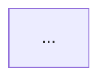

# 📜 知识库内容编写与表达规范

> **最高纲领与核心定位**：
> 本规范是整个技术知识库（Java 后端、分布式、AI 应用开发等）的最高内容生产、重构与审查标准。
> 恪守 **KISS（简洁至上）**、**第一性原理（深度分析）** 与 **事实为本** 三大核心准则，旨在打造工业级、高质量、兼顾工程实战与认知效率的顶级技术知识库。

---

## 目录导航

- [[#一、核心理念与写作原则]]
- [[#二、提问与面试问答规范（默认折叠、支持自测）]]
- [[#三、举例与比喻规范（拒绝正文乱穿插、设立类比专区）]]
- [[#四、图表与代码排版规范（Mermaid 0 错误）]]
- [[#五、通关总结与复习（99 文档）标准化模板]]
- [[#六、模板与审查 Checklist]]

---

## 一、核心理念与写作原则

### 1. 简洁至上（KISS 原则）
- 崇尚清晰、简洁与可维护性，杜绝过度工程化与没有必要的防御性设计；
- 能用一句话讲透的结论，绝不堆砌大段车轱辘话；
- 避免为了“看起来很高深”而引入冗余的废话和非必要复杂度。

### 2. 第一性原理（深度剖析）
- 不停留在“怎么配”或“API 怎么调”，必须刨根问底“为什么这样设计”；
- 追溯到操作系统底层调度、CPU 硬件缓存与内存屏障、JVM 运行时规范、网络协议报文、数据结构与数学边界。

### 3. 事实为本（工程真实性）
- 拒绝玩具代码与未经生产验证的伪理论；
- 所有技术论断必须经得起官方源码、RFC 规范和工业级生产排障的推敲；
- 凡有业界演进（如 JDK 15+ 废弃偏向锁、JDK 21 虚拟线程挑战 WebFlux），必须如实反映最新工程趋势，杜绝背诵过时的老旧八股文。

---

## 二、提问与面试问答规范（默认折叠、支持自测）

提问与面试连环问的根本价值在于**“检验掌握程度、激发读者的主动联想与深度自测”**。如果将题目与答案直接平铺展开，读者一眼扫过就会产生“我已经懂了”的认知错觉，彻底丧失主动复盘的价值。

### 1. 核心标准：强制使用原生默认折叠 Question 引用块
全库中所有面试题、连环追问、深入思考题、30 秒面试绝杀等场景，**一律强制采用 Obsidian 原生默认折叠块语法**：

```markdown
> [!question]- 题目编号与完整题干（支持一览问题，不剧透答案）
> 核心解答结论（30 秒答题版）...
> 
> 深入底层机制展开（2 分钟深入版）...
> 
> **生产实战与排障避坑**：
> 1. 要点一...
> 2. 要点二...
```

### 2. 编写铁律（Checklist）

| 规则维度 | 正确规范（DO） | 严厉禁止（DON'T） |
| :--- | :--- | :--- |
| **折叠标识** | 必须带有减号：`> [!question]-`（默认收起） | ❌ 严禁使用无减号的 `> [!question]`（平铺展开） |
| **题干位置** | 完整题干直接跟在 `> [!question]- ` 之后 | ❌ 严禁在标题栏写“点击查看答案”、“高频问题”等废话 |
| **展示形式** | 独立卡片化折叠展示 | ❌ 严禁使用无折叠的大表格、无折叠列表展示长篇问答 |
| **口语前缀** | 答案直接进入核心阐述，层次分明 | ❌ 严禁添加“现场绝杀：”、“【答】”、“【答案解析】”等多余口语前缀 |
| **首尾修饰** | 干净利落，直接展示文本 | ❌ 严禁在回答外层包裹生硬的中文双引号 `“...”` |
| **多行缩进** | 折叠块内部每一行（含空行、列表、代码块）必须带 `> ` | ❌ 严禁在折叠块中漏写 `>` 导致 Markdown 块结构断裂 |

---

## 三、举例与比喻规范（拒绝正文乱穿插、设立类比专区）

生动恰当的比喻能极大降低认知门槛，但**滥用比喻、或在正文严密的推导过程中突然穿插生活例子，会严重破坏专业技术文档的严肃性与逻辑连贯性**。

### 1. 结构隔离铁律：拒绝在技术推导中乱穿插例子
- **正文推导区（严禁穿插例子）**：
  - 在讲解底层源码执行流、状态机流转、锁升级、内存屏障、分布式事务协议、内核参数调优等正文段落，**必须全量使用标准、精确的计算机与软件工程术语**；
  - 严禁在技术推导中间突然插入诸如“就像你去菜市场买菜”、“就像打工人上班”等破坏阅读沉浸感的碎例子。
- **类比辅助专区（物理隔离）**：
  - 若某个抽象概念确实需要生活化类比来帮助初学者建立直觉，**必须将其独立放置于专门设立的小节或引用块中**（如 `## 💡 心智模型与场景类比` 或 `## 🗣️ 白话版（直觉建立）`）；
  - 做到“硬核技术原理”与“通俗直觉辅助”井水不犯河水，让想快速阅读底层硬核逻辑的专业读者不受干扰，初学者也能在专区获得顿悟。

### 2. 比喻选型铁律：追求严密工业类比，杜绝低俗化

- **🚫 坚决杜绝**：
  - 粗俗、不雅或带有调侃色彩的生活比喻（如公共卫生间抢坑位、占坑不拉屎等）；
  - 带有情绪化、民科化或误导性的生造词汇（如死魂灵对象、打工人抢公章等）。
- **✅ 强烈提倡**：
  - **现代工业与精密制造类比**：如汽车流水线装配（Bean 生命周期）、标准模具与冲压车间（工厂模式）、模块化插拔构件（SPI / Starter 机制）；
  - **市政交通与公共设施类比**：如十字路口交通红绿灯（内存屏障禁止重排）、ETC 快速通道（TLAB 无锁分配）、立交桥分流道（网关路由）；
  - **商业金融与政务服务类比**：如银行综合业务办理窗口（线程池工作队列与排队机制）、房产中介全权托管（代理模式）、工商执照注册登记（服务注册中心）。

---

## 四、图表与代码排版规范（Mermaid 0 错误）

### 1. Mermaid 图表规范
- **语法零错误原则**：全库所有 Mermaid 流程图、时序图、类图必须经过语法解析器严格校验，**语法错误数坚决保持为 0**。
- **特殊字符转义**：
  - 节点文案若包含括号、冒号、换行或特殊符号，**节点标签必须使用双引号包裹**：
    `A["用户请求 (User Request)"] --> B["网关分发 (Gateway)"]`；
  - 严禁在节点内部使用未转义的特殊字符导致渲染崩溃。
- **风格统一**：
  - 统一配置样式类（`classDef`），主干流程推荐暖色/亮色，分支采用沉稳冷色，字迹与背景对比清晰。

### 2. 代码块规范
- **指明语言类型**：每个代码块必须带有明确的语言标记（` ```java `、` ```bash `、` ```sql `、` ```text `）；
- **生产级可运行**：不贴残缺的伪代码片段，关键配置类和核心逻辑必须结构完整；
- **注释精要**：只在非显而易见的坑点、边界条件和核心架构处添加注释，不写“废话注释”。

---

## 五、通关总结与复习（99 文档）标准化模板

每个大专题模块的终篇必须以 `99-本章总结与复习.md` 命名，并严格遵循“四大支柱”统一结构：

```markdown
# 🏆 99 · [模块名称] 通关总复盘与大厂面试全景图

> **一句话导读**：...

---

## 🗺️ [模块名称] 宇宙大一统全景图（Mermaid 知识架构树）



---

## 🎨 大厂高频必考：[模块名称] 核心设计模式 / 技术选型决策树

（盘点本模块的经典架构模式或第一性原理决策对比表）

---

## ⚡ 大厂面试必杀 10~13 连问（第一性原理直击要害）

> [!question]- Q1：问题 1？
> 核心解答...

> [!question]- Q2：问题 2？
> 核心解答...

...

---

## 📜 生产 [模块名称] 开发十大约法三章（血泪规约）

1. **【规约 1】** ...
2. **【规约 2】** ...
...
10. **【规约 10】** ...

---

## 🎓 恭喜通关！
```

---

## 六、模板与审查 Checklist

每次新建笔记或重构现有文档时，必须对照以下清单进行自检：

- [ ] **是否包含了完整的 YAML Frontmatter 元数据**（title, tags, created, updated, status, mastery）；
- [ ] **正文技术推导是否全程采用专业、严谨的技术术语**，没有掺杂生硬的生活例子；
- [ ] **所有通俗类比是否均收纳在专门的“心智模型”独立段落**，且比喻高雅恰当；
- [ ] **所有面试题、连环追问、复盘自测是否 100% 采用 `> [!question]-` 默认折叠格式**；
- [ ] **折叠块标题栏是否是完整的题干**，内部解答是否直击本质且去除了多余口语前缀；
- [ ] **所有 Mermaid 图表是否符合规范并通过语法检查（0 Error）**；
- [ ] **文档末尾是否包含清晰的下一步导航或复盘记忆钩子**。
