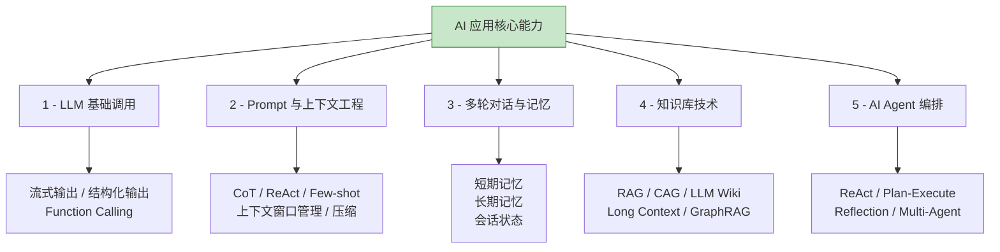
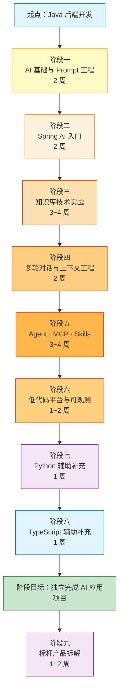
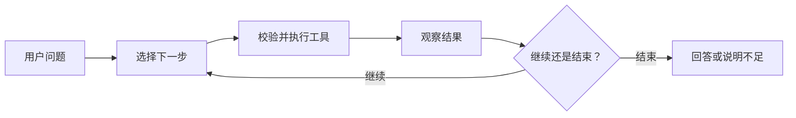
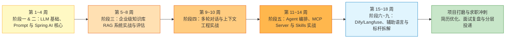

# 🚀 AI 应用开发学习路径

> [!info] 文档说明
> 面向 Java 后端工程师的 AI 应用学习路线，聚焦可复用能力；模型和框架版本以各专题及官方文档为准。
> 
> **核心原则**：以能力为主线（不是语言）；同类技术归类讲；新旧路线对比讲。
> 
> **目标岗位**：AI 应用开发工程师 / 大模型应用工程师 / AI Agent 工程师 / RAG 工程师
> 
> **预计周期**：约 16~20 周（按下表串行学习；可并行，随基础与项目难度调整）

---

## 📑 目录

- [[#第一章 个人情况简介|第一章 · 个人情况简介]]
- [[#第二章 市场行情与就业调研|第二章 · 市场行情与就业调研]]
- [[#第三章 学习主线与技术栈|第三章 · 学习主线与技术栈]]
- [[#第四章 学习路径总览|第四章 · 学习路径总览]]
- [[#第五章 分阶段学习计划|第五章 · 分阶段学习计划]]
- [[#第六章 知识库技术全景（RAG 与替代方案）|第六章 · 知识库技术全景（RAG 与替代方案）]]
- [[#第七章 Agent 设计模式全景|第七章 · Agent 设计模式全景]]
- [[#第八章 Prompt 与上下文工程|第八章 · Prompt 与上下文工程]]
- [[#第九章 协议与平台|第九章 · 协议与平台]]
- [[#第十章 推荐资源清单|第十章 · 推荐资源清单]]
- [[#第十一章 求职准备|第十一章 · 求职准备]]
- [[#第十二章 学习打卡|第十二章 · 学习打卡]]

---

## 第一章 个人情况简介

> [!abstract] 学习者画像
> 一位 Java 后端工程师，希望转型为 AI 应用开发工程师。**主语言锁定 Java**，其他语言作为辅助理解。

### 🧑‍💻 基本信息

| 项目        | 内容                             |
| --------- | ------------------------------ |
| **当前岗位**  | Java 后端开发工程师                   |
| **目标岗位**  | AI 应用开发 / 大模型应用 / AI Agent 工程师 |
| **学习起点**  | 2026 年 5 月                     |
| **学习方式**  | 业余自学 + 项目实战                    |
| **可投入时间** | 每日 2~3 小时（建议）                  |
| **主语言策略** | Java 为主，Python / TS 为辅         |

### ✅ 已具备的可迁移能力

> [!success] 这些能力直接加分
> AI 应用开发的本质是“**软件工程 + LLM 调用 + 业务流程编排**”。绝大多数转 AI 的开发者卡在“生产化”环节，这恰恰是你的强项。

- ☑️ **后端架构思维**：分布式、微服务、服务治理
- ☑️ **并发与性能优化**：JVM 调优、线程模型
- ☑️ **数据库与存储**：MySQL / Redis / 索引优化
- ☑️ **API 与协议**：HTTP / RESTful / RPC / 消息队列
- ☑️ **生产级思维**：日志、监控、CI/CD、稳定性、可观测性
- ☑️ **业务理解力**：能把模糊需求拆成可交付方案

### 🎯 需要补齐的核心能力

> [!todo] 学习目标清单
> - [ ] **LLM 基础**：原理、Token、上下文窗口、参数调优
> - [ ] **Prompt 与上下文工程**：System Prompt、Few-shot、CoT、ReAct、上下文压缩
> - [ ] **多轮对话与记忆**：会话记忆、长短期记忆、对话状态
> - [ ] **知识库技术**：RAG、CAG、LLM Wiki、Long Context（多种范式）
> - [ ] **AI Agent**：ReAct、Plan-Execute、Reflection、Multi-Agent
> - [ ] **协议与原语**：Function Calling、MCP、Skills（SKILL.md）、AGENTS.md、A2A
> - [ ] **主流框架**：Spring AI、LangChain4j（Java 主线）
> - [ ] **向量数据库**：Milvus、pgvector
> - [ ] **可观测与评估**：Langfuse、Ragas
> - [ ] **低代码平台**：Dify、Coze
> - [ ] Python 基础（看得懂、能跑通）

### ⚠️ 学习态度警示

> [!warning] 五条避坑准则
> 1. **不要从深度学习数学理论啃起** —— 应用岗不需要从神经网络反向传播开始
> 2. **不要陷入框架对比内耗** —— Spring AI / LangChain4j 选一个先用起来
> 3. **不要只学不练** —— AI 应用是手感活，必须跑通端到端项目
> 4. **不要忽视工程化** —— 这是你的差异化武器，简历亮点的来源
> 5. **不要焦虑别的语言** —— Python / TS 看得懂能跑通即可，不需要精通

---

## 第二章 市场行情与就业调研

### 🌍 AI 应用开发岗位分类与能力要求

企业招聘的 AI 相关工程岗位主要分为三类：
1. **企业业务 AI 集成岗（Java 为主）**：在现有金融、电商、政企、ERP/CRM 等核心业务系统中接入大模型能力，落地企业内部知识库（RAG）、智能客服、智能工单与业务自动化工作流；
2. **AI 原生应用与 Agent 研发岗（Java / Python / TS）**：围绕多步规划 Agent、工具生态（MCP / Function Calling）、多轮上下文管理构建独立产品；
3. **AI 基础设施与模型服务岗（Python / C++ / Go）**：负责模型微调、私有化推理加速（vLLM / SGLang）、AI 网关与评估平台建设。

### 📊 主流编程语言在 AI 工程中的分工

| 语言 | 核心应用场景与职责 | 学习策略 |
| ---- | -------- | -------- |
| **Java** | 企业级核心业务后端、权限安全、微服务治理、高并发网关与事务集成 | 作为主线深入掌握，充分发挥现有工程优势 |
| **Python** | 模型训练与微调、文档解析、RAG 评估（Ragas）、原型验证与算法服务封装 | 能够阅读主流开源项目代码、运行并修改脚本 |
| **TypeScript** | 流式对话前端交互（SSE）、全栈 AI 应用（Next.js + Vercel AI SDK） | 按全栈联调需求掌握基础语法与核心组件 |
| **Go** | 高性能 AI 网关、云原生基础设施 | 按需了解，非当前阶段必修项 |

### 💰 岗位评估与筛选维度

在收集与对比目标岗位 JD 时，建议重点关注以下核心维度：
- **技术栈匹配度**：优先筛选明确要求“Java 后端经验 + Spring AI / LangChain4j / RAG / Agent 落地经验”的复合型岗位；
- **业务落地场景**：区分岗位是做内部提效工具、ToB 行业解决方案，还是高并发 ToC 产品；
- **工程化深度**：关注团队是否重视检索质量评估、链路可观测性、响应延迟优化与 Token 成本控制。

### 🏢 重点关注的企业与团队类型

> [!tip] 投递方向建议
> 1. **具备成熟 Java 业务底座、正推进 AI 赋能的行业龙头与中大型企业**（如金融、银行、证券、运营商、大型电商及企业服务软件公司）；
> 2. **互联网大厂的 B 端业务线、研发效能中台与企业智能服务团队**；
> 3. **专注于垂直行业知识库、智能客服与企业级 Agent 交付的科技公司**。

---

## 第三章 学习主线与技术栈

### 🎯 学习主线

> [!important] 核心思想
> **学的是“通用工程能力”，而非单一框架语法。** RAG 检索增强、多轮对话记忆、上下文窗口预算管理、Agent 任务编排是跨语言通用的底层架构能力；掌握核心机制后，切换开发语言只是更换对应的 SDK。

### 🧠 五大核心能力



### 📚 技术栈分级

#### 🥇 Java 主战场（必学，深入）

| 技术 | 说明 | 必学度 |
| ---- | ---- | ------ |
| **Spring AI** | Spring 官方 AI 框架（推荐主选） | ⭐⭐⭐⭐⭐ |
| **LangChain4j** | 社区驱动 Java AI 框架 | ⭐⭐⭐⭐⭐ |
| **Spring Boot** | 复用已有基础，版本按所选 Spring AI 的兼容要求确定 | — |
| **MCP Java SDK** | 模型上下文协议接入与服务端开发 | ⭐⭐⭐⭐ |

#### 🥈 跨语言通用能力（必学）

| 技术 | 说明 | 必学度 |
| ---- | ---- | ------ |
| **LLM API** | OpenAI / Claude / DeepSeek / Qwen / GLM | ⭐⭐⭐⭐⭐ |
| **Prompt 工程** | 系统提示、Few-shot、CoT、ReAct | ⭐⭐⭐⭐⭐ |
| **上下文工程** | 窗口预算管理、历史压缩、分层记忆 | ⭐⭐⭐⭐⭐ |
| **知识库技术** | RAG / CAG / LLM Wiki | ⭐⭐⭐⭐⭐ |
| **Agent 设计模式** | ReAct / Plan-Execute / Reflection | ⭐⭐⭐⭐⭐ |
| **MCP 协议** | 跨应用工具与外部数据访问标准协议 | ⭐⭐⭐⭐⭐ |
| **Skills（SKILL.md）** | 领域工作流与程序化知识封装规范 | ⭐⭐⭐⭐⭐ |
| **AGENTS.md** | 面向编程 Agent 的项目工程规范文件 | ⭐⭐⭐⭐ |
| **向量数据库** | Milvus / pgvector | ⭐⭐⭐⭐⭐ |
| **Dify / Coze** | 可视化工作流与低代码 AI 平台 | ⭐⭐⭐⭐ |
| **Langfuse** | LLM 全链路追踪与可观测性平台 | ⭐⭐⭐⭐ |
| **Ragas** | RAG 检索与生成质量量化评估框架 | ⭐⭐⭐⭐ |

#### 🥉 辅助语言（看得懂、能跑通即可）

> [!note] 为什么需要辅助语言
> Python 在算法实验、文档解析与评估工具链上生态最全，TypeScript 在流式 Web UI 与全栈交互上组件最丰富。两门辅助语言无需深入底层细节，核心目标是能够阅读开源项目源码并跑通联调。

##### 🐍 Python（生态最全，AI 后端必会读）

| 技术 | 说明 | 必学度 |
| ---- | ---- | ------ |
| Python 基础 | 核心语法、异步协程 `asyncio`、`uv` 包管理 | ⭐⭐⭐ |
| LangChain Python | 阅读主流示例并与 Java 实现对照 | ⭐⭐⭐ |
| FastAPI | 封装轻量级模型推理或文档解析 HTTP 服务 | ⭐⭐ |

##### 🟦 TypeScript（前端 / 全栈 AI 必会读）

| 技术 | 说明 | 必学度 |
| ---- | ---- | ------ |
| TypeScript 基础 | 基础语法与静态类型系统 | ⭐⭐⭐ |
| Vercel AI SDK | TypeScript 模型调用与流式 UI 标准工具包 | ⭐⭐⭐ |
| Next.js | React 全栈框架，常用于快速构建 AI 交互前端 | ⭐⭐ |
| Mastra / LangChain.js | TypeScript 生态下的 Agent 编排框架 | ⭐⭐ |

#### 🔧 进阶 / 选学

- **模型微调**：LoRA / QLoRA、LLaMA-Factory
- **推理服务部署**：vLLM、SGLang、Ollama
- **多模态处理**：视觉理解、语音识别与合成
- **AI 网关**：LiteLLM、One-API

---

## 第四章 学习路径总览

### 🗺️ 学习地图



### 📅 时间分配

| 阶段 | 名称 | 周期 | 优先级 |
| ---- | ---- | ---- | ------ |
| 一 | AI 基础与 Prompt 工程 | 2 周 | ⭐⭐⭐⭐⭐ |
| 二 | Spring AI 入门 | 2 周 | ⭐⭐⭐⭐⭐ |
| 三 | 知识库技术实战 | 3~4 周 | ⭐⭐⭐⭐⭐ |
| 四 | 多轮对话与上下文工程 | 2 周 | ⭐⭐⭐⭐⭐ |
| 五 | AI Agent · MCP · Skills | 3~4 周 | ⭐⭐⭐⭐⭐ |
| 六 | 低代码平台与可观测 | 1~2 周 | ⭐⭐⭐⭐ |
| 七 | Python 辅助补充 | 1 周 | ⭐⭐⭐ |
| 八 | TypeScript 辅助补充 | 1 周 | ⭐⭐⭐ |
| 九 | 标杆产品拆解 | 1~2 周 | ⭐⭐⭐ |

---

## 第五章 分阶段学习计划

### 🌱 阶段一 · AI 基础与 Prompt 工程（2 周）

> [!tip] 学习重点
> 本阶段无需推导深度学习底层数学公式，重点在于理解大语言模型自回归生成的工作机制、Token 计费与窗口限制，并熟练掌握 Prompt 编写与结构化输出约束。

#### 🎯 学习目标

- [ ] 理解 LLM 基本原理（Token、上下文窗口、采样温度与 Top-P）
- [ ] 掌握 Prompt 工程核心方法（System Prompt、Few-shot、CoT）
- [ ] 理解 Embedding 向量化与相似度检索原理
- [ ] 熟悉主流模型的能力特点与选型维度
- [ ] 调通第一个 LLM API

#### 📚 核心知识点

##### 1. LLM 基本原理

| 概念 | 掌握要求 | 核心作用 |
| ---- | -------- | ---- |
| Transformer 架构 | 理解自注意力与自回归解码流程 | 理解模型为何擅长上下文关联与长文本处理 |
| Token / Tokenizer | 重点掌握 | 决定 API 计费成本与上下文窗口占用计算 |
| 上下文窗口 | 重点掌握 | 理解输入、输出和模型窗口的限制关系 |
| Temperature / Top-P | 重点掌握 | 控制模型采样生成时的随机度与确定性 |
| 上下文学习（ICL） | 重点掌握 | Few-shot 少样本提示与动态知识注入的基础 |
| SFT / RLHF / DPO | 理解基本概念 | 区分基座模型、指令微调模型与偏好对齐模型 |

##### 2. 主流模型选型维度

| 类别 | 代表模型 | 选型考量维度 |
| ---- | -------- | ---- |
| **海外商业模型** | OpenAI GPT、Claude、Gemini 系列 | 综合推理能力、代码生成质量、长窗口表现与调用成本 |
| **国内主流模型** | DeepSeek、Qwen、GLM、Kimi 系列 | 中文语境理解、API 响应延迟、数据处理要求和成本 |
| **开源可私有化模型** | Qwen 开源系列、DeepSeek 开源系列、Llama 系列 | 支持企业内网私有化部署（vLLM/Ollama）与领域微调 |
| **Embedding 向量模型** | BGE-M3、Qwen-Embedding、text-embedding-3 | 向量维度、多语言检索精度与长文本支持长度 |
| **Rerank 重排模型** | bge-reranker-v2、Cohere Rerank | 交叉编码精排能力，用于提升 RAG 最终召回准确率 |

> [!tip] Prompt 工程详细内容请见 [[#第八章 Prompt 与上下文工程]]

#### 📝 实操任务

> [!example] 动手清单
> - [ ] 注册 DeepSeek / 通义千问 / OpenAI 任一平台并获取 API Key
> - [ ] 使用 Postman 或 curl 跑通标准的 Chat Completions 接口
> - [ ] 编写 5 个以上不同业务场景（分类、抽取、总结、改写、代码审查）的 Prompt 模板
> - [ ] 使用分词工具计算不同中英文文本的 Token 数量
> - [ ] 调用 Embedding 接口生成文本向量并计算余弦相似度
> - [ ] 阅读官方文档与 Prompt Engineering Guide 经典示例
> - [ ] 在本地 Markdown 仓库沉淀个人“Prompt 模板库”

---

### 🌿 阶段二 · Spring AI 入门（2 周）

> [!important] Java 主战场启动
> 本阶段将大模型调用能力集成到 Spring Boot 工程中，重点掌握 Spring AI 的核心抽象、流式输出、结构化映射与工具调用；版本搭配以所选 Spring AI 的官方文档为准。

#### 🎯 学习目标

- [ ] 搭建第一个 Spring Boot + Spring AI 项目
- [ ] 掌握 `ChatClient` 与 `ChatModel` 的职责边界
- [ ] 实现基于 SSE 的流式响应接口
- [ ] 配置并动态切换多个模型供应商
- [ ] 使用 Function Calling（`@Tool`）调用本地 Java 业务方法

#### 📚 核心知识点

##### Spring AI 核心抽象

```text
☑ ChatClient / ChatModel - 高阶链式门面接口与底层模型驱动接口
☑ Prompt / PromptTemplate - 提示词模板渲染与参数绑定
☑ Message - System / User / Assistant / Tool 消息角色模型
☑ ChatMemory - 多轮对话历史存储与管理接口
☑ Advisor - 请求与响应环绕拦截扩展机制
☑ EmbeddingModel / VectorStore - 文本向量化与向量数据库统一访问接口
☑ Tool / Function Calling - 本地 Java 方法注册与工具回调机制
☑ RAG 检索增强组装 - QuestionAnswerAdvisor 与 RetrievalAugmentationAdvisor
☑ MCP Client / Server - 模型上下文协议客户端与服务端集成
```

#### 📝 实操任务

> [!example] 动手清单
> - [ ] 搭建 Spring Boot + Spring AI 基础工程
> - [ ] 接入 DeepSeek 或通义千问模型服务
> - [ ] 实现 `/chat` 同步问答接口
> - [ ] 实现 `/chat/stream` SSE 流式输出接口
> - [ ] 使用 `BeanOutputConverter` 实现结构化输出（自动反序列化为 Java Record/POJO）
> - [ ] 编写并注册 5 个业务工具方法（如订单查询、库存核对、天气查询等）
> - [ ] 实现多模型数据源配置与按需切换

---

### 🔥 阶段三 · 知识库技术实战（3~4 周，重投入）

> [!important] 核心简历项目
> 企业私有知识库是 AI 应用落地最广泛的场景。本阶段产出的端到端系统将作为简历中的核心主打项目。
> 
> 除传统 RAG 外，还需掌握 CAG、LLM Wiki、Long Context 等不同知识增强方案的选型边界，详见 [[#第六章 知识库技术全景（RAG 与替代方案）]]。

#### 🎯 学习目标

- [ ] 掌握 RAG 离线摄取与在线检索生成的完整链路及各环节优化手段
- [ ] 明确 RAG 与替代方案（CAG / LLM Wiki / Long Context）的适用边界
- [ ] 熟练使用向量数据库（Milvus 或 PostgreSQL pgvector）
- [ ] 独立实现端到端企业级知识库问答系统
- [ ] 掌握基于 Ragas 的 RAG 检索与生成质量量化评估方法

#### 📝 实操任务

> [!example] 项目实战 - 企业知识库系统
> 
> **第 1 周：RAG 基础离线与在线链路**
> - [ ] 使用 Docker 部署单机版 Milvus 或 pgvector
> - [ ] 完成 Spring AI 与向量数据库的集成配置
> - [ ] 实现多格式文档上传与解析（PDF / Word / Markdown）
> - [ ] 完成文本分块（Chunking）、Embedding 向量化与元数据入库
> 
> **第 2 周：完善检索精排与生成溯源**
> - [ ] 实现 Top-K 向量检索、上下文拼接与 LLM 回答生成
> - [ ] 接入 Rerank 重排序模型过滤低相关度文档片段
> - [ ] 实现答案引用溯源（在回答末尾精确标注来源文档名称与段落编号）
> - [ ] 改造为 SSE 流式回答输出并附带溯源元数据事件
> 
> **第 3 周：检索进阶优化与对比实验**
> - [ ] 实现 Multi-Query 多查询扩展改写与 HyDE 假设性文档嵌入
> - [ ] 实现向量语义检索 + BM25 全文关键词检索的多路混合检索（Hybrid Search）
> - [ ] 实现父子块分层索引策略（小块精准检索、大块提供完整上下文）
> - [ ] **进阶实验**：基于同一份中等规模文档实现 CAG（前缀缓存增强）版本并对比延迟与成本
> - [ ] **进阶实验**：采用 LLM Wiki 模式维护本地 Obsidian 结构化知识库
> 
> **第 4 周：量化评估与可观测性接入**
> - [ ] 构建包含 30~50 条标准问答对的测试评估集（Golden Dataset）
> - [ ] 使用 Ragas 运行忠实度、相关性与上下文召回率评估
> - [ ] 接入 Langfuse 实现全链路 Trace 追踪与 Token 消耗统计
> - [ ] 整理压测数据与优化对比报告，沉淀技术复盘文章

---

### 💬 阶段四 · 多轮对话与上下文工程（2 周）

> [!important] 高频面试与实战话题
> 多轮对话与上下文工程直接决定了复杂 AI 应用在长周期交互中的稳定性、准确性与单次调用成本。

#### 🎯 学习目标

- [ ] 理解模型调用、多轮上下文与窗口限制之间的关系
- [ ] 掌握上下文 Token 预算分配、裁剪与滚动摘要策略
- [ ] 实现短期窗口记忆、长期语义检索记忆与结构化实体画像记忆
- [ ] 解决多轮对话中的并发冲突、持久化存储与话题切换检测

#### 📚 核心知识点

##### 多轮对话记忆机制

| 类型 | 实现方式 | 适用场景 |
| ---- | -------- | -------- |
| **滑动窗口** | 保留最近 N 轮对话消息 | 短周期简单问答 |
| **Token 窗口** | 按精确计算的 Token 预算动态裁剪历史消息 | 严格控制成本与防止窗口溢出 |
| **摘要记忆** | 当历史超过阈值时异步调用模型浓缩为前情摘要 | 长周期连续对话 |
| **语义检索记忆** | 筛选可保存的事实并向量化，按当前问题召回 | 跨天、跨会话的复杂客服与顾问 |
| **结构化记忆** | 抽取用户固定属性与核心事实以键值对形式存入数据库 | 个性化助理、会员画像管理 |
| **复合分层记忆** | 按任务和预算组合画像、摘要、语义召回和近期窗口 | 需要多种记忆配合的系统 |

> [!tip] 上下文工程详细内容请见 [[#第八章 Prompt 与上下文工程]]

#### 📝 实操任务

> [!example] 项目实战 - 智能客服多轮对话系统
> - [ ] 基于 Redis 实现分布式多轮对话记忆存储（`ChatMemory`）
> - [ ] 实现 Token 预算管理器，确保输入总长始终预留安全的模型输出空间
> - [ ] 实现滚动摘要记忆（超过指定轮数自动触发后台摘要压缩）
> - [ ] 结合 `VectorStore` 实现跨会话长期语义检索记忆
> - [ ] 实现多租户/多用户会话隔离、并发防重，并设计 Redis 与 MySQL 的持久化和恢复策略
> - [ ] 增加前置意图识别与话题切换检测逻辑
> - [ ] 将 RAG 知识检索结果与多轮对话记忆整合进统一上下文组装流水线

---

### 🤖 阶段五 · AI Agent · MCP · Skills（3~4 周）

> [!important] 核心进阶赛道
> Agent 使大模型具备自主规划与工具执行能力，而 **MCP（模型上下文协议）** 与 **Skills（程序化技能包）** 则是实现企业级工具复用与复杂业务流程标准化的核心机制。
> - **MCP**：标准化连接外部数据源与工具服务；
> - **Skills**：以结构化 Markdown 目录封装领域工作流与操作规范；
> - 各类 Agent 设计模式的详细对比见 [[#第七章 Agent 设计模式全景]]，三层原语（Function Calling / MCP / Skills）的架构关系见 [[#第九章 协议与平台]]。

#### 🎯 学习目标

- [ ] 掌握主流 Agent 设计模式（ReAct、Plan-and-Execute、Reflection、Multi-Agent）
- [ ] 使用 Spring AI 实现具备多工具编排能力的 ReAct Agent
- [ ] 实现 Supervisor-Worker 多智能体分工协作
- [ ] 掌握 MCP 协议规范并使用 Java SDK 开发自定义 MCP Server
- [ ] 掌握 Skills（`SKILL.md`）规范并设计可复用的领域技能包
- [ ] 理清 Skills × MCP × Function Calling 三层协同架构
- [ ] 落地 Agent 生产级安全防护（防注入、权限审批、循环熔断与成本控制）

#### 📝 实操任务

> [!example] 项目实战清单
> 
> **项目 D：通用 ReAct Agent**（第 1 周）
> - [ ] 基于 Spring AI 实现完整的 ReAct 思考-行动-观察循环控制
> - [ ] 接入 5 个以上工具（网络搜索、数值计算、文件读写、数据库查询、外部 REST API）
> - [ ] 集成长期记忆与最大迭代步数熔断保护
> 
> **项目 E：MCP Server 工具集**（第 2 周）
> - [ ] 使用 Spring AI MCP Server SDK 开发标准化工具服务端
> - [ ] 暴露 3 个以上真实业务能力（如工单查询、数据库 Schema 检索、日志分析）
> - [ ] 使用 MCP Inspector 进行协议联调测试
> - [ ] 接入 Claude Desktop 或 Cursor 客户端完成端到端演示
> 
> **项目 F1：Skills 设计与 AGENTS.md 实践**（第 3 周）
> - [ ] 研读 `anthropics/skills` 官方仓库结构与设计规范
> - [ ] 设计 2~3 个实用业务 Skill（如“代码审查规范”“SQL 慢查询诊断”“接口文档生成”）
> - [ ] 编写包含 YAML frontmatter 与分步执行指令的 `SKILL.md`
> - [ ] 让 Skill 内部引导调用自定义 MCP Server 暴露的工具，跑通“Skills 流程编排 + MCP 工具执行”闭环
> - [ ] 为自己的 Java 实战项目编写根目录 `AGENTS.md` 工程说明文件
> 
> **项目 F2：综合业务 Agent 系统**（第 3~4 周）
> - [ ] 选择具体业务场景（如电商售后智能客服、企业研发助手或智能数据分析 Agent）
> - [ ] 采用 Plan-and-Execute 或 Supervisor 多 Agent 架构实现
> - [ ] 完整串联 RAG 知识检索 + 分层多轮记忆 + MCP 工具调用 + Skills 流程规范
> - [ ] 接入 Langfuse 全链路可观测监控与异常降级策略

---

### 🛠️ 阶段六 · 低代码平台与可观测（1~2 周）

> [!tip] 平台视野与生产工程化
> 本阶段通过低代码工作流平台（Dify）理解可视化编排引擎的设计思路，并通过可观测（Langfuse）与自动化评估（Ragas）补齐生产级工程闭环。

#### 🎯 学习目标

- [ ] 使用 Dify 搭建完整的 RAG 与 Agent 业务工作流
- [ ] 阅读并理解 Dify 工作流引擎（DAG 图执行与节点调度）的核心架构
- [ ] 熟练使用 Langfuse 进行 Prompt 版本管理、链路追踪与成本分析
- [ ] 使用 Ragas 构建自动化回归评估流水线

#### 📝 实操任务

> [!example] 动手清单
> - [ ] 使用 Docker Compose 在本地部署 Dify 社区版
> - [ ] 在 Dify 中搭建一个包含意图分类、知识库检索与工具调用的客服工作流
> - [ ] 研读 Dify 工作流编排引擎核心源码并撰写架构分析笔记
> - [ ] 为阶段三和阶段五的 Java 项目完整接入 Langfuse Trace 埋点
> - [ ] 运行 Ragas 评估脚本生成量化评估报告

---

### 🐍 阶段七 · Python 辅助补充（1 周）

> [!warning] 定位明确：辅助阅读与工具集成
> 目标是能够顺畅阅读 GitHub 上的主流 Python AI 项目代码、运行开源评估与解析脚本，并在必要时用 FastAPI 封装轻量级算法微服务供 Java 主服务调用。

#### 📝 实操任务

> [!example] 动手清单
> - [ ] 使用现代 Python 包管理器 `uv` 创建虚拟环境并管理依赖
> - [ ] Clone 1~2 个主流 Python AI 开源项目并在本地配置运行
> - [ ] 使用 FastAPI 编写一个支持流式输出的轻量级内部服务接口
> - [ ] 对照阅读 LangChain / LangGraph Python 文档与 Java 生态实现的异同

---

### 🟦 阶段八 · TypeScript 辅助补充（1 周）

> [!warning] 定位明确：全栈流式交互联调
> 目标是能够读懂基于 Next.js 与 Vercel AI SDK 的现代 AI 前端项目，快速搭建支持打字机流式渲染、工具调用状态展示的对话界面，并与 Java 后端服务对接。

#### 🎯 学习目标

- [ ] 掌握 TypeScript 核心语法与静态类型声明
- [ ] 读懂并运行 Vercel AI SDK 官方示例
- [ ] 了解 LangChain.js 与 Mastra 在全栈 AI 开发中的定位
- [ ] 使用 Next.js 搭建一个对接后端流式接口的 AI 对话页面

#### 📚 核心技能清单

| 技能 | 建议投入时间 | 核心用途 | 说明 |
| ---- | ------ | ---- | ---- |
| TypeScript 语法基础 | 1 天 | 阅读与编写类型安全代码 | 熟悉接口、泛型、联合类型与异步 `async/await` |
| `pnpm` 包管理 | 半天 | 依赖安装与脚本执行 | 现代前端项目主流包管理工具 |
| Node.js 运行环境 | 半天 | 本地服务运行与调试 | 理解事件循环与服务端运行环境 |
| Next.js App Router | 1 天 | 全栈路由与页面组织 | 区分服务端组件（RSC）与客户端交互组件 |
| Vercel AI SDK | 1 天 | 模型调用与流式协议封装 | 重点掌握核心流式传输协议与状态管理 |
| `useChat` Hook | 半天 | 构建 AI 聊天流式 UI | 自动处理消息列表状态、流式增量拼接与加载状态 |

#### 🌐 TypeScript AI 生态与 Java 生态组件对照

| TypeScript 框架 | 核心功能定位 | 对应 Java 生态组件定位 |
| ---- | ---- | -------------- |
| **Vercel AI SDK** | 统一模型调用接口与前端流式 UI 状态管理 | 对应 Spring AI `ChatClient` + 前端流式状态封装 |
| **LangChain.js** | LangChain 的 TypeScript 实现版本 | 对应 LangChain4j |
| **Mastra** | TypeScript 原生 Agent 编排框架（含工作流、RAG 与评估） | 对应 Spring AI Alibaba Graph / Embabel Agent |
| **OpenAI Agents JS** | OpenAI 官方轻量级多 Agent 编排与交接 SDK | 对应基于官方 Java SDK 的轻量 Agent 封装 |
| **Next.js** | 支持前后端一体化的 React 全栈应用框架 | 对应 Spring Boot Web 层 + 前端视图层 |

#### 📝 实操任务

> [!example] 动手清单
> - [ ] 装好 Node.js + pnpm
> - [ ] Clone Vercel AI SDK 的官方示例（next-openai）跑通
> - [ ] 改一个 Demo 接入 DeepSeek 或国产模型
> - [ ] 用 Next.js + Vercel AI SDK 起一个最简 AI Chat 页面（带流式输出）
> - [ ] 阅读 Mastra 文档，理解和 Spring AI 的对照关系
> - [ ] **加分项**：把阶段三 RAG 后端用 Next.js 写个简单前端

---

### 🧭 阶段九 · 标杆产品拆解（1~2 周）

> [!important] 向顶级产品学习
> 拆解 **Codex** 与 **Claude Code** 这两个最成功的编程 Agent 产品，重点看它们怎么做上下文工程、工具调用、权限治理、工作流与扩展机制。对应仓库 `09-标杆产品拆解/`（Codex、Claude-Code 两个子目录），入口见 [[../09-标杆产品拆解/_index|标杆产品拆解索引]]。
> 推荐顺序：[[../09-标杆产品拆解/01-标杆产品对比-Codex-vs-Claude-Code|对比总览]] → [[../09-标杆产品拆解/02-编程Agent通用架构图|通用架构图]] → 两个产品的全链路拆解 → [[../09-标杆产品拆解/03-从Codex和Claude-Code反推企业Agent设计|反推企业 Agent 设计]]。

#### 🚀 持续进阶（找到工作后）

- **模型微调**：LoRA / QLoRA、LLaMA-Factory
- **推理优化**：vLLM、SGLang、TGI
- **多模态**：图文、语音、视频
- **AI 网关**：LiteLLM、One-API、Higress
- **多 Agent 高级框架**：CrewAI、AutoGen、A2A 协议
- **AI 安全**：越狱防护、内容审核、数据隐私

---

## 第六章 知识库技术全景（RAG 与替代方案）

> [!info] 章节说明
> 这些方案都让模型在回答时使用外部资料；它们可以组合，选型要比较效果、权限、更新成本和延迟。

### 🧭 六种路线怎么选？

| 路线 | 做法与适用情况 | 详细笔记 |
| :--- | :--- | :--- |
| RAG | 按问题检索相关资料后生成，适合需要更新和引用的知识 | [[../03-知识库技术-RAG/01-RAG核心原理与全链路实战|RAG 基础]] |
| CAG 与缓存 | 预加载范围可控的知识，按实际服务能力复用缓存 | [[../03-知识库技术-RAG/02-RAG工业级进阶与检索调优|CAG 与长上下文]] |
| LLM Wiki | 把原始资料整理为有来源、索引与链接的主题笔记 | [[../03-知识库技术-RAG/02-RAG工业级进阶与检索调优|Markdown 知识库]] |
| 长上下文 | 在窗口与权限允许时直接提供较多资料，适合一次性分析 | [[../03-知识库技术-RAG/02-RAG工业级进阶与检索调优|长上下文的边界]] |
| GraphRAG | 利用实体、关系与摘要辅助关系或全局问题 | [[../03-知识库技术-RAG/03-前沿演进与质量评估|GraphRAG]] |
| Agentic RAG | 根据问题与检索结果选择改写、重试、追问或结束 | [[../03-知识库技术-RAG/03-前沿演进与质量评估|Agentic RAG]] |

RAG 可以使用文件、关键词或向量检索，不一定需要向量数据库。CAG、长上下文和服务商提示词缓存也不完全等同；缓存命中取决于具体实现。GraphRAG 的关系抽取和 Agentic RAG 的判断都可能出错，需要回查原文。

### 📌 原有学习要点

```text
☑ Chunking：固定窗口 / 递归字符 / 语义切分
☑ Multi-Query：将单一用户问题扩展改写为多个子查询并发检索
☑ HyDE：先生成假设性回答文档，再用其向量检索真实文档
☑ Hybrid Search：稠密向量语义检索 + 稀疏 BM25 关键词检索多路融合
☑ Rerank：粗召回 Top-N 后使用 Cross-Encoder 交叉编码器精排取 Top-K
☑ Parent-Child Chunk：按子块精准检索匹配，按父块回传完整上下文
☑ Contextual Retrieval：为切片补充文档背景摘要后入库，生成的摘要仍需检查
☑ 引用溯源：在生成结果中精确标注所引用的文档 ID 与位置标号
```

具体原理和评测见 [[../03-知识库技术-RAG/01-RAG核心原理与全链路实战|文本切分]]、[[../03-知识库技术-RAG/02-RAG工业级进阶与检索调优|混合检索与重排]]、[[../03-知识库技术-RAG/03-前沿演进与质量评估|评估与溯源]]。

### 📚 LLM Wiki 的三个操作

```text
☑ Ingest（摄取整理）：输入新资料，由 LLM 解析并创建新页面或增量更新已有主题页面
☑ Query（索引查询）：先读取目录索引定位关联页面，再读取目标页面内容组装上下文作答
☑ Lint（巡检整理）：定期检查失效链接、合并重复概念、补全缺失索引
```

保留原始资料，模型生成的整理结果和引用需要人工核验。可以从 [[../08-项目实战/10-项目-Obsidian-LLM-Wiki|Obsidian LLM Wiki 项目]]开始练习。

---

## 第七章 Agent 设计模式全景

> [!info] 章节说明
> 根据任务是否需要工具、动态决策、事先规划或多角色分工选择模式；先从简单方案建立基线，再根据效果和风险增加复杂度。

### 🧩 常见模式

| 模式 | 做法 | 适合先理解什么 |
| :--- | :--- | :--- |
| Tool Use | 模型提出工具名和参数，宿主校验并执行 | 模型不直接执行代码，权限由服务端判断 |
| ReAct | 根据工具观察决定下一步 | 多轮工具交互与退出条件 |
| Plan-and-Execute | 先生成计划，再逐步执行并按需调整 | 计划需要校验，执行要有状态和权限控制 |
| Reflection | 检查初稿或执行结果，再有限次修正 | 模型自检可能误判，确定性检查可作为补充 |
| Reflexion | 将失败反馈整理为经验，供后续尝试参考 | 经验可能错误，不应不加验证地长期复用 |
| REWOO | 先规划带依赖的工具步骤，执行后再汇总 | 可减少部分模型交互，但效果与成本需实测 |
| Multi-Agent | 按角色分工并汇总结果 | 增加协作、权限和状态管理成本 |

### ⚙️ 一个 ReAct 例子

用户问“订单 A123 为什么延误？”系统查询订单状态，发现延误后再检索补偿规则，最后提供有依据的说明。是否发放补偿券是另一项业务操作，应先检查授权及是否需要审批；不能因为检索到规则就声称已经发券。



工具调用本身也可以多轮进行；ReAct 强调利用观察调整后续行动。工具调用次数、耗时、成本和高风险动作都需要由应用控制，不应假定能读取模型完整的隐藏推理。

### 📝 学习顺序

先学 [[../05-Agent-MCP-Skills/02-Tool-Use工具调用-代码实践|工具调用]]、[[../05-Agent-MCP-Skills/03-ReAct-Spring-AI实现|ReAct]]，再按项目需要学习 [[../05-Agent-MCP-Skills/04-Plan-and-Execute-实现|Plan-and-Execute]]、[[../05-Agent-MCP-Skills/05-Reflection-实现|Reflection]] 和 [[../05-Agent-MCP-Skills/06-Multi-Agent-Supervisor实现|Multi-Agent]]。完整比较见 [[../05-Agent-MCP-Skills/01-Agent设计模式详解|Agent 设计模式]]。

---

## 第八章 Prompt 与上下文工程

> [!info] 章节说明
> Prompt 关注怎样描述任务与输出要求；上下文工程关注一次请求应提供哪些指令、资料、历史和工具结果，以及它们如何在预算内组织。

### 🎨 提示词方法

| 方法 | 使用重点 | 详细笔记 |
| :--- | :--- | :--- |
| Zero-shot / Few-shot | 先写清任务与约束，再按需要提供有代表性的示例 | [[../01-LLM基础与Prompt/09-Few-shot与Zero-shot|Few-shot 与 Zero-shot]] |
| System Prompt | 交代角色、任务边界和输出要求 | [[../01-LLM基础与Prompt/08-System-Prompt设计|System Prompt 设计]] |
| CoT / 多路径 / 思维树 | 针对复杂问题设计推理或多方案验证流程；效果与成本需评测 | [[../01-LLM基础与Prompt/10-CoT思维链|CoT 思维链]] |
| 结构化输出 | 指定期望结构，业务端仍需校验类型与语义 | [[../01-LLM基础与Prompt/11-结构化输出|结构化输出]] |
| Prompt Chaining / ReAct | 拆成多个步骤，或根据工具结果动态选择下一步 | [[../05-Agent-MCP-Skills/01-Agent设计模式详解|Agent 模式]] |
| 防御性提示与护栏 | 区分可信指令与外部内容，结合权限和输入输出检查 | [[../01-LLM基础与Prompt/12-防御性提示与防注入|提示词注入防护]] |

提示词、分隔符或模型裁判都不能单独保证安全和正确；应结合权限、确定性校验和真实样本评估。

### 🧠 上下文怎么装？

上下文预算应考虑系统指令、工具定义、用户输入、历史消息、检索证据和输出预留。裁剪时优先保留当前问题和必要条件；工具调用及对应结果要保持关联，避免只留下半条交互。窗口大小和各项占比由模型和任务决定，不存在通用固定比例。
当历史过长时，可以选用滑动窗口、摘要、结构化记忆或按需检索；摘要可能遗漏事实，记忆读取也要按用户和会话隔离。相关机制见 [[../01-LLM基础与Prompt/14-上下文窗口预算管理|上下文预算]]、[[../01-LLM基础与Prompt/15-上下文压缩策略|上下文压缩]] 和 [[../04-多轮对话与上下文工程/06-分层记忆|分层记忆]]。

> [!question]- System Prompt 写了“不能泄露”，是否就能保证敏感数据安全？
> 不能。提示词是行为约束，数据访问和工具权限还要由服务端控制，输入输出也要按需求检查与脱敏。

---

## 第九章 协议与平台

> [!info] 章节说明
> 先分清模型怎样提出工具调用、应用怎样连接外部能力，再按场景选择工作流平台、观测和评估工具。

### 🔌 Function Calling、MCP、Skills 与 AGENTS.md

| 概念 | 解决的问题 | 详细笔记 |
| :--- | :--- | :--- |
| Function Calling | 模型提出结构化工具请求，由应用校验并执行 | [[../05-Agent-MCP-Skills/02-Tool-Use工具调用-代码实践|工具调用]] |
| MCP | Host / Client 与能力服务之间的发现和通信协议 | [[../05-Agent-MCP-Skills/09-MCP协议详解|MCP 协议]] |
| Skills | 将特定任务的指引和可选资源组织为可复用的技能 | [[../05-Agent-MCP-Skills/13-Skills详解|Skills]] |
| AGENTS.md | 在支持它的编程工具中提供项目约定与操作指引 | [[../05-Agent-MCP-Skills/16-AGENTS规范详解|AGENTS.md]] |
| A2A | 面向 Agent 之间交互的协议 | [A2A 官方文档](https://a2a-protocol.org/latest/)，按所用版本了解其与 MCP 的边界 |

Skill 的渐进式加载通常先提供名称和描述，匹配任务后再读取完整指引及相关资料；具体行为由宿主决定。AGENTS.md 的查找范围和优先级也因工具而异，不能假设所有工具都自动读取。

### 📌 原有 MCP 学习要点

```text
☑ 底层通信协议：基于 JSON-RPC 2.0 消息格式
☑ 传输机制：
   - stdio（标准输入输出流，适用于本地进程间通信）
   - Streamable HTTP（适用于远程微服务部署，支持按需返回 SSE 流式响应）
☑ 核心架构角色：
   - MCP Host（宿主应用，如 Claude Desktop、Cursor、自研 Spring Boot AI 应用）
   - MCP Client（宿主内维护与单个 Server 1:1 连接的协议客户端）
   - MCP Server（轻量级能力提供方，对接数据库、Git、内部业务 API）
☑ 服务端暴露的三大核心原语：
   - Tools（工具）：供模型主动触发调用的可执行函数（含输入输出 JSON Schema）
   - Resources（资源）：供客户端或模型按 URI 读取的只读上下文数据（如文件、Schema、日志）
   - Prompts（提示模板）：服务端预定义的可复用结构化提示词模板与参数
☑ 安全与鉴权：远程 HTTP 可使用标准授权机制，业务权限仍需服务端校验
```

工具可能只读也可能产生副作用；鉴权、参数校验、审批与审计仍要由应用和服务端实现。

### 🛠️ 平台、评估与网关

| 类别 | 示例 | 关注点 |
| :--- | :--- | :--- |
| 可视化平台 | Dify、Coze、RAGFlow、n8n、FastGPT | 流程编排、知识库、集成能力与部署方式 |
| 模型服务 | 阿里百炼、火山方舟、DeepSeek、智谱 | 模型能力、数据处理规则、价格和接口兼容性 |
| 可观测 | Langfuse、Phoenix、LangSmith | 链路、脱敏、模型用量、延迟与排障 |
| 评估 | Ragas、人工评测集 | 召回、忠实度、回答质量以及评估器误差 |
| 模型网关 | LiteLLM、One-API / New-API、Higress | 路由、权限、配额、流式中断和费用核对 |

先按项目需要学习 [[../06-平台与工程化/05-平台选型对比|平台选型]]、[[../06-平台与工程化/06-Langfuse接入|Langfuse]]、[[../06-平台与工程化/07-Ragas评估实践|Ragas]] 和 [[../06-平台与工程化/11-AI网关生产架构-限流-计费-审计|AI 网关]]。产品功能和价格会变化，选型时应以对应版本的官方资料和实际测试为准。

---

## 第十章 推荐资源清单

### 📖 权威官方文档

| 资源 | 链接 | 说明 |
| ---- | ---- | ---- |
| **Spring AI 官方文档** | https://docs.spring.io/spring-ai/reference/ | Java 主线核心必读文档 |
| **LangChain4j 官方文档** | https://docs.langchain4j.dev/ | Java 声明式 AI 服务参考 |
| **MCP 协议官方规范** | https://modelcontextprotocol.io/ | 模型上下文协议标准规范 |
| **Milvus 官方文档** | https://milvus.io/docs | 分布式向量数据库文档 |
| **Dify 官方文档** | https://docs.dify.ai/ | 开源 LLM 应用开发平台文档 |
| **OpenAI Cookbook** | https://cookbook.openai.com/ | 工程实战示例与代码库 |
| **Anthropic Engineering Docs** | https://docs.anthropic.com/ | Prompt 工程、Agent 设计与 Skills/MCP 权威指南 |

### 🎥 精选专题课程

- 🎓 **DeepLearning.AI 短课程系列**
    - *ChatGPT Prompt Engineering for Developers*
    - *Building Systems with the ChatGPT API*
    - *Building and Evaluating Advanced RAG*
    - *AI Agents in LangGraph*
- 🎓 **Spring AI / LangChain4j 企业级项目实战课程**

### 📚 必读经典技术文章与指南

- **Anthropic**：*Building Effective Agents*（工业界 Agent 架构设计必读指南）
- **Anthropic**：*Contextual Retrieval*（RAG 上下文增强检索方案）
- **Lilian Weng**：*LLM Powered Autonomous Agents*（Agent 规划、记忆与工具综述）
- **Andrej Karpathy**：*Context Engineering & LLM Wiki* 系列技术分享

### 💻 值得研读源码的开源项目

| 项目仓库 | 核心学习价值 | 主要语言 |
| ---- | ---- | ---- |
| `spring-projects/spring-ai` | 学习模型抽象、Advisor 责任链、Tool 调用与向量库集成设计 | Java |
| `langchain4j/langchain4j` | 学习动态代理 `AiServices` 与多模型适配实现 | Java |
| `langgenius/dify` | 学习生产级可视化工作流引擎、RAG 管道与多模型管理架构 | Python + TypeScript |
| `infiniflow/ragflow` | 学习深度文档解析与高精 RAG 工程实现 | Python |
| `modelcontextprotocol/servers` | 官方 MCP Server 参考实现集合 | TypeScript / Python / Java |

---

## 第十一章 求职准备

### 🎯 简历项目与核心竞争力打造

> [!success] Java 后端工程师转型 AI 应用开发的核心优势
> 企业将 AI 原型推向生产环境时，最大的痛点往往集中在**高并发稳定性、响应延迟控制、权限安全隔离、全链路监控、自动化评估与 Token 成本治理**。将扎实的 Java 工程化能力与 RAG、Agent、MCP 结合，能够形成极具竞争力的复合优势。

#### 简历核心代表项目组合（建议深度打磨 2~3 个）

| 项目名称 | 核心技术栈 | 重点突出的工程亮点 |
| ---- | ---------- | -------- |
| **企业级混合检索知识库系统（Advanced RAG）** | Spring Boot + Spring AI + Milvus/pgvector + Rerank + Langfuse + Ragas | 多格式解析、父子块分层索引、向量+BM25 混合检索、Cross-Encoder 重排、精确引用溯源、Ragas 量化评估闭环 |
| **企业级 MCP Server 与 Skills 工具平台** | Java 21 + Spring AI MCP SDK + 自定义 `SKILL.md` 技能库 | 遵循 MCP 标准协议暴露内部业务能力、实现渐进式上下文披露与工具调用安全鉴权审计 |
| **多智能体协同业务系统（Agentic System）** | Spring AI + Plan-and-Execute / Supervisor + Redis 分层记忆 + 护栏 | 复杂任务拆解与动态路由、分布式会话并发隔离、Token 窗口预算精算、高危操作人工审批（HITL）与异常熔断降级 |

### 💬 面试高频核心问题清单（按模块自测）

#### 1. LLM 原理、Prompt 与上下文工程

- [ ] 自回归大模型生成文本的完整链路是什么？KV Cache 和 Prompt Caching 的原理是什么？
- [ ] 结构化 System Prompt 包含哪些核心要素？如何保证模型稳定返回符合 Schema 的 JSON？
- [ ] CoT（思维链）与 ReAct 的核心区别和适用场景分别是什么？
- [ ] 当上下文接近窗口上限时，如何进行 Token 预算分配与裁剪？
- [ ] 什么是提示词注入（Prompt Injection）？在工程上如何构建多层防御体系？

#### 2. 多轮对话与记忆工程

- [ ] 滑动窗口记忆、滚动摘要记忆、向量检索记忆与结构化画像记忆各自的优缺点与组合方式？
- [ ] 在裁剪工具调用历史消息时，为什么必须保证 `Assistant(tool_calls)` 与 `Tool(result)` 成对保留？
- [ ] 在分布式多实例环境下，如何实现多轮对话的会话隔离、并发防重与冷热分层持久化？
- [ ] 如何在多轮对话中检测用户话题切换并避免旧上下文污染？

#### 3. 知识库技术（RAG 与衍生范式）

- [ ] 完整阐述企业级 Advanced RAG 的离线摄取链路与在线检索生成链路。
- [ ] 常见的文档切分（Chunking）策略有哪些？什么是父子块（Parent-Child）检索与上下文增强检索（Contextual Retrieval）？
- [ ] 为什么纯向量检索在精确工单号、专有名词查询上表现不佳？如何实现向量 + BM25 混合检索与 RRF/加权融合？
- [ ] Bi-Encoder（向量嵌入模型）与 Cross-Encoder（Rerank 重排模型）在底层结构、速度与精度上有何本质区别？
- [ ] RAG、CAG（缓存增强生成）与 LLM Wiki 各自的适用边界是什么？如何选型？
- [ ] 如何使用 Ragas 对 RAG 系统进行量化评估？忠实度（Faithfulness）与上下文召回率（Context Recall）低分别该如何调优？

#### 4. Agent · MCP · Skills

- [ ] ReAct、Plan-and-Execute、Reflection 与 Multi-Agent 四种模式的核心差异与选型标准是什么？
- [ ] 什么场景下应该使用确定性工作流（Workflow），什么场景下才应该引入自主 Agent？
- [ ] 详细阐述 Function Calling、MCP 与 Skills 三层原语各自解决的问题及协同工作流程。
- [ ] 什么是 Skills 的“渐进式上下文披露（Progressive Disclosure）”？它如何解决上下文膨胀问题？
- [ ] `AGENTS.md` 与 `README.md` 的受众和内容有什么区别？
- [ ] MCP 协议的三大核心原语（Tools / Resources / Prompts）与两种主流传输方式（stdio / Streamable HTTP）分别是什么？
- [ ] 生产环境中如何防止 Agent 陷入无限工具调用死循环或执行越权高危操作？

#### 5. 生产工程化与稳定性治理

- [ ] 高并发场景下如何系统性降低大模型应用的 Token 成本与首字延迟（TTFT）？
- [ ] 如何基于 Langfuse / OpenTelemetry 构建 LLM 应用的全链路可观测性体系？
- [ ] 当上游大模型 API 出现限流（429）、高延迟或服务故障时，AI 网关与应用层如何设计重试、主备模型平滑切换（Fallback）与降级策略？

### 📝 技术影响力与作品沉淀

> [!tip] 让项目与思考过程可见
> - [ ] 整理并开源 1~2 个结构清晰、配有完整架构图与评测数据的 GitHub 实战项目；
> - [ ] 将学习与项目调优过程中的关键实践（如 RAG 召回率从 65% 提升至 90% 的演进复盘、Spring AI MCP 实战、Agent 上下文预算管理）沉淀为系列技术文章。

### 🗓️ 学习与求职推进路线图



| 阶段节点 | 预计周期 | 核心交付产出 |
| :--- | :--- | :--- |
| **第一阶段：基础与框架筑基**（阶段一 ~ 二） | 第 1 ~ 4 周 | 掌握 Prompt 工程与 Spring AI 核心抽象，跑通流式对话、结构化输出与工具调用 Demo |
| **第二阶段：核心项目一攻坚**（阶段三 ~ 四） | 第 5 ~ 10 周 | 完成“企业级混合检索 RAG 知识库 + 多轮分层记忆客服系统”，产出 Ragas 评估报告 |
| **第三阶段：核心项目二攻坚**（阶段五 ~ 六） | 第 11 ~ 16 周 | 完成“Java MCP Server 工具集 + Skills 技能库 + 多 Agent 协同系统”，接入 Langfuse 追踪 |
| **第四阶段：全栈联调与求职冲刺**（阶段七 ~ 九） | 第 17 ~ 20 周 | 补齐 Python/TS 辅助阅读与标杆产品架构拆解，完成简历包装、高频题自测与分层投递 |

### 📌 投递策略

> [!tip] 分层投递（重点放在 Java + AI 复合岗）
> ```text
> 第一波（5~10 家）：摸盘
>   ├─ 中小公司，AI 应用岗，Java 友好
>   └─ 主要目的：感受面试套路、补漏洞
> 
> 第二波（20~30 家）：主战场
>   ├─ 传统行业 AI 转型岗（你的最大优势区）
>   │   ├─ 银行、券商、保险、运营商
>   │   └─ 大型集成商（东软、太极、华讯）
>   ├─ 互联网大厂 AI 中台 / B 端 AI 业务
>   └─ 主要目的：拿 offer
> 
> 第三波（5~10 家）：捡漏
>   ├─ 顶级岗位（智谱、月之暗面、面壁等）
>   └─ 准备到位再冲
> ```

---

## 第十二章 学习打卡

> [!todo] 当前任务
> - [ ] 阅读完本份学习路径
> - [ ] 制定本周学习计划
> - [ ] 调通第一个 LLM API
> - [ ] 创建 GitHub 项目仓库
> - [ ] 创建本地学习仓库目录结构

### 📅 周学习日志（模板）

> [!note]- 第 1 周（点击展开）
> **日期**：YYYY-MM-DD ~ YYYY-MM-DD
> **本周目标**：
> - [ ] 目标 1
> - [ ] 目标 2
> 
> **学习内容**：
> - 
> 
> **遇到的问题**：
> - 
> 
> **下周计划**：
> - 

> [!note]- 第 2 周（点击展开）
> 学习时记录本周复盘、卡点和下周动作。

> [!note]- 第 3 周（点击展开）
> 学习时记录本周复盘、卡点和下周动作。

### 📊 进度跟踪

| 阶段 | 计划周数 | 实际开始 | 实际结束 | 状态 |
| ---- | -------- | -------- | -------- | ---- |
| 阶段一 · AI 基础与 Prompt 工程 | 2 周 | | | 🔵 未开始 |
| 阶段二 · Spring AI 入门 | 2 周 | | | ⚪ 未开始 |
| 阶段三 · 知识库技术实战 | 3~4 周 | | | ⚪ 未开始 |
| 阶段四 · 多轮对话与上下文工程 | 2 周 | | | ⚪ 未开始 |
| 阶段五 · AI Agent · MCP · Skills | 3~4 周 | | | ⚪ 未开始 |
| 阶段六 · 低代码平台与可观测 | 1~2 周 | | | ⚪ 未开始 |
| 阶段七 · Python 辅助补充 | 1 周 | | | ⚪ 未开始 |
| 阶段八 · TypeScript 辅助补充 | 1 周 | | | ⚪ 未开始 |
| 阶段九 · 标杆产品拆解 | 1~2 周 | | | ⚪ 未开始 |

> 状态图例：🔵 进行中 / 🟢 已完成 / 🟡 部分完成 / ⚪ 未开始 / 🔴 受阻

### 🏆 里程碑勋章

> [!success]- 完成阶段一时来打卡 🥉
> 已掌握：LLM 基础概念、Prompt 工程
> 完成日期：

> [!success]- 完成阶段三时来打卡 🥈
> 已掌握：Spring AI、完整 RAG 系统
> 完成日期：

> [!success]- 完成阶段五时来打卡 🥇
> 已掌握：多轮对话、上下文工程、Agent、MCP
> 完成日期：

> [!success]- 完成阶段六时来打卡 🏆
> 已掌握：完整 AI 应用开发能力栈
> 完成日期：

> [!success]- 拿到第一个 AI 应用开发 Offer 时来打卡 🎉
> 公司：
> 岗位：
> 入职日期：

---

## 🎁 写在最后

> [!quote] 给自己的话
> 转型不是一蹴而就，但你已经踩在最好的时间点上。
> 
> Java 后端的工程化能力 × 大模型时代的应用层机会 = 真正的复利。
> 
> **学的是“能力”，不是“语言”。RAG、上下文、Agent 这些核心能力跨语言通用，掌握了能力，工具只是手段。**
> 
> **少看多写，少比多练。先跑通一个端到端项目，胜过看十本书。**

---

## 🔗 相关笔记

- [[../01-LLM基础与Prompt/_index|阶段一：AI 基础与 Prompt 工程]]
- [[../02-框架-SpringAI与LangChain4j/_index|阶段二：Spring AI 与 LangChain4j]]
- [[../03-知识库技术-RAG/_index|阶段三：知识库技术 RAG]]
- [[../04-多轮对话与上下文工程/_index|阶段四：多轮对话与上下文工程]]
- [[../05-Agent-MCP-Skills/_index|阶段五：Agent · MCP · Skills]]
- [[../06-平台与工程化/_index|阶段六：平台与工程化]]
- [[../07-辅助语言/01-Python速查-Java视角|阶段七：Python 辅助补充]]
- [[../07-辅助语言/06-TS速查-Java视角|阶段八：TypeScript 辅助补充]]
- [[../09-标杆产品拆解/_index|阶段九：标杆产品拆解]]
- [[../08-项目实战/03-项目-企业知识库RAG系统|项目：企业知识库 RAG 系统]]
- [[../08-项目实战/06-项目-MCP-Server工具集|项目：MCP Server 工具集]]
- [[../08-项目实战/07-项目-业务Agent系统|项目：业务 Agent 系统]]
- [[../01-LLM基础与Prompt/07-Prompt工程基础|Prompt 工程基础]]
- [[../../40-求职准备/_index|面试问题集]]
- [[../../40-求职准备/18-简历-AI方向|简历包装]]
- [[../../40-求职准备/20-投递记录|投递记录]]

---

#AI #学习路径 #Java #LLM #Agent #RAG #CAG #LLM-Wiki #MCP #上下文工程
