# 🚀 AI 应用开发学习路径

> [!info] 文档说明
> 基于 **2026 年 5 月** 的市场行情与技术现状调研，**以 Java 为主语言**、聚焦 AI 应用核心能力的系统性学习路径。
> 
> **核心原则**：以能力为主线（不是语言）；同类技术归类讲；新旧路线对比讲。
> 
> **目标岗位**：AI 应用开发工程师 / 大模型应用工程师 / AI Agent 工程师 / RAG 工程师
> 
> **预计周期**：3~4 个月（每天 2~3 小时投入）

---

## 📑 目录

- [[#第一章 个人情况简介|第一章 · 个人情况简介]]
- [[#第二章 市场行情与就业调研|第二章 · 市场行情与就业调研]]
- [[#第三章 学习主线与技术栈|第三章 · 学习主线与技术栈]]
- [[#第四章 学习路径总览|第四章 · 学习路径总览]]
- [[#第五章 分阶段学习计划|第五章 · 分阶段学习计划]]
- [[#第六章 知识库技术全景（RAG 与替代方案）|第六章 · 知识库技术全景（RAG 与替代方案）]]
- [[#第七章 Agent 设计模式全景|第七章 · Agent 设计模式全景]]
- [[#第八章 Prompt 与上下文工程|第八章 · Prompt 与上下文工程]]
- [[#第九章 协议与平台|第九章 · 协议与平台]]
- [[#第十章 推荐资源清单|第十章 · 推荐资源清单]]
- [[#第十一章 求职准备|第十一章 · 求职准备]]
- [[#第十二章 学习打卡|第十二章 · 学习打卡]]

---

## 第一章 个人情况简介

> [!abstract] 学习者画像
> 一位 Java 后端工程师，希望转型为 AI 应用开发工程师。**主语言锁定 Java**，其他语言作为辅助理解。

### 🧑‍💻 基本信息

| 项目        | 内容                             |
| --------- | ------------------------------ |
| **当前岗位**  | Java 后端开发工程师                   |
| **目标岗位**  | AI 应用开发 / 大模型应用 / AI Agent 工程师 |
| **学习起点**  | 2026 年 5 月                     |
| **学习方式**  | 业余自学 + 项目实战                    |
| **可投入时间** | 每日 2~3 小时（建议）                  |
| **主语言策略** | Java 为主，Python / TS 为辅         |

### ✅ 已具备的可迁移能力

> [!success] 这些能力直接加分
> AI 应用开发的本质是「**软件工程 + LLM 调用 + 业务流程编排**」。绝大多数转 AI 的开发者卡在「生产化」环节，这恰恰是你的强项。

- ☑️ **后端架构思维**：分布式、微服务、服务治理
- ☑️ **并发与性能优化**：JVM 调优、线程模型
- ☑️ **数据库与存储**：MySQL / Redis / 索引优化
- ☑️ **API 与协议**：HTTP / RESTful / RPC / 消息队列
- ☑️ **生产级思维**：日志、监控、CI/CD、稳定性、可观测性
- ☑️ **业务理解力**：能把模糊需求拆成可交付方案

### 🎯 需要补齐的核心能力

> [!todo] 学习目标清单
> - [ ] **LLM 基础**：原理、Token、上下文窗口、参数调优
> - [ ] **Prompt 与上下文工程**：System Prompt、Few-shot、CoT、ReAct、上下文压缩
> - [ ] **多轮对话与记忆**：会话记忆、长短期记忆、对话状态
> - [ ] **知识库技术**：RAG、CAG、LLM Wiki、Long Context（多种范式）
> - [ ] **AI Agent**：ReAct、Plan-Execute、Reflection、Multi-Agent
> - [ ] **协议与原语**：Function Calling、MCP、Skills（SKILL.md）、AGENTS.md、A2A
> - [ ] **主流框架**：Spring AI、LangChain4j（Java 主线）
> - [ ] **向量数据库**：Milvus、pgvector
> - [ ] **可观测与评估**：Langfuse、Ragas
> - [ ] **低代码平台**：Dify、Coze
> - [ ] Python 基础（看得懂、能跑通）

### ⚠️ 学习态度警示

> [!warning] 五条避坑准则
> 1. **不要从深度学习数学理论啃起** —— 应用岗不需要从神经网络反向传播开始
> 2. **不要陷入框架对比内耗** —— Spring AI / LangChain4j 选一个先用起来
> 3. **不要只学不练** —— AI 应用是手感活，必须跑通端到端项目
> 4. **不要忽视工程化** —— 这是你的差异化武器，简历亮点的来源
> 5. **不要焦虑别的语言** —— Python / TS 看得懂能跑通即可，不需要精通

---

## 第二章 市场行情与就业调研

### 🌍 2026 年 5 月 AI 就业图景

> [!quote] 关键数据
> - AI Engineer 岗位过去一年增长 **59%**
> - LLM 相关技能岗位薪资 **比市场均值高 25~35%**
> - 全球 AI 工程师人才供需比 **3.2 : 1**
> - 国内 Java + AI 复合背景岗位需求快速增长

### 📊 主流语言在 AI 岗位中的分布

| 语言 | 岗位占比 | 主要赛道 | 你的策略 |
| ---- | -------- | -------- | -------- |
| Python | 71% | AI 后端 / Agent / 数据 | 看得懂、能跑通 |
| **Java** | **22%** | **企业级 AI 落地** | **⭐ 主战场** |
| TypeScript | 35%+ | 全栈 AI 产品 | 不学也行 |
| Go | 8% | AI 基础设施 / 网关 | 不学 |

> [!success] Java 在 AI 应用领域的位置
> Java 在 AI 应用市场占 22%，但集中在 **高价值、高复杂度** 的企业级落地场景：
> - 金融（银行、券商、保险）
> - 政企（政府、央企、运营商）
> - 大型零售 / 制造 / 物流
> - 大厂 AI 中台
> 
> 这些场景 **薪资高、岗位稳、和你已有经验完全对齐**。

### 💰 薪资参考（2026 年 5 月，国内一线城市）

| 岗位方向 | 1~3 年经验 | 3~5 年经验 | 5 年以上 |
| -------- | ---------- | ---------- | -------- |
| AI 应用开发（Java 方向） | 22K~32K | 32K~48K | 48K~70K+ |
| 大模型应用工程师 | 25K~35K | 35K~55K | 55K~80K+ |
| AI Agent / 平台研发 | 25K~40K | 40K~60K | 60K~100K+ |
| RAG 工程师 | 22K~32K | 32K~50K | 50K~70K+ |

### 🏢 适合你投递的公司类型

> [!tip] Java + AI 复合背景的高溢价场景
> 1. **传统行业 AI 转型**：银行、券商、保险、运营商、医疗、制造（**核心目标**）
> 2. **互联网大厂 AI 中台 / B 端 AI 业务**：阿里、腾讯、字节、华为、京东
> 3. **政企集成商**：东软、中软、华讯、太极等
> 4. **AI 应用产品（B 端）**：Dify 类企业服务、AI 客服、AI BI 平台
> 5. **大模型厂商 B 端落地团队**：智谱、深度求索、月之暗面的企业服务方向

---

## 第三章 学习主线与技术栈

### 🎯 学习主线

> [!important] 核心思想
> **学的是「能力」，不是「语言」。** RAG、多轮对话、上下文工程、Agent 这些是跨语言的核心能力，掌握了能力，换语言只是换 SDK。

### 🧠 五大核心能力

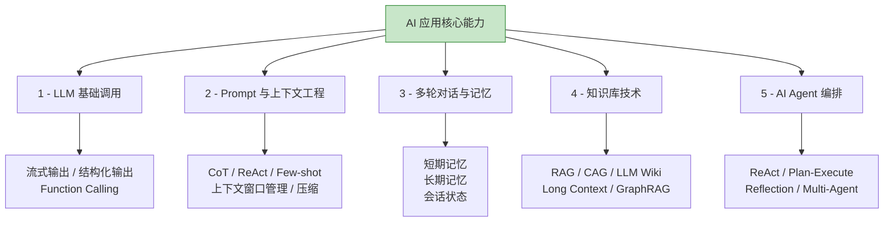

### 📚 技术栈分级

#### 🥇 Java 主战场（必学，深入）

| 技术 | 说明 | 必学度 |
| ---- | ---- | ------ |
| **Spring AI** | Spring 官方 AI 框架（推荐主选） | ⭐⭐⭐⭐⭐ |
| **LangChain4j** | 社区驱动 Java AI 框架 | ⭐⭐⭐⭐⭐ |
| **Spring Boot 3.x** | 已会，无需学习 | — |
| **MCP Java SDK** | 协议接入 | ⭐⭐⭐⭐ |

#### 🥈 跨语言通用能力（必学）

| 技术 | 说明 | 必学度 |
| ---- | ---- | ------ |
| **LLM API** | OpenAI / Claude / DeepSeek / Qwen / GLM | ⭐⭐⭐⭐⭐ |
| **Prompt 工程** | 系统提示、Few-shot、CoT、ReAct | ⭐⭐⭐⭐⭐ |
| **上下文工程** | 窗口管理、压缩、记忆 | ⭐⭐⭐⭐⭐ |
| **知识库技术** | RAG / CAG / LLM Wiki | ⭐⭐⭐⭐⭐ |
| **Agent 设计模式** | ReAct / Plan-Execute / Reflection | ⭐⭐⭐⭐⭐ |
| **MCP 协议** | 跨应用工具/数据访问的事实标准 | ⭐⭐⭐⭐⭐ |
| **Skills（SKILL.md）** | 程序化知识打包（2025 推出，2026 普及） | ⭐⭐⭐⭐⭐ |
| **AGENTS.md** | 给编程 Agent 看的项目说明（开放标准） | ⭐⭐⭐⭐ |
| **向量数据库** | Milvus / pgvector | ⭐⭐⭐⭐⭐ |
| **Dify / Coze** | 低代码 AI 平台 | ⭐⭐⭐⭐ |
| **Langfuse** | LLM 可观测性 | ⭐⭐⭐⭐ |
| **Ragas** | RAG 评估 | ⭐⭐⭐⭐ |

#### 🥉 辅助语言（看得懂、能跑通即可）

> [!note] 为什么需要辅助语言
> Java 阵营在 AI 领域稍滞后，**新玩法 Python 先有，新前端体验 TS 先有**。两个辅助语言都不需要精通，目标只是「能 clone 项目跑起来、能读懂代码」。

##### 🐍 Python（生态最全，AI 后端必会读）

| 技术 | 说明 | 必学度 |
| ---- | ---- | ------ |
| Python 基础 | 语法、异步、包管理 | ⭐⭐⭐ |
| LangChain Python | 看 demo、对照学习 | ⭐⭐⭐ |
| FastAPI | 起简单服务 | ⭐⭐ |

##### 🟦 TypeScript（前端 / 全栈 AI 必会读）

| 技术 | 说明 | 必学度 |
| ---- | ---- | ------ |
| TypeScript 基础 | 语法、类型系统（Java 用户上手快） | ⭐⭐⭐ |
| Vercel AI SDK | TS AI 工具包事实标准（月下载 2000 万） | ⭐⭐⭐ |
| Next.js | 全栈框架，2026 内置 AI/MCP 支持 | ⭐⭐ |
| Mastra / LangChain.js | TS 版 Agent 框架 | ⭐⭐ |

#### 🔧 进阶 / 选学

- **微调**：LoRA / QLoRA、LLaMA-Factory
- **推理优化**：vLLM、SGLang
- **多模态**：图文、语音、视频
- **AI 网关**：LiteLLM、One-API

---

## 第四章 学习路径总览

### 🗺️ 学习地图

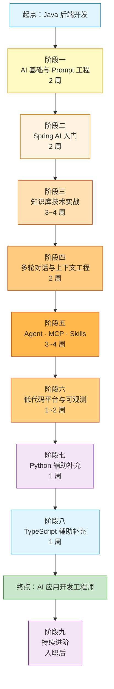

### 📅 时间分配

| 阶段 | 名称 | 周期 | 优先级 |
| ---- | ---- | ---- | ------ |
| 一 | AI 基础与 Prompt 工程 | 2 周 | ⭐⭐⭐⭐⭐ |
| 二 | Spring AI 入门 | 2 周 | ⭐⭐⭐⭐⭐ |
| 三 | 知识库技术实战 | 3~4 周 | ⭐⭐⭐⭐⭐ |
| 四 | 多轮对话与上下文工程 | 2 周 | ⭐⭐⭐⭐⭐ |
| 五 | AI Agent · MCP · Skills | 3~4 周 | ⭐⭐⭐⭐⭐ |
| 六 | 低代码平台与可观测 | 1~2 周 | ⭐⭐⭐⭐ |
| 七 | Python 辅助补充 | 1 周 | ⭐⭐⭐ |
| 八 | TypeScript 辅助补充 | 1 周 | ⭐⭐⭐ |
| 九 | 持续进阶 | 持续 | ⭐⭐⭐ |

---


## 第五章 分阶段学习计划

### 🌱 阶段一 · AI 基础与 Prompt 工程（2 周）

> [!tip] 学习心法
> 这阶段不需要手撕 Transformer，**理解概念能对话即可**。重点是建立 LLM 的「世界观」和 Prompt 工程手感。

#### 🎯 学习目标

- [ ] 理解 LLM 基本原理（Token、上下文、参数、温度）
- [ ] 掌握 Prompt 工程核心技巧
- [ ] 理解 Embedding 与向量检索原理
- [ ] 熟悉主流模型的能力边界与选型
- [ ] 调通第一个 LLM API

#### 📚 核心知识点

##### 1. LLM 基本原理

| 概念 | 必懂程度 | 备注 |
| ---- | -------- | ---- |
| Transformer 架构 | 知道是什么 | 不需要手撕代码 |
| Token / Tokenizer | 必懂 | 计费、上下文限制都跟它相关 |
| 上下文窗口 | 必懂 | 决定能塞多少内容 |
| Temperature / Top-P | 必懂 | 调用参数核心 |
| 上下文学习（ICL） | 必懂 | Prompt 工程基础 |
| RLHF / DPO | 知道概念 | 后训练方法 |

##### 2. 主流模型选型（2026 年 5 月）

| 类别 | 代表模型 | 特点 |
| ---- | -------- | ---- |
| **闭源旗舰** | GPT-5、Claude Opus 4.x、Gemini 2.x | 能力天花板、价格高 |
| **国内闭源** | DeepSeek-V3/R1、Qwen3、GLM-4.x、Kimi K2 | 中文好、性价比高 |
| **开源主力** | Llama 3.x、Qwen 系列、DeepSeek 开源版 | 可私有部署、可微调 |
| **Embedding** | text-embedding-3、BGE-M3、Qwen-Embedding | 检索基础 |
| **Rerank** | bge-reranker、Cohere Rerank | RAG 增强必备 |

> [!tip] Prompt 工程详细内容请见 [[#第八章 Prompt 与上下文工程]]

#### 📝 实操任务

> [!example] 动手清单
> - [ ] 注册 OpenAI / DeepSeek / 智谱 任一平台
> - [ ] 用 Postman / curl 跑通 Chat Completions 接口
> - [ ] 写 5+ 个不同场景的 Prompt 模板
> - [ ] 计算文本 Token 数量
> - [ ] 调 Embedding 接口，对比文本相似度
> - [ ] 阅读 OpenAI Cookbook 至少 3 个示例
> - [ ] 整理「Prompt 模板库」（用 Markdown 沉淀）

---

### 🌿 阶段二 · Spring AI 入门（2 周）

> [!important] Java 主战场启动
> 这阶段把 LLM 调用能力落到 Spring Boot 体系里。**目标是建立 Spring AI 的心智模型，不是学完所有功能。**

#### 🎯 学习目标

- [ ] 搭建第一个 Spring AI 项目
- [ ] 理解 ChatClient / ChatModel 抽象
- [ ] 实现流式输出
- [ ] 接入多个模型供应商
- [ ] 用 Function Calling 调用 Java 方法

#### 📚 核心知识点

##### Spring AI 核心抽象

```text
☑ ChatClient / ChatModel - 模型调用统一接口
☑ Prompt / PromptTemplate - 提示工程封装
☑ Message - System / User / Assistant 角色
☑ ChatMemory - 多轮对话记忆
☑ Advisor - 拦截器扩展（类似 AOP）
☑ Embedding / VectorStore - 向量化与检索
☑ Tool / Function Calling - 工具调用
☑ RAG - retrieveAndGenerate
☑ MCP Client / Server - 协议接入
```

#### 📝 实操任务

> [!example] 动手清单
> - [ ] Spring Boot 3 + Spring AI 项目搭建
> - [ ] 接入 DeepSeek 或通义千问（国内模型，便宜）
> - [ ] 实现 `/chat` 同步接口
> - [ ] 实现 `/chat/stream` SSE 流式接口
> - [ ] 结构化输出（解析成 Java POJO）
> - [ ] 实现 5 个 Function Calling 工具
> - [ ] 多模型动态切换

---

### 🔥 阶段三 · 知识库技术实战（3~4 周，重投入）

> [!important] 核心简历项目
> 知识库是 AI 应用最核心的"基础设施"。**这阶段产出会成为简历最重要的项目。**
> 
> 知识库不止 RAG 一种方案，2026 年百花齐放。完整对比请见 [[#第六章 知识库技术全景（RAG 与替代方案）]]

#### 🎯 学习目标

- [ ] 理解 RAG 全链路与每一步优化点
- [ ] 掌握 RAG 替代方案（CAG / LLM Wiki / Long Context）的取舍
- [ ] 掌握向量数据库使用（Milvus 或 pgvector）
- [ ] 独立实现端到端 RAG 系统
- [ ] 掌握 RAG 评估方法

#### 📝 实操任务

> [!example] 项目实战 - 企业知识库系统
> 
> **第 1 周：RAG 基础链路**
> - [ ] 部署 Milvus（Docker 单机版）或 pgvector
> - [ ] Spring AI + Milvus 集成
> - [ ] 文档上传与解析（PDF / Word / MD）
> - [ ] 简单切分 + Embedding + 入库
> 
> **第 2 周：完善检索与生成**
> - [ ] Top-K 检索 + 拼 Prompt + LLM 生成
> - [ ] 接入 Rerank 模型
> - [ ] 引用溯源（答案标注来源）
> - [ ] 流式输出版本
> 
> **第 3 周：进阶优化与对比实验**
> - [ ] 实现 Multi-Query 改写
> - [ ] 混合检索（向量 + 关键词）
> - [ ] 父子块切分策略
> - [ ] **加分项**：用同一份知识库实现 CAG 版本对比
> - [ ] **加分项**：用 LLM Wiki 模式做个人版（写到 Obsidian）
> 
> **第 4 周：评估与压测**
> - [ ] 准备 30~50 条评估问题
> - [ ] 跑 Ragas 评估
> - [ ] 接入 Langfuse 全链路追踪
> - [ ] 性能压测、成本统计、写技术博客

---

### 💬 阶段四 · 多轮对话与上下文工程（2 周）

> [!important] 高频面试与实战话题
> 多轮对话和上下文工程是 AI 应用的"灵魂"，**很多课程一带而过**。深入掌握能在面试和项目里脱颖而出。

#### 🎯 学习目标

- [ ] 理解上下文窗口的本质与限制
- [ ] 掌握上下文压缩与裁剪策略
- [ ] 实现多种记忆机制（短期、长期、语义）
- [ ] 处理长对话与话题切换

#### 📚 核心知识点

##### 多轮对话记忆机制

| 类型 | 实现方式 | 适用场景 |
| ---- | -------- | -------- |
| **滑动窗口** | 保留最近 N 轮 | 简单聊天 |
| **Token 窗口** | 按 Token 数裁剪 | 控制成本 |
| **摘要记忆** | LLM 总结历史 | 长对话 |
| **语义检索记忆** | Embedding 检索相关历史 | 复杂客服 |
| **结构化记忆** | 提取实体/事实存数据库 | 助理型应用 |
| **分层记忆** | 短期 + 长期 + 语义 | Agent 系统 |

> [!tip] 上下文工程详细内容请见 [[#第八章 Prompt 与上下文工程]]

#### 📝 实操任务

> [!example] 项目实战 - 智能客服多轮对话系统
> - [ ] 基础多轮对话（Redis ChatMemory）
> - [ ] Token 预算管理（按窗口大小裁剪）
> - [ ] 摘要型记忆（超过 N 轮自动摘要）
> - [ ] 语义检索记忆（结合 VectorStore）
> - [ ] 多用户会话隔离 + 持久化
> - [ ] 添加意图识别 + 话题切换处理
> - [ ] 把 RAG 系统的检索结果纳入上下文

---

### 🤖 阶段五 · AI Agent · MCP · Skills（3~4 周）

> [!important] 2026 年最热门赛道
> Agent 是 AI 应用的核心战场，**MCP + Skills 是 2026 年企业落地的关键拼图**。
> - **MCP**：连接外部系统（事实标准，9700 万月下载）
> - **Skills**：打包程序化知识（2025 年下半年由 Anthropic 推出，2026 年已有 Microsoft Agent Framework 等支持）
> - **会写 MCP Server + 会设计 Skills 是简历强亮点**
> 
> 各种 Agent 设计模式的完整对比请见 [[#第七章 Agent 设计模式全景]]
> 三层原语（Function Calling / MCP / Skills）的对比请见 [[#第九章 协议与平台]]

#### 🎯 学习目标

- [ ] 理解 Agent 设计模式（ReAct、Plan-Execute、Reflection、Multi-Agent）
- [ ] 用 Spring AI 实现 ReAct Agent
- [ ] 实现多 Agent 协作
- [ ] 掌握 MCP 协议规范并实现 Server
- [ ] **掌握 Skills（SKILL.md）规范并设计自己的 Skill**
- [ ] **理解 Skills × MCP × Function Calling 三层心智**
- [ ] Agent 工程化（追踪、评估、安全）

#### 📝 实操任务

> [!example] 项目实战清单
> 
> **项目 D：通用 ReAct Agent**（第 1 周）
> - [ ] 用 Spring AI 实现 ReAct
> - [ ] 接入 5+ 工具（搜索、计算、文件、查 DB、调外部 API）
> - [ ] 引入 Memory 长期记忆
> 
> **项目 E：MCP Server 工具集**（第 2 周）
> - [ ] 用 Spring AI MCP 实现 Server
> - [ ] 暴露 3+ 个有意义的业务能力
> - [ ] 用 MCP Inspector 测试
> - [ ] 接入 Claude Desktop / Cursor 演示
> - [ ] 推到 GitHub
> 
> **项目 F1：Skills 设计实践**（第 3 周新增）
> - [ ] 阅读 anthropics/skills 官方仓库（GitHub）
> - [ ] 设计 2~3 个自己的 Skill（如「周报生成」「代码审查」「需求拆解」）
> - [ ] 写好 SKILL.md（YAML frontmatter + Markdown 指令）
> - [ ] 在 Claude.ai 或 Claude Code 中加载并测试
> - [ ] **加分项**：让 Skill 调用你的 MCP Server，体会"Skills + MCP"协同
> - [ ] 给你的 Java 项目加一个 AGENTS.md
> 
> **项目 F2：业务 Agent 系统**（第 3~4 周）
> - [ ] 选真实业务场景（智能客服 / AI 文档助理 / AI BI）
> - [ ] 用 Plan-Execute 或 Multi-Agent 实现
> - [ ] 整合 RAG + 多轮对话 + MCP 工具 + Skills
> - [ ] Langfuse 可观测 + 简易评估

---

### 🛠️ 阶段六 · 低代码平台与可观测（1~2 周）

> [!tip] 拓展视野与工程化
> 这阶段补齐两块：**低代码平台让你理解产品视角**，**可观测让你的项目像生产级**。

#### 🎯 学习目标

- [ ] 用 Dify 搭建完整业务流并理解原理
- [ ] 看懂 Dify 部分核心源码（Workflow 引擎）
- [ ] 接入 Langfuse 做 LLM 可观测
- [ ] 用 Ragas 做 RAG 评估

#### 📝 实操任务

> [!example] 动手清单
> - [ ] 本地部署 Dify（Docker Compose）
> - [ ] 用 Dify 搭一个客服 Bot
> - [ ] 阅读 Dify 部分核心源码
> - [ ] 写一篇博客《Dify 工作流引擎架构分析》
> - [ ] 给阶段三/五的项目接入 Langfuse
> - [ ] 用 Ragas 评估并出报告

---

### 🐍 阶段七 · Python 辅助补充（1 周）

> [!warning] 不是让你转 Python
> 目标是「**看得懂 GitHub 上的 Python AI 项目代码、能跑通**」。Python 在 AI 领域生态最完整，**新玩法往往 Python 先有**。

#### 📝 实操任务

> [!example] 动手清单
> - [ ] 用 uv 配置 Python 项目
> - [ ] Clone 1~2 个 GitHub 上的 Python AI 项目，跑通
> - [ ] 用 FastAPI 起一个最简 LLM 代理服务
> - [ ] 阅读 LangChain Python 文档，对照 LangChain4j

---

### 🟦 阶段八 · TypeScript 辅助补充（1 周）

> [!warning] 同样不是让你转 TS
> 目标是「**看得懂 GitHub 上的 TS AI 项目代码、能跑通 Vercel AI SDK 这类示例**」。
> 
> **为什么要补 TS**：2026 年很多 AI 应用产品（Cursor、Claude Code、Dify 前端、各种 Chat UI）都是 TS/Next.js 写的。Vercel AI SDK 月下载 2000 万次，是除 Python LangChain 之外最大的 AI 应用工具包。读得懂 TS 代码，前端 AI 项目的好玩法你也能吃到。

#### 🎯 学习目标

- [ ] TypeScript 基础语法（Java 用户视角）
- [ ] 看得懂 Vercel AI SDK 的示例
- [ ] 知道 LangChain.js / Mastra 的位置
- [ ] 能用 Next.js 起一个最简 AI Chat 页面

#### 📚 必备技能（按 Java 用户视角）

| 技能 | 学习量 | 用途 | 备注 |
| ---- | ------ | ---- | ---- |
| TS 语法基础 | 1 天 | 看代码 | Java 用户上手很快，类型系统熟悉 |
| pnpm / npm | 半天 | 包管理 | 推荐 pnpm |
| Node.js / Bun 基础 | 半天 | 运行环境 | |
| Next.js App Router | 1 天 | 全栈框架 | Server Component 是关键 |
| Vercel AI SDK | 1 天 | TS AI 工具包事实标准 | 重点！|
| 流式 UI（useChat） | 半天 | AI 聊天 UI 标配 | |

> [!tip] Java 转 TS 比转 Python 更简单
> TypeScript 的类型系统、装饰器、面向对象用法跟 Java 几乎是同源思路。你看 TS 代码会比看 Python 还顺。

#### 🌐 TS AI 生态认知图

| 框架 | 定位 | 类比 Java 阵营 |
| ---- | ---- | -------------- |
| **Vercel AI SDK** | 调 LLM + 流式 UI 的工具包 | 类比 Spring AI 的核心 |
| **LangChain.js** | LangChain 的 TS 版 | 类比 LangChain4j |
| **Mastra** | TS 原生 Agent 框架（含 RAG / Eval） | 类比 Spring AI Agent 模块 |
| **OpenAI Agents JS** | OpenAI 官方轻量 Agent SDK | 类比直接调 OpenAI Java SDK |
| **Next.js** | 全栈框架，2026 年内置 AI/MCP 支持 | 类比 Spring Boot 但前后端通吃 |

#### 📝 实操任务

> [!example] 动手清单
> - [ ] 装好 Node.js + pnpm
> - [ ] Clone Vercel AI SDK 的官方示例（next-openai）跑通
> - [ ] 改一个 Demo 接入 DeepSeek 或国产模型
> - [ ] 用 Next.js + Vercel AI SDK 起一个最简 AI Chat 页面（带流式输出）
> - [ ] 阅读 Mastra 文档，理解和 Spring AI 的对照关系
> - [ ] **加分项**：把阶段三 RAG 后端用 Next.js 写个简单前端

---

### 🚀 阶段九 · 持续进阶（找到工作后）

- **模型微调**：LoRA / QLoRA、LLaMA-Factory
- **推理优化**：vLLM、SGLang、TGI
- **多模态**：图文、语音、视频
- **AI 网关**：LiteLLM、One-API、Higress
- **多 Agent 高级框架**：CrewAI、AutoGen、A2A 协议
- **AI 安全**：越狱防护、内容审核、数据隐私

---


## 第六章 知识库技术全景（RAG 与替代方案）

> [!info] 章节说明
> 这一章把所有「**让 LLM 用上你的私有知识**」的技术全部归类整理。2026 年这个领域百花齐放，**RAG 不再是唯一答案**。

### 🎯 共同目标

把不在 LLM 训练数据里的私有知识（公司文档、个人笔记、代码库……）让 LLM 能用起来。

### 📊 五种主流方案对比

| 方案 | 中文名 | 一句话核心 | 适用场景 | 学习优先级 |
| ---- | ---- | ---------- | -------- | ---------- |
| **RAG** | 检索增强生成 | 查向量库 → 拼上下文 → 生成 | 大规模、动态更新的知识 | ⭐⭐⭐⭐⭐ |
| **CAG** | 缓存增强生成 | 知识一次性预加载到上下文 | 中小规模、相对稳定的知识 | ⭐⭐⭐⭐ |
| **LLM Wiki** | LLM 维护的 Wiki | LLM 把资料整理成 Markdown 文件互链 | 个人 / 小团队知识库 | ⭐⭐⭐⭐ |
| **Long Context** | 长上下文直塞 | 全部塞进上下文窗口 | 一次性任务、原型 | ⭐⭐⭐ |
| **GraphRAG** | 图谱 RAG | 用知识图谱组织检索 | 实体关系复杂的领域 | ⭐⭐⭐ |
| **Agentic RAG** | 智能体 RAG | Agent 自己决定检索策略 | 复杂多跳问题 | ⭐⭐⭐⭐ |

### 🔍 方案一：RAG（检索增强生成）

> [!note] 行业默认方案
> 2024 年起的事实标准，目前仍是 **生产环境最稳的选择**。

#### 工作流程

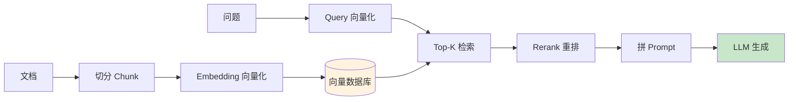

#### 优势 vs 劣势

| 优势 | 劣势 |
| ---- | ---- |
| 支持海量数据（百万+文档） | 链路长，调优点多 |
| 知识可热更新 | 向量检索召回质量天花板 |
| 成本相对可控 | 跨 chunk 信息可能丢失 |
| 引用溯源清晰 | 系统组件多（向量库、Embedding、Rerank） |

#### 必学技巧

```text
☑ Chunking：固定 / 递归 / 语义切分
☑ Multi-Query：一个问题改写成多个查询
☑ HyDE：先让 LLM 假设性回答，用回答去检索
☑ Hybrid Search：向量 + BM25 关键词混合
☑ Rerank：召回多、精排取头
☑ Parent-Child Chunk：小块检索、大块生成
☑ Contextual Retrieval：给每个 chunk 加上下文摘要
☑ 引用溯源：答案标注来源文档与位置
```

### 🚀 方案二：CAG（缓存增强生成）

> [!note] 2025 年提出的新方案
> Cache-Augmented Generation，2025 年随 Long Context 模型成熟而兴起。**「Don't Do RAG」论文引发广泛讨论**。

#### 核心思路

不做实时检索，而是把整个知识库 **预加载** 到 LLM 的 KV-Cache 中，每次查询直接复用缓存。

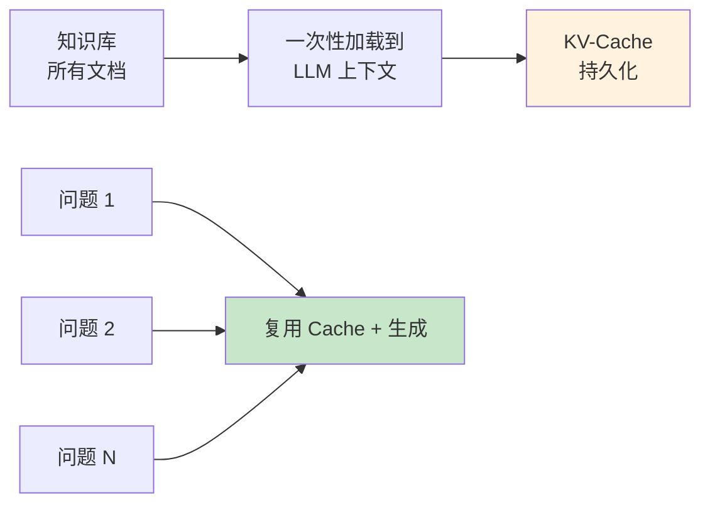

#### 优势 vs 劣势

| 优势 | 劣势 |
| ---- | ---- |
| **零检索延迟** | 知识规模受上下文窗口限制 |
| **链路简单**（无向量库、无 Embedding） | 知识更新要重建 Cache |
| **不会漏召回** | 大上下文成本高 |
| **跨文档信息保留完整** | 当前主流模型最多 1M~10M Token |

#### 适用场景

- 客服 FAQ（几百到几千条问答）
- 产品手册（一本书规模）
- 代码库小型项目
- API 文档查询助手

> [!tip] 何时选 CAG 而不是 RAG
> 知识量 **小于 50 万 Token**（约 75 万字）、**更新不频繁**、**对延迟敏感** 的场景，CAG 通常完胜 RAG。

### 📚 方案三：LLM Wiki（LLM 维护的知识库）⭐ 你问的就是这个

> [!success] 2026 年新范式
> Andrej Karpathy 提出并实践，他自己用这种方式维护了 **40 万字的个人 Wiki**。**完美适配 Obsidian！**
> 
> 核心理念：**RAG 是每次查询都重新发现知识；LLM Wiki 是把知识一次性编译好放着。**

#### 工作流程

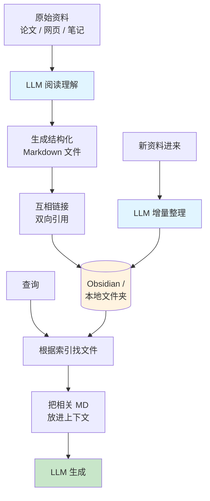

#### 三层架构（来自 Karpathy 实践）

```text
1. raw/        # 原始资料（论文 PDF、网页存档、聊天记录）
2. wiki/       # LLM 生成的 Markdown 页面（按主题组织、互相链接）
3. CLAUDE.md   # 元提示，告诉 LLM 怎么维护这个 Wiki
```

#### 三个核心操作

```text
☑ Ingest：把新资料喂进来，LLM 决定写成新页面或更新已有页面
☑ Query：基于索引找相关 Wiki 页面，组合上下文回答
☑ Lint：定期让 LLM 检查链接、合并重复、补漏洞
```

#### 优势 vs 劣势

| 优势 | 劣势 |
| ---- | ---- |
| **不需要向量数据库** | 规模受限（适合个人 / 小团队） |
| **人类可读可改** | 需要 LLM 持续维护 |
| **天然适合 Obsidian** | 检索靠文件名 + 索引，不如向量检索精准 |
| **跨主题的关联在写入时建立** | 新资料整合需要算力 |
| **零检索延迟（直接读文件）** | 不适合实时性强的领域 |

#### 适用场景

- ⭐ **个人知识库**（你的 Obsidian 仓库）
- ⭐ **团队 Wiki**（产品文档、设计决策、ADR）
- 学习笔记 / 阅读笔记的 AI 整合
- 代码项目的内部文档

#### 在 Obsidian 中的实现

> [!tip] 你已经在 Obsidian 里了，这个方案对你天然友好
> 实践工具：
> - **Obsidian Copilot 插件**：直接在 Obsidian 里调 LLM
> - **Smart Connections 插件**：建立笔记间的语义关联
> - **Cursor / Claude Code**：把 Obsidian 仓库当做上下文
> - 自己写 MCP Server：暴露 Obsidian 仓库给任意 LLM

### 📜 方案四：Long Context（长上下文直塞）

> [!note] 简单直接但贵
> 不做任何检索，直接把整个知识塞进 LLM 上下文。**模型上下文窗口越来越大让这条路越来越可行**。

#### 适用场景

- 单文档分析（合同审查、论文总结）
- 代码库一次性理解（小型项目）
- 原型验证（先跑通再优化）

#### 优劣

| 优势 | 劣势 |
| ---- | ---- |
| 实现极其简单 | 成本高（按 Token 计费） |
| 不会漏信息 | 中间信息容易被忽略（Lost in the Middle） |
| 不需要任何基础设施 | 推理慢 |

### 🕸️ 方案五：GraphRAG（图谱增强 RAG）

> [!note] 微软提出，适合实体关系复杂的领域
> 核心思路：先用 LLM 抽取实体和关系建图谱，查询时结合图谱做多跳推理。

#### 适用场景

- 法律案例（人物、案件、判决多重关系）
- 医疗诊断（症状、疾病、药物、检查）
- 企业知识（部门、人员、项目、产品）

#### 优劣

| 优势 | 劣势 |
| ---- | ---- |
| 多跳问题准确率高 | 建图成本高 |
| 可解释性强 | 维护复杂 |
| 全局视野好 | 实现门槛高 |

### 🤖 方案六：Agentic RAG（智能体 RAG）

> [!note] RAG + Agent 融合
> Agent 自己决定要不要检索、检索几次、用什么策略检索。**比传统 RAG 多 3~10 倍 Token，但多跳问题质量大幅提升**。

#### 工作流程

```text
用户问题
  ↓
Agent 思考：需要检索吗？
  ↓
检索 → 评估结果是否够回答
  ↓
不够 → 改写查询 → 再检索 → 再评估
  ↓
够了 → 生成答案
```

#### 适用场景

- 复杂多跳问题（"A 公司的 CEO 的母校是哪所大学？"）
- 模糊查询
- 法律 / 医疗 / 金融等高质量要求场景

### 🎯 决策树：你该选哪种？

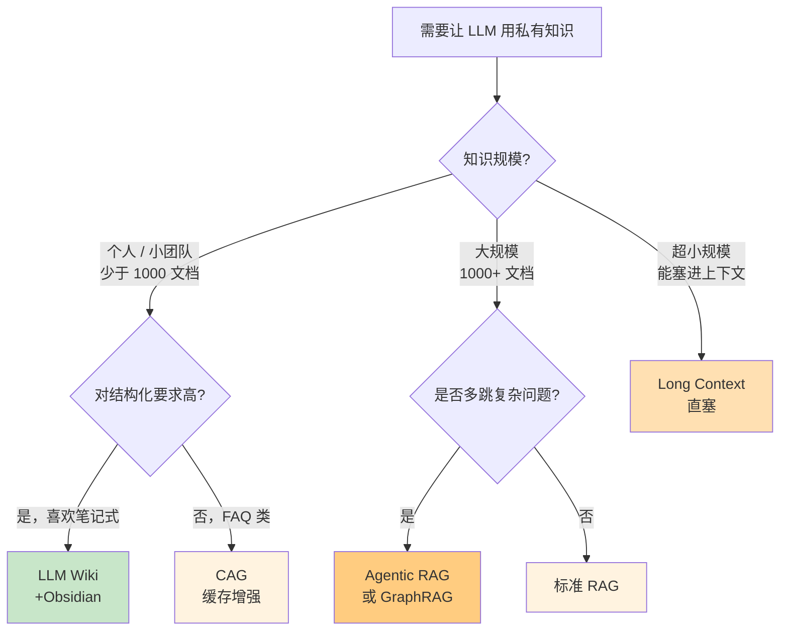

### 📝 学习建议

> [!tip] 学习优先级
> 1. **RAG**（必须精通，岗位 JD 高频）
> 2. **CAG**（理解原理，会简单实现）
> 3. **LLM Wiki**（理解理念，在 Obsidian 实践 - 你已经有完美的环境）
> 4. **Agentic RAG**（项目里能用上）
> 5. **GraphRAG / Long Context**（了解、知道何时用）

> [!example] 你的 Obsidian 实践建议
> 既然你已经在 Obsidian 里了，建议你 **同时实践 RAG 和 LLM Wiki 两条路**：
> - **RAG**：作为简历主项目（用 Spring AI + Milvus 做企业知识库）
> - **LLM Wiki**：作为你的学习沉淀方式（让 AI 帮你维护这个 Obsidian 仓库），双重收益

---


## 第七章 Agent 设计模式全景

> [!info] 章节说明
> 这一章把所有 Agent 相关的设计模式归类整理。**ReAct 只是众多模式之一**，掌握全景才能选对场景的方案。

### 🎯 共同目标

让 LLM **不只是回答**，而是能 **思考、规划、调用工具、自我修正、协作完成复杂任务**。

### 📊 七大设计模式（按复杂度递增）

| 模式 | 中文 | 一句话核心 | 复杂度 | 学习优先级 |
| ---- | ---- | ---------- | ------ | ---------- |
| **Tool Use** | 工具调用 | LLM 调用你定义的函数 | ⭐ | ⭐⭐⭐⭐⭐ |
| **ReAct** | 推理-行动 | Thought → Action → Observation 循环 | ⭐⭐ | ⭐⭐⭐⭐⭐ |
| **Plan-and-Execute** | 先规划后执行 | 先列计划，再逐步执行 | ⭐⭐⭐ | ⭐⭐⭐⭐⭐ |
| **Reflection** | 反思 | 输出后自检并修正 | ⭐⭐⭐ | ⭐⭐⭐⭐ |
| **Reflexion** | 强化反思 | 反思 + 持久化记忆 + 重试 | ⭐⭐⭐⭐ | ⭐⭐⭐ |
| **REWOO** | 无观察推理 | 一次性规划批量执行，省 Token | ⭐⭐⭐ | ⭐⭐⭐ |
| **Multi-Agent** | 多智能体协作 | 多个 Agent 分工合作 | ⭐⭐⭐⭐⭐ | ⭐⭐⭐⭐ |

### 🔧 模式一：Tool Use（工具调用）

> [!note] 一切 Agent 的基础
> 也叫 Function Calling，是所有 Agent 模式的基石。

```text
LLM 接收问题 → 决定调用哪个工具 + 传什么参数 → 执行工具 → 用结果生成答案
```

**适用**：所有需要外部能力（查 DB、调 API、计算、发邮件）的场景

### 🔁 模式二：ReAct（推理-行动循环）⭐ 最常用

> [!success] 2026 年最广泛使用的 Agent 模式
> 论文《ReAct: Synergizing Reasoning and Acting》提出，已成为 LangChain / LangGraph / Spring AI 的默认范式。

#### 工作流程

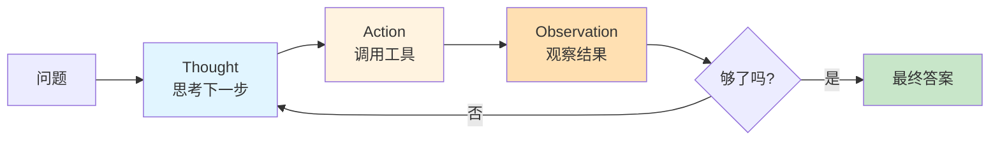

#### 示例（伪代码）

```text
问：阿里巴巴最新一季营收多少？

Thought: 我需要查最新财报数据
Action: web_search("阿里巴巴 2026 Q1 营收")
Observation: 搜到 2470 亿人民币

Thought: 数据足够回答了
Final Answer: 阿里巴巴 2026 财年第一季度营收 2470 亿元
```

#### 适用场景

- 需要动态调用工具的对话
- 需要边想边做的任务
- 不确定步骤数量的场景

### 📋 模式三：Plan-and-Execute（先规划后执行）

> [!note] 复杂任务的标准做法
> 先一次性规划完整步骤，再逐步执行。比 ReAct 更适合 **明确多步的任务**。

#### 工作流程

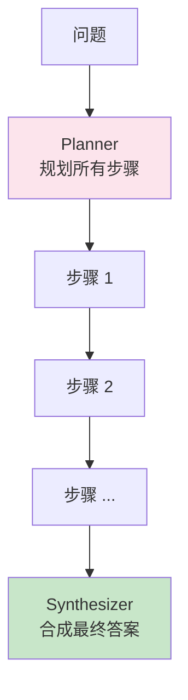

#### 与 ReAct 对比

| 维度 | ReAct | Plan-and-Execute |
| ---- | ----- | ---------------- |
| 决策时机 | 每步动态决定 | 一次性规划 |
| Token 成本 | 高（每步都调 LLM） | 中（规划 + 执行各一次） |
| 灵活性 | 高 | 中 |
| 适合场景 | 探索性任务 | 明确多步任务 |

### 🪞 模式四：Reflection（反思）

> [!note] 质量保证的常用手段
> 输出后让 LLM 自检 → 发现问题 → 修正。**Anthropic《Building Effective Agents》经典模式**。

#### 工作流程

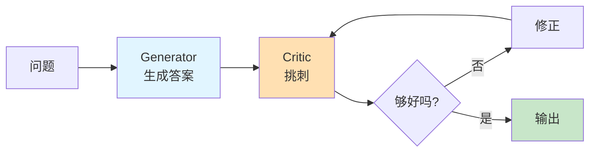

#### 适用场景

- 代码生成
- 长文写作
- 高质量要求的总结

### 💪 模式五：Reflexion（强化反思）

> [!note] Reflection 的强化版
> 让 Agent **记住**自己的批判，重试时带着教训去做。**HumanEval 编程通过率从 80% 提到 91%**。

#### 与 Reflection 区别

| 维度 | Reflection | Reflexion |
| ---- | ---------- | --------- |
| 记忆 | 当次会话内 | 持久化跨 episode |
| 反思格式 | 自由文本 | 结构化"教训" |
| 重试方式 | 单次修正 | 完整重跑 + 教训作为输入 |
| 成本 | 中 | 高（多次完整运行） |

### ⚡ 模式六：REWOO（无观察推理）

> [!note] 省钱省时的模式
> Reasoning WithOut Observation，把 ReAct 拆成 **Plan + Worker + Solver**，只在最后调一次大 LLM 整合。

#### 工作流程

```text
1. Planner（用大 LLM）：规划所有步骤和工具调用
2. Worker（用便宜模型）：批量执行所有工具调用
3. Solver（用大 LLM）：用所有结果合成答案
```

**省钱原理**：避免每步都用大模型推理，工具调用结果不回灌到 LLM 中间循环里。

### 👥 模式七：Multi-Agent（多智能体协作）

> [!important] 复杂业务系统的最终形态
> 多个 Agent 各司其职、协作完成大任务。**2026 年企业落地的主流架构**。

#### 主要协作模式

| 模式 | 中文 | 一句话核心 | 代表框架 |
| ---- | ---- | ---------- | -------- |
| **Supervisor-Worker** | 主管-工人 | 主 Agent 调度子 Agent | LangGraph |
| **Hierarchical** | 分层 | 树状的主-子-孙结构 | LangGraph |
| **Role-based** | 角色化 | Researcher / Writer / Reviewer | CrewAI |
| **Debate** | 辩论 | 多 Agent 互相质疑得出更好答案 | AutoGen |
| **Verifier-Critic** | 验证者-批评者 | 一个干活一个挑刺 | 自实现 |
| **Swarm** | 蜂群 | 去中心化协作 | OpenAI Swarm |

#### Supervisor-Worker 流程示例

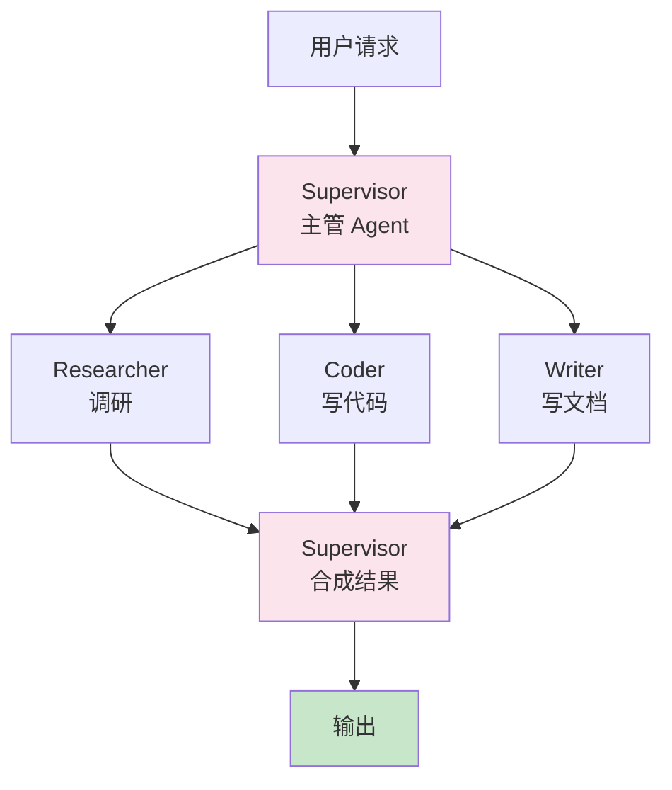

### 🎯 模式选择决策树

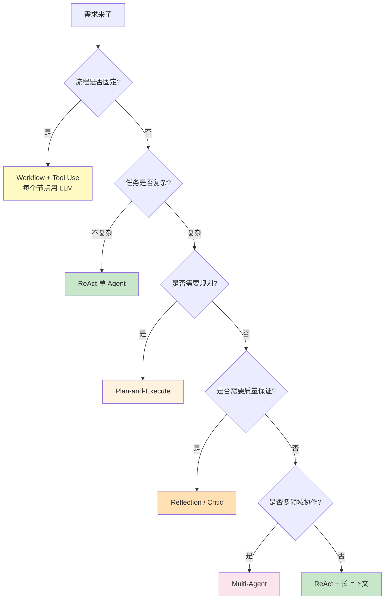

### 💡 Anthropic 经典原则

> [!quote] 来自《Building Effective Agents》
> 1. **优先用 Workflow（固定流程），复杂场景才用 Agent（自主）**
> 2. **简单可控比"自主"更重要**
> 3. **工具描述要清晰、参数要明确**
> 4. **给 Agent 充足的"思考空间"，不要硬塞**
> 5. **错误恢复机制要设计好**
> 6. **可观测性比功能本身更重要**

### 📝 学习路径建议

> [!tip] 三阶段掌握
> 
> **第一阶段（必学）**
> Tool Use → ReAct → Plan-and-Execute → Reflection
> 
> **第二阶段（项目用得上）**
> Multi-Agent (Supervisor-Worker) → Reflexion
> 
> **第三阶段（按需深入）**
> REWOO → Tree-of-Thoughts → Graph-of-Thoughts → Swarm

---

## 第八章 Prompt 与上下文工程

> [!info] 章节说明
> 这一章把所有「**怎么给 LLM 写好提示、组织好上下文**」的技术整理在一起。

### 🎯 共同目标

让 LLM **更准、更稳、更便宜地** 输出你想要的结果。

### 🎨 Prompt 工程技巧（按抽象层级）

#### 一、基础提示技巧

| 技巧 | 中文 | 一句话核心 | 必学度 |
| ---- | ---- | ---------- | ------ |
| **Zero-shot** | 零样本 | 不给例子直接问 | ⭐⭐⭐⭐⭐ |
| **Few-shot** | 少样本 | 给 2~5 个示例让 LLM 学 | ⭐⭐⭐⭐⭐ |
| **System Prompt** | 系统提示 | 设定角色和规则 | ⭐⭐⭐⭐⭐ |
| **Structured Output** | 结构化输出 | 强制输出 JSON / Schema | ⭐⭐⭐⭐⭐ |
| **Role Playing** | 角色扮演 | 让 LLM 扮演特定角色 | ⭐⭐⭐⭐ |

#### 二、推理增强技巧

| 技巧 | 中文 | 一句话核心 | 必学度 |
| ---- | ---- | ---------- | ------ |
| **CoT**（Chain-of-Thought） | 思维链 | 让 LLM 逐步推理 | ⭐⭐⭐⭐⭐ |
| **Zero-shot CoT** | 零样本思维链 | "让我们一步步思考" | ⭐⭐⭐⭐ |
| **Self-Consistency** | 自我一致性 | 多次采样取多数答案 | ⭐⭐⭐ |
| **Tree-of-Thoughts** | 思维树 | 多分支探索最优解 | ⭐⭐⭐ |
| **Self-Refine** | 自我改进 | 让 LLM 自己改自己的输出 | ⭐⭐⭐ |

#### 三、行动增强技巧

| 技巧 | 中文 | 一句话核心 | 必学度 |
| ---- | ---- | ---------- | ------ |
| **ReAct** | 推理-行动 | 见 [[#第七章 Agent 设计模式全景]] | ⭐⭐⭐⭐⭐ |
| **Function Calling** | 函数调用 | 让 LLM 调用预定义工具 | ⭐⭐⭐⭐⭐ |
| **Prompt Chaining** | 提示链 | 多个 Prompt 串联，前一个输出是后一个输入 | ⭐⭐⭐⭐ |

#### 四、安全与稳健

| 技巧 | 中文 | 一句话核心 | 必学度 |
| ---- | ---- | ---------- | ------ |
| **Defensive Prompting** | 防御性提示 | 防 Prompt 注入 | ⭐⭐⭐⭐ |
| **Constitutional AI** | 宪法 AI | Anthropic 提的"宪法"式约束 | ⭐⭐⭐ |
| **Guardrails** | 护栏 | 输入输出都过滤 | ⭐⭐⭐⭐ |

### 🧠 上下文工程（Context Engineering）

> [!quote] 业界共识
> Andrej Karpathy 提出：**Prompt Engineering → Context Engineering**。LLM 应用的核心从「写好提示词」演进到「构造好整个上下文」。

#### 上下文窗口预算分配（建议）

| 区块 | 占比建议 | 说明 |
| ---- | -------- | ---- |
| System Prompt | 5~10% | 角色与规则 |
| Few-shot 示例 | 5~15% | 必要时提供 |
| RAG / 知识检索 | 30~50% | 知识源 |
| 历史对话 | 10~30% | 多轮上下文 |
| 工具调用结果 | 5~15% | 中间结果 |
| 当前用户输入 | 5% | 本轮问题 |
| 输出预留 | 10~20% | 留给生成 |

#### 上下文压缩策略

| 策略 | 一句话核心 | 适用场景 |
| ---- | ---------- | -------- |
| **截断法** | 直接砍最早的 | 简单粗暴，最常用 |
| **摘要法** | LLM 总结历史 | 长对话 |
| **精简法** | 保留要点、去客套 | 客服对话 |
| **检索法** | 只保留相关历史 | 复杂多轮 |
| **分层法** | 近期完整 + 远期摘要 | Agent 长程任务 |

#### 多轮对话记忆机制对比

| 类型 | 实现方式 | 适用场景 | 复杂度 |
| ---- | -------- | -------- | ------ |
| **滑动窗口** | 保留最近 N 轮 | 简单聊天 | ⭐ |
| **Token 窗口** | 按 Token 数裁剪 | 控制成本 | ⭐ |
| **摘要记忆** | LLM 总结历史 | 长对话 | ⭐⭐ |
| **语义检索记忆** | Embedding 检索相关历史 | 复杂客服 | ⭐⭐⭐ |
| **结构化记忆** | 提取实体/事实存数据库 | 助理型应用 | ⭐⭐⭐ |
| **分层记忆** | 短期 + 长期 + 语义 | Agent 系统 | ⭐⭐⭐⭐ |

### 📐 System Prompt 模板（三段式）

```text
## 角色定义
你是 [角色]，专长是 [领域]，性格 [特征]。

## 任务说明
你的任务是 [核心任务]。
处理流程：
1. ...
2. ...
3. ...

## 输出格式
[ ] 用 Markdown 格式
[ ] 不要包含 [禁忌内容]
[ ] 答不出就明说"我不知道"
[ ] 引用来源时用 [文档名:章节] 格式
```

### 🎯 学习优先级

> [!tip] 必学清单
> 1. System Prompt 三段式
> 2. Few-shot 示例设计
> 3. CoT / ReAct
> 4. 结构化输出（JSON Mode）
> 5. 上下文窗口预算管理
> 6. 摘要型记忆 + 语义检索记忆
> 7. 防御性提示

---


## 第九章 协议与平台

> [!info] 章节说明
> 这一章把所有「**让 AI 应用之间能互通**」的协议和「**让你少写代码**」的平台整理在一起。

### 🔌 协议与原语层（让 AI 互通、可复用）

> [!important] 2026 年的三层心智模型
> 这一节是面试和实战的核心知识点。务必搞清楚这三层各自解决什么问题、什么时候用哪个、组合起来怎么用。

#### 主流协议/原语对比

| 名称 | 全称 | 一句话核心 | 解决什么 | 提出方 | 必学度 |
| ---- | ---- | ---------- | -------- | ------ | ------ |
| **Function Calling** | 函数调用 | LLM 调用你定义的函数 | 单应用内工具调用 | OpenAI | ⭐⭐⭐⭐⭐ |
| **MCP** | Model Context Protocol | LLM ↔ 工具/数据 标准协议 | 跨应用工具与数据访问 | Anthropic | ⭐⭐⭐⭐⭐ |
| **Skills** | Agent Skills | Markdown 打包"怎么做事"的能力 | 程序化知识/工作流复用 | Anthropic | ⭐⭐⭐⭐⭐ |
| **AGENTS.md** | Agents 项目说明 | 给编程 Agent 看的项目说明书 | 编程 Agent 上下文 | 社区（开放标准） | ⭐⭐⭐⭐ |
| **A2A** | Agent-to-Agent | Agent ↔ Agent 通信协议 | Agent 间互相调用 | Google | ⭐⭐⭐ |

#### 三层心智：Skills × MCP × Function Calling

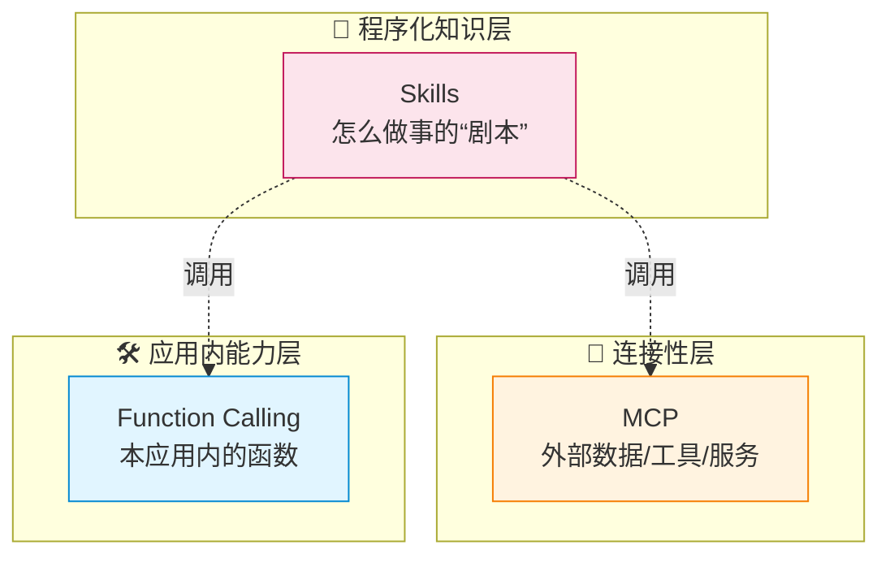

> [!success] 一句话讲清楚三者
> - **Function Calling**：你的 Spring AI 应用里定义的工具，只你自己用
> - **MCP**：把工具/数据封装成标准协议，**Claude Desktop / Cursor / 任意 AI 客户端都能用**
> - **Skills**：把"做某件事的完整流程"打包成 Markdown 文件夹，需要时 Agent 自动加载
> 
> **Skills 是「程序化知识」（Procedural Knowledge），MCP 是「外部连接」（Connectivity），Function Calling 是「本地能力」（Local Capability）。三者组合使用是 2026 年企业落地的主流架构。**

---

#### MCP 详解（必学）

> [!success] 2026 年最重要的连接协议
> MCP 月下载量 **9700 万次**，**10000+ 活跃 Server**，已成事实标准。**会写 MCP Server 是简历强亮点**。

```text
☑ 通信：JSON-RPC 2.0
☑ 传输：stdio / HTTP+SSE / Streamable HTTP
☑ 角色：Server（提供能力）/ Client（消费能力）/ Host（宿主应用）
☑ 三大原语：
   - Tools：可调用的函数
   - Resources：可读取的数据
   - Prompts：预设提示模板
☑ 鉴权：OAuth 2.1（HTTP 模式）
☑ 2026 新增：MCP UI Framework
```

**MCP 适用场景**：
- 让 LLM 访问 GitHub / 数据库 / SaaS 平台
- 跨多个 AI 客户端（Claude / Cursor / Dify）共享工具
- 企业内部把现有系统能力暴露给 AI

---

#### Skills 详解（必学，2026 年新原语）

> [!success] 2025 年下半年由 Anthropic 推出，2026 年快速普及
> Microsoft Agent Framework 已支持 Agent Skills 开放规范。**Skills 是 2026 年企业 AI 落地的关键拼图**。

##### Skills 是什么

一个 Skill 就是一个 **文件夹**，包含：

```text
my-skill/
├── SKILL.md          # 必需。YAML frontmatter + Markdown 指令
├── scripts/          # 可选。脚本文件
├── templates/        # 可选。模板文件
└── references/       # 可选。参考资料
```

**SKILL.md 最小结构**：

```markdown
---
name: invoice-processor
description: 当用户上传发票时，提取信息并填入财务系统
---

# 处理流程

1. 读取发票图片，调用 OCR 工具提取字段
2. 校验金额、税号、日期
3. 调用财务系统 MCP Server 写入
4. 失败时记录到 errors.log 并通知用户
```

##### Skills 的核心特征：渐进式上下文披露

> [!important] Skills 最关键的设计
> **Agent 启动时只读 SKILL.md 的 YAML 元数据**（name + description），任务匹配时才加载完整指令。**这避免了把所有 Skill 都塞进上下文导致爆炸。**

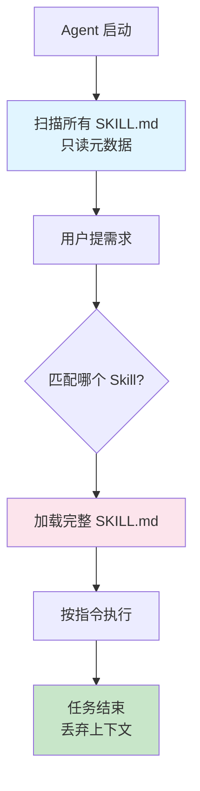

##### Skills vs MCP：什么时候用哪个

| 维度 | Skills | MCP |
| ---- | ------ | --- |
| **本质** | 程序化知识 / 工作流剧本 | 连接外部系统的协议 |
| **回答的问题** | "**怎么做**这件事" | "**用什么**做这件事" |
| **形式** | Markdown 文件夹 | JSON-RPC 协议 |
| **加载方式** | 渐进式（按需加载完整指令） | 实时调用 |
| **典型场景** | 周报生成、合同审查、数据分析模板 | 查 DB、调 API、读文件 |
| **代表载体** | Claude.ai、Claude Code、Agent SDK | Claude Desktop、Cursor、Dify |
| **简单类比** | "员工手册" | "工具箱" |

> [!tip] 2026 年企业落地经典组合
> **Skills + MCP 组合使用，不是替代关系。**
> - Skills 描述"周报应该怎么写、走什么流程、用什么模板"
> - MCP 提供"查询 Jira 的工具、读 Confluence 的工具、发送邮件的工具"
> - Agent 拿到 Skill 后，按 Skill 的步骤调用 MCP 工具完成任务

##### Skills 与 LLM Wiki 的关系

> [!note] 跟你 Obsidian 实践相关
> **LLM Wiki**（[[#📚 方案三：LLM Wiki（LLM 维护的知识库）⭐ 你问的就是这个]]）和 **Skills** 都是用 Markdown 组织 AI 上下文，思路一脉相承：
> - **LLM Wiki**：知识"是什么"（陈述性知识）
> - **Skills**：知识"怎么做"（程序化知识）
> - 你的 Obsidian 仓库里完全可以同时有 Wiki 和 Skills

##### Skills 的官方资源

```text
☑ 官方仓库：https://github.com/anthropics/skills
☑ 支持平台：Claude.ai / Claude Code / Agent SDK / API
☑ Microsoft Agent Framework 已兼容
```

---

#### AGENTS.md 详解（编程 Agent 必备）

> [!note] 给 Coding Agent 看的项目说明
> **AGENTS.md 是 vendor-neutral 的开放标准**（不绑定特定 AI 厂商），放在项目根目录，告诉 Cursor / Claude Code / Codex CLI / 通义灵码 这些编程 Agent：
> - 这个项目怎么 build、怎么 test
> - 代码规范、命名规范
> - 哪些路径不能改、哪些约定要守

```markdown
# AGENTS.md 示例
## 构建命令
- `pnpm build` 构建生产版本
- `pnpm test` 跑所有测试

## 代码规范
- 用 TypeScript strict 模式
- 组件用 React Server Component 优先

## 边界
- `src/legacy/` 目录不要修改
- 数据库 schema 改动需要先评审
```

> [!tip] 跟 README.md 的区别
> - **README.md**：给**人类开发者**看
> - **AGENTS.md**：给 **AI 编程 Agent** 看
> - 两者并存，各司其职

---

#### Function Calling 与 MCP 关系（澄清）

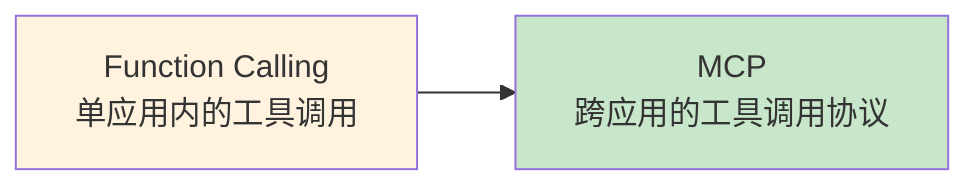

简单说：
- **Function Calling**：你在 Spring AI 里定义工具给 LLM 用，**仅限你这个应用内**
- **MCP**：把工具暴露成标准协议，**任何 AI 应用都能用**
- **本质**：MCP Server 在内部仍然是用 Function Calling 思路实现的，MCP 多了一层"标准化对外暴露"

---

#### 学习优先级建议

> [!tip] 三层都要会，但顺序有讲究
> 1. **第一周**：Function Calling（在 Spring AI 里定义工具）
> 2. **第二周**：MCP（把工具暴露给 Claude Desktop / Cursor）
> 3. **第三周**：Skills（写一个 SKILL.md，让 AI 按你的流程做事）
> 4. **持续**：AGENTS.md（给你的代码项目都加上）
> 5. **了解**：A2A（Google 推的 Agent 间通信，目前主要在 Google 生态）


### 🛠️ 低代码平台层（少写代码）

#### 主流平台对比

| 平台 | 定位 | GitHub Star | 适用场景 | 学习重点 |
| ---- | ---- | ----------- | -------- | -------- |
| **Dify** | 开源 LLM 应用平台 | 14万+ | 企业 AI 应用、自部署 | 工作流、源码二开 |
| **Coze**（扣子） | 字节出品，无代码 Bot | — | 快速搭建 Bot | 业务视角理解 Agent |
| **RAGFlow** | 深度文档理解 RAG | 8万+ | 复杂文档 RAG | RAG 进阶 |
| **n8n** | 通用自动化平台（含 AI） | 18万+ | 集成自动化 | 集成视角 |
| **FastGPT** | 国内开源 RAG 平台 | — | 中小企业 RAG | 对比 Dify |

#### 国内大模型平台

| 平台 | 厂商 | 特点 |
| ---- | ---- | ---- |
| **阿里百炼** | 阿里 | 通义系列模型 + 应用平台 |
| **火山方舟** | 字节 | 豆包系列模型 + 工程化 |
| **百度千帆** | 百度 | 文心系列 + 行业方案 |
| **腾讯混元** | 腾讯 | 混元模型 + 微信生态 |

### 📊 可观测与评估工具

| 工具 | 用途 | 开源 | 必学度 |
| ---- | ---- | ---- | ------ |
| **Langfuse** | LLM 应用 Trace + 监控 | ✅ 可自部署 | ⭐⭐⭐⭐⭐ |
| **Ragas** | RAG 评估三件套 | ✅ | ⭐⭐⭐⭐ |
| **LangSmith** | LangChain 官方 | ❌ SaaS | ⭐⭐⭐ |
| **Phoenix** | Arize 出品的 LLM 可观测 | ✅ | ⭐⭐⭐ |
| **Helicone** | LLM 网关 + 监控 | ✅ | ⭐⭐ |

#### Ragas 评估三件套（必懂）

| 指标 | 中文 | 衡量什么 |
| ---- | ---- | -------- |
| **Faithfulness** | 忠实度 | 答案是否基于检索内容（防幻觉） |
| **Answer Relevancy** | 答案相关性 | 答案是否回答了问题 |
| **Context Precision/Recall** | 上下文精度/召回率 | 检索质量好不好 |

### 🔗 AI 网关（进阶）

> [!note] 多模型统一管理
> 当你的应用要支持多个模型时，AI 网关帮你统一接口、降级、限流、审计。

| 网关 | 特点 | 必学度 |
| ---- | ---- | ------ |
| **LiteLLM** | Python 主流，支持 100+ 模型 | ⭐⭐⭐ |
| **One-API** | 国内常用，OpenAI 兼容协议 | ⭐⭐⭐ |
| **Higress AI** | 阿里出品，云原生 AI 网关 | ⭐⭐ |
| **AI Gateway**（Cloudflare） | 边缘部署 | ⭐⭐ |

---

## 第十章 推荐资源清单

### 📖 官方文档（最权威）

| 资源 | 链接 | 备注 |
| ---- | ---- | ---- |
| **Spring AI** | https://docs.spring.io/spring-ai/reference/ | Java 主线必读 |
| **LangChain4j** | https://docs.langchain4j.dev/ | Java 副线 |
| **MCP 规范** | https://modelcontextprotocol.io/ | 协议原文 |
| **Milvus** | https://milvus.io/docs | 向量库 |
| **Dify** | https://docs.dify.ai/ | 平台 |
| **OpenAI Cookbook** | https://cookbook.openai.com/ | 案例宝库 |
| **Anthropic Docs** | https://docs.anthropic.com/ | Claude + Agent 经典 |
| **LangChain Python** | https://python.langchain.com/ | 看 demo 用 |

### 🎥 视频课程

- 🎓 **DeepLearning.AI 短课程系列**（吴恩达，免费，强烈推荐）
	- ChatGPT Prompt Engineering for Developers
	- Building Systems with the ChatGPT API
	- LangChain for LLM Application Development
	- Functions, Tools and Agents with LangChain
	- AI Agents in LangGraph
	- Building Agentic RAG
- 🎓 **B 站 Spring AI / LangChain4j 实战课程**
- 🎓 **极客时间 / 拉勾教育** 大模型应用开发课

### 📚 必读经典

- **Anthropic：Building Effective Agents**（Agent 设计圣经）
- **Lilian Weng：LLM Powered Autonomous Agents**
- **Andrej Karpathy：Context Engineering / LLM Wiki 系列博客**
- 《大模型应用开发：动手做 AI Agent》
- 《LLM 应用开发实践》

### 💻 优质开源项目（看源码学）

| 项目 | 价值 | 语言 |
| ---- | ---- | ---- |
| spring-projects/spring-ai | 框架本体 | Java |
| langchain4j/langchain4j | 框架本体 | Java |
| langgenius/dify | 完整 LLM 平台 | Python + TS |
| infiniflow/ragflow | 深度 RAG 实现 | Python |
| modelcontextprotocol/servers | MCP 官方 Server 示例 | 多语言 |
| hhhuang/CAG | CAG 参考实现 | Python |
| langchain-ai/langchain | LangChain 主线（看设计） | Python |

### 🌐 社区与资讯

- **HuggingFace**：模型与数据集
- **GitHub Trending**：每周看 AI 板块
- **掘金 / InfoQ / 腾讯云 / 阿里云开发者社区**：中文实战
- **公众号**：宝玉、AI 产品经理、机器之心、量子位
- **Twitter / X**：@LangChainAI、@karpathy、@simonw

---

## 第十一章 求职准备

### 🎯 简历包装思路

> [!success] 你的差异化武器
> 绝大多数转 AI 的开发者卡在生产化环节——**并发、稳定性、监控、降级、成本控制、链路追踪**。这恰恰是你 Java 后端的看家本领。
> 
> 面试时多讲「**我怎么把 AI 应用做成生产级**」，比讲「我会调 LangChain」值钱得多。

#### 简历必备项目（建议 2~3 个）

| 项目 | 推荐技术栈 | 简历亮点 |
| ---- | ---------- | -------- |
| **企业知识库 RAG 系统** | Spring Boot 3 + Spring AI + Milvus + Langfuse | 全链路、可观测、可评估 |
| **MCP Server 工具集** | Java + Spring AI MCP | 协议先进性、工具复用 |
| **业务 Agent 系统** | Spring AI + Plan-Execute / Multi-Agent | Agent 编排能力 + 多轮 |

> [!tip] 加分项
> 如果还想做差异化项目，可以选一个：
> - **CAG 实践**（在小知识库上对比 RAG vs CAG）
> - **LLM Wiki 实践**（用 Obsidian + MCP 实现个人知识库）
> - **Agentic RAG 系统**（Agent 自主决定检索策略）

### 💬 面试高频问题（按主题）

#### Prompt 与上下文工程

- [ ] System Prompt 三段式具体怎么落？
- [ ] CoT、ReAct 的区别和适用场景
- [ ] 上下文窗口超了怎么处理？
- [ ] 怎么防 Prompt 注入？

#### 多轮对话

- [ ] 多种记忆机制对比和选型
- [ ] 长对话怎么压缩？
- [ ] 怎么做会话隔离与并发安全？
- [ ] 话题切换怎么检测和处理？

#### 知识库技术

- [ ] RAG 全链路讲一遍
- [ ] 文本切分策略选型
- [ ] Embedding 模型怎么选？
- [ ] Rerank 必要性、模型选择
- [ ] 混合检索怎么实现？
- [ ] **RAG vs CAG 怎么选？** （加分项）
- [ ] **什么场景用 LLM Wiki？** （加分项）
- [ ] RAG 怎么评估？指标含义？

#### Agent · MCP · Skills

- [ ] ReAct vs Plan-Execute vs Reflection 区别
- [ ] 什么时候用 Workflow，什么时候用 Agent？
- [ ] Function Calling 与 MCP 的区别和联系
- [ ] **Skills 与 MCP 的区别？什么场景用哪个？什么场景组合用？**
- [ ] **SKILL.md 的结构？渐进式上下文披露是什么？**
- [ ] **AGENTS.md 与 README.md 的区别？**
- [ ] MCP 协议三大原语
- [ ] Agent 怎么做错误恢复？
- [ ] 多 Agent 怎么避免无限循环？

#### 工程化

- [ ] 大模型成本怎么控制？
- [ ] LLM 应用怎么做可观测？
- [ ] 流式输出错误怎么处理？
- [ ] 模型故障的降级策略？
- [ ] AI 应用的安全风险？

### 📝 输出建设

> [!tip] 知识沉淀就是简历亮点
> - [ ] 在掘金 / CSDN / 公众号写 3~5 篇技术博客
>   - 推荐选题：RAG 全链路、CAG 实践、MCP 实战、Agent 设计模式、上下文工程、LLM Wiki 实践
> - [ ] GitHub 维护 1~2 个高质量 AI 项目（README 写好）
> - [ ] LinkedIn / 脉脉 个人简介更新 AI 关键词
> - [ ] 知乎专栏写 RAG / Agent 实战系列

### 🗓️ 求职时间表

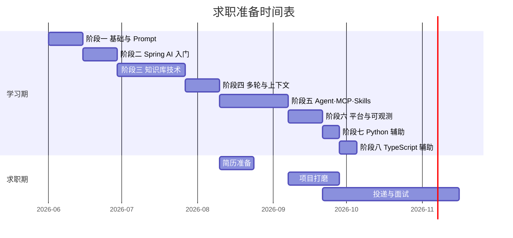

### 📌 投递策略

> [!tip] 分层投递（重点放在 Java + AI 复合岗）
> ```text
> 第一波（5~10 家）：摸盘
>   ├─ 中小公司，AI 应用岗，Java 友好
>   └─ 主要目的：感受面试套路、补漏洞
> 
> 第二波（20~30 家）：主战场
>   ├─ 传统行业 AI 转型岗（你的最大优势区）
>   │   ├─ 银行、券商、保险、运营商
>   │   └─ 大型集成商（东软、太极、华讯）
>   ├─ 互联网大厂 AI 中台 / B 端 AI 业务
>   └─ 主要目的：拿 offer
> 
> 第三波（5~10 家）：捡漏
>   ├─ 顶级岗位（智谱、月之暗面、面壁等）
>   └─ 准备到位再冲
> ```

---

## 第十二章 学习打卡

> [!todo] 当前任务
> - [ ] 阅读完本份学习路径
> - [ ] 制定本周学习计划
> - [ ] 调通第一个 LLM API
> - [ ] 创建 GitHub 项目仓库
> - [ ] 创建本地学习仓库目录结构

### 📅 周学习日志（模板）

> [!note]- 第 1 周（点击展开）
> **日期**：YYYY-MM-DD ~ YYYY-MM-DD
> **本周目标**：
> - [ ] 目标 1
> - [ ] 目标 2
> 
> **学习内容**：
> - 
> 
> **遇到的问题**：
> - 
> 
> **下周计划**：
> - 

> [!note]- 第 2 周（点击展开）
> 学习时记录本周复盘、卡点和下周动作。

> [!note]- 第 3 周（点击展开）
> 学习时记录本周复盘、卡点和下周动作。

### 📊 进度跟踪

| 阶段 | 计划周数 | 实际开始 | 实际结束 | 状态 |
| ---- | -------- | -------- | -------- | ---- |
| 阶段一 · AI 基础与 Prompt 工程 | 2 周 | | | 🔵 未开始 |
| 阶段二 · Spring AI 入门 | 2 周 | | | ⚪ 未开始 |
| 阶段三 · 知识库技术实战 | 3~4 周 | | | ⚪ 未开始 |
| 阶段四 · 多轮对话与上下文工程 | 2 周 | | | ⚪ 未开始 |
| 阶段五 · AI Agent · MCP · Skills | 3~4 周 | | | ⚪ 未开始 |
| 阶段六 · 低代码平台与可观测 | 1~2 周 | | | ⚪ 未开始 |
| 阶段七 · Python 辅助补充 | 1 周 | | | ⚪ 未开始 |
| 阶段八 · TypeScript 辅助补充 | 1 周 | | | ⚪ 未开始 |
| 阶段九 · 持续进阶 | 持续 | | | ⚪ 未开始 |

> 状态图例：🔵 进行中 / 🟢 已完成 / 🟡 部分完成 / ⚪ 未开始 / 🔴 受阻

### 🏆 里程碑勋章

> [!success]- 完成阶段一时来打卡 🥉
> 已掌握：LLM 基础概念、Prompt 工程
> 完成日期：

> [!success]- 完成阶段三时来打卡 🥈
> 已掌握：Spring AI、完整 RAG 系统
> 完成日期：

> [!success]- 完成阶段五时来打卡 🥇
> 已掌握：多轮对话、上下文工程、Agent、MCP
> 完成日期：

> [!success]- 完成阶段六时来打卡 🏆
> 已掌握：完整 AI 应用开发能力栈
> 完成日期：

> [!success]- 拿到第一个 AI 应用开发 Offer 时来打卡 🎉
> 公司：
> 岗位：
> 入职日期：

---

## 🎁 写在最后

> [!quote] 给自己的话
> 转型不是一蹴而就，但你已经踩在最好的时间点上。
> 
> Java 后端的工程化能力 × 大模型时代的应用层机会 = 真正的复利。
> 
> **学的是「能力」，不是「语言」。RAG、上下文、Agent 这些核心能力跨语言通用，掌握了能力，工具只是手段。**
> 
> **少看多写，少比多练。先跑通一个端到端项目，胜过看十本书。**

---

## 🔗 相关笔记

- [[../01-LLM基础与Prompt/_index|阶段一：AI 基础与 Prompt 工程]]
- [[../02-框架-SpringAI与LangChain4j/_index|阶段二：Spring AI 与 LangChain4j]]
- [[../03-知识库技术-RAG/_index|阶段三：知识库技术 RAG]]
- [[../04-多轮对话与上下文工程/_index|阶段四：多轮对话与上下文工程]]
- [[../05-Agent-MCP-Skills/_index|阶段五：Agent · MCP · Skills]]
- [[../06-平台与工程化/_index|阶段六：平台与工程化]]
- [[../07-辅助语言/01-Python速查-Java视角|阶段七：Python 辅助补充]]
- [[../07-辅助语言/06-TS速查-Java视角|阶段八：TypeScript 辅助补充]]
- [[../08-项目实战/03-项目-企业知识库RAG系统|项目：企业知识库 RAG 系统]]
- [[../08-项目实战/06-项目-MCP-Server工具集|项目：MCP Server 工具集]]
- [[../08-项目实战/07-项目-业务Agent系统|项目：业务 Agent 系统]]
- [[../01-LLM基础与Prompt/07-Prompt工程基础|Prompt 工程基础]]
- [[../../40-求职准备/_index|面试问题集]]
- [[../../40-求职准备/18-简历-AI方向|简历包装]]
- [[../../40-求职准备/20-投递记录|投递记录]]

---

#AI #学习路径 #Java #LLM #Agent #RAG #CAG #LLM-Wiki #MCP #上下文工程
