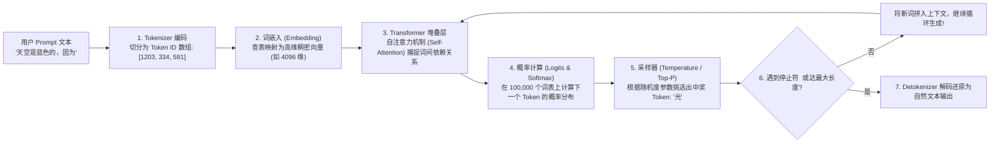
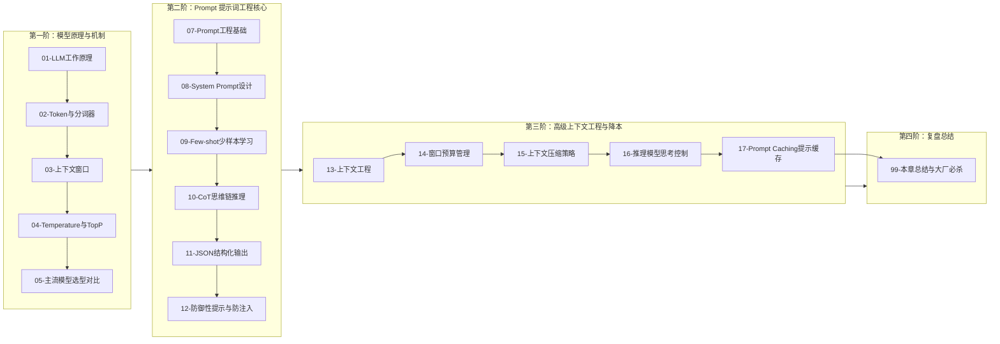

# LLM 与 Prompt 工程全景与心智模型

> [!abstract] 一句话心智模型
> 如果把大语言模型（LLM）比作一位**博览群书但没有长期实体记忆的“超级速记秘书”**：
> - **底层本质（Next Token Predictor）**：他本质上在玩一场极度高超的**“文字接龙游戏”**。他没有真正的主观意识，而是根据你给的上下文线索，在几万个词表里计算“下一个最合理的字词概率”；
> - **三阶段人生履历**：
>   1. **海量通读（预训练 Pre-training）**：读遍全网数万亿文本，学会了语言语法和人类世界常识（拥有了深厚知识底模）；
>   2. **职场集训（指令微调 SFT）**：经过数十万道标准“Q&A 问答题”训练，学会了听懂人类指令，不再随意胡乱发散；
>   3. **价值观对齐（人类反馈强化学习 RLHF / DPO）**：树立安全与道德底线，学会友善、严谨、拒绝输出有害违规内容；
> - **Prompt 工程（指挥官的精准简报）**：给秘书下达任务时，不要指望他能读心。你的指令（System Prompt）、提供的范例（Few-shot）、推理引导（CoT 一步步思考）以及输出约束（JSON 结构化），就是他在有限工作台（上下文窗口）上交付完美答卷的唯一依据！

---

## 🎯 一、LLM 运行的第一性原理流转链

在工程师眼中，一次大模型 API 调用绝不是神奇的魔法，而是一条精密无比的数学流水线：

### 必须牢记的工程师铁律：
1. **模型看不懂汉字或英文字母**：它只认数字 ID（Token ID）；
2. **生成是自回归单向流动的（Auto-regressive）**：模型每输出一个 Token，就要把这个新 Token 塞进上下文末尾，重新经历一次 Transformer 计算来预测下一个，直到撞上停止符。这就是为什么大模型 API 是**流式打字机（Streaming SSE）**输出的根本原因！

---

## 🗺️ LLM 核心概念全景对照表

| 核心术语 | 技术物理本质与定义 | 核心控制参数与工程影响 | 概念形象类比（辅助说明） |
| :--- | :--- | :--- | :--- |
| **Token** | 模型处理语言的最小离散数值化单元。基于 BPE 等分词算法切分。100 个汉字通常对应 120~160 个 Token。 | 厂商计费计量单位；上下文窗口（Context Window）物理占用的基本度量。 | 类比为模型的词根与部首片段 |
| **Embedding** | 将离散文本映射到高维连续向量空间（如 1536 维）的稠密浮点数数组。语义接近的文本在向量空间内余弦相似度高。 | RAG 密集检索、聚类分析与语义匹配的底层数学基石。 | 类比为语义高维空间几何坐标 |
| **Self-Attention** | 自注意力机制。通过 Query、Key、Value 矩阵点积与 Softmax 归一化，计算输入序列中每个 Token 与其余所有 Token 的动态关联权重。 | 解决长距离语义依赖与跨上下文指代消解。 | 类比为多对多的动态注意力关注权重网 |
| **Temperature** | 采样温度参数。在自回归预测下一个词时，用于除以 Logits 调整概率分布的平滑度。接近 0 时输出趋向贪婪确定性；调高时增加多样性。 | 结构化数据/代码生成强制设为 `0.0~0.2`；创意生成设为 `0.7~0.9`。 | 类比为控制输出发散度与随机性的调节旋钮 |
| **Top-P (核采样)** | 累积概率截断阈值（Nucleus Sampling）。按照预测概率降序累加，仅从累积概率达到 $P$（如 0.9）的最小候选集合中抽样，剔除长尾极端词。 | 过滤低概率离谱 Token，通常与 Temperature 协同调整。 | 类比为高置信度候选词动态筛选阀 |
| **Context Window** | 上下文窗口容量。单次推理前向计算中所能容纳的“历史 Prompt 输入 + 生成 Completion 输出”的最大 Token 上限。 | 超过上限将引发截断错误；需结合滑动窗口与摘要机制防范“中间迷失”。 | 类比为模型单次前向注意力的最大内存工作台 |
| **Prompt Caching** | 提示词缓存机制。针对多次请求中相同的前缀文本（如长系统提示词、知识库片段），直接复用 GPU 显存中的 KV Cache 避免重复计算。 | 降低首次生成延迟（TTFT）达 80%，节省输入成本达 50%~90%。 | 类比为预计算注意力的显存热复用机制 |

---

## 🚀 本章知识拓扑与阅读路径

### 🧭 章节通关指南
1. **原理与机制篇（01~05）**：
   - 研读 [[01-LLM工作原理]] 与 [[02-Token与Tokenizer]]：搞懂分词原理，彻底明白“为什么大模型经常做错简单的数草莓字母数量题”。
   - 研读 [[03-上下文窗口]] 与 [[04-模型参数-Temperature与TopP]]：搞清参数控制的数学边界，如何针对不同业务场景配置最优采样温度。
2. **Prompt 提示词实战篇（07~12）**：
   - 研读 [[07-Prompt工程基础]] 与 [[08-System-Prompt设计]]：掌握结构化 System Prompt 的六要素编写模板。
   - 进阶 [[09-Few-shot与Zero-shot]]、[[10-CoT思维链]] 与 [[11-结构化输出]]：学会用少样本（Few-shot）和思维链（Let's think step by step）诱导大模型输出高智商推理，并用 JSON Schema 强约束输出。
   - 筑牢 [[12-防御性提示与防注入]]：防御“忽略之前指令”的恶意越狱攻击。
3. **上下文工程与推理降本篇（13~17）**：
   - 研读 [[13-上下文工程概述]]、[[14-上下文窗口预算管理]] 与 [[15-上下文压缩策略]]：学会管理 Token 预算，用滑动窗口和递归摘要避免上下文膨胀。
   - 掌握新一代利器 [[16-推理模型与思考控制]]（DeepSeek-R1 / OpenAI o1/o3）与 [[17-Prompt-Caching提示缓存]]（长文本延迟直降 80%、成本直降 90% 的秘密）。
