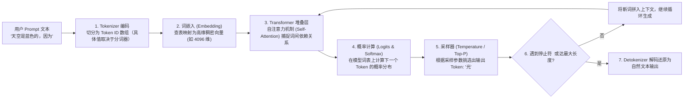
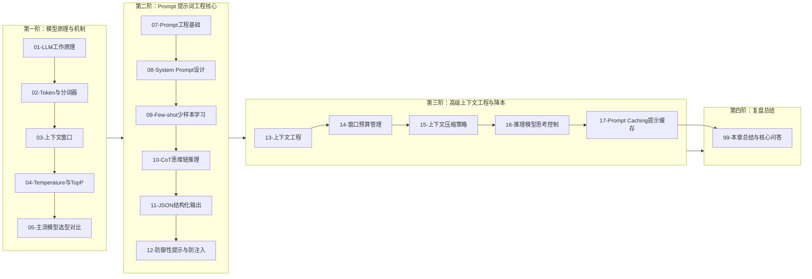

# LLM 与 Prompt 工程全景与心智模型

> [!abstract] 一句话心智模型
> 大语言模型（LLM）基于上下文分布自回归地预测下一个 Token。预训练阶段构建语言表征与广泛的知识模式，指令微调与偏好对齐进一步提升指令遵循与交互体验。
> 在工程落地中，Prompt 工程用于明确任务边界、提供上下文证据与示例并约束输出结构；应用层则通过结果校验、权限控制与上下文预算管理来保障系统的事实准确性与运行可靠性。

---

## 🎯 一、LLM 运行的第一性原理流转链

从工程视角来看，一次大模型 API 调用本质上是一条由分词、向量映射、注意力计算与概率采样组成的计算流水线：

### 核心工程认知：
1. **模型的输入与输出均为离散数值（Token ID）**：自然语言文本必须经过分词器（Tokenizer）编码为整数序列后才能进入模型运算，字符级操作与统计会受分词粒度影响。
2. **自回归生成与网络传输解耦**：主流文本生成采用逐 Token 自回归解码，并通过 KV Cache 复用已计算的上下文注意力键值以降低计算开销。网络层既可以等待完整生成后一次性返回，也可以通过 Server-Sent Events（SSE）流式推送增量内容（单个 SSE 数据帧可包含一个或多个 Token 的解码片段）。

---

## 🗺️ LLM 核心概念全景对照表

| 核心术语 | 技术物理本质与定义 | 核心控制参数与工程影响 | 典型工程应用场景与注意事项 |
| :--- | :--- | :--- | :--- |
| **Token** | 模型处理语言的最小离散数值化单元，通常基于 BPE 等子词分词算法切分。不同语言与文本类型的切分粒度取决于目标模型的分词器词表。 | 厂商 API 计费计量单位；上下文窗口（Context Window）容量的基本度量。 | 用于成本核算、限流配额与上下文预算分配；工程上需使用与目标模型匹配的 Tokenizer 实测统计。 |
| **Embedding** | 将离散文本映射到高维连续向量空间（如 1536 维）的稠密浮点数数组，语义相近的文本在向量空间中具有较高的相似度。 | 向量维度、距离度量方式（余弦相似度、内积、欧氏距离）与归一化策略。 | 用于 RAG 向量检索、文本聚类、去重与语义路由；检索与索引端必须使用同一 Embedding 模型。 |
| **Self-Attention** | 自注意力机制。通过 Query、Key、Value 矩阵点积与 Softmax 归一化，计算输入序列中各 Token 之间的动态上下文关联权重。 | 决定模型捕捉长距离语义依赖与跨段落指代消解的能力；计算与显存开销随序列长度增长。 | 支撑长文档理解、多轮对话状态追踪与代码跨文件分析；过长上下文中的无关噪声会分散注意力权重。 |
| **Temperature** | 采样温度参数。在解码阶段对 Logits 进行缩放，调节 Softmax 输出概率分布的平滑度。接近 0 时趋向贪心解码，调高时增加候选多样性。 | 平衡输出稳定性与多样性。信息抽取、代码生成通常设为低值；创意写作可适当调高。 | 调低温度可减少随机发散，但若需严格保证 JSON 格式或事实准确，仍需配合 Schema 约束与外部校验。 |
| **Top-P (核采样)** | 累积概率截断阈值（Nucleus Sampling）。按预测概率降序累加，仅保留累积概率达到阈值 $P$（如 0.9）的最小候选子集参与重归一化采样。 | 动态裁剪长尾低概率候选词，防止高温度下采样到语义偏离的异常 Token。 | 调参时建议固定 `temperature` 或 `top_p` 其中之一进行单变量实验，以便清晰归因采样效果的变化。 |
| **Context Window** | 上下文窗口容量。单次推理请求所能容纳的“输入 Prompt（含系统提示、历史、文档、工具定义）+ 模型生成输出”的最大 Token 总量。 | 超出窗口上限会导致请求报错或内容被截断；有效召回质量还会受上下文位置（如中间衰减）影响。 | 长对话与多文档问答需预先留足输出预算，并结合滑动窗口、相关性重排与摘要压缩控制输入规模。 |
| **Prompt Caching** | 提示词缓存机制。针对多次请求中一致的输入前缀，直接复用已计算的 KV Cache 等中间状态，省去重复的 Prefill 预填充计算。 | 显著降低长前缀场景下的首 Token 延迟（TTFT）与输入 Token 计费成本。 | 适用于长系统提示词、固定工具定义与多轮追加对话；工程上需将稳定内容前置，并通过响应 `usage` 验证命中率。 |

---

## 🚀 本章知识拓扑与阅读路径

### 🧭 章节通关指南
1. **原理与机制篇（01~06）**：
   - 研读 [[01-LLM工作原理]] 与 [[02-Token与Tokenizer]]：掌握自回归生成与 BPE 分词机制，理解字符计数与精确算术在子词视角下的局限性。
   - 研读 [[03-上下文窗口]]、[[04-模型参数-Temperature与TopP]]、[[05-主流模型选型对比]] 与 [[06-微调-LoRA-QLoRA-LLaMA-Factory入门]]：明确上下文容量边界、解码采样参数配置、模型多维选型与微调适用场景。
2. **Prompt 提示词实战篇（07~12）**：
   - 研读 [[07-Prompt工程基础]] 与 [[08-System-Prompt设计]]：掌握结构化提示词的六要素编写规范与系统级指令分层设计。
   - 进阶 [[09-Few-shot与Zero-shot]]、[[10-CoT思维链]] 与 [[11-结构化输出]]：运用少样本示例与分步推理改善复杂任务表现，并通过 JSON Schema 与数据校验实现强类型结构化输出。
   - 筑牢 [[12-防御性提示与防注入]]：理解指令与数据混淆的根因，构建基于代码鉴权、参数校验与人机协同的纵深防御体系。
3. **上下文工程与推理降本篇（13~17）**：
   - 研读 [[13-上下文工程概述]]、[[14-上下文窗口预算管理]] 与 [[15-上下文压缩策略]]：系统规划 Token 预算分配，利用滑动窗口与面向问题的压缩策略控制上下文规模。
   - 掌握 [[16-推理模型与思考控制]]（DeepSeek-R1 / OpenAI o 系列 / Claude Extended Thinking）与 [[17-Prompt-Caching提示缓存]]（稳定前缀设计与成本优化）。
