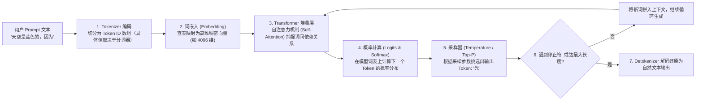
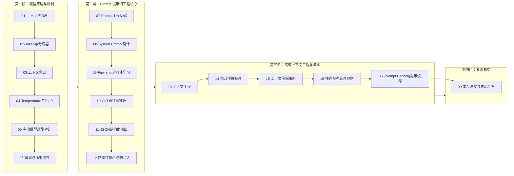

# LLM 与 Prompt 工程全景与心智模型

> [!abstract] 一句话心智模型
> 大语言模型（LLM）基于上下文分布自回归地预测下一个 Token。预训练阶段构建语言表征与广泛的知识模式，指令微调与偏好对齐进一步提升指令遵循与交互体验。
> 在工程落地中，Prompt 工程用于明确任务边界、提供上下文证据与示例并约束输出结构；应用层则通过结果校验、权限控制与上下文预算管理来保障系统的事实准确性与运行可靠性。

---

## 🎯 一、LLM 运行的第一性原理流转链

从工程视角看，一次文本生成可概括为分词、模型计算与逐步生成。图中的示例 Token 和维度仅用于说明，不代表实际模型输出：

### 核心工程认知：

1. **模型的输入与输出均为离散数值（Token ID）**：自然语言文本必须经过分词器（Tokenizer）编码为整数序列后才能进入模型运算，字符级操作与统计会受分词粒度影响。
2. **自回归生成**：模型逐步选择 Token，KV Cache 可复用已计算的上下文，减少重复计算。
3. **网络传输**：可以等生成完成后一次性返回，也可以通过 SSE 推送增量内容；一次推送不一定对应一个 Token。

---

## 🗺️ LLM 核心概念全景对照表

| 术语 | 含义 | 使用时注意 |
| :--- | :--- | :--- |
| **Token** | 分词器把文本转换为模型使用的 Token ID。 | 不同分词器的数量不同，预算与成本应按目标模型统计。 |
| **Embedding** | 将文本转换成向量，用于相似度检索等任务。 | 文档与问题需使用兼容的编码方式；距离度量与前缀要求随模型而异。 |
| **Self-Attention** | 通过 Query、Key、Value 计算输入中各部分之间的关联。 | 长上下文的效果与计算成本需要结合模型和任务评估。 |
| **Temperature** | 调整采样概率分布，影响输出的随机性。 | 低温不保证结果准确，仍要校验事实与格式。 |
| **Top-P** | 保留累计概率达到阈值的候选 Token，再从中采样。 | 调参时可先固定一个参数，再观察另一个参数的效果。 |
| **Context Window** | 模型单次请求可处理上下文的容量。 | 按模型限制规划输入和输出预算，避免超限。 |
| **Prompt Caching** | 服务支持时复用相同输入前缀的部分计算。 | 保持可复用内容稳定，通过用量数据检查命中情况。 |

---

## 🚀 本章知识拓扑与阅读路径

### 🧭 章节通关指南

1. **原理与选型**：
   - [[01-LLM工作原理]]、[[02-Token与Tokenizer]]：生成与分词。
   - [[03-上下文窗口]]、[[04-模型参数-Temperature与TopP]]：上下文与采样。
   - [[05-主流模型选型对比]]、[[06-微调-LoRA-QLoRA-LLaMA-Factory入门]]：模型选择与微调边界。
2. **Prompt 工程**：
   - [[07-Prompt工程基础]]、[[08-System-Prompt设计]]：提示词与系统指令。
   - [[09-Few-shot与Zero-shot]]、[[10-CoT思维链]]、[[11-结构化输出]]：示例、分步提示与输出校验。
   - [[12-防御性提示与防注入]]：区分指令和数据，并在代码层控制权限。
3. **上下文与推理**：
   - [[13-上下文工程概述]]、[[14-上下文窗口预算管理]]、[[15-上下文压缩策略]]：选择和压缩上下文。
   - [[16-推理模型与思考控制]]、[[17-Prompt-Caching提示缓存]]：推理投入与前缀缓存。
