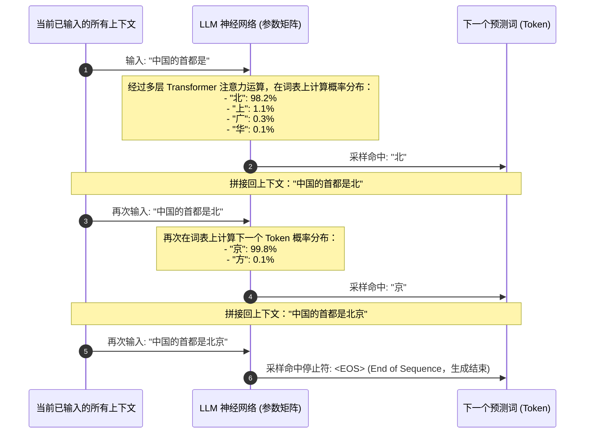
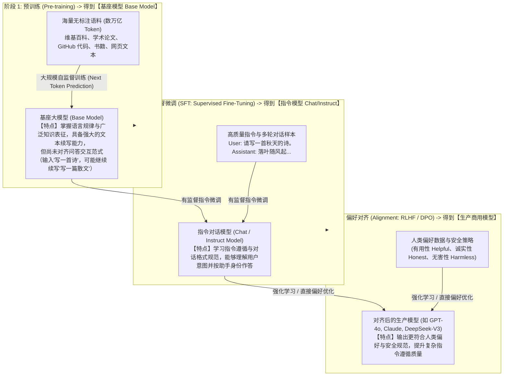
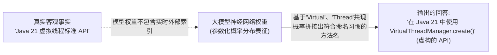

# LLM 工作原理：从自回归解码到指令对齐

> [!abstract] 一句话心智模型
> 主流大语言模型采用自回归机制，基于上下文条件概率逐步预测下一个 Token。预训练阶段从海量语料中学习语言结构与广泛的知识表征，后训练阶段（SFT 与偏好对齐）则赋予模型遵循人类指令与对话交互的能力。由于模型本质上是基于统计分布生成文本，高概率输出并不直接等同于客观事实，工程上需结合外部检索与校验机制保障准确性。

---

## 🎲 一、LLM 的底层第一性原理：自回归解码（Autoregressive Decoding）

当你向大模型发送一句提示词：“中国的首都是”：

### 核心工作机制：
1. **单向自回归生成（Auto-Regressive）**：标准解码过程按时间步逐个生成 Token，并利用 KV Cache 缓存已计算的注意力键值，避免每一步对历史序列重复进行前向计算（在投机解码 Speculative Decoding 等推理优化下，也可由轻量模型草拟多个候选 Token 再由主模型并行验证）。在接口层面，服务端既可以在生成完毕后一次性返回完整文本，也可以通过 SSE 流式推送增量片段。
2. **概率采样的随机性（Non-deterministic）**：当采样参数（如 `temperature > 0`）引入随机采样时，解码器不再固定选取概率排名第一的 Token，而是按概率分布从候选集合中抽样。由于当前采样出的 Token 会追加到上下文并改变后续所有步骤的条件概率分布，相同的输入在多次调用时可能产生不同的回答路径。

---

## 🏫 二、现代大模型的三阶段训练流水线

为什么开源基座模型直接输入“你好”时可能只是继续续写文本，而对话模型却能按助手身份礼貌回应？这源于现代大模型标准的三阶段训练演进：

---

## 🧠 三、深度剖析：为什么大模型会出现“幻觉（Hallucination）”？

在开发 AI 应用时，常见的生产风险是模型生成看似合理但与事实不符的内容（例如编造不存在的 Java API 方法或虚构论文引用）。

### 幻觉的底层成因：
1. **统计生成机制与事实核验的差异**：预训练的核心目标是最大化上下文条件下的语言序列似然度，后训练则侧重人类偏好与任务奖励。模型在解码时优先保证语义连贯与模式匹配，内部缺乏独立的实时事实检索与逻辑真值校验机制。
2. **参数化知识的有损压缩**：海量训练语料被编码进固定规模的神经网络浮点数权重中，高频共现模式得以保留，而长尾细节、精确数值与冷门事实容易在泛化过程中发生混淆。
3. **迎合倾向（Sycophancy）**：在指令微调与偏好对齐阶段，如果训练数据倾向于奖励看似完整、详尽的回答，模型在面对超出自身知识边界或前提有误的提问时，往往会顺应用户预设去构造表面自洽的回答，而非主动声明未知。

### 工业级治理幻觉的四道防线：
1. **RAG（检索增强生成）**：在调用模型前，先从可信知识库或业务数据库中检索权威证据注入上下文，并通过提示词约束模型严格基于给定资料作答、对缺失信息明确说明未知。
2. **合理配置低采样温度**：在事实问答与信息抽取场景下调低 `temperature`，收敛输出分布以减少因随机采样带来的长尾发散（但需注意，若模型本身对某知识存在认知偏差，低温下仍会稳定输出该错误，因此需配合外部证据使用）。
3. **证据溯源与程序化核验**：要求模型输出结论时附带原文引用 ID，并在应用层通过确定性代码、规则引擎或单元测试对关键结构与业务结论进行校验。
4. **Tool / Function Calling（工具调用）**：涉及精确数值计算、实时状态查询或外部系统交互时，通过工具调用交由计算器、SQL 引擎或业务 API 执行，避免依赖模型的参数记忆。

---

## ⚡ 一分钟面试必杀卡

> [!NOTE] 面试高频问题标准答题套路
> 
> **Q1：为什么说大语言模型的本质是“预测下一个 Token（Next Token Prediction）”？**
> - **A**：
>   - 主流生成式大模型（如 GPT、Claude、DeepSeek 等）底层均采用自回归 Transformer 架构。
>   - 在推理解码时，模型将当前上下文编码为隐层状态，通过多层自注意力机制计算词表中各候选 Token 的条件概率分布；采样选定一个 Token 后，将其追加到输入序列末尾，循环执行下一步预测直至遇到停止符。
>   - 代码生成、逻辑推理与多语言翻译等复杂任务表现，本质上都是在海量语料上优化序列条件概率分布并结合后训练对齐所涌现出的高阶表征能力。
> 
> **Q2：基座模型（Base Model）和对话模型（Chat/Instruct Model）有什么核心区别？**
> - **A**：
>   - **基座模型（Base Model）** 仅完成了海量无标注语料的自监督预训练，具备广泛的语言规律与世界知识表征，但尚未学习问答交互格式；输入一个问题时，它往往会顺着语境继续续写更多问题或网页片段。
>   - **对话模型（Chat/Instruct Model）** 在基座模型之上经历了监督微调（SFT）与偏好对齐（RLHF/DPO），从而能够识别指令结构、遵循格式约束并以助手角色进行多轮交互，是应用开发与 API 调用的常用形态。
