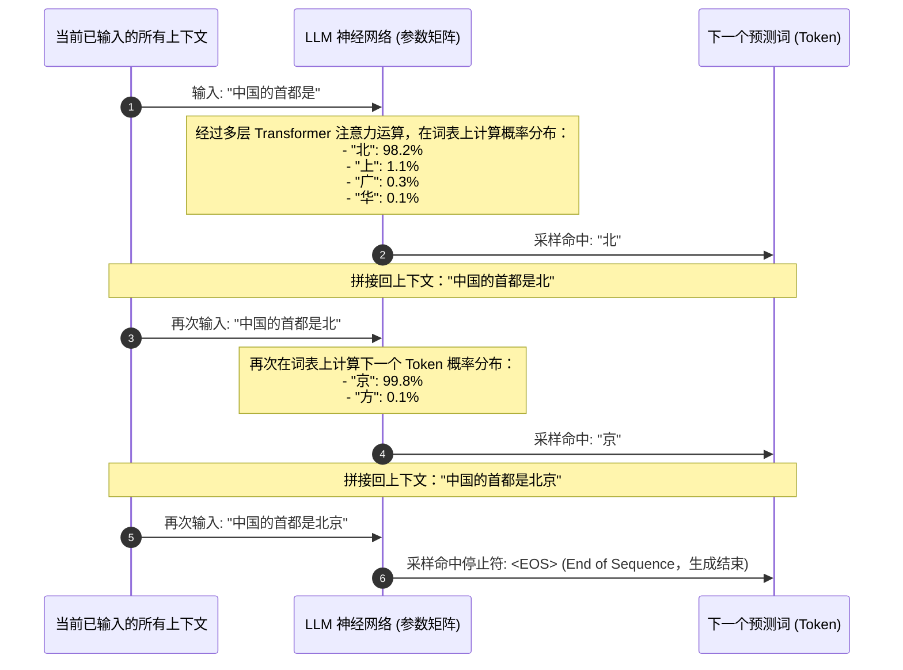
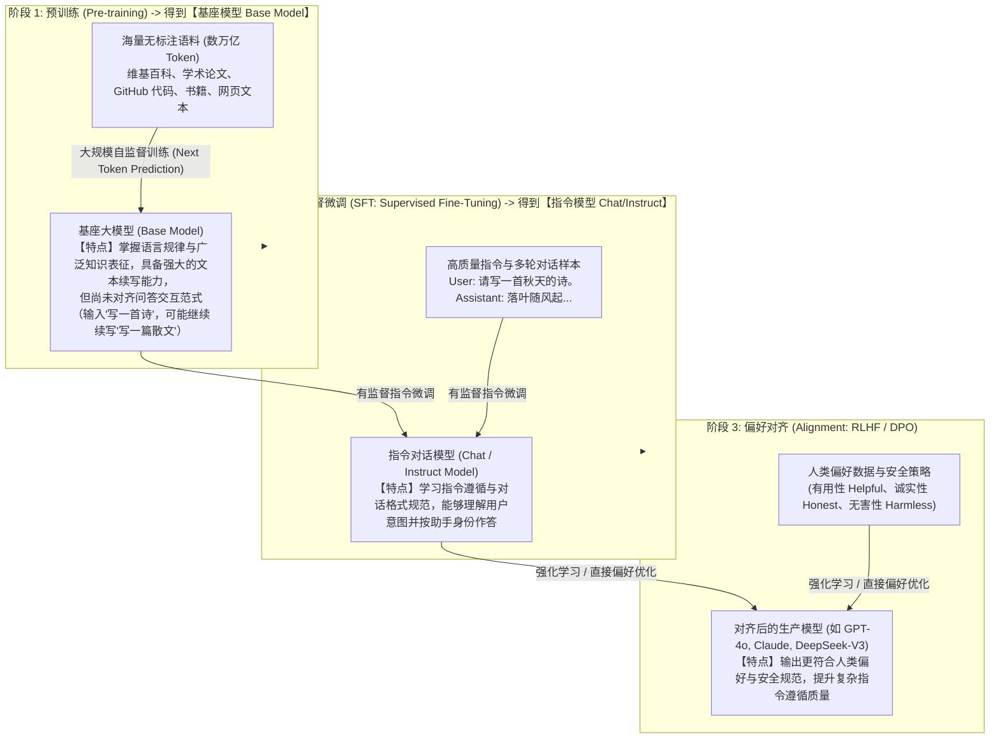
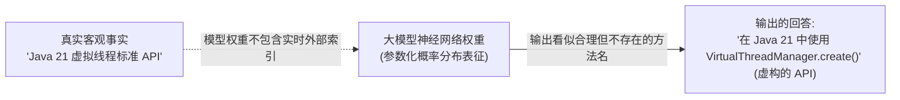

# LLM 工作原理：从自回归解码到指令对齐

> [!abstract] 一句话心智模型
> 主流大语言模型采用自回归机制，基于上下文条件概率逐步预测下一个 Token。预训练阶段从海量语料中学习语言结构与广泛的知识表征，后训练阶段（SFT 与偏好对齐）则赋予模型遵循人类指令与对话交互的能力。由于模型本质上是基于统计分布生成文本，高概率输出并不直接等同于客观事实，工程上需结合外部检索与校验机制保障准确性。

---

## 🎲 一、LLM 的底层第一性原理：自回归解码（Autoregressive Decoding）

当你向大模型发送一句提示词：“中国的首都是”。下图的 Token 切分和概率均为人为构造，仅用于说明生成过程，不代表真实模型测量值：

### 核心工作机制：

1. **自回归生成**：每次选出一个 Token 并加入上下文，再预测下一个。KV Cache 可以复用已计算的键值；投机解码等优化也可以先草拟多个候选 Token 再进行验证。
2. **概率采样**：使用随机采样时，模型按候选 Token 的概率分布选择，而不总是选概率最高的一个。每次选择都会影响后续上下文，因此相同输入可能产生不同回答。
3. **返回方式**：服务可以等生成结束后一次性返回，也可以通过 SSE 流式推送增量内容；一次推送不一定恰好对应一个 Token。

---

## 🏫 二、大模型的常见训练阶段

基座模型收到提示后可能主要续写文本，对话模型则经过进一步训练，更擅长遵循指令。下面是常见阶段，实际训练顺序和方法因模型而异：

---

## 🧠 三、深度剖析：为什么大模型会出现“幻觉（Hallucination）”？

在开发 AI 应用时，常见的生产风险是模型生成看似合理但与事实不符的内容（例如编造不存在的 Java API 方法或虚构论文引用）。

### 幻觉的底层成因：

1. **生成目标**：语言生成关注上下文中什么回答更合适，并不等于对每个事实做了独立核验。
2. **知识不完整**：模型参数无法保证保留所有细节，冷门事实、精确数值或已经变化的信息都可能出错。
3. **迎合倾向**：面对错误前提或超出知识范围的问题，模型可能顺着提问给出看似合理的回答，而没有指出不确定性。

### 工业级治理幻觉的四道防线：

1. **RAG**：检索相关资料，要求回答基于资料并标明来源；资料不足时应说明。
2. **采样温度**：较低的 `temperature` 可以减少输出随机性，但不能保证事实正确。
3. **结果核验**：检查引用是否支持结论，并用程序或业务规则验证关键字段。
4. **工具调用**：精确计算、实时查询和业务操作交给计算器、数据库或业务 API，并校验工具参数。

---

## ⚡ 一分钟面试必杀卡

注重工作原理时，应区分下一 Token 预测、预训练和后训练的作用。

> [!question]- 为什么说生成式语言模型通过预测下一个 Token 输出内容？
> 自回归模型根据已有上下文计算下一个 Token 的概率分布，选择一个 Token 并追加到上下文，然后重复这一过程，直到停止。训练目标和后训练方式共同影响它的表现。

> [!question]- 基座模型和对话模型有什么区别？
> 基座模型主要通过预训练学习续写；对话模型通常在基座模型上继续进行指令微调及其他后训练，以提升遵循指令和交互能力。具体训练流程因模型而异。
