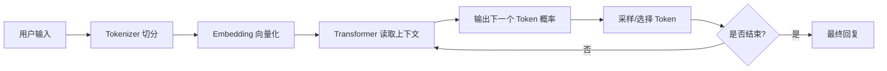

# LLM工作原理

> [!abstract] 一句话总结
> LLM 是基于 Transformer 的概率生成模型：把输入切成 Token，读入上下文，预测下一个 Token，并通过预训练、指令微调和对齐让这种预测表现为问答、推理、写作和代码能力。

## 📌 这是什么

LLM（Large Language Model，大语言模型）不是数据库，也不是规则引擎。它的核心动作是：根据当前上下文，计算“下一个 Token 可能是什么”的概率分布，然后逐个生成 Token，直到遇到停止条件。

工程上可以把一次 LLM 调用拆成：

```text
文本输入 -> Tokenizer -> Token IDs -> Embedding -> Transformer -> Logits -> 采样/解码 -> 文本输出
```

## 🤔 解决什么问题 / 为什么需要

传统 NLP 通常一个任务训练一个模型，例如分类、翻译、抽取分别做。LLM 用一个通用模型承接大量语言、代码、多模态任务，再通过 Prompt、RAG、工具调用和 Agent 编排适配业务。

| 传统 NLP   | LLM                    |
| -------- | ---------------------- |
| 任务专用模型   | 通用基础模型                 |
| 依赖大量标注数据 | 可通过 Prompt/Few-shot 迁移 |
| 输出形式固定   | 可输出文本、代码、JSON、计划       |
| 能力割裂     | 统一到同一个模型接口             |

## 🧩 核心概念

| 概念 | 含义 | 备注 |
| ---- | ---- | ---- |
| Token | 模型处理文本的基本单位 | 不等于字或词 |
| Embedding | Token 的向量表示 | 把离散文本映射到连续空间 |
| Attention | 计算上下文中不同位置的重要性 | Transformer 的核心 |
| Transformer | 多层注意力和前馈网络组成的架构 | 当前主流 LLM 基础 |
| Logits | 下一个 Token 的原始分数 | 采样前转为概率 |
| Decoding | 从概率分布生成文本的策略 | 受 temperature/top_p 影响 |
| Alignment | 让模型更符合人类偏好和安全要求 | SFT、RLHF、DPO 等 |

## ⚙️ 工作原理 / 流程



1. **预训练**：用大规模语料做“预测下一个 Token”，模型学语言、常识、代码和世界模式。
2. **指令微调**：用问答、任务指令、工具调用样例，让模型学会按指令工作。
3. **对齐训练**：用人类偏好或规则反馈，让输出更有帮助、更安全。
4. **推理生成**：输入 Prompt 后，模型循环预测 Token，直到停止。

## 💻 代码实践

```java
String answer = chatClient.prompt()
    .system("你是严谨的 Java 后端导师。")
    .user("用三句话解释 Transformer 的 Attention。")
    .call()
    .content();
```

工程上不要把 LLM 当确定性函数。同一输入可能因为模型版本、采样参数、上下文顺序、工具结果不同而变化，所以要设计评估集、日志、trace 和失败兜底。

## ⚠️ 踩坑与注意事项

- [ ] **把 LLM 当搜索引擎**：模型参数里没有实时事实，实时数据要接搜索、RAG 或数据库。
- [ ] **忽略 Token 成本**：输入、输出、历史消息、工具结果都占 Token。
- [ ] **迷信“会推理”**：LLM 擅长模式补全，复杂任务仍需要拆解、验证和工具。
- [ ] **没有评估集**：Prompt 或模型改动必须用固定样例回归。

## 🎯 面试问题

> [!question] 高频问题
> - Q: 为什么说 LLM 是“预测下一个 Token”？
>   - A: 生成时模型基于已有上下文输出下一个 Token 的概率分布，选出一个 Token 后再继续预测。
> - Q: Transformer 的核心优势是什么？
>   - A: Self-Attention 让每个位置直接关注其他位置，比 RNN 更易并行，也更适合长距离依赖。
> - Q: 预训练、SFT、RLHF 分别解决什么？
>   - A: 预训练学通用语言规律；SFT 学会按指令做任务；RLHF/偏好优化让输出更符合人类偏好。

## 🔗 关联笔记

- [[02-Token与Tokenizer]]
- [[03-上下文窗口]]
- [[04-模型参数-Temperature与TopP]]
- [[07-Prompt工程基础]]
- [[_index]]

## 📚 参考资料

- [Attention Is All You Need - arXiv](https://arxiv.org/abs/1706.03762)
- [OpenAI API Models](https://platform.openai.com/docs/models)
- [Claude Models Overview](https://docs.anthropic.com/en/docs/about-claude/models/overview)

