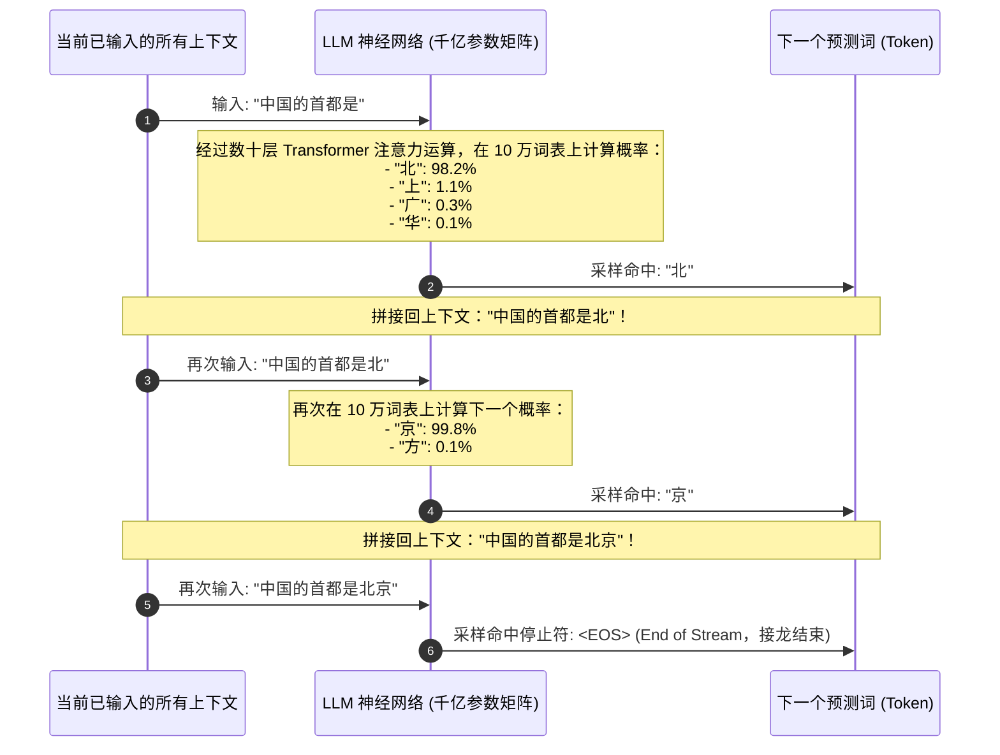
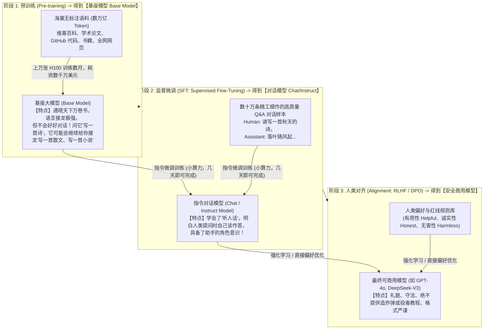
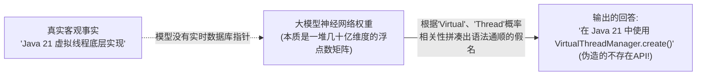

# LLM 工作原理：从概率接龙到通用智能

> [!abstract] 一句话心智模型
> 大语言模型（LLM）不是通晓一切的神仙，也不是精确检索的数据库，而是一台**宇宙级的超级文字接龙游戏机（Next Token Predictor）**：
> - **底层第一定律**：给定前面的所有上文，计算并押注“下一个 Token 最可能出现的概率分布”；
> - **为什么接龙能接出“人类智能”（涌现 Emergence）？** 因为人类语言是思维的最高结晶，想要在万亿语料库中把每一个接龙词猜得毫无破绽，神经网络内部必须被迫学会语法、常识、代码逻辑甚至世界运行的物理规律——**“极致的数据压缩，逼出了逻辑智能”**！
> - **大模型为什么会“一本正经地胡说八道（幻觉）”？** 因为它的目标是**“概率上听起来最顺口”**，而不是**“客观事实是否绝对真实”**！

---

## 🎲 一、LLM 的底层第一性原理：自回归接龙

当你向 ChatGPT 或 Claude 发送一句提示词：“中国的首都是”：

### 必须厘清的核心技术真相：
1. **单向自回归（Auto-Regressive）**：模型**绝对无法一次性“生成一整篇文章”**。它是吐出一个词，拼回输入，再算下一个词，周而复始。这就是为什么大模型 API 天然是流式传输（Streaming Server-Sent Events）的物理本质！
2. **非确定性（Non-deterministic）**：即使输入一模一样，如果采样参数（Temperature > 0）允许给概率排第二、第三的词机会，每次接龙走出的路线就完全不同，生成千姿百态的回答。

---

## 🏫 二、一个合格大模型的“三大养成阶段”

很多初学者问：“为什么开源大模型只要输入‘你好’，它就能有礼貌地问‘请问有什么我可以帮您’，而不是顺着‘你好’继续背诵‘你好李焕英...’？”
这归功于现代大模型严密的三阶段训练流水线：

---

## 🧠 三、深度揭秘：为什么大模型会出现“幻觉（Hallucination）”？

在开发 AI 应用时，最常遭遇的生产事故就是大模型**“一本正经地胡说八道”**（例如捏造不存在的 Java API 方法、编造虚假的学术论文作者）。

### 幻觉的第一性原理根因：
1. **模型内部没有逻辑事实判定器**：大模型的底层损失函数只有一条——**“预测下一个 Token 的交叉熵损失最小”**。对模型而言，它只要生成一个**在语法、语感、专业术语上看起来天衣无缝的词**就算圆满完成任务！
2. **世界知识被有损压缩**：几万亿的文字被硬生生压缩进几十 G 的权重参数里，必然丢失大量冷门、生僻或严谨细节。
3. **过度谄媚（Sycophancy）**：模型被微调得极其“热心肠”，即使对于它完全不知道的事物，它也极力倾向于顺应你的提问去编造一个自洽的故事，而不是坦白说“我不知道”。

### 工业级治理幻觉的四大防线：
1. **RAG（检索增强生成，最有效手段）**：在提问前，先从企业向量数据库中精准捞出真凭实据，强制塞入上下文：“必须严格根据以下资料回答，若资料中没有，回答不知道”；
2. **降低采样温度（Temperature = 0）**：杜绝低概率发散词，只让模型输出最确信的最高概率词；
3. **思维链强制核验（CoT）**：让模型在给出最终结论前，先逐步输出推理步骤或引用依据；
4. **Tool/Function Calling（工具调用）**：涉及精确算术、汇率查询、实时数据库时，强制模型调用外部 Python 脚本或 SQL 查询，绝不依赖自身记忆。

---

## ⚡ 一分钟面试必杀卡

> [!NOTE] 面试高频问题标准答题套路
> 
> **Q1：为什么说大语言模型的本质是“预测下一个 Token（Next Token Prediction）”？**
> - **A**：
>   - 无论是 GPT、Claude 还是 DeepSeek，其底层均采用自回归 Transformer 架构。
>   - 在推理生成时，模型将当前输入的所有上下文作为特征向量输入，通过多层自注意力机制计算出词表中每一个候选 Token 成为下一个词的概率分布，采样挑出一个词后，追加到输入序列中，不断循环推进。
>   - 所谓的“代码编写、逻辑推理、多语言翻译”，全部是海量神经网络参数在解决“让下一个词预测最合理”时涌现出来的伴生高维能力。
> 
> **Q2：基座模型（Base Model）和对话模型（Chat/Instruct Model）有什么核心区别？**
> - **A**：
>   - **基座模型（Base Model）** 只经历了海量语料的“预训练”阶段，它具备极强的世界知识和文字接龙能力，但**没有建立与人类对话交互的规范**，问它一个问题，它通常只会继续罗列类似的问题。
>   - **对话模型（Chat Model）** 在基座模型之上，经过了数十万条高质量人类对话问答的**“监督微调（SFT）”**与**“偏好对齐（RLHF/DPO）”**，因此能够明确理解人类的指令意图，扮演专业助手角色，并恪守安全道德红线。
