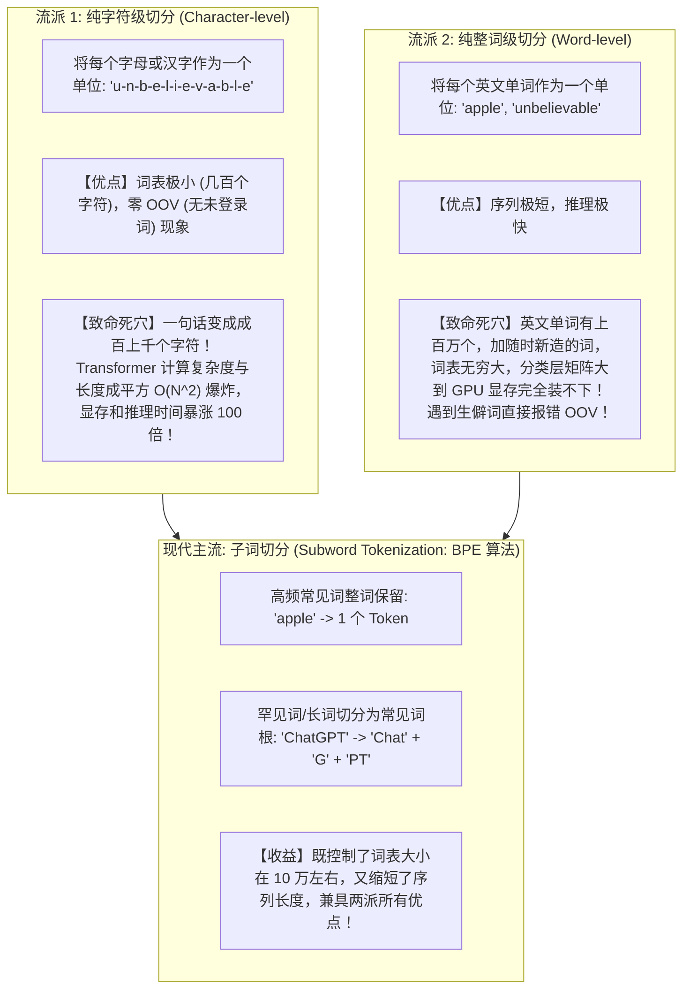

# Token 与 Tokenizer：大模型的母语密码本

> [!abstract] 一句话心智模型
> 如果大语言模型是一个外星智慧体，它既不认识英文字母，也不认识方块汉字：
> - **Tokenizer（分词器）** 就是**外星智慧体的随身同声传译密码本**。它把人类滔滔不绝的语言切碎成一块块积木（Token），每块积木对应一个唯一的数字编号（Token ID）；
> - **为什么模型数不清“strawberry 里有几个 r”？为什么早期大模型做加减法经常算错？** 秘密全在分词器上！因为模型看到的是被拼好的积木块，根本看不到底层的单个字母或对齐的数字！
> - **商业计费与容量的第一指标**：API 计费按百万 Token 结算，上下文窗口按 Token 额度计量，理解 Token 是做好 AI 成本控制与窗口预算的绝对基石。

---

## 🧩 一、为什么需要 Token？两大极端派系的工程妥协

在自然语言处理史上，曾有两个走极端的流派：



---

## 🔠 二、BPE（Byte Pair Encoding，字节对编码）底层算法推导

主流大模型（GPT-4、Claude、DeepSeek、Llama）最常用的分词算法是 **BPE（字节对编码）**。

### BPE 是如何一步步训练出词表的？
1. **初始化**：将语料库中的所有单词拆散为最细粒度的单个字符（甚至单个字节 Byte），建立初始基础词表；
2. **频次统计**：扫描全网语料，统计**哪两个相邻的片段一起出现的频率最高**；
3. **合并新词**：将最高频的一对片段合并成一个全新的词条加入词表；
4. **循环往复**：不断统计并合并（如 `t` + `h` -> `th`，`th` + `e` -> `the`），直到词表大小达到预设上限（如 **100,000** 个）。

```text
原始训练语料： "low", "lower", "newest", "widest"

初始状态（切成字符）：
l o w : 5 次
l o w e r : 2 次
n e w e s t : 6 次
w i d e s t : 3 次

第 1 轮统计：发现 's' 和 't' 相邻出现了 6 + 3 = 9 次（最高！）
-> 将 'st' 合并为一个新 Token！

第 2 轮统计：发现 'e' 和 'st' 相邻出现了 6 + 3 = 9 次
-> 将 'est' 合并为一个新 Token！

第 3 轮统计：发现 'l' 和 'o' 相邻出现了 5 + 2 = 7 次
-> 将 'lo' 合并为一个新 Token！
...
高频词逐渐演化为一个独立的整词，低频词保留为词根！
```

---

## 🍓 三、经典大模型世纪谜题的技术真相

### 谜题 1：为什么大模型数不清“strawberry 里面有几个 r”？
- **人类直觉**：`s-t-r-a-w-b-e-r-r-y`，眼睛扫一遍，明明白白有 3 个 `r`。为什么问 GPT-4o 它经常信誓旦旦回答有 2 个？
- **第一性原理真相**：
  - 打开 OpenAI 的官方 Tokenizer 工具测试，`strawberry` 在 GPT 的词表中被**直接切成了三个独立的 Token**：
    $$\text{"strawberry"} \longrightarrow \mathbf{["str",\ "aw",\ "berry"]}$$
  - 映射为数字 ID 可能是：`[496, 675, 12891]`。
  - **大模型从始至终根本没有看到字符 's'、't'、'r'！在它的脑海深处，它只收到了三个抽象的数字编号！**
  - 让模型数几个 'r'，相当于拿三个打包密封的集装箱问码头工人：“这三个箱子里分别有几颗特定零件？” 模型只能依靠统计概率去瞎猜，自然频频翻车！

---

### 谜题 2：为什么早期大模型做多位数算术经常算错？
- 早期模型的 Tokenizer 没有对数字做针对性优化，`123456` 可能被切成 `["12", "345", "6"]`，而另一个数 `9876` 被切成 `["98", "76"]`。
- 在做加法对齐和进位时，不同长度的数字积木混在一起，导致空间位置对应关系完全乱套！
- **新一代推理模型（如 DeepSeek-R1、o1）的改良**：
  - 分词器强制规则：**所有阿拉伯数字一律单字符硬切！**
  - `123456` 必须严格切成：`["1", "2", "3", "4", "5", "6"]`！
  - 每一个数字对应独立的 Token，数位进位对齐逻辑清晰明了，数学推理与算术准确率瞬间质的飞跃！

---

### 谜题 3：为什么中英文的 Token 计费差异这么大？
- 在早期的 GPT-3 / GPT-3.5 时代，词表主要是为英语设计的（约 5 万词表，中文词条极少）。
- 导致一个汉字在 UTF-8 编码下占 3 个字节，分词器无法识别整词，甚至把一个汉字强行拆成了 **2 到 3 个 Token**！
  - 同样的 1000 字内容，英文只要 **750 个 Token**，而中文要吃掉整整 **2000 个 Token**！国内企业调用 OpenAI 成本无形中暴涨了将近 3 倍！
- **现代国产大模型（DeepSeek、Qwen、GLM）的逆袭**：
  - 词表直接扩充到 **10 万 ~ 15 万**；
  - 专门收录了海量的常用汉字、成语和中文专业词汇（如“人工智能”、“机器学习”直接作为一个完整 Token）；
  - 现代模型中，**1 个汉字通常仅占 0.6 ~ 0.8 个 Token**，中文生成速度更快、API 计费大幅降低！

---

## 💻 四、企业工程落地：精确计算与预算预估

在 Java 开发中，绝对不能粗暴地拿 `String.length()` 字符长度去估算大模型开销。

### 使用官方算法精确计算（以 OpenAI jtokkit 为例）：
```xml
<dependency>
    <groupId>com.knaddison</groupId>
    <artifactId>jtokkit</artifactId>
    <version>1.1.0</version>
</dependency>
```

```java
import com.knaddison.jtokkit.Encodings;
import com.knaddison.jtokkit.api.Encoding;
import com.knaddison.jtokkit.api.EncodingRegistry;
import com.knaddison.jtokkit.api.EncodingType;

public class TokenDemo {
    public static void main(String[] args) {
        EncodingRegistry registry = Encodings.newDefaultEncodingRegistry();
        // 获取 GPT-4o / GPT-4 的分词规则 cl100k_base / o200k_base
        Encoding enc = registry.getEncoding(EncodingType.CL100K_BASE);

        String prompt = "分布式锁的核心是看门狗自动续期机制。";
        // 编码为 Token ID 数组
        int[] tokenIds = enc.encode(prompt).toArray();
        
        System.out.println("字符长度: " + prompt.length());        // 20 个字符
        System.out.println("Token 数量: " + tokenIds.length);    // 约 14 个 Token
    }
}
```

---

## ⚡ 一分钟面试必杀卡

> [!NOTE] 面试高频问题标准答题套路
> 
> **Q1：什么是 BPE（Byte Pair Encoding）算法？大模型为什么广泛使用它？**
> - **A**：
>   - BPE（字节对编码）是一种子词分词算法。它从最细粒度的单字符/单字节出发，通过在海量语料库中不断统计并合并出现频次最高的相邻字节对，动态迭代构建出固定大小（通常 5 万到 15 万）的词表。
>   - 它在“纯字符级”（序列过长导致计算复杂度爆炸）和“纯单词级”（词表过大且无法处理生僻词 OOV）之间达成了完美平衡：既能让常见词保持单个 Token 实现极速推理，又能把罕见词拆成常见子词根优雅表达，避免了词表失控。
> 
> **Q2：为什么大模型在处理数字计算、字母计数时容易犯低级错误？如何解决？**
> - **A**：
>   - 根本原因在于 **Tokenizer（分词器）的切分粒度屏蔽了字符细节**。例如英文单词会被切成子词根，模型输入层接收到的是抽象的 Token ID，无法直接感知底层的单个字符；多位数字若被随机切分成不同位数的块，也会打乱数学运算的进位对齐逻辑。
>   - **解决方案**：现代分词器通过预分词规则强制将每个阿拉伯数字独立拆分成单个 Token；或者在应用层通过思维链（CoT）引导模型先拼写展开（如让模型先把单词拆成单个字母再数），或直接引入外部 Tool/Code Interpreter 执行精确计算。
