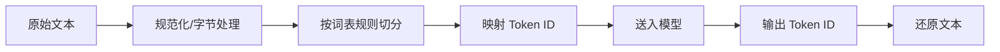

# Token与Tokenizer

> [!abstract] 一句话总结
> Token 是 LLM 读写文本的计量单位，Tokenizer 负责把人类文本切成 Token；理解它直接影响成本、上下文长度、截断策略和多语言效果。

## 🎯 本节定位

- **本章第 2 课，承接 [[01-LLM工作原理]]**。Token 是成本与容量的计量单位：窗口预算管理（[[14-上下文窗口预算管理]]）、压缩策略（[[15-上下文压缩策略]]）、结构化输出（[[11-结构化输出]]）都建立在这一课之上。

## 📌 这是什么

模型不是按“字数”或“字符数”工作，而是按 Token 工作。Tokenizer 会把文本拆成模型词表中的片段，再映射成数字 ID。英文常见词可能是一个 Token，中文一个字可能是一个 Token，代码里的符号、缩进、变量名也会被拆成多个 Token。

## 🤔 解决什么问题 / 为什么需要

Token 是 LLM API 的核心计费和容量单位。你要估算一次调用能放多少历史消息、RAG 文档、工具结果，必须先知道 Token 数量。

| 场景 | Token 影响 |
| ---- | ---- |
| 成本估算 | 输入/输出通常按百万 Token 计费 |
| 上下文窗口 | 超过窗口会报错或被截断 |
| 延迟 | Token 越多，推理越慢 |
| 多语言 | 中文、日文、代码的切分效率不同 |

## 🧩 核心概念

| 概念            | 含义                        | 备注             |
| ------------- | ------------------------- | -------------- |
| Token         | 模型处理的最小文本片段               | 不等于单词或字符       |
| Tokenizer     | 文本与 Token ID 的转换器         | 不同模型可能不同       |
| Encoding      | Tokenizer 使用的词表和规则        | 如 BPE 变体       |
| BPE           | Byte Pair Encoding，常见子词算法 | 合并高频片段减少词表压力   |
| Token ID      | Token 在词表里的整数编号           | 模型实际接收的是 ID 序列 |
| Special Token | 特殊控制 Token                | 表示消息边界、结束符等    |

## ⚙️ 工作原理 / 流程



Tokenizer 的目标不是让人读起来自然，而是让模型用有限词表高效表示文本。高频片段会成为短 Token，罕见词、拼写错误、长变量名、Base64、表格和 JSON 可能被切得很碎。

## 💻 代码实践

```java
int estimatedInputTokens = tokenCounter.count(systemPrompt)
    + tokenCounter.count(userQuestion)
    + tokenCounter.count(retrievedDocs);

if (estimatedInputTokens > maxInputBudget) {
    retrievedDocs = contextCompressor.compress(retrievedDocs, maxInputBudget);
}
```

Java 项目可封装统一的 `TokenCounter`，按模型适配不同 tokenizer；不要在业务代码里到处散落字符数估算。

## ⚠️ 踩坑与注意事项

- [ ] **按字符数估算成本**：中文、英文、代码的 Token/字符比例不同。
- [ ] **忽略输出 Token**：上下文窗口包含输入和即将生成的输出。
- [ ] **字符串硬截断**：可能破坏 JSON、Markdown 表格或代码块。
- [ ] **模型切换不重算**：不同模型的 Tokenizer 和上下文限制可能不同。

## 🎯 面试问题

> [!question] 高频问题
> - Q: Token 和单词有什么区别？
>   - A: Token 是模型词表里的片段，可能是一个词、半个词、一个字、标点或空格组合。
> - Q: 为什么代码和 JSON 更耗 Token？
>   - A: 符号、缩进、长变量名、重复字段会被切成大量片段。
> - Q: 为什么上线前要做 Token 预算？
>   - A: 它决定成本、延迟、上下文是否溢出，以及 RAG 能塞多少证据。

## 🔗 关联笔记

- [[03-上下文窗口]]
- [[14-上下文窗口预算管理]]
- [[15-上下文压缩策略]]
- [[11-结构化输出]]
- [[_index]]

## 📚 参考资料

- [OpenAI: What are tokens and how to count them?](https://help.openai.com/en/articles/4936856-what-are-tokens-and-how-to-count-them)
- [OpenAI Tokenizer](https://platform.openai.com/tokenizer)
- [OpenAI Cookbook: Count tokens with tiktoken](https://cookbook.openai.com/examples/how_to_count_tokens_with_tiktoken)

