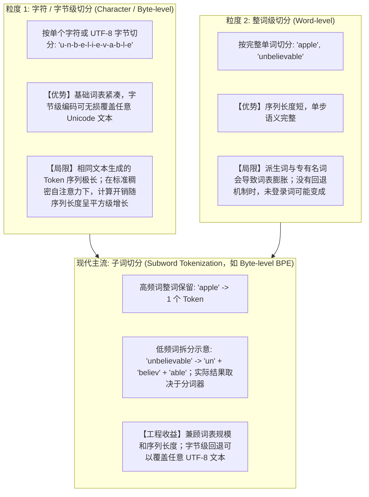

# Token 与 Tokenizer：文本数值化与子词分词机制

> [!abstract] 一句话心智模型
> 分词器（Tokenizer）负责将自然语言文本与离散整数序列（Token ID）进行双向映射；单个 Token 可对应完整单词、常见词根或字节片段。由于不同模型采用各自的词表，工程上进行成本核算与窗口控制时，应使用目标模型对应的 Tokenizer 统计，并将消息角色封装、工具 Schema 定义及多模态输入的开销一并纳入预算。

---

## 🧩 一、为什么需要子词分词？不同切分粒度的工程权衡

在自然语言处理演进过程中，文本切分粒度经历了从字符/字节级、整词级到子词级（Subword）的权衡演进：



---

## 🔠 二、BPE（Byte Pair Encoding，字节对编码）底层算法推导

主流大模型（如 GPT 系列、Claude、DeepSeek、Llama 等）广泛采用基于字节的 **BPE（Byte Pair Encoding）** 或其变体算法构建词表。

### BPE 词表训练的核心迭代过程：

1. **初始化**：将训练语料拆分为最基础的字符或 UTF-8 字节单元，构成初始基础词表；
2. **频次统计**：扫描语料库，统计当前所有相邻 Token 对（Pair）共同出现的频次；
3. **合并高频对**：将出现频次最高的一对相邻单元合并为一个新的子词 Token，并加入词表；
4. **迭代终止**：重复统计与合并过程（如 `t` + `h` $\to$ `th`，`th` + `e` $\to$ `the`），直到词表容量达到预设上限（例如 `cl100k_base` 约 10 万，`o200k_base` 约 20 万）。

```text
原始训练语料： "low", "lower", "newest", "widest"

初始状态（拆分为基础字符）：
l o w : 5 次
l o w e r : 2 次
n e w e s t : 6 次
w i d e s t : 3 次

第 1 轮统计：相邻对 ('s', 't') 出现了 6 + 3 = 9 次（频次最高）
-> 合并生成新 Token 'st'

第 2 轮统计：相邻对 ('e', 'st') 出现了 6 + 3 = 9 次
-> 合并生成新 Token 'est'

第 3 轮统计：相邻对 ('l', 'o') 出现了 5 + 2 = 7 次
-> 合并生成新 Token 'lo'
...
最终效果：高频词汇逐渐合并为独立 Token，低频词则由可复用的子词词根组合表示。
```

---

## 🔍 三、典型分词现象与工程问题剖析

### 问题 1：为什么大模型直接处理字符级任务（如统计单词 `strawberry` 中字母 `r` 的个数）容易出错？

模型接收到的是 Token ID，不一定是逐字母展开的字符。假设 `strawberry` 被切成 `str`、`aw`、`berry`，模型仍需根据这些片段判断字母数量；实际切分结果取决于分词器。分词只是影响任务表现的可能因素，不能据此断定每次出错的原因。让模型分步检查有时会改善结果，但精确字符统计、正则匹配和长度校验仍应交给程序执行。

---

### 问题 2：为什么大模型直接心算多位数算术可能出现偏差？

不同分词器对长数字的切分方式不同，模型处理多位数时也可能出现数位或进位错误，但不能把每次算错都归因于分词。分步推导有时有帮助，却不能保证正确；金融核算、订单计价等需要精确结果的场景，应使用 Java `BigDecimal`、数据库聚合或计算器工具，并检查传入的数值。

---

### 问题 3：为什么相同语义的中英文文本消耗的 Token 数量存在差异？

不同分词器的词表和训练数据不同：一个常见英文单词或中文词组可能对应一个 Token，生僻字符也可能拆成多个 Token。字符数与 Token 数没有跨模型通用的固定换算比例，正文、代码和 JSON 的情况也不同；计算预算与成本时，应使用目标模型对应的分词器统计实际业务样本。

---

## 💻 四、企业工程落地：精确计算与预算预估

在 Java 应用开发中，由于 `String.length()` 返回的是 UTF-16 代码单元数量，与模型的 Token 消耗量并不等价，因此需要使用与目标模型词表匹配的分词库进行本地预估。

### 使用本地分词库统计 Token

以 [jtokkit](https://jtokkit.knuddels.de/docs/getting-started/usage) 为例，词表必须与目标模型匹配，实际请求总用量还包含消息封装和工具等开销。下面省略 import 和应用配置：

```xml
<dependency>
    <groupId>com.knuddels</groupId>
    <artifactId>jtokkit</artifactId>
    <version>1.1.0</version>
</dependency>
```

```java
EncodingRegistry registry = Encodings.newDefaultEncodingRegistry();
Encoding encoding = registry.getEncoding(EncodingType.CL100K_BASE);
int tokens = encoding.countTokens("北京出差住宿标准是多少？");
```

---

## ⚡ 一分钟面试必杀卡

复习时可以先尝试回答以下两个问题。

> [!question]- BPE 是什么，为什么常用于分词？
> BPE 根据训练数据中常见的相邻单元逐步建立子词词表，让常见词可以用较少 Token 表示，也能通过子词处理不常见的文本。具体词表和预处理方式随模型而异。

> [!question]- 模型处理字符计数或多位数计算为什么会出错？
> Token 不一定与单个字符或数字位对齐，加上生成过程本身可能出错，不能依靠语言模型保证精确结果。需要精确计数或财务计算时，可交给程序或计算工具并核对输入。
