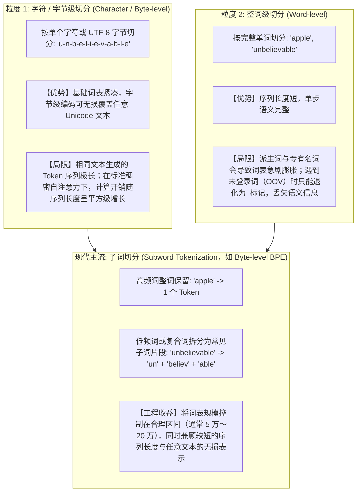

# Token 与 Tokenizer：文本数值化与子词分词机制

> [!abstract] 一句话心智模型
> 分词器（Tokenizer）负责将自然语言文本与离散整数序列（Token ID）进行双向映射；单个 Token 可对应完整单词、常见词根或字节片段。由于不同模型采用各自的词表，工程上进行成本核算与窗口控制时，应使用目标模型对应的 Tokenizer 统计，并将消息角色封装、工具 Schema 定义及多模态输入的开销一并纳入预算。

---

## 🧩 一、为什么需要子词分词？不同切分粒度的工程权衡

在自然语言处理演进过程中，文本切分粒度经历了从字符/字节级、整词级到子词级（Subword）的权衡演进：



---

## 🔠 二、BPE（Byte Pair Encoding，字节对编码）底层算法推导

主流大模型（如 GPT 系列、Claude、DeepSeek、Llama 等）广泛采用基于字节的 **BPE（Byte Pair Encoding）** 或其变体算法构建词表。

### BPE 词表训练的核心迭代过程：
1. **初始化**：将训练语料拆分为最基础的字符或 UTF-8 字节单元，构成初始基础词表；
2. **频次统计**：扫描语料库，统计当前所有相邻 Token 对（Pair）共同出现的频次；
3. **合并高频对**：将出现频次最高的一对相邻单元合并为一个新的子词 Token，并加入词表；
4. **迭代终止**：重复统计与合并过程（如 `t` + `h` $\to$ `th`，`th` + `e` $\to$ `the`），直到词表容量达到预设上限（例如 `cl100k_base` 约 10 万，`o200k_base` 约 20 万）。

```text
原始训练语料： "low", "lower", "newest", "widest"

初始状态（拆分为基础字符）：
l o w : 5 次
l o w e r : 2 次
n e w e s t : 6 次
w i d e s t : 3 次

第 1 轮统计：相邻对 ('s', 't') 出现了 6 + 3 = 9 次（频次最高）
-> 合并生成新 Token 'st'

第 2 轮统计：相邻对 ('e', 'st') 出现了 6 + 3 = 9 次
-> 合并生成新 Token 'est'

第 3 轮统计：相邻对 ('l', 'o') 出现了 5 + 2 = 7 次
-> 合并生成新 Token 'lo'
...
最终效果：高频词汇逐渐合并为独立 Token，低频词则由可复用的子词词根组合表示。
```

---

## 🔍 三、典型分词现象与工程问题剖析

### 问题 1：为什么大模型直接处理字符级任务（如统计单词 `strawberry` 中字母 `r` 的个数）容易出错？
- **输入表征粒度**：经过 BPE 分词后，模型接收的是子词级 Token ID（例如 `strawberry` 在部分分词器中被切分为 `str` + `aw` + `berry` 等子词片段，具体切分结果取决于目标模型的 Tokenizer），而非逐字母展开的字符数组。
- **注意力与推理负担**：虽然模型在预训练中接触过大量单词拼写知识，但在一次前向直接作答中，它需要先在内部隐式还原每个子词对应的字母序列，再完成位置对齐与累加计数，容易在中间环节产生偏差。
- **工程对策**：通过思维链（或推理模型）让模型先将单词逐字符展开再计数可改善准确率；而在生产系统中，涉及精确字符统计、正则匹配与长度校验的逻辑，应直接交由确定性程序代码或工具调用执行。

---

### 问题 2：为什么大模型直接心算多位数算术可能出现偏差？
- **数字切分与数位对齐**：不同分词器对长数字的切分策略不同（有的按 1～3 位数字切分，有的按单数字切分）。当一个多位整数被切分为多个长度不一的子词 Token 时，模型在自回归从左到右生成结果的过程中，难以像人类列竖式那样从右向左严格对齐十进制数位并处理连续进位。
- **工程对策**：分步展开推导有助于缓解简单算术错误；但在金融核算、报表统计、订单计价等业务场景中，必须将数值计算交由后端代码（如 Java `BigDecimal`）、数据库聚合或计算器工具完成，模型仅负责提取参数或解释结果。

---

### 问题 3：为什么相同语义的中英文文本消耗的 Token 数量存在差异？
- **词表分布与编码密度**：不同模型的 Tokenizer 在训练语料配比与词表规模上存在差异。若词表中英文常见词覆盖更密，单个英文单词往往对应 1 个 Token；而中文常见词组可能合并为 1 个 Token，低频汉字或生僻字符则可能拆分为 1～3 个字节级 Token。
- **工程对策**：字符数与 Token 数之间没有跨模型通用的固定换算比例，且普通正文、代码、JSON 与多语言混合文本的编码密度各不相同。在制定上下文预算与成本预估时，应采集真实业务样本，使用目标模型对应的分词器实测统计。

---

## 💻 四、企业工程落地：精确计算与预算预估

在 Java 应用开发中，由于 `String.length()` 返回的是 UTF-16 代码单元数量，与模型的 Token 消耗量并不等价，因此需要使用与目标模型词表匹配的分词库进行本地预估。

### 使用本地分词库统计 Token（以 OpenAI 词表对应的 `jtokkit` 为例）：
```xml
<dependency>
    <groupId>com.knuddels</groupId>
    <artifactId>jtokkit</artifactId>
    <version>1.1.0</version>
</dependency>
```

```java
import com.knuddels.jtokkit.Encodings;
import com.knuddels.jtokkit.api.Encoding;
import com.knuddels.jtokkit.api.EncodingRegistry;
import com.knuddels.jtokkit.api.EncodingType;

public class TokenDemo {
    public static void main(String[] args) {
        EncodingRegistry registry = Encodings.newDefaultEncodingRegistry();
        // 按目标模型选择匹配的编码表：如 GPT-4 / GPT-3.5 使用 CL100K_BASE，GPT-4o 系列使用 O200K_BASE
        Encoding enc = registry.getEncoding(EncodingType.CL100K_BASE);

        String prompt = "分布式锁的核心是看门狗自动续期机制。";
        int[] tokenIds = enc.encode(prompt).toArray();
        
        System.out.println("Java String 长度 (UTF-16): " + prompt.length());
        System.out.println("分词后 Token 数量: " + tokenIds.length);
    }
}
```

---

## ⚡ 一分钟面试必杀卡

> [!NOTE] 面试高频问题标准答题套路
> 
> **Q1：什么是 BPE（Byte Pair Encoding）算法？大模型为什么广泛使用它？**
> - **A**：
>   - BPE（字节对编码）是一种基于频次统计的子词（Subword）分词算法。它从基础字符或 UTF-8 字节出发，通过在训练语料中迭代统计并合并出现频率最高的相邻单元对，构建出固定规模（通常 5 万～20 万）的词表。
>   - 它在字符级切分（序列过长导致注意力计算开销大）与整词级切分（词表膨胀且难以处理未登录词 OOV）之间取得了良好平衡：高频词以完整 Token 表示以缩短序列长度，低频词或新词则拆解为常见子词或字节片段，实现任意文本的无损编码。
> 
> **Q2：为什么大模型在直接处理字母计数、多位数计算时容易出错？工程上如何解决？**
> - **A**：
>   - **原因**：模型处理的基本单元是子词级 Token 而非单个字符或对齐的十进制数位，且自回归解码是从左到右逐步生成概率分布，在缺乏显式中间状态时难以直接完成跨子词的字符拆解与从右向左的连续进位对齐。
>   - **工程解决方案**：对于推理过程，可通过显式展开中间步骤降低单步跳跃难度；在生产业务中，涉及精确计数、字符串处理与数值运算的逻辑，应一律通过 Function Calling 调用外部工具或交由后端确定性代码（如 `BigDecimal`）执行。
