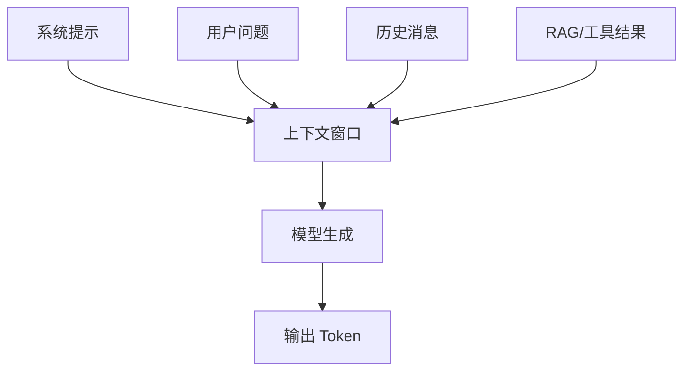

# 上下文窗口

> [!abstract] 一句话总结
> 上下文窗口是模型一次调用能“看见”的 Token 范围，包括系统提示、用户问题、历史消息、检索资料、工具结果和即将生成的输出。

## 📌 这是什么

上下文窗口可以理解为 LLM 的工作记忆。模型生成答案时只能引用当前请求里放进去的内容，以及训练中形成的参数记忆；没有放入窗口的对话历史、文档和实时事实，模型并不能自动访问。

## 🤔 解决什么问题 / 为什么需要

LLM 应用的很多问题不是“模型不聪明”，而是上下文放错了：关键信息没放进去、无关信息塞太多、历史消息遮蔽了新指令、工具结果太长导致溢出。

| 问题 | 上下文原因 |
| ---- | ---- |
| 答非所问 | 任务、约束、输出格式不明确 |
| 忘记前文 | 历史消息被截断或压缩过度 |
| 幻觉 | 没有提供可信证据或证据不完整 |
| 成本高 | 把重复系统提示和无关文档反复塞入 |

## 🧩 核心概念

| 概念 | 含义 | 备注 |
| ---- | ---- | ---- |
| Context Window | 一次调用可处理的最大 Token 数 | 输入和输出共用预算 |
| Input Tokens | 请求里已有的 Token | system/user/history/docs/tools |
| Output Tokens | 模型本次可生成的 Token | 需要预留 |
| Context Rot | 长上下文中注意力和召回质量下降 | 不是窗口越大越好 |
| Truncation | 截断超出窗口的内容 | 容易删掉关键证据 |
| Prompt Cache | 缓存重复前缀 | 可降低延迟和成本 |

## ⚙️ 工作原理 / 流程



典型构造顺序：

1. 放稳定规则：角色、边界、安全策略、输出格式。
2. 放当前任务：用户问题和本轮目标。
3. 放必要证据：RAG 文档、数据库结果、工具返回。
4. 放少量历史：只保留对当前任务有用的状态。
5. 预留输出：避免输入占满导致答案被截断。

## 💻 代码实践

```java
int maxWindow = 128_000;
int outputReserve = 4_000;
int inputBudget = maxWindow - outputReserve;

PromptParts parts = promptBuilder
    .system(systemRules)
    .history(memory.selectRelevant(userQuestion))
    .documents(retriever.topK(userQuestion, 5))
    .user(userQuestion)
    .fitToBudget(inputBudget);
```

## ⚠️ 踩坑与注意事项

- [ ] **长窗口崇拜**：窗口越长不代表效果越好，噪声会稀释注意力。
- [ ] **忘记给输出留空间**：输入塞满后模型可能无法完整回答。
- [ ] **把历史全塞进去**：聊天历史应做摘要、状态化或相关性筛选。
- [ ] **证据位置混乱**：关键约束和证据要放在清晰位置，减少互相覆盖。

## 🎯 面试问题

> [!question] 高频问题
> - Q: 上下文窗口和训练数据有什么区别？
>   - A: 训练数据是模型参数里的长期知识；上下文窗口是本次调用临时可见的工作记忆。
> - Q: 为什么长上下文仍需要 RAG？
>   - A: 长窗口解决容量，不解决资料选择、时效性、权限、证据排序和成本问题。
> - Q: 如何处理上下文溢出？
>   - A: 先做预算，删无关内容，再摘要历史，最后压缩证据并预留输出 Token。

## 🔗 关联笔记

- [[02-Token与Tokenizer]]
- [[13-上下文工程概述]]
- [[14-上下文窗口预算管理]]
- [[15-上下文压缩策略]]
- [[_index]]

## 📚 参考资料

- [Claude Docs: Context windows](https://docs.anthropic.com/en/docs/build-with-claude/context-windows)
- [OpenAI API Models](https://platform.openai.com/docs/models)
- [Anthropic: Effective context engineering for AI agents](https://www.anthropic.com/engineering/effective-context-engineering-for-ai-agents)

