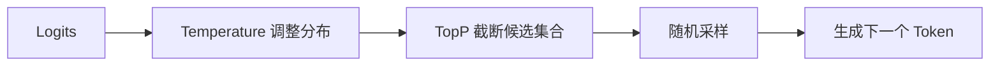

# 模型参数-Temperature与TopP

> [!abstract] 一句话总结
> Temperature 和 TopP 都控制模型从候选 Token 中“怎么选”，前者调概率分布的尖锐程度，后者限制候选 Token 的累计概率范围。

## 🎯 本节定位

- **本章第 4 课，承接 [[01-LLM工作原理]] 的采样/解码环节**。结构化输出场景的参数选择见 [[11-结构化输出]]；推理模型用 effort 档位取代采样参数，见 [[16-推理模型与思考控制]]。

## 📌 这是什么

LLM 每一步都会给下一个 Token 生成一个概率分布。解码参数决定是总选最高概率 Token，还是允许一些低概率但可能有创意的选择。Temperature 和 TopP 是最常见的两个采样参数。

## 🤔 解决什么问题 / 为什么需要

不同任务需要不同稳定性。代码生成、信息抽取、JSON 输出需要稳定；创意写作、头脑风暴、命名需要多样性。采样参数就是在“可重复”和“有变化”之间调节。

| 任务 | 推荐倾向 |
| ---- | ---- |
| JSON/分类/抽取 | 低 temperature，少改 top_p |
| 代码补全 | 低到中等 temperature |
| 文案/头脑风暴 | 中到高 temperature |
| 严肃问答/RAG | 低 temperature，加证据约束 |

## 🧩 核心概念

| 概念 | 含义 | 备注 |
| ---- | ---- | ---- |
| Logits | 模型输出的原始分数 | 采样前的分布 |
| Temperature | 调整分布平滑度 | 越低越保守，越高越随机 |
| TopP | nucleus sampling，保留累计概率前 p 的候选 | 限制候选集合 |
| Greedy | 总选最高概率 Token | 稳定但可能死板 |
| Seed | 随机种子 | 部分平台支持近似复现 |
| Determinism | 确定性 | API/硬件/版本变化仍可能影响结果 |

## ⚙️ 工作原理 / 流程



Temperature 影响所有候选的相对概率；TopP 只保留累计概率达到阈值的候选集合。实践中通常不要同时大幅调整两者，否则很难判断效果变化来自哪里。

## 💻 代码实践

```java
ChatOptions options = ChatOptions.builder()
    .temperature(0.2)
    .topP(0.9)
    .build();

String json = chatClient.prompt()
    .options(options)
    .user("从文本中抽取姓名、手机号、城市，输出 JSON。")
    .call()
    .content();
```

> [!tip]
> 对结构化输出，优先使用模型或框架提供的 JSON Schema / Structured Outputs，而不是单靠低 temperature。

## ⚠️ 踩坑与注意事项

- [ ] **以为 temperature=0 完全确定**：模型服务、并发、版本升级仍可能带来差异。
- [ ] **同时乱调 temperature 和 top_p**：调参归因困难，建议先固定一个。
- [ ] **用高随机性做事实问答**：更容易引入幻觉。
- [ ] **忽略模型限制**：部分模型可能不接受自定义 temperature/top_p，应看官方文档。

## 🎯 面试问题

> [!question] 高频问题
> - Q: Temperature 和 TopP 的区别？
>   - A: Temperature 改变概率分布形状；TopP 按累计概率截断候选集合。
> - Q: 为什么结构化输出不能只靠 temperature=0？
>   - A: 低随机性不能保证 Schema 合法，仍应使用 JSON Schema、解析校验和重试。
> - Q: 创意任务怎么调？
>   - A: 适当提高 temperature，保留足够 top_p，并用约束定义风格和边界。

## 🔗 关联笔记

- [[01-LLM工作原理]]
- [[11-结构化输出]]
- [[07-Prompt工程基础]]
- [[05-主流模型选型对比]]
- [[_index]]

## 📚 参考资料

- [OpenAI Prompt engineering](https://platform.openai.com/docs/guides/prompt-engineering)
- [OpenAI Structured Outputs](https://platform.openai.com/docs/guides/structured-outputs)
- [Claude Models Overview](https://docs.anthropic.com/en/docs/about-claude/models/overview)

