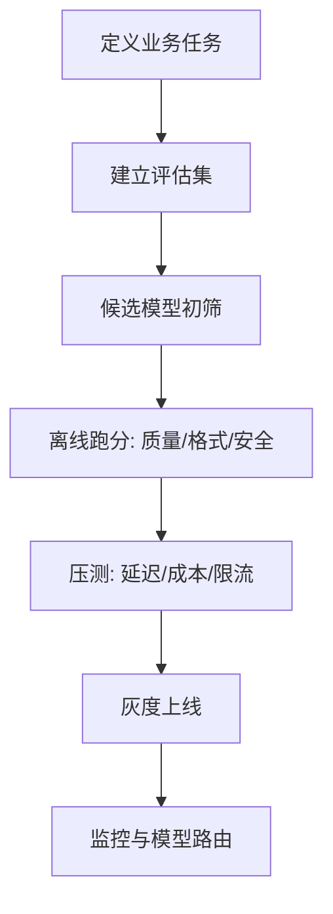

# 主流模型选型对比

> [!abstract] 一句话总结
> 模型选型不是“谁最强”单维度问题，而是在能力、成本、延迟、上下文、工具生态、合规和可替换性之间做工程取舍。

## 🎯 本节定位

- **本章第 5 课，选型视角的总览**。前置：[[01-LLM工作原理]]、[[04-模型参数-Temperature与TopP]]；推理模型的能力定位见 [[16-推理模型与思考控制]]；选定模型后的 Prompt 落地见 [[07-Prompt工程基础]]。

## 📌 这是什么

主流模型选型是为具体业务场景选择合适的基础模型或模型组合。成熟系统通常不是只用一个模型，而是“大模型负责难题，小模型负责高频简单任务，Embedding/重排/审核模型负责配套能力”。

> [!important]
> 本笔记的模型状态按 **2026-07-04** 官方文档口径整理。模型名称、价格、上下文窗口和能力会频繁变化，落地前必须重新查看官方模型页。

## 🤔 解决什么问题 / 为什么需要

模型是 LLM 应用的成本和体验核心。选错模型会导致响应慢、费用高、工具调用不稳、结构化输出难、中文效果差或企业合规过不了。

| 选型维度 | 要问的问题 |
| ---- | ---- |
| 能力 | 推理、代码、写作、图像、音频、工具调用哪个最重要？ |
| 成本 | 单次调用、日调用量、输出长度是否可控？ |
| 延迟 | 用户能否等待慢思考？是否需要流式输出？ |
| 上下文 | 是否需要处理长文档、代码库、会议记录？ |
| 生态 | SDK、结构化输出、工具调用、缓存、评估是否成熟？ |
| 合规 | 数据驻留、私有化、审计、供应商风险能否接受？ |

## 🧩 核心概念

| 概念              | 含义             | 备注              |
| --------------- | -------------- | --------------- |
| Frontier Model  | 最强能力模型         | 适合复杂推理、编码、Agent |
| Mini/Nano/Fast  | 轻量模型           | 适合分类、改写、简单抽取    |
| Reasoning Model | 显式或内置推理能力模型    | 适合数学、规划、复杂代码    |
| Multimodal      | 支持文本外的图片/音频/视频 | 取决于具体 API       |
| Context Window  | 最大上下文长度        | 长窗口不等于高召回       |
| Model Router    | 按任务路由不同模型      | 成本优化常用          |

## ⚙️ 选型流程



## 🧪 主流模型家族速览

| 家族 | 适合场景 | 选型提示 |
| ---- | ---- | ---- |
| OpenAI GPT 系列 | 通用推理、代码、工具调用、结构化输出 | 生态成熟，优先验证 Structured Outputs、Responses API、成本曲线 |
| Anthropic Claude 系列 | 长文档、代码、Agent、稳健写作 | 关注长上下文、prompt caching、工具调用和安全边界 |
| Google Gemini 系列 | 多模态、长上下文、Google 生态集成 | 适合图像/视频/长输入场景，注意区域和 API 差异 |
| DeepSeek 系列 | 代码、推理、成本敏感场景 | API 兼容性好，生产前重点测稳定性、限流和合规 |
| Qwen/通义千问等国产模型 | 中文、本地化、私有化、成本控制 | 适合国内业务合规和私有部署，需自建评估 |

## 💻 代码实践

```java
public ChatClient chooseClient(TaskType type) {
    return switch (type) {
        case CLASSIFICATION, REWRITE -> fastCheapClient;
        case CODE_REVIEW, COMPLEX_REASONING -> frontierClient;
        case LONG_DOCUMENT_QA -> longContextClient;
        case JSON_EXTRACTION -> structuredOutputClient;
    };
}
```

最小可行评估集建议包含：20 条简单样例、20 条边界样例、20 条真实失败样例。每条样例定义期望输出、硬性格式、不可接受错误。

## ⚠️ 踩坑与注意事项

- [ ] **只看榜单**：榜单不能替代业务评估集。
- [ ] **忽略输出长度**：很多成本来自输出而不是输入。
- [ ] **没有备选模型**：供应商故障、限流、涨价都会影响生产。
- [ ] **用大模型做所有事**：分类、路由、简单改写应交给低成本模型。
- [ ] **模型升级不回归**：升级可能改善能力，也可能破坏格式和风格。

## 🎯 面试问题

> [!question] 高频问题
> - Q: 如何为 RAG 问答选模型？
>   - A: 看长上下文、遵循证据、引用能力、低幻觉、成本和延迟；用真实文档集评估，不只看通用榜单。
> - Q: 为什么要做模型路由？
>   - A: 不同任务难度差异大，路由能用小模型处理高频简单请求，把预算留给难题。
> - Q: 模型升级前要测什么？
>   - A: 质量、格式稳定性、工具调用、拒答率、延迟、成本、长上下文召回和安全策略。

## 🔗 关联笔记

- [[01-LLM工作原理]]
- [[04-模型参数-Temperature与TopP]]
- [[11-结构化输出]]
- [[03-上下文窗口]]
- [[_index]]

## 📚 参考资料

- [OpenAI API Models](https://platform.openai.com/docs/models)
- [Claude Models Overview](https://docs.anthropic.com/en/docs/about-claude/models/overview)
- [Gemini API Models](https://ai.google.dev/gemini-api/docs/models)
- [DeepSeek API Docs](https://api-docs.deepseek.com/)

