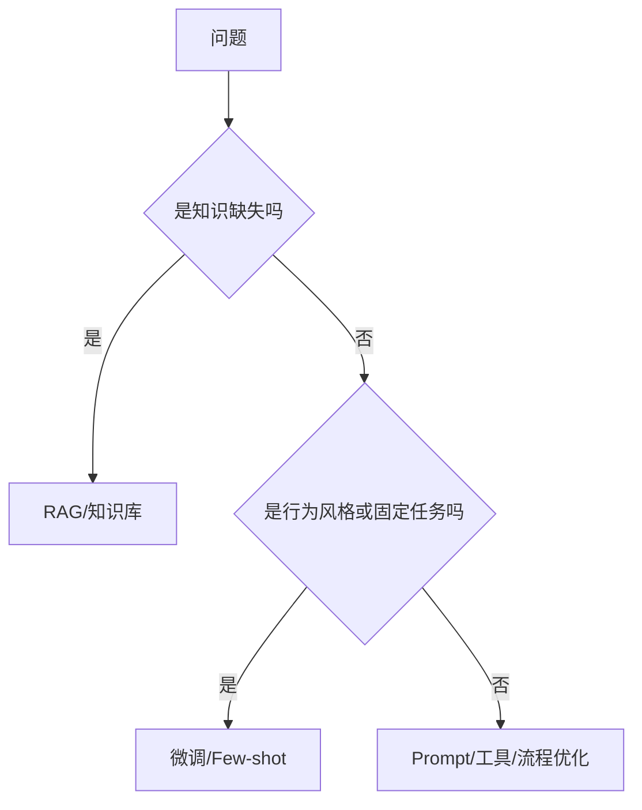

# 微调：LoRA / QLoRA / LLaMA-Factory 入门

> [!abstract] 一句话总结
> 应用开发岗不一定要会训练大模型，但必须能判断什么时候用 Prompt、RAG、工具调用，什么时候才值得微调。

## 🎯 本节定位

本篇重点是判断何时值得微调，不要求掌握训练细节。可以先阅读 [[07-Prompt工程基础]]，Few-shot 与微调的边界见 [[09-Few-shot与Zero-shot]]；[[../03-知识库技术-RAG/_index|RAG]] 和 [[../05-Agent-MCP-Skills/_index|工具调用]] 分别用于提供外部知识和执行操作。

## 先记结论

| 问题 | 优先方案 |
| ---- | -------- |
| 模型不知道企业知识 | RAG |
| 模型输出格式不稳定 | 结构化输出 + 校验 |
| 模型不会调用业务工具 | Tool Calling / Agent |
| 模型风格不符合要求 | Few-shot 或微调 |
| 大量稳定标注样本、任务模式固定 | 微调 |
| 想让模型记住频繁变化的数据 | 不要微调，用 RAG |

## LoRA 和 QLoRA 是什么

- **LoRA**：冻结原模型参数，只训练少量低秩适配器参数，成本低。
- **QLoRA**：在量化基础上做 LoRA，进一步降低显存需求。
- **LLaMA-Factory**：常用开源微调工具，支持多模型、多训练方式和 Web UI。

## 🧩 LoRA 为什么能减少训练参数？

假设某个原始权重矩阵为 `W`，全量微调会更新大量原始权重；LoRA 固定 `W`，用两个较小的低秩矩阵表示增量，计算时使用 `W + BA`，只训练适配器的参数。矩阵的秩越小，可训练参数通常越少，但任务效果和训练资源仍需实测。
QLoRA 在 LoRA 基础上使用量化的冻结基座模型来降低显存需求，并训练适配器；权重、优化器、激活值等仍会占用资源，不能仅凭模型文件大小推算训练所需显存。

## 应用开发岗要掌握到什么程度

不要求手写训练框架，但要能说清：
1. 数据怎么准备：指令、输入、输出、拒答样例。
2. 什么时候微调：任务稳定、样本足够、Prompt/RAG 解决不了。
3. 怎么评估：固定 eval set，对比微调前后效果。
4. 怎么上线：模型版本、灰度、回滚、成本和延迟。
5. 风险是什么：过拟合、遗忘、安全能力下降、许可证问题。

## 数据格式示例

```json
{
  "instruction": "把客服工单归类到指定标签",
  "input": "用户反馈发票抬头开错，需要重新开票",
  "output": "发票问题"
}
```

## 微调与 RAG 的边界



## 面试讲法

> 我不会把微调当成万能方案。企业知识变化快时优先 RAG；需要模型学会稳定风格、分类标准或固定输出模式时才考虑微调。微调前要有高质量样本和评估集，微调后要做安全、幻觉、格式和成本回归。

## 学习检查

- [ ] 能解释 LoRA 与全量微调的区别。
- [ ] 能说清 RAG 与微调的边界。
- [ ] 能设计一个客服意图分类微调数据格式。
- [ ] 能说明微调上线前要跑哪些回归测试。

## 🔗 关联笔记

- [[07-Prompt工程基础]]
- [[09-Few-shot与Zero-shot]]
- [[01-LLM工作原理]]
- [[_index]]

## 📚 参考资料

- [LLaMA-Factory GitHub](https://github.com/hiyouga/LLaMA-Factory)
- [Hugging Face PEFT Documentation](https://huggingface.co/docs/peft/index)
- [QLoRA Paper](https://arxiv.org/abs/2305.14314)

