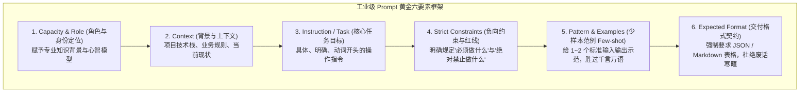
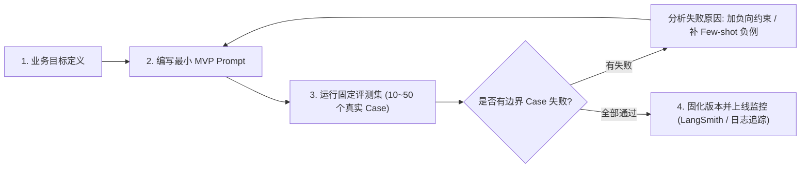

# Prompt 工程基础：人话化指令与结构化框架

> [!abstract] 一句话心智模型
> Prompt 工程不是“向神明许愿念咒语”，而是**给一位智商极高但缺乏业务背景的顶级专家写一份“精准任务交接简报”**：
> - **弱指令（模糊许愿）**：“帮我写个用户登录”，专家会凭空猜测你用什么语言、什么框架、什么数据库，最终交付一份与你工程完全不兼容的玩具代码；
> - **强指令（工业简报）**：明确角色（10年资深架构师）、明确背景（Spring Boot 3 + Spring Security 6 + JWT）、明确输入输出格式（统一 Result 包装）、明确负向约束（**绝对禁止明文存密码、禁止废弃的 WebSecurityConfigurerAdapter**）；
> - **工业事实**：模型输出的质量上限，在 90% 的情况下**完全取决于你的指令边界有多清晰！**

---

## 🏗️ 一、Prompt 工业级黄金六要素框架（CRISPE 架构）

编写生产级高质量 Prompt，切忌信马由缰。业界成熟的标准是采用 **CRISPE 结构化框架**：



### 六要素标准生产模板（可直接复用）：
```markdown
# 角色 (Role)
你是一位拥有 10 年一线实战经验的 Java 分布式架构师与代码重构专家。

# 背景 (Context)
我们正在将一个古老的 Java 8 单体系统升级到 Spring Boot 3.2 与 JDK 21，ORM 框架选用 MyBatis-Plus，数据库为 MySQL 8.0。

# 任务 (Task)
请对用户传入的这道 SQL 慢查询进行深度分析，找出执行缓慢的根本原因，并给出具体的复合索引优化方案以及改写后的 SQL。

# 约束条件 (Constraints)
1. 必须使用 Markdown 格式输出；
2. 必须结合 MySQL InnoDB B+ 树最左匹配原则解释为什么原有索引失效；
3. **【严禁】** 给出不符合 SQL 规范的伪代码；
4. **【严禁】** 在输出中包含“好的，很高兴为您服务”等任何无意义的开场白或寒暄废话，直接输出技术分析正文！

# 示例 (Examples)
[输入示例]：SELECT * FROM t_order WHERE user_id = 100 AND status = 1 ORDER BY create_time DESC;
[输出示例]：
- 瓶颈诊断：...
- 推荐索引：`idx_user_status_time(user_id, status, create_time)`
- 底层原理：覆盖过滤与排序，避免 filesort...

# 输入数据 (Input)
```sql
{{USER_SQL_INPUT}}
```
```

---

## 🎯 二、三大常见翻车指令 vs 工业级改造实战

### 案例 1：角色设定假大空
- **翻车写法**：“你是一个人工智能助手，请帮我分析这段代码。”
  - **后果**：回答平庸无奇，罗列一堆教科书上的概念，毫无针对性。
- **工业级改造**：“你是一位专注性能优化的资深 SRE 专家，请以苛刻的标准审查以下代码是否存在内存泄漏（如 ThreadLocal 未清理）、高并发锁竞争与慢 I/O 隐患。”

### 案例 2：负向约束软弱无力
- **翻车写法**：“请只返回 JSON 数据，不要返回其他内容。”
  - **后果**：大模型往往依然会在开头热情地加上一段：“好的！以下是为您生成的 JSON 格式数据：\n```json ...\n希望对您有所帮助！”——**导致下游系统 JSON 解析当场报错崩溃！**
- **工业级改造**：
  ```markdown
  【绝对约束】：
  1. 输出必须是以 `{` 开头、以 `}` 结尾的纯文本合法 JSON 字符串；
  2. 严禁使用任何 ```json 代码块包裹；
  3. 严禁输出任何开场白、解释说明、或结语问候；
  4. 如果无法解析，统一返回标准错误 JSON: {"error": "INVALID_INPUT"}。
  ```

### 案例 3：缺乏少样本（Few-shot）导致格式漂移
- **翻车写法**：“把这段日志里的 IP 和时间提取出来。”
  - **后果**：模型一会儿返回 `IP: 1.1.1.1, 时间: 2026`，一会儿返回 `{"ip": "1.1.1.1"}`，格式完全不稳定。
- **工业级改造**：直接在 Prompt 中喂给模型一个标准 Input 和 Output 范例，模型会自动通过强大的自注意力机制**像素级模仿范例的格式与语气**！

---

## ⚡ 三、Prompt 工程核心心法与生命周期



> [!TIP] 生产开发黄金准则：
> 1. **Prompt 也是代码（Prompt as Code）**：严禁把几十行的 Prompt 散落在 Java 业务代码的硬编码字符串中，必须将其作为独立模版文件（`.st` 或 `.md`）纳入 Git 版本控制！
> 2. **建立自动化回归评测集**：修改 Prompt 前，必须跑一遍包含 50 个真实边角料样例的评测集，确保“修复一个 Bug 没有引发另外三个格式崩溃”！

---

## ⚡ 一分钟面试必杀卡

> [!NOTE] 面试高频问题标准答题套路
> 
> **Q1：什么是好的 Prompt？编写高质量生产 Prompt 的核心方法论是什么？**
> - **A**：
>   - 好的 Prompt 的核心是**“消除一切潜在歧义”**，把大模型当做接口去调用，提供清晰的契约与输入输出边界。
>   - 核心方法论：遵循 **CRISPE 结构化框架**，明确划分角色（Role）、业务背景（Context）、具体任务（Task）、严厉的负向红线约束（Constraints）、少样本范例（Few-shot）和结构化格式输出（Format），并建立固定的测试评估集持续回归迭代。
> 
> **Q2：为什么在 Prompt 中反复强调“请只输出 JSON”，大模型依然会输出废话？如何彻底解决？**
> - **A**：
>   - 根本原因是大模型在指令微调（SFT）和人类对齐时被训练得具有强烈的“对话礼貌倾向”，自回归接龙会天然倾向于生成“好的”、“以下是为您准备的数据”等开场白。
>   - **彻底解决手段**：
>     1. 在 Prompt 中用清晰的负面清单严厉禁止，并给出负例警示；
>     2. 在 API 参数层面开启官方原生的 **`response_format: { "type": "json_object" }`（JSON Mode）** 或 **Structured Outputs（JSON Schema 强约束）**，通过底层采样 Logits 掩码直接从物理层面拦截非 JSON 字符输出。
