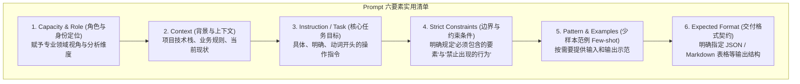
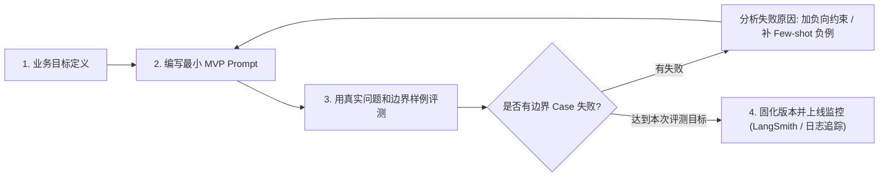

# Prompt 工程基础：清晰指令设计与结构化框架

> [!abstract] 一句话心智模型
> 写 Prompt 时要说清任务、必要背景、约束和输出要求；复杂任务可以补充示例，再用真实问题检验效果。输出校验和权限控制仍需由应用负责。

---

## 🏗️ 一、编写 Prompt 时考虑哪些内容？

下面列出角色、背景、任务、约束、示例和输出格式六个方面；是否需要全部写出，取决于具体任务：



### 一个提示词示例

````markdown
角色：Java 后端开发者。
背景：应用使用 Spring Boot 和 MySQL。
任务：根据提供的 SQL、表结构、索引及执行计划分析慢查询。
约束：信息不足时说明缺什么；不要把推测当作事实。
示例输入：按 user_id 筛选订单，再按 create_time 倒序。
示例输出：检查相关索引，并结合执行计划验证。
输出格式：按“问题、依据、建议、验证方式”分点回答。
输入：{{SQL_AND_EXECUTION_PLAN}}
````

---

## 🎯 二、三个常见问题

### 1. 任务描述过于笼统

“请帮我分析这段代码”没有说明关注点，回答可能只罗列通用概念。可以改成“检查这段代码是否存在 `ThreadLocal` 未清理、锁竞争或慢 I/O，并指出相关代码和原因”。

### 2. 输出要求不够具体

只说“返回 JSON”时，模型仍可能加解释或使用代码块。可以明确要求“返回合法 JSON；无法解析时返回 `{"error":"INVALID_INPUT"}`”，并说明需要哪些字段。如果服务支持原生 JSON Schema 约束，可以结合使用；后端仍需处理拒答、截断、解析失败和业务校验。

### 3. 规则不容易用一句话说明

“从日志提取 IP 和时间”没有说明字段格式时，模型可能返回不同结构。可以提供少量标准输入和输出示例，说明字段名称和时间格式，再由后端校验结果。

---

## ⚙️ 三、如何迭代提示词？



> [!tip] 版本管理与评测
> 较长或需要频繁调整的提示词可以放在模板文件中并纳入版本管理。修改后用真实问题和边界样例比较效果；通过少量测试不代表所有情况都不会退化。

---

## ⚡ 一分钟面试必杀卡

复习时关注任务、约束和验证方式。

> [!question]- 好的 Prompt 应该包含什么？
> 写清任务、必要背景、输入输出和约束；任务复杂时补充示例，并用真实问题集检验。并非每次都必须包含固定数量的要素。

> [!question]- 为什么只在 Prompt 中要求 JSON 仍可能解析失败？
> 模型可能输出额外文本或漏掉字段。可使用接口支持的 JSON 或 Schema 约束，并处理拒答、截断、解析失败与业务校验；具体能力以模型文档为准。
