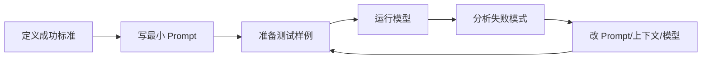

# Prompt工程基础

> [!abstract] 一句话总结
> Prompt 工程是把业务目标、上下文、约束、示例和输出格式组织成模型容易执行的指令，并通过评估持续迭代。

## 📌 这是什么

Prompt 不是“咒语”，而是 LLM 应用的接口设计。好的 Prompt 会清楚说明任务、角色、输入数据、约束、判断标准和输出格式；坏的 Prompt 让模型自己猜你的意图。

## 🤔 解决什么问题 / 为什么需要

LLM 是通用模型，不知道你的业务规则、偏好、数据含义和失败边界。Prompt 工程的目标是降低歧义，让模型稳定完成当前任务。

| 弱 Prompt | 强 Prompt |
| ---- | ---- |
| “总结一下” | “面向产品经理，用 5 条 bullet 总结风险和下一步” |
| 没有上下文 | 提供角色、背景、输入字段含义 |
| 没有验收标准 | 明确输出结构和禁止事项 |
| 靠感觉迭代 | 用样例集评估变化 |

## 🧩 核心概念

| 概念 | 含义 | 备注 |
| ---- | ---- | ---- |
| Instruction | 明确任务指令 | 做什么、不要做什么 |
| Context | 背景和资料 | 让模型有依据 |
| Constraints | 约束条件 | 字数、风格、边界、引用 |
| Examples | 示例 | Few-shot 稳定格式和边界 |
| Output Format | 输出格式 | JSON、表格、Markdown 等 |
| Evaluation | 评估 | Prompt 改动必须可回归 |

## ⚙️ 工作流程



通用骨架：

```text
角色：你是...
任务：请完成...
背景：...
输入：...
约束：
- 必须...
- 禁止...
输出格式：...
质量标准：...
```

## 💻 代码实践

```java
String prompt = """
你是资深客服质检员。
任务：判断下面客服回复是否解决了用户问题。
输出：只返回 JSON：{"passed": boolean, "reason": string}
判断标准：
- 必须回应用户核心诉求
- 不得承诺系统无法保证的结果

用户问题：%s
客服回复：%s
""".formatted(userQuestion, agentReply);
```

## ⚠️ 踩坑与注意事项

- [ ] **只写角色不写任务**：角色不能替代具体操作步骤。
- [ ] **规则互相冲突**：模型会随机取舍，必须消除冲突。
- [ ] **没有负例**：只给正确示例，模型不知道边界。
- [ ] **Prompt 越长越好**：冗余规则会增加成本并稀释重点。

## 🎯 面试问题

> [!question] 高频问题
> - Q: Prompt 工程和上下文工程有什么区别？
>   - A: Prompt 工程侧重指令表达；上下文工程侧重把正确的信息在正确位置、正确预算内交给模型。
> - Q: 如何系统优化 Prompt？
>   - A: 先定义成功标准和评估集，再根据失败模式调整指令、示例、格式或模型。
> - Q: Prompt 写得越详细越好吗？
>   - A: 不是。详细要服务于消除歧义，冗余和冲突会降低效果。

## 🔗 关联笔记

- [[08-System-Prompt设计]]
- [[09-Few-shot与Zero-shot]]
- [[10-CoT思维链]]
- [[11-结构化输出]]
- [[_index]]

## 📚 参考资料

- [OpenAI Prompt engineering](https://platform.openai.com/docs/guides/prompt-engineering)
- [Anthropic Prompt engineering overview](https://docs.anthropic.com/en/docs/build-with-claude/prompt-engineering/overview)
- [OpenAI Prompting fundamentals](https://openai.com/academy/prompting/)

