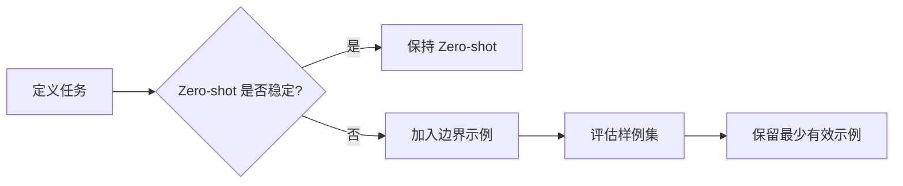

# Few-shot与Zero-shot

> [!abstract] 一句话总结
> Zero-shot 是不给示例直接让模型做任务，Few-shot 是给少量输入输出示例让模型模仿规则、风格和格式。

## 🎯 本节定位

- **本章第 9 课，承接 [[07-Prompt工程基础]]**。示例与微调的边界见 [[06-微调-LoRA-QLoRA-LLaMA-Factory入门]]；示例占用的 Token 预算见 [[14-上下文窗口预算管理]]。

## 📌 这是什么

Zero-shot 依赖模型已学到的通用能力；Few-shot 通过少量样例在上下文里“临时教学”。它们都不改变模型参数，只改变本次调用的上下文。

## 🤔 解决什么问题 / 为什么需要

很多业务规则无法只靠一句自然语言描述清楚，比如标签边界、文案风格、复杂 JSON 结构。Few-shot 用样例把隐性标准显性化。

| 方式 | 优点 | 缺点 |
| ---- | ---- | ---- |
| Zero-shot | 简洁、省 Token、易维护 | 边界和格式稳定性较弱 |
| One-shot | 给 1 个示例，快速定调 | 容易过拟合该示例 |
| Few-shot | 稳定风格和规则 | 占 Token，示例选择很关键 |

## 🧩 核心概念

| 概念 | 含义 | 备注 |
| ---- | ---- | ---- |
| Demonstration | 示例 | 输入和期望输出 |
| Label Space | 可选标签集合 | 分类任务必须明确 |
| Boundary Case | 边界样例 | Few-shot 最有价值 |
| Negative Example | 反例 | 告诉模型什么不算 |
| In-context Learning | 上下文学习 | 模型从 Prompt 示例中归纳模式 |

## ⚙️ 工作流程



## 💻 代码实践

```text
任务：把用户反馈分类为 bug / feature / question。

示例：
输入：点击保存后页面报 500
输出：bug

输入：希望支持导出 Excel
输出：feature

输入：会员到期后数据还在吗
输出：question

现在分类：
输入：{user_feedback}
输出：
```

示例选择优先级：真实失败样例 > 边界样例 > 典型正例。不要为了“看起来完整”塞很多重复样例。

## ⚠️ 踩坑与注意事项

- [ ] **示例和任务格式不一致**：模型会模仿错误格式。
- [ ] **示例太多**：增加成本，还可能让模型关注无关模式。
- [ ] **只给简单正例**：边界失败不会改善。
- [ ] **示例含敏感数据**：Few-shot 示例也是上下文，需脱敏。

## 🎯 面试问题

> [!question] 高频问题
> - Q: Few-shot 和微调有什么区别？
>   - A: Few-shot 把示例放进上下文，不改模型参数；微调用数据训练模型参数，适合大量稳定模式。
> - Q: 什么时候 Zero-shot 足够？
>   - A: 任务通用、格式简单、容错高，且评估集表现稳定时。
> - Q: Few-shot 示例怎么选？
>   - A: 选最能说明边界和格式的少量真实样例，避免重复和噪声。

## 🔗 关联笔记

- [[07-Prompt工程基础]]
- [[11-结构化输出]]
- [[10-CoT思维链]]
- [[14-上下文窗口预算管理]]
- [[_index]]

## 📚 参考资料

- [Anthropic Prompt engineering overview](https://docs.anthropic.com/en/docs/build-with-claude/prompt-engineering/overview)
- [OpenAI Prompt engineering](https://platform.openai.com/docs/guides/prompt-engineering)
- [Anthropic Prompt Engineering Interactive Tutorial](https://github.com/anthropics/prompt-eng-interactive-tutorial)

