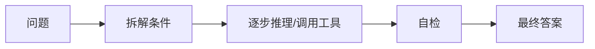

# CoT思维链

> [!abstract] 一句话总结
> CoT（Chain-of-Thought）通过让模型分步骤处理问题来提升复杂推理质量，但生产系统通常应要求“简洁推理摘要/验证步骤”，而不是暴露完整内部思维。

## 🎯 本节定位

- **本章第 10 课，承接 [[07-Prompt工程基础]]**。推理模型把 CoT 内化为模型能力，两者的关系见 [[16-推理模型与思考控制]]；思考结果的输出格式见 [[11-结构化输出]]。

## 📌 这是什么

CoT 是一种 Prompt 技巧：让模型在回答前先拆解问题、列出中间步骤，再给最终答案。它常用于数学、逻辑、规划、代码分析、复杂问答。

## 🤔 解决什么问题 / 为什么需要

复杂任务如果要求模型直接给结论，模型容易跳步、漏条件或编造。分步骤处理能增加中间检查点，让结果更稳定。

| 任务类型 | CoT 价值 |
| ---- | ---- |
| 数学/逻辑 | 减少跳步错误 |
| 代码调试 | 先定位原因再给补丁 |
| 规划 | 先拆任务再执行 |
| RAG 问答 | 先核对证据再回答 |

## 🧩 核心概念

| 概念 | 含义 | 备注 |
| ---- | ---- | ---- |
| Chain-of-Thought | 连续推理步骤 | 训练/提示层面的推理格式 |
| Scratchpad | 草稿区 | 可用于内部推理或工具编排 |
| Reasoning Summary | 推理摘要 | 生产中更适合展示给用户 |
| Self-check | 自检 | 输出前按标准复核 |
| Reasoning Budget | 推理预算 | 部分模型可控制思考深度 |

## ⚙️ 工作流程



常用写法：

```text
请先分析需要考虑的因素，再给最终结论。
最终输出只包含：
1. 结论
2. 关键依据（3 条以内）
3. 不确定性
```

## 💻 代码实践

```java
String answer = chatClient.prompt()
    .user("""
        判断这个 SQL 慢查询的可能原因。
        请先列出检查步骤，但最终只输出：
        - 根因候选
        - 验证方法
        - 修复建议

        SQL: %s
        EXPLAIN: %s
        """.formatted(sql, explain))
    .call()
    .content();
```

## ⚠️ 踩坑与注意事项

- [ ] **强制输出完整思维链**：可能泄露不必要内部过程，也增加成本。
- [ ] **把推理当事实**：中间推理仍可能错，关键场景要工具验证。
- [ ] **简单任务滥用 CoT**：分类、抽取等任务可能只会变慢变贵。
- [ ] **没有最终格式**：模型可能输出冗长过程而不是可用结论。

## 🎯 面试问题

> [!question] 高频问题
> - Q: CoT 为什么能提升复杂任务效果？
>   - A: 它把隐式推理显式拆成步骤，减少一次性跳到结论时的遗漏。
> - Q: 生产系统要展示完整 CoT 吗？
>   - A: 通常不需要，展示关键依据或推理摘要即可。
> - Q: CoT 和工具调用怎么结合？
>   - A: 先规划检查步骤，再调用搜索、计算、数据库等工具验证中间结论。

## 🔗 关联笔记

- [[07-Prompt工程基础]]
- [[09-Few-shot与Zero-shot]]
- [[11-结构化输出]]
- [[12-防御性提示与防注入]]
- [[_index]]

## 📚 参考资料

- [Claude Extended Thinking](https://docs.anthropic.com/en/docs/build-with-claude/extended-thinking)
- [Claude: Reduce hallucinations](https://docs.anthropic.com/en/docs/test-and-evaluate/strengthen-guardrails/reduce-hallucinations)
- [OpenAI Prompt engineering](https://platform.openai.com/docs/guides/prompt-engineering)

