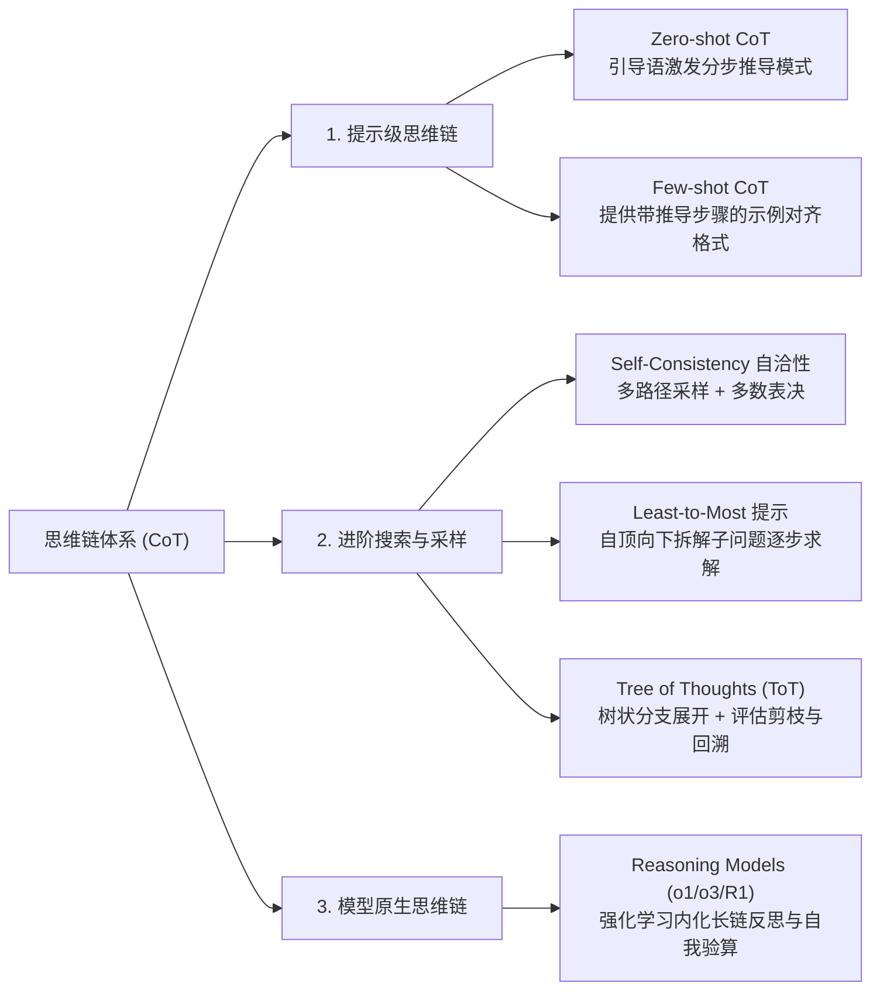
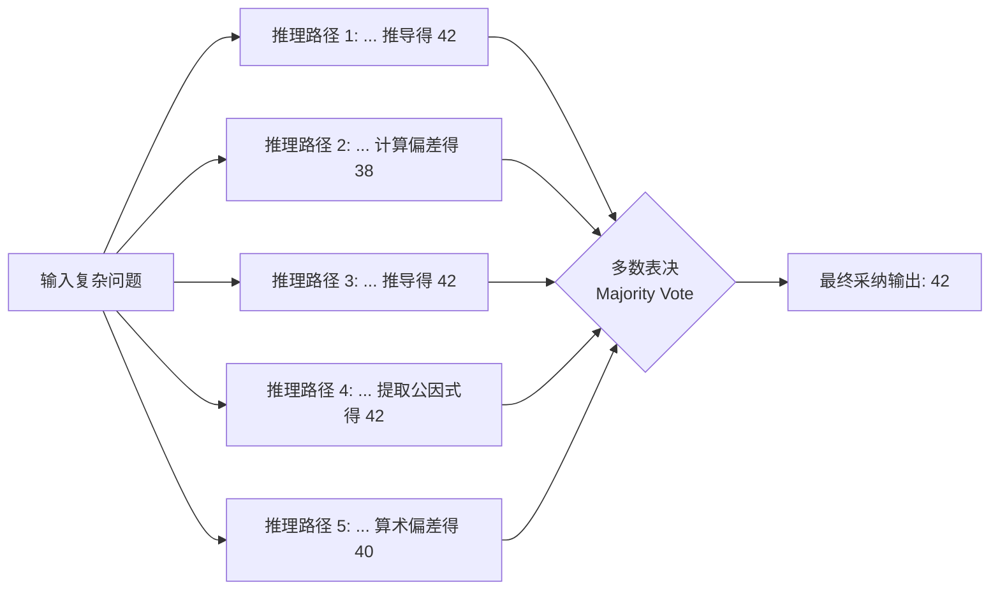
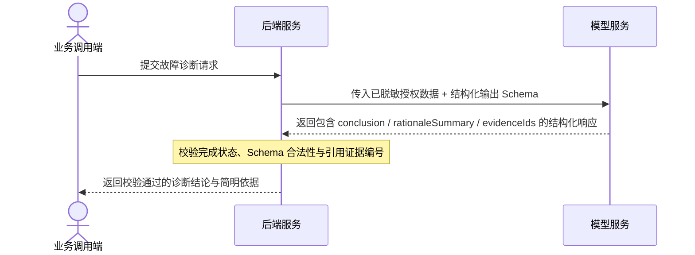

# CoT思维链（Chain of Thought）

> [!abstract] 一句话总结
> CoT（Chain of Thought，思维链）的核心机制是通过生成显式的中间推理步骤，将复杂问题拆解为多步顺序子任务，利用上下文序列承接中间状态并扩展推理期计算量（Test-time Compute），从而降低单步直接映射的跳跃难度。

---

## 🗣️ 核心直觉

在让模型处理复杂逻辑、数学计算或多步规划时，若要求模型直接给出最终结论，模型必须在单步解码中完成所有隐式推导，容易因跨度过大而出错。通过引导模型先输出中间推导步骤，已生成的步骤会进入上下文供后续自注意力层参考，从而提升复杂推理任务的稳定性。在工程落地中，应将模型的推导依据与最终结构化结论分离，并对关键业务结果辅以规则校验或工具验算。

---

## 📌 第一性原理：为什么大模型需要思维链？

从 Transformer 自回归解码的计算过程来看，直接回答与思维链推理在计算路径上存在显著差异：

```mermaid
flowchart TD
    subgraph Direct["传统直接回答（无 CoT）"]
        Q1["输入问题 Token"] --> F1["单步 Transformer 前向传播"]
        F1 --> A1["直接采样输出最终答案 Token<br/>（缺少显式中间状态支撑）"]
    end

    subgraph CoT["思维链推理（CoT）"]
        Q2["输入问题 Token"] --> F2["第 1 步前向计算"]
        F2 --> S1["生成中间推理步骤 1"]
        S1 -->|"追加至上下文并更新 KV Cache"| F3["第 2 步前向计算"]
        F3 --> S2["生成中间推理步骤 2"]
        S2 -->|"逐步累积中间状态"| FN["第 N 步前向计算"]
        FN --> AN["生成最终答案 Token<br/>（推理计算深度随中间步骤展开而扩展）"]
    end

    style Direct fill:#ffebee,stroke:#c62828,stroke-width:1px
    style CoT fill:#e8f5e9,stroke:#2e7d32,stroke-width:1px
```



### 1. 从单步映射到多步序列计算
- 对于参数规模固定的 Transformer 模型，每生成一个 Token 所经过的网络层数是固定的。当面对多跳逻辑或复合运算时，单步前向传播难以直接拟合从问题到答案的复杂映射。
- 引入 CoT 后，模型通过生成一系列中间 Token，将原本需要在单步内完成的复杂推理拆解为多个条件概率跨度更小的子步骤，从而在测试阶段投入更多计算资源（需注意，若中间某一步推导出现偏差，后续步骤也可能沿错误前提继续展开，因此复杂任务仍需结合外部验证）。

### 2. 利用上下文序列承接中间状态
- 自回归模型在每一步生成的中间推理文本都会追加到当前上下文序列中，其对应的注意力键值（Key/Value）被保存在 KV Cache 中供后续解码步骤直接关注与引用。
- 这种机制相当于为模型提供了可读写的外部上下文状态，使其能够逐步记录拆解出的已知条件、子问题结论与待验证假设（生成的推理文本主要反映上下文条件下的高概率解释路径，工程上通常将其作为可读依据展示，而非内部神经元激活状态的逐字还原）。

---

## 🧩 CoT 的演进体系与四大范式

思维链自 2022 年提出以来，已从最初的提示词引导演进为涵盖搜索采样与原生强化学习的方法体系：



### 1. Zero-shot CoT（零样本思维链）
- **代表论文**：Kojima et al., 2022 (*Large Language Models are Zero-Shot Reasoners*)。
- **典型引导语**：在 Prompt 末尾添加简短的分步指令：
   ```text
   请一步一步地思考并推导。（Let's think step by step.）
   ```
- **工作机制**：预训练语料中包含大量教材解答、技术文档与代码推导，这类文本通常呈现“先列条件、再分步推导、最后得出结论”的分布特征。分步引导语能够将模型的续写分布切换到分步推导模式。

### 2. Few-shot CoT（少样本示例思维链）
- **代表论文**：Wei et al., 2022 (*Chain-of-Thought Prompting Elicits Reasoning in Large Language Models*)。
- **工作机制**：在 Prompt 中显式提供 2～3 个包含完整推导过程的 `<问题, 推导步骤, 最终答案>` 示例。
- **工程价值**：除了激活分步推理外，更重要的是**规范推导的领域逻辑、颗粒度与最终输出格式**。

```text
【示例 1】
Q: 食堂有 23 个苹果。如果用掉 20 个做午餐，又买了 6 个，现在还剩几个？
A: 食堂原本有 23 个苹果，用掉 20 个后剩余 23 - 20 = 3 个；随后又购入 6 个，因此当前共有 3 + 6 = 9 个。答案是 9。

【待回答问题】
Q: 小明有 5 箱书，每箱 12 本。他把其中 3 箱送给图书馆，剩下的书平均分给 4 位同学，每位同学分得几本？
A: 
```

### 3. Self-Consistency（自洽性采样表决）
- **核心痛点**：单条思维链在中间步骤仍可能因偶然采样偏差导致推导失误，一旦某一步出错，后续结论往往偏离正确方向。
- **解决策略**：
  1. 适当调高采样温度（如 `temperature = 0.7`），允许模型探索不同的推导路径；
  2. 针对同一问题独立采样生成 $K$ 条（如 5～9 条）推理链；
  3. 解析各条推理链的最终答案，通过**多数表决（Majority Vote）**选出一致性最高的结果。
- **适用边界**：适用于结果具有明确收敛答案（如数值、分类标签、枚举选项）且单次调用预算充裕的任务；由于总 Token 消耗随采样次数 $K$ 线性增长，生产中需权衡准确率收益与调用成本。



### 4. Tree of Thoughts（ToT 思维树搜索）
- **核心思路**：复杂规划与博弈问题往往需要多方案探索与中途回溯，而非单向线性生成。
- **工作机制**：将推理过程建模为树结构，在每个节点生成多个候选思考分支，利用评估提示或启发式函数对分支状态打分，并结合广度优先（BFS）或深度优先（DFS）算法进行剪枝与回溯搜索。

---

## ⚙️ 工业级落地：生产环境中的推理输出设计

在企业级 AI 应用中，若直接让模型将自由发散的思考过程与最终答案混杂输出，通常会带来两方面问题：
1. **下游解析困难**：冗长的中间分析与最终结论混在同一段自然语言中，容易破坏正则提取或 JSON 反序列化。
2. **内部上下文暴露风险**：若模型在长篇中间推导中直接复述系统提示词规则、内部检索原文或未脱敏字段，直接透传给前端可能造成敏感信息外泄。

### 生产标准架构：结构化分离结论与精简依据

在生产接口中，建议通过结构化 Schema 将“最终业务结论”、“可对外展示的简明依据”与“引用证据 ID”分字段输出：

```text
你是故障诊断助手。请按指定 JSON 结构返回：
1. conclusion：最终诊断结论；
2. rationaleSummary：面向研发人员的简明诊断依据（控制在 3 条以内，不输出内部系统规则）；
3. evidenceIds：引用的日志或监控证据编号；
4. pendingVerifications：需进一步排查的待验证项。
若现有日志证据不足以定位根因，请将 conclusion 设为 UNKNOWN 并列出缺失的排查项。
```



> [!NOTE] 工程实践要点
> 若使用 XML 标签（如 `<thinking>...</thinking><answer>...</answer>`）在纯文本中分隔推导过程与最终答案，后端在标签解析失败时应触发异常处理或重试，避免直接将未解析的原始全文回退展示给终端用户。若调用原生推理模型（如 DeepSeek-R1、OpenAI o 系列、Claude Extended Thinking），其专用思考字段（如 `reasoning_content` 或 thinking block）由 API 独立返回，应用层可按需决定是否在前端展示摘要。

---

## 💻 代码实战：Spring AI 中的自洽性采样表决

以下示例演示在支持自定义 `temperature` 的模型上，通过多次采样并对数值结果进行多数表决（注：涉及纯算术计算时，生产环境应优先调用确定性计算工具；此处以算术题演示多路径采样与严格多数阈值的判定逻辑）：

```java
public String selfConsistencyVote(String problem, int sampleSize) {
    if (sampleSize < 3 || sampleSize > 9) {
        throw new IllegalArgumentException("采样次数建议控制在 3～9 次之间");
    }
    java.util.Map<String, Integer> counts = new java.util.HashMap<>();
    for (int i = 0; i < sampleSize; i++) {
        String response = chatClient.prompt()
                .user("请分步推导以下问题，并在最后一行仅输出最终十进制数值结果：" + problem)
                .options(org.springframework.ai.openai.OpenAiChatOptions.builder()
                        .temperature(0.7).build())
                .call().content();
        if (response == null || response.isBlank()) {
            continue;
        }
        String[] lines = response.trim().split("\\R");
        String lastLine = lines[lines.length - 1].trim();
        try {
            String normalizedValue = new java.math.BigDecimal(lastLine)
                    .stripTrailingZeros().toPlainString();
            counts.merge(normalizedValue, 1, Integer::sum);
        } catch (NumberFormatException e) {
            // 忽略未能解析为有效数值的采样分支
        }
    }
    return counts.entrySet().stream()
            .filter(e -> e.getValue() > sampleSize / 2)
            .map(java.util.Map.Entry::getKey)
            .findFirst()
            .orElse("未形成超过半数的一致结论，需转交外部验证");
}
```

---

## 🆚 Prompt 级 CoT vs 原生推理模型（o1 / o3 / DeepSeek-R1）

随着强化学习后训练技术的发展，思维链已从“Prompt 显式诱导”演进到“模型原生内化推理”：

| 对比维度 | Prompt 级引导 CoT（如在通用对话模型中提示分步思考） | 原生推理模型（如 OpenAI o1/o3、DeepSeek-R1、Claude Extended Thinking） |
| :--- | :--- | :--- |
| **驱动机制** | 依赖提示词引导与少样本示例，激发模型按分步格式续写 | 通过强化学习（RL）等后训练将拆解、试错与验算内化为模型行为 |
| **自我纠错能力** | 较弱。单向线性生成中一旦某步出错，后续步骤易顺着错误前提继续推导 | 较强。在思考阶段可自主进行多路径探索、假设推翻与反向验算 |
| **计算预算控制** | 仅能通过提示词要求简略或详细程度进行粗粒度引导 | 支持通过 `reasoning_effort` 档位或 thinking budget 参数精确控制思考深度 |
| **输出结构隔离** | 推理文本与最终答案默认处于同一输出流，需靠 Schema 字段或标签分隔 | 思考过程通过独立字段或隐藏摘要返回，与最终回答天然分离 |
| **延迟与成本特征** | 消耗常规输出 Token，开销相对可控 | 内部思考消耗较多输出 Token，首字延迟（TTFT）与单次调用成本显著增加 |

> [!TIP]
> 关于原生推理模型的详细机制与档位控制，请参考：[[16-推理模型与思考控制]]。

---

## ⚠️ 生产避坑指南与反模式

### 1. 忌：在简单感知或模式匹配任务上滥用 CoT
- **典型场景**：简单意图分类、情感极性判断、固定字段抽取、常规文本翻译。
- **负面影响**：原本直接输出几十个 Token 即可完成的任务，引入长思维链后会额外生成数百个中间 Token，导致首字延迟与 API 调用成本成倍上升，而准确率往往没有实质提升（甚至可能因过度发散而偏离字面事实）。
- **选型原则**：**模式识别与直接抽取类任务优先直接输出；多步逻辑推导、复杂算法设计、根因排查与长链路规划任务再启用 CoT 或推理模型。**

### 2. 忌：将模型的推理文本直接等同于合规审计证明
- 在部分已知结论或强先验问题上，模型可能先倾向于某个结论，再在中间步骤中构造看似合理的解释（事后合理化）。
- **工程对策**：在金融风控、合规审查等高严肃性场景中，模型的推导文本仅作为辅助参考；核心数值核算、规则命中与权限判定必须由确定性代码或规则引擎完成验证。

### 3. 忌：开放式推导破坏结构化输出契约
- 若仅在自然语言提示中要求“先思考再给出 JSON”，模型常在 JSON 前后附加总结陈词，导致反序列化失败。
- **工程对策**：开启平台原生的 Structured Outputs（JSON Schema），在 Schema 中设计前置的 `reasoning`（或 `rationale`）字段与后置的 `result` 字段，既允许模型先完成分步推导，又从解码层面保证整体输出为合法 JSON。

---

## 🎯 高频面试问题

> [!question] 面试高频问题 3 连击
> 
> **Q1：从底层原理分析，为什么让模型“先输出中间推理步骤”能改善复杂任务的准确率？**
> - **答**：
>   1. **降低单步条件概率跳跃难度**：Transformer 单步前向传播的网络层数固定，直接从复杂问题跨越到最终答案时映射难度大；拆解为中间子步骤后，每一步只需预测逻辑跨度更小的局部结论。
>   2. **利用上下文与 KV Cache 承接中间状态**：每一步生成的中间推理 Token 会追加到输入序列中，供后续自注意力层直接引用，相当于扩展了测试期的有效计算深度（Test-time Compute）。
>
> **Q2：什么是 Self-Consistency（自洽性采样）？它解决什么问题，有什么工程代价？**
> - **答**：
>   Self-Consistency 用于缓解单条思维链在中间步骤偶发采样失误的问题。它通过设置较高采样温度（如 `0.7`）对同一问题独立生成多条推理路径，再对各路径得出的最终答案进行多数表决（Majority Vote）。由于正确的推导往往收敛到同一确定性结果，表决能有效过滤单路径偶然错误；其代价是 Token 消耗与计算成本随采样次数 $K$ 成倍增加，因此主要用于高价值且具有明确答案的任务。
>
> **Q3：在生产系统中需要使用 CoT 时，如何兼顾推理质量与下游 JSON 解析的稳定性？**
> - **答**：
>   推荐使用原生 Structured Outputs（JSON Schema 约束），在目标 DTO / Schema 中将 `rationale`（简明推导依据）定义为前置字段，将业务结论字段（如 `category`、`riskLevel`）置于其后。这样模型在自回归生成时会先生成推导依据以辅助后续字段决策，同时整个响应受 Schema 状态机约束，后端可直接安全反序列化并校验业务字段。

---

## 🪝 一分钟复盘记忆卡

```text
┌────────────────────────────────────────────────────────┐
│               CoT 思维链 复盘卡                        │
├────────────────────────────────────────────────────────┤
│  1. 核心机制：拆解多步子任务，以显式上下文承接中间状态 │
│  2. 演进路线：Zero/Few-shot CoT → 自洽采样/ToT → R1/o1 │
│  3. 工程形态：Schema 前置 rationale 字段 + 后置结论字段│
│  4. 适用边界：复杂逻辑/数学/排障适用，简单分类抽取慎用 │
│  5. 可靠性保障：推理文本作辅助依据，关键结果需代码核验 │
└────────────────────────────────────────────────────────┘
```

---

## 🔗 关联笔记

- [[07-Prompt工程基础]] - 提示工程基础规范与提示词清单
- [[11-结构化输出]] - 如何将推理后的最终答案规范化为程序对象
- [[12-防御性提示与防注入]] - 思维链泄露与防注入的边界防御
- [[16-推理模型与思考控制]] - 从提示级 CoT 进化为模型原生强化学习思考
- [[_index]] - 本章知识总览
