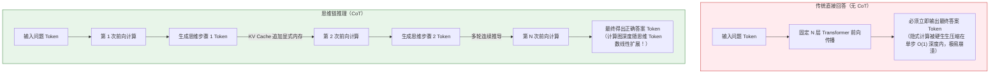
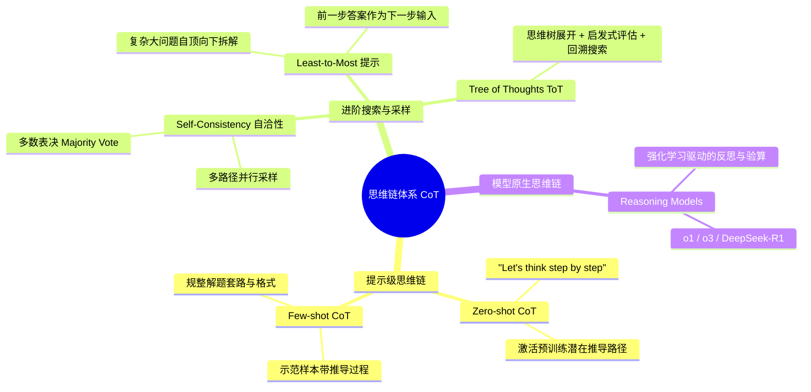
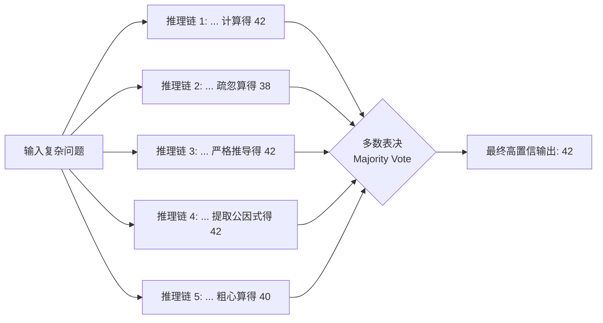
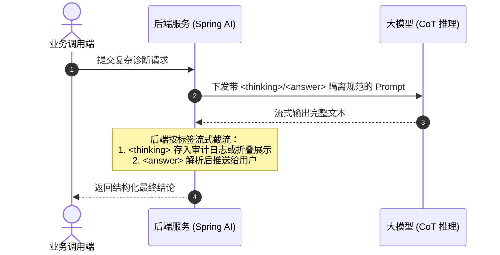

# CoT思维链（Chain of Thought）

> [!abstract] 一句话总结
> CoT（Chain of Thought，思维链）的核心第一性原理是**“用 Token 换算力，把隐式前向计算外挂为显式上下文工作内存”**——让大模型在输出最终结论前把中间推理步骤写出来，从而规避自回归单步跳跃的逻辑崩溃。

---

## 🗣️ 白话版（先建立直觉）

想象你正在参加一场闭卷考试，监考老师突然问你：**“$479 \times 683$ 等于多少？限时 1 秒，直接报出答案，不准动笔。”**

哪怕你是心算高手，要求你“脱口而出”，大概率也会当场蒙圈或者猜错。因为你的大脑神经元在 1 秒的单次冲动里，根本无法容纳如此多进位和乘积累加的中间状态。

但如果老师递给你**一张草稿纸和一支笔**，对你说：“不着急，你在草稿纸上一笔一画列竖式，把每一位的相乘、进位相加都写下来，最后在卷面上誊写答案。” 这时哪怕是小学生，也能 100% 算出正确结果。

在没有 CoT 之前，我们要求大模型直接给出复杂答案，就是在逼大模型“一口吃成个胖子”；而 **CoT 思维链，就是给大模型递过去的那张草稿纸**。模型写下的每一个字（Token），都会变成上下文留在记忆里，为下一步的推导铺平道路！

---

## 📌 第一性原理：为什么大模型需要思维链？

要真正掌握 CoT，必须穿透表面提示词技巧，理解 Transformer 的底层物理限制：



### 1. 计算容量的固定性（$O(1)$ 前向限制）
- 大模型是一个前向神经网络（如 32 层或 80 层 Transformer）。
- 当模型生成下一个 Token 时，它只能调用固定的层数完成一次前向计算。**单次计算的浮点运算量（FLOPs）是有刚性上限的**。
- 如果一个问题需要 10 步逻辑推导（如多约束逻辑题、数学证明、代码 Bug 根因分析），你却要求它在第一个 Token 处就决定最终答案，就等于强制模型把一个深达 10 步的计算图，强行压缩在固定的 32 层网络中完成。这种信息瓶颈和注意力溢出，必然导致它“凭概率幻觉胡说八道”。

### 2. 上下文即“显式外挂内存”（KV Cache Scratchpad）
- 自回归模型每生成一个中间 Token，这个 Token 就会被写入 KV Cache（键值缓存），成为下一次计算的输入。
- **生成的每一个中间推理 Token，本质上都在充当计算的临时暂存器（Working Memory）**。
- 通过生成 200 个 Token 的思考过程，大模型实际执行了 $200 \times N$ 层的深度前向计算！它把原本无法解决的高难度推导，分解成了每一步都极简单的“微小自回归预测”。

---

## 🧩 CoT 的演进体系与四大范式

思维链从 2022 年被提出至今，已经从最初的一句简单提示词，演变成了一整套复杂的提示工程与模型架构方法论：



### 1. Zero-shot CoT（零样本思维链）
- **核心论文**：Kojima et al., 2022 (*Large Language Models are Zero-Shot Reasoners*)。
- **魔法咒语**：在 Prompt 末尾加上一行简短的引导句：
  ```text
  让我们一步一步思考。（Let's think step by step.）
  ```
- **工作机制**：预训练语料中包含了海量的教材、解题过程、论文和代码注释，这些语料在给出答案前往往包含“首先... 接着... 综上所述...”。这句话激活了模型内部处于休眠状态的“逐步解题”自回归概率模式。

### 2. Few-shot CoT（少样本示例思维链）
- **核心论文**：Wei et al., 2022 (*Chain-of-Thought Prompting Elicits Reasoning in Large Language Models*)。
- **工作机制**：在提示中显式提供 2~3 个带有思考过程的 `<问题, 推导步骤, 答案>` 示范样例。
- **威力**：不仅让模型学会分步推导，更关键的是**给出了推导的领域范式、格式规范与边界粒度**。

```text
【示范 1】
Q: 食堂有 23 个苹果。如果他们用掉了 20 个做午餐，又买了 6 个，现在还剩几个？
A: 首先，食堂原本有 23 个苹果。用掉了 20 个，此时剩余 23 - 20 = 3 个。接着又买了 6 个，所以现在共有 3 + 6 = 9 个。答案是 9。

【待回答问题】
Q: 小明有 5 箱书，每箱 12 本。他把其中 3 箱送给了图书馆，剩下的书平均分给 4 位同学，每位同学分得几本？
A: 
```

### 3. Self-Consistency（自洽性采样表决）
- **核心问题**：即使加了 CoT，模型在推导中间依然可能出现计算失误或幻觉，如果只生成一条路径（Greedy Search，温度为 0），一步错全盘皆输。
- **解决策略**：
  1. 将模型采样温度调高（如 `temperature = 0.7`）。
  2. 让模型并发生成 $K$ 条（例如 5~10 条）完全独立的 CoT 推理链。
  3. 提取每条链的最终答案，进行**多数表决（Majority Vote）**。
- **效果**：数学和算法类任务的准确率能在传统 CoT 基础上再跃升 10%~20%，极大平抑了概率采样的随机翻车风险。



### 4. Tree of Thoughts（ToT 思维树搜索）
- **核心痛点**：人类思考复杂难题时，从来不是一条道走到黑，而是会：生成多个思路候选 $\to$ 评估每个思路的可行性 $\to$ 遇到死胡同主动**回溯（Backtrack）** $\to$ 探索下一条支路。
- **ToT 机制**：结合经典算法（广度优先 BFS / 深度优先 DFS）对每一步的思考状态进行模型打分，支持剪枝与回溯。

---

## ⚙️ 工业级落地：生产级 CoT 标准架构

在企业级 AI 开发中，直接让模型“自由发挥写思维”会导致两大生产灾难：
1. **答案格式混乱**：下游系统无法用正则或 JSON 解析最终结论，中间的过程和最终结果混在一堆。
2. **敏感信息泄露**：模型在思维链中可能把企业内部检索到的敏感规约、脱敏前的数据或者 Prompt 核心指令“自言自语”地吐给终端用户。

### 生产标准姿势：XML 标签硬隔离法

```text
你是一名资深的 Java 性能优化架构师。
面对用户的系统诊断问题，请遵循以下规范：

1. 必须在 <thinking> 标签内进行严密的因果逻辑推导与排查假设，验证你的每一步推论。
2. 内部思考完毕后，在 <answer> 标签内输出给用户的最终专业回复。
3. 下游只解析 <answer> 标签内容，<thinking> 严禁向用户直接展现任何内网资产或敏感配置。

【待分析日志】
${exceptionLog}
```



---

## 💻 代码实战：Spring AI 中的思维链与自洽性提取

在生产级 Java 代码中，我们通常需要处理带思维链的响应解析，并在高安全要求场景下实现多路推理自洽表决：

```java
package com.example.ai.cot;

import org.springframework.ai.chat.client.ChatClient;
import org.springframework.ai.chat.prompt.Prompt;
import org.springframework.stereotype.Service;

import java.util.*;
import java.util.regex.Matcher;
import java.util.regex.Pattern;
import java.util.stream.Collectors;

@Service
public class ReasoningAuditService {

    private final ChatClient chatClient;
    private static final Pattern THINKING_PATTERN = Pattern.compile("<thinking>(.*?)</thinking>", Pattern.DOTALL);
    private static final Pattern ANSWER_PATTERN = Pattern.compile("<answer>(.*?)</answer>", Pattern.DOTALL);

    public ReasoningAuditService(ChatClient.Builder builder) {
        this.chatClient = builder.build();
    }

    public record AuditResult(String thinkingProcess, String finalAnswer) {}

    /**
     * 1. 结构化思维链解析：将内部思考与外部答案严格分离
     */
    public AuditResult diagnoseWithCoT(String userCase) {
        String systemPrompt = """
            你是一个排障决策引擎。请严格遵循：
            1. 在 <thinking> 内部逐步拆解因果链、排查所有可能分支；
            2. 在 <answer> 内部输出最终确定的结论与操作指令。
            """;

        String rawResponse = chatClient.prompt()
                .system(systemPrompt)
                .user(userCase)
                .call()
                .content();

        String thinking = extractTagContent(rawResponse, THINKING_PATTERN, "未捕获到思维链");
        String answer = extractTagContent(rawResponse, ANSWER_PATTERN, rawResponse);

        return new AuditResult(thinking, answer);
    }

    /**
     * 2. Self-Consistency 自洽性多路表决采样
     */
    public String selfConsistencyVote(String mathProblem, int sampleSize) {
        String prompt = "请一步步思考并给出答案。最后一行必须单独写：'结论: [数值]'。\n题目：" + mathProblem;
        
        List<String> candidates = new ArrayList<>();
        Pattern resultPattern = Pattern.compile("结论:\\s*(\\-?\\d+(\\.\\d+)?)");

        for (int i = 0; i < sampleSize; i++) {
            String response = chatClient.prompt()
                    .user(prompt)
                    // 使用微高温度激发多样化推导路径
                    .options(org.springframework.ai.chat.prompt.ChatOptions.builder().temperature(0.7).build())
                    .call()
                    .content();

            Matcher matcher = resultPattern.matcher(response);
            if (matcher.find()) {
                candidates.add(matcher.group(1));
            }
        }

        // 统计众数 (Majority Vote)
        return candidates.stream()
                .collect(Collectors.groupingBy(s -> s, Collectors.counting()))
                .entrySet().stream()
                .max(Map.Entry.comparingByValue())
                .map(Map.Entry::getKey)
                .orElse("无法达成多数一致");
    }

    private String extractTagContent(String text, Pattern pattern, String defaultValue) {
        Matcher matcher = pattern.matcher(text);
        if (matcher.find()) {
            return matcher.group(1).trim();
        }
        return defaultValue;
    }
}
```

---

## 🆚 Prompt 级 CoT vs 原生推理模型（o1 / DeepSeek-R1）

进入 2025~2026 年后，业界关于 CoT 的认知发生了本质迭代：

| 维度 | Prompt 级人工诱导 CoT（如 GPT-4o / Claude Sonnet 提示） | 原生推理模型（如 OpenAI o1/o3, DeepSeek-R1） |
| :--- | :--- | :--- |
| **驱动机制** | 靠用户写提示词“一步步思考”唤起语言惯性 | 靠模型预训练/后训练 **强化学习（RL，PPO/GRPO）** |
| **自我纠错能力** | 弱。一旦第 2 步推导算错，后续自回归容易顺错胡诌 | **极强**。自主产生“Wait, let me double check...”、“Hold on...”等反思回溯 |
| **算力控制** | 只能靠提示词长度粗糙控制 | 支持 **Reasoning Effort** 档位与显式 Token 思考预算 |
| **输出可见性** | 思考文字完全混在常规输出中，占用用户可见带宽 | 思考作为内部 `reasoning_content`，可折叠、隐藏或加密 |
| **使用代价** | 仅按常规生成的输入输出计费 | 思考消耗大量隐藏 Token，按全额输出计费且延迟显著拉长 |

> [!TIP]
> 关于原生推理模型的深入对比与控制，请深度阅读配套专题：[[16-推理模型与思考控制]]。

---

## ⚠️ 生产避坑指南与反模式

### 1. 忌：简单任务滥用 CoT（“杀鸡用牛刀”）
- **错误场景**：情感分类（判断用户评价是积极还是消极）、文本摘要、实体抽取（从身份证识别姓名）。
- **严重后果**：原本 20 个 Token 搞定的抽取任务，加了 CoT 模型叽里咕噜想了 500 个 Token。“首字延迟（TTFT）暴涨、API 账单暴增 20 倍”，而准确率提升微乎其微。
- **黄金准则**：**知觉性、记忆性任务（直接给）不要用 CoT；计算性、长逻辑推理、代码复杂重构才用 CoT。**

### 2. 忌：轻信模型的“过程伪装”（Fake Reasoning）
- 大模型是一个概率统计系统。如果模型早已背过答案（比如已知 $A=5$），但被要求写出思维链，它可能写出一堆逻辑荒谬的假推导，但最后依然奇迹般地填上 $5$。
- **对策**：在金融、审计、高安全场景下，模型的思考过程不能作为法律合规的确定性依据，必须配合外部确定性代码或计算工具做后置验证！

### 3. 忌：未设输出格式导致的解析灾难
- 让模型想得太嗨，模型往往会在结尾补充大量感想、免责声明或多余问候，直接破坏下游正则或 JSON 解析。
- **对策**：必须在提示词中强调：“思考过程必须包裹在标签内，最终结论格式必须严格遵守约定，不得附加任何多余闲聊”。

---

## 🎯 大厂高频面试 30 秒绝杀

> [!question] 面试高频问题 3 连击
> 
> **Q1：从底层架构原理分析，为什么加上一句“Let's think step by step”能显著提升大模型的推理正确率？**
> - **答（满分绝杀）**：
>   1. **打破单步算力瓶颈**：Transformer 每一层的前向计算量是固定的 $O(1)$ 深度，如果直接求结论，必须在固定层数内压缩完成所有复杂推导，极易造成注意力容量溢出；
>   2. **外挂动态内存**：自回归生成每多吐出一个思维 Token，就会将推导状态保存进 KV Cache，将复杂的深层逻辑拆解为多轮连续的简单微步预测，本质上是用显式 Token 换取了更多的前向计算量！
>
> **Q2：什么是 Self-Consistency？它的核心解决什么痛点？**
> - **答（满分绝杀）**：
>   自洽性采样是为了解决单一思维链偶发推导翻车的问题。通过微调温度并发采样多条独立的推导路径，然后对多条路径给出的最终答案做多数表决（Majority Vote）。由于正确推导往往指向同一个数学确定性终点，而幻觉翻车路径各不相同，表决能高效过滤掉单点失误。
>
> **Q3：在生产架构中，面对带 CoT 的输出，后端服务应如何优雅设计？**
> - **答（满分绝杀）**：
>   实行**“标签硬隔离 + 异步流式分流”**。提示词强制要求 `<thinking>` 与 `<answer>` 分离。后端在读取 SSE 流时，通过状态机拦截 `<thinking>` 内部的 Token，作为排障与审计日志沉淀在服务端或降级折叠展示，只把 `<answer>` 的纯净结果交付给业务系统，防止敏感系统提示泄露与下游解析异常。

---

## 🪝 一分钟复盘记忆卡

```
┌────────────────────────────────────────────────────────┐
│               CoT 思维链 极速通关卡                     │
├────────────────────────────────────────────────────────┤
│  1. 核心本质：给模型递草稿纸，用 Token 换动态计算深度  │
│  2. 理论依据：Transformer 固定 O(1) 前向深度难以一步登天│
│  3. 四大范式：Zero-shot、Few-shot、自洽表决、ToT 树搜索 │
│  4. 生产规范：XML 标签分离（<thinking> vs <answer>）    │
│  5. 架构禁忌：分类抽取莫滥用，长链排障是舞台           │
└────────────────────────────────────────────────────────┘
```

---

## 🔗 关联笔记

- [[07-Prompt工程基础]] - 提示工程基础规范与 CRISPE 框架
- [[11-结构化输出]] - 如何将推理后的最终答案规范化为程序对象
- [[12-防御性提示与防注入]] - 思维链泄露与防注入的边界防御
- [[16-推理模型与思考控制]] - 从提示级 CoT 进化为模型原生强化学习思考
- [[_index]] - 本章知识总览
