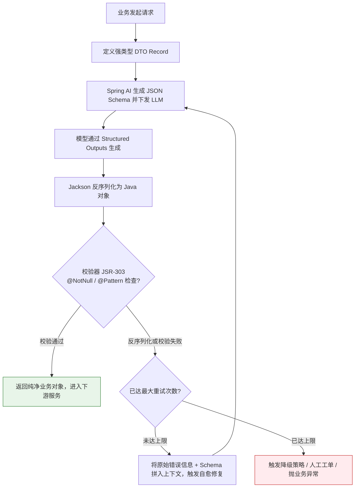

# 结构化输出（Structured Outputs）

> [!abstract] 一句话总结
> 结构化输出的核心是将大模型不可预测的**“自由发散自回归”**，通过 **“Logit 掩码约束（Constrained Decoding）+ JSON Schema 契约”** 驯化为工业级后端程序能够 100% 可靠反序列化的强类型数据对象（DTO）。

---

## 🗣️ 白话版（先建立直觉）

想象你去政务大厅办业务。如果办事员给你一张**纯白信纸**，让你“随便写写你的个人情况”，你可能会洋洋洒洒写一段抒情散文：“我叫张三，来自美丽的江南水乡，今年大约三十出头，平时喜欢打球，身份证号是... 哎呀最后一位好像是X吧”。这封信交给人类柜员，柜员勉强能看懂；但如果塞进**自动化扫描录入机**，机器当场就会因为找不到特定格式而报错卡死！

现在的政务大厅怎么做？给你一张**《标准化表格》**：
- 姓名栏：方格限制，必填；
- 年龄栏：只能填纯阿拉伯数字，不得带“岁”字；
- 性别栏：只能打钩单选（男/女）；
- 身份证：固定 18 格，不填满或格式不对无法提交。

大模型天生是个“抒情散文家”，它最喜欢吐出一堆“好的，为您整理如下...”等客套废话。而**结构化输出，就是给大模型扣上一张严丝合缝的电子表格，让每一个输出字符都焊死在预设的契约规则里**，让下游的 Java / Spring Boot 系统可以闭着眼睛直接反序列化为对象！

---

## 📌 第一性原理：为什么大模型吐 JSON 会翻车？

要解决结构化问题，先要知道 LLM 的“散漫”本质：

```mermaid
graph TD
    subgraph Natural["大模型天然生成过程（自由概率自回归）"]
        P["上下文 Context"] --> N1["计算下一个 Token 的词表概率分布 (Logits)"]
        N1 --> S1["采样最高概率 Token: '好的，'"]
        S1 --> N2["计算下一个 Token: '这是您要的'"]
        N2 --> S2["继续生成: '```json\n{\\n'"]
        S2 --> Broken["偶发故障：漏掉末尾大括号 }、枚举拼错、客套话包裹<br/>导致下游 Jackson/FastJson 抛出 JsonParseException 崩溃！"]
    end

    subgraph Constrained["底层语法引导生成（Constrained Decoding / Logit Masking）"]
        P2["上下文 + JSON Schema"] --> M1["构建 DFA 状态机 / 语法树 (CFG)"]
        M1 --> M2["在采样前动态计算合法 Token 集合"]
        M2 --> M3["对非法 Token 的 Logits 强制置为 -∞ (掩码拦截)"]
        M3 --> Sure["100% 产出严格合规、闭合合法的 JSON 字符串！"]
    end

    style Natural fill:#ffebee,stroke:#c62828,stroke-width:1px
    style Constrained fill:#e8f5e9,stroke:#2e7d32,stroke-width:1px
```



1. **无语法感知**：大模型并不运行在编译器之上，它生成的每一个字符只是在预测“概率上看起来最合理的下一个词”。
2. **常见的破坏模式**：
   - **Markdown 污染**：开头加上 ````json`，结尾带上 ````，中间夹杂 `// 注释`（标准 JSON 不支持注释！）；
   - **客套话包夹**：前缀说“收到，这是您的分析报告：”，后缀说“希望以上信息对您有帮助！”；
   - **符号残缺**：超长生成时因 `max_tokens` 耗尽，末尾的大括号 `}` 或双引号 `"` 被活生生截断；
   - **数据类型漂移**：原本定义为数字 `price: 99.5`，模型自作聪明返回 `price: "99.5元"`。

---

## 🧩 技术演进：从“纯文本祈祷”到“底层编译器约束”

工业界历经了三个世代的技术迭代，才彻底解决结构化输出难题：

| 世代阶段 | 实现手段 | 底层机制 | 致命缺陷 / 局限 | 推荐指数 |
| :--- | :--- | :--- | :--- | :--- |
| **第一代：Prompt 提示词祈祷** | 在 Prompt 里写：“请务必只输出标准 JSON，不要任何客套话，不要代码块标记” | 全凭模型自律，依靠预训练样本概率 | 脆弱不堪，小模型或高并发下解析失败率常高达 15%~30% | ❌ 已淘汰 |
| **第二代：平台级 JSON Mode** | API 传参设置 `response_format: { type: "json_object" }` | 模型层面约束首尾必须是合法 JSON 格式 | **只管语法合法，不管内容合法！** 依然可能漏字段、字段名拼写错误、类型不符 | ⚠️ 仅过渡 |
| **第三代：强约束 Structured Outputs** | 传入严格的 **JSON Schema** 并在平台启用 `strict: true`（如 OpenAI/Claude/SGLang/Outlines） | **语法引导生成（Constrained Decoding）**：在 Token 生成阶段用状态机进行 Logit Masking 强制拦截 | 需要模型与推理引擎原生支持，初次请求有微秒级编译开销 | ✅ **工业标准** |

---

## ⚙️ 工业生产标准闭环：三道坚固防线

在企业级 Java 微服务中，绝不能假设大模型 100% 永远不出错。生产落地必须构建**“契约生成 $\to$ 强校验解析 $\to$ 自愈容错重试”**的立体防御架构：



---

## 💻 代码实战：Spring AI 中的强类型结构化输出

在 Spring AI 1.0+ 时代，我们通过 `ChatClient` 的 `.entity(...)` API，可以直接将 Prompt 输出绑定至 Java Record / DTO，底层自动完成 Schema 生成与反序列化：

### 1. 契约定义（Java 17+ Record + 规范注解）

```java
package com.example.ai.dto;

import com.fasterxml.jackson.annotation.JsonProperty;
import com.fasterxml.jackson.annotation.JsonPropertyDescription;
import jakarta.validation.constraints.Max;
import jakarta.validation.constraints.Min;
import jakarta.validation.constraints.NotBlank;
import jakarta.validation.constraints.NotNull;
import java.util.List;

public record OrderRiskAssessment(
    @JsonProperty(required = true)
    @JsonPropertyDescription("订单唯一ID")
    @NotBlank String orderId,

    @JsonProperty(required = true)
    @JsonPropertyDescription("风险等级枚举：LOW, MEDIUM, HIGH, CRITICAL")
    @NotNull RiskLevel riskLevel,

    @JsonProperty(required = true)
    @JsonPropertyDescription("风险评估得分，范围 0-100")
    @Min(0) @Max(100) int score,

    @JsonPropertyDescription("命中风险规则明细原因列表")
    List<String> riskFactors,

    @JsonProperty(required = true)
    @JsonPropertyDescription("决策处置建议：PASS(放行), REVIEW(人工审核), REJECT(直接拒绝)")
    @NotNull Action action
) {
    public enum RiskLevel { LOW, MEDIUM, HIGH, CRITICAL }
    public enum Action { PASS, REVIEW, REJECT }
}
```

### 2. 核心调用与失败自愈重试服务

```java
package com.example.ai.service;

import com.example.ai.dto.OrderRiskAssessment;
import lombok.extern.slf4j.Slf4j;
import org.springframework.ai.chat.client.ChatClient;
import org.springframework.ai.chat.client.ResponseEntity;
import org.springframework.stereotype.Service;

@Slf4j
@Service
public class RiskAnalysisEngine {

    private final ChatClient chatClient;
    private static final int MAX_RETRY = 2;

    public RiskAnalysisEngine(ChatClient.Builder chatClientBuilder) {
        this.chatClient = chatClientBuilder.build();
    }

    /**
     * 强类型结构化分析 + 自动重试自愈机制
     */
    public OrderRiskAssessment evaluateOrderRisk(String orderDetailJson) {
        String basePrompt = """
            你是一个电商风控专家。请基于以下订单详情数据，按照要求精准抽取并评估风险。
            订单明细：
            %s
            """.formatted(orderDetailJson);

        int attempts = 0;
        String feedbackContext = "";

        while (attempts <= MAX_RETRY) {
            attempts++;
            try {
                String currentPrompt = basePrompt + feedbackContext;
                
                // Spring AI 会自动提取 OrderRiskAssessment 的 Schema，
                // 并下发给支持 Structured Outputs 的底层模型（如 OpenAI / DeepSeek / Claude）
                OrderRiskAssessment assessment = chatClient.prompt()
                        .user(currentPrompt)
                        .call()
                        .entity(OrderRiskAssessment.class);

                // 显式校验逻辑兜底
                validateAssessment(assessment);
                
                log.info("风控评估成功解析，订单ID: {}, 等级: {}", assessment.orderId(), assessment.riskLevel());
                return assessment;

            } catch (Exception e) {
                log.warn("第 {} 次结构化解析失败: {}", attempts, e.getMessage());
                if (attempts > MAX_RETRY) {
                    log.error("重试耗尽，启动安全降级策略！");
                    return fallbackRiskAssessment(orderDetailJson);
                }
                // 自愈回路：把具体的报错信息回传给大模型，让其对症下药修正
                feedbackContext = "\n【注意：上一次输出未通过验证，错误信息如下，请务必修正】：\n" + e.getMessage();
            }
        }
        return fallbackRiskAssessment(orderDetailJson);
    }

    private void validateAssessment(OrderRiskAssessment assessment) {
        if (assessment.orderId() == null || assessment.orderId().isBlank()) {
            throw new IllegalArgumentException("orderId 不能为空！");
        }
    }

    private OrderRiskAssessment fallbackRiskAssessment(String orderDetailJson) {
        // 生产兜底：当 AI 不可用或反复解析失败时，默认转人工审核，保证系统可用性
        return new OrderRiskAssessment(
                "UNKNOWN",
                OrderRiskAssessment.RiskLevel.HIGH,
                99,
                List.of("AI服务结构化解析异常，降级转人工"),
                OrderRiskAssessment.Action.REVIEW
        );
    }
}
```

---

## ⚠️ 生产避坑指南与致命陷阱

### 1. 陷阱一：Schema 嵌套层级过深导致模型迷航
- **现象**：定义了深达 5~6 层的嵌套 JSON（如“用户 $\to$ 订单 $\to$ 商品 $\to$ 优惠券 $\to$ 规则”）。
- **后果**：大模型生成注意力被严重稀释，推理延迟翻倍，且极其容易在深层漏掉括号或遗忘必填字段。
- **治理原则**：**展平设计（Flat Schema）**。单次抽取的结构体深度尽量控制在 2~3 层以内；复杂业务分两次调用（先抽取订单与商品列表，再对单件商品抽取优惠明细）。

### 2. 陷阱二：没有对枚举值（Enum）进行白名单封闭
- **现象**：在 Schema 中将状态字段定义为普通的 `String`，而期望模型只返回 `"SUCCESS"` 或 `"FAIL"`。
- **后果**：大模型偶尔会发挥自由意志，返回 `"OK"`、`"Completed"`、`"成功"` 或带空格的 `" SUCCESS "`，导致后端 `switch-case` 击穿匹配。
- **治理原则**：在 Schema 中必须通过 `enum: ["SUCCESS", "FAIL"]` 进行硬约束，并保证 Java 端使用强类型 Enum 承接。

### 3. 陷阱三：依赖大模型做浮点数精确运算
- **现象**：让模型在 JSON 里输出 `taxAmount = price * taxRate` 并验证。
- **治理原则**：**大模型负责“抽取与定性”，后端程序负责“计算与定量”**。让大模型输出原材料（单价、税率、数量），计算公式和校验必须交由 Java 的 `BigDecimal` 执行！

---

## 🎯 大厂高频面试 30 秒绝杀

> [!question] 面试高频问题 3 连击
> 
> **Q1：JSON Mode 和 Structured Outputs 有什么本质技术区别？**
> - **答（满分绝杀）**：
>   - **JSON Mode** 只是在宏观上保证模型吐出的首尾符号满足合法 JSON 语法，但它无法感知业务逻辑，模型依然可能缺斤少两、字段拼错或改变类型；
>   - **Structured Outputs** 则是基于 **语法引导解码（Constrained Decoding）**。底层引擎通过预先编译的 JSON Schema 构建有限状态机（FSM），在每一步生成 Token 时，利用 **Logit Masking** 将所有不符合 Schema 的词表概率置为负无穷，在物理上杜绝了非法字段或类型漂移的产生，达成 100% 契约遵从。
>
> **Q2：如果生产环境大模型输出的 JSON 偶尔被截断或者多了解释文字，你们是如何从架构层面保障系统稳定性的？**
> - **答（满分绝杀）**：
>   构建四层防御体系：
>   1. **优先开启原生约束**：启用模型供应商的 Structured Outputs（如 OpenAI `strict: true`）；
>   2. **框架层预清洗**：在反序列化前，通过正则抽取最外层 `{...}` 内容，过滤掉首尾可能的客套话与 markdown 围栏；
>   3. **自愈反思重试机制**：如果 Jackson 解析抛出异常，捕获异常栈并将错误信息拼入下一轮 Prompt 提示模型针对性修复，重试上限 2 次；
>   4. **业务兜底降级**：若重试依旧失败，触发预设熔断降级逻辑（如转人工复核或返回默认风控策略），保障核心主流程不阻塞。
>
> **Q3：为什么推荐在生产环境优先使用 Java Record 配合 Jackson 注解来定义 AI 交互结构？**
> - **答（满分绝杀）**：
>   Java Record 具备**不可变性（Immutable）**、精炼的语法以及天然的值语义构造函数。结合 `@JsonPropertyDescription` 注解，框架能极其方便地通过反射直接萃取出标准的 JSON Schema，一键下发给大模型；同时反序列化过程不存在内部状态可变副作用，非常适合作为跨服务边界传输的干净 DTO。

---

## 🪝 一分钟复盘记忆卡

```
┌────────────────────────────────────────────────────────┐
│               结构化输出 极速通关卡                     │
├────────────────────────────────────────────────────────┤
│  1. 核心矛盾：LLM 自由发散自回归 vs 程序强类型反序列化 │
│  2. 终极解法：Logit 掩码拦截（Constrained Decoding）   │
│  3. 演进历程：提示词祈求 → JSON Mode → Structured      │
│  4. 防御设计：Schema 约束 + JSR 校验 + 自愈重试 + 降级  │
│  5. 架构铁律：大模型负责定性抽取，Java 负责精确计算     │
└────────────────────────────────────────────────────────┘
```

---

## 🔗 关联笔记

- [[07-Prompt工程基础]] - 提示工程基础与规范化模板
- [[10-CoT思维链]] - 思考过程与最终结构化输出的标签分离
- [[12-防御性提示与防注入]] - 结构化输出作为防御提示注入的关键边界
- [[16-推理模型与思考控制]] - 推理模型的输出格式控制与计费机制
- [[_index]] - 本章知识总览
