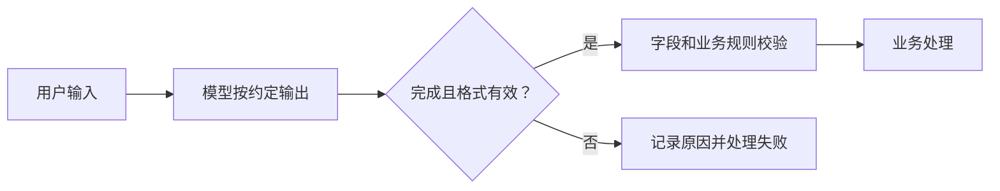

# 🧱 结构化输出

> [!abstract] 一句话总结
> 结构化输出让模型按约定格式返回数据，方便程序读取；格式正确仍不代表字段内容真实或符合业务规则。

## 🎯 解决什么问题？

用户说“我要订两张明天的电影票”，程序需要读取人数和日期。如果模型返回一段散文，下游还得猜哪句话是人数；假设今天是 2026-10-30，返回 `{ "count": 2, "date": "2026-10-31" }` 这样的数据更方便处理。日期需要基于当前时间和时区推算，缺少条件时不能凭空猜测。

## 🧩 三种约束方式

| 方式 | 能保证什么 | 还要处理什么 |
| :--- | :--- | :--- |
| 提示词要求 JSON | 告诉模型目标格式 | 可能夹带文字、漏字段或格式无效 |
| JSON Mode | 在接口正常完成时约束 JSON 语法 | 字段名、类型和业务含义未必符合要求 |
| 原生 JSON Schema 约束 | 受支持的严格模式可约束正常完成的输出结构 | 模型拒答、截断、Schema 子集和业务正确性仍需处理 |

具体保证和支持的 Schema 子集取决于模型和服务商。Spring AI 的对象转换也可能只是把文本转换成 Java 对象，不能不检查底层模型是否启用了原生 Schema 约束。

## ⚙️ 一条处理链



先区分正常完成、拒答、超时和输出截断，再反序列化并校验必填字段、日期范围和用户权限。对外部动作还需要独立授权；不要因为输出符合 Schema 就直接执行。

## 🧪 格式正确，业务仍可能错在哪里？

假设用户只说“订两张票”，模型返回 `{ "count": 2, "date": "2026-10-31" }`。这个 JSON 可以被解析，字段类型也看起来正确，但用户没有提供日期，程序不能把模型猜测的日期当成事实。应要求补充日期，或者使用允许为空的字段并在后续步骤追问。
再看 `{ "count": 0, "date": "2026-10-31" }`：格式符合预期，但人数不符合订票规则。解析、结构校验、业务校验分别处理不同问题；授权与实际订票还要由服务端控制。

## 💻 Java 简短示例

假设已有 Jackson `objectMapper`，`json` 是模型正常完成后返回的文本；以下片段只演示解析，未包含调用、异常处理与业务校验。

```java
record Booking(int count, String date) {}
Booking booking = objectMapper.readValue(json, Booking.class);
if (booking.count() <= 0) throw new IllegalArgumentException("人数必须大于零");
```

Spring AI 的 `entity(...)` 可以把回答转换为目标类型。以下仅展示调用关系，假设 `chatClient` 和 `Booking` 已配置；不同版本对原生结构约束的支持以对应文档为准，结果仍需校验。

```java
Booking booking = chatClient.prompt()
        .user("提取订票人数和日期：2026 年 10 月 31 日订两张电影票")
        .call().entity(Booking.class);
```

实际输入如果是“明天”，仍需要注入可信的当前日期和时区；解析出的结果也不能直接触发订票。

## 🧪 怎么评估？

用正常输入、缺少日期、模糊人数和无关输入构造测试集，分别统计解析成功率、字段准确率、拒答与截断情况。字段类型符合要求不代表日期或数量来自用户原话。

> [!question]- 能解析成 Java 对象，为什么还需要业务校验？
> JSON 可能在语法和类型上都正确，但人数为负数、日期已过期或用户没有权限；这些约束需要业务系统验证。

## 🔗 关联与资料

- 输出格式设计：[[07-Prompt工程基础]]；工具调用：[[../05-Agent-MCP-Skills/_index|Agent 与工具]]。
- [OpenAI：Structured Outputs](https://platform.openai.com/docs/guides/structured-outputs)；[Spring AI：Structured Output](https://docs.spring.io/spring-ai/reference/api/structured-output.html)。
