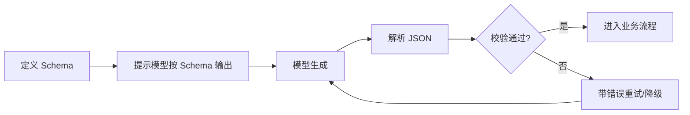

# 结构化输出

> [!abstract] 一句话总结
> 结构化输出是让 LLM 按 JSON、表格或 Schema 返回机器可解析结果，核心是“Schema 约束 + 解析校验 + 失败重试”。

## 🎯 本节定位

- **本章第 11 课，承接 [[07-Prompt工程基础]]、[[04-模型参数-Temperature与TopP]]**。输出校验与安全的关系见 [[12-防御性提示与防注入]]；结构化字段占用 Token 的计量见 [[02-Token与Tokenizer]]。

## 📌 这是什么

许多 LLM 应用不是给人读一段话，而是把模型输出接入程序：分类结果、抽取字段、工具参数、审批决策、推荐列表。这要求输出稳定、合法、可解析。

## 🤔 解决什么问题 / 为什么需要

自然语言输出对人友好，但对程序脆弱。一个多余解释、一处少逗号、一个枚举值拼错，都可能让下游系统失败。

| 非结构化 | 结构化 |
| ---- | ---- |
| “我觉得是高风险” | `{"risk_level":"high"}` |
| 人能看懂 | 程序能解析 |
| 格式漂移 | Schema 约束 |
| 难以批处理 | 适合入库/调用工具 |

## 🧩 核心概念

| 概念 | 含义 | 备注 |
| ---- | ---- | ---- |
| JSON Mode | 要求输出合法 JSON | 不一定保证符合业务 Schema |
| Structured Outputs | 按 JSON Schema 约束输出 | 优先使用平台原生能力 |
| Schema | 字段、类型、枚举、必填规则 | 输出契约 |
| Parser | 解析器 | 把字符串转对象 |
| Validator | 校验器 | 检查字段合法性 |
| Repair Retry | 修复重试 | 解析失败时带错误信息重试 |

## ⚙️ 工作原理 / 流程



## 💻 代码实践

```java
record TicketIntent(
    String category,
    String priority,
    String summary
) {}

TicketIntent intent = chatClient.prompt()
    .user("""
        从用户工单中抽取意图。
        category 只能是 bug/feature/question。
        priority 只能是 low/medium/high。
        工单：%s
        """.formatted(ticketText))
    .call()
    .entity(TicketIntent.class);
```

## ⚠️ 踩坑与注意事项

- [ ] **只在 Prompt 里说“输出 JSON”**：不等于 Schema 合法。
- [ ] **不做解析校验**：模型输出必须当外部输入处理。
- [ ] **字段设计太自由**：枚举、必填、类型越明确越稳定。
- [ ] **错误重试无上限**：最多重试 1-2 次，然后降级人工或返回失败。
- [ ] **把业务决策完全交给模型**：高风险动作要代码层审批。

## 🎯 面试问题

> [!question] 高频问题
> - Q: JSON Mode 和 Structured Outputs 区别？
>   - A: JSON Mode 主要保证语法是 JSON；Structured Outputs 进一步要求符合给定 JSON Schema。
> - Q: 如何保证结构化输出稳定？
>   - A: 使用原生 Schema 约束，字段用枚举和必填，解析校验，失败重试。
> - Q: 为什么还需要后端校验？
>   - A: LLM 输出不可信，必须像用户输入一样验证。

## 🔗 关联笔记

- [[07-Prompt工程基础]]
- [[04-模型参数-Temperature与TopP]]
- [[09-Few-shot与Zero-shot]]
- [[12-防御性提示与防注入]]
- [[_index]]

## 📚 参考资料

- [OpenAI Structured Outputs](https://platform.openai.com/docs/guides/structured-outputs)
- [OpenAI: Introducing Structured Outputs](https://openai.com/index/introducing-structured-outputs-in-the-api/)
- [Claude Cookbook](https://docs.anthropic.com/en/docs/resources/cookbook)

