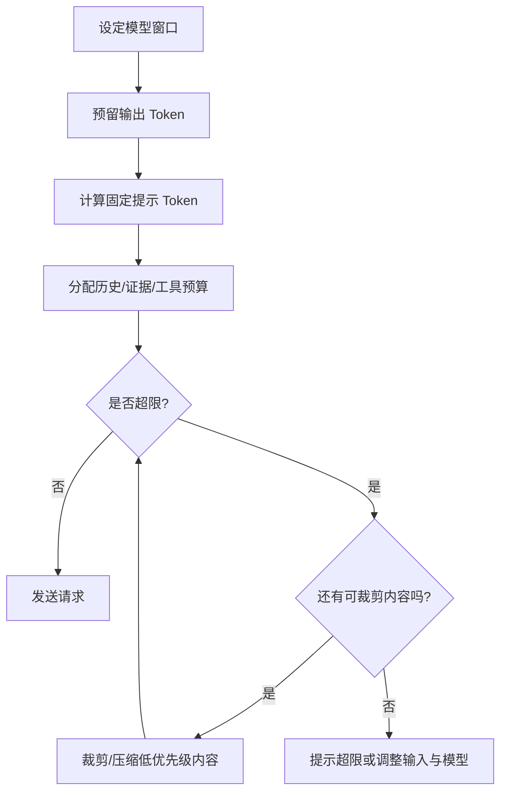

# 上下文窗口预算管理

> [!abstract] 一句话总结
> 上下文窗口预算管理是在固定 Token 上限内，为系统提示、用户问题、历史、证据、工具结果和输出预留合理空间。

## 🎯 本节定位

本章第 14 课，承接 [[03-上下文窗口]]。Token 计量见 [[02-Token与Tokenizer]]；超预算时的压缩手段见 [[15-上下文压缩策略]]；可缓存前缀的分层设计与 [[17-Prompt-Caching提示缓存]] 是同一思路。

## 📌 这是什么

很多模型的上下文窗口需要同时容纳输入和输出，也有服务分别规定输入与输出上限。预算管理是在请求前按目标模型的规则计算各部分 Token，超限时按优先级裁剪或压缩。

## 🤔 解决什么问题 / 为什么需要

没有预算管理的系统会随机失败：有时超限报错，有时历史被截断，有时 RAG 证据塞不进去，有时输出写到一半停止。

| 部分 | 预算策略 |
| ---- | ---- |
| System Prompt | 稳定、短、可缓存 |
| User Question | 必须保留原文 |
| History | 摘要 + 相关片段 |
| RAG Evidence | topK + 重排 + 截断 |
| Tool Results | 结构化摘要优先 |
| Output | 按任务预留；部分推理模型将内部推理 Token 计入输出预算，按服务规则确认 |

## 🧩 核心概念

| 概念 | 含义 | 备注 |
| ---- | ---- | ---- |
| Hard Limit | 模型最大窗口 | 超过会失败或截断 |
| Soft Budget | 应用设定的目标预算 | 通常低于硬限制 |
| Output Reserve | 输出预留 | 防止答案被截断 |
| Priority | 上下文优先级 | 决定谁先被裁剪 |
| Token Accounting | Token 记账 | 记录每部分消耗 |
| Cacheable Prefix | 可缓存前缀 | 稳定内容放前面 |

## ⚙️ 工作流程



推荐优先级：

```text
必须保留：系统规则、当前用户问题、权限信息
高优先级：直接证据、工具关键结果、输出 Schema
中优先级：最近历史、用户偏好
低优先级：寒暄、重复资料、长日志原文
```

## 💻 代码实践

下面是预算计算片段，数字仅作示例；实际还需统计工具结果、消息封装及其他输入。

```java
int window = 128_000;
int outputReserve = 8_000;
int fixedInput = 2_000; // 系统规则、工具定义和当前问题的估算
int historyBudget = window - outputReserve - fixedInput;
```

上线建议记录每次请求的 token breakdown：

```text
system=850, user=120, history=1800, docs=9600, tools=400, output=1700
```

## ⚠️ 踩坑与注意事项

- [ ] 为输出预留空间，避免回答被截断。
- [ ] 不要只按字符截断，以免破坏 JSON、代码块、表格和引用。
- [ ] 文档长度不一，除了 Top-K 数量，还要控制检索结果的 Token 预算。
- [ ] 记录各部分 Token 用量，便于排查成本异常。
- [ ] 动态内容放在前缀可能降低缓存命中率，应检查实际用量。

## 🎯 面试问题

> [!question]- 为什么输出也要算进上下文窗口？
> 对输入和输出共享上下文上限的模型，生成内容也占用窗口，因此输入不能占满全部空间。还要检查服务是否另设输入或输出上限。

> [!question]- RAG topK 应该固定吗？
> 不应只固定数量，应结合 Token 长度、相关性和输出预留动态控制。

> [!question]- 如何降低长上下文成本？
> 检索重排、摘要压缩、缓存稳定前缀、模型路由和限制输出长度。

## 🔗 关联笔记

- [[02-Token与Tokenizer]]
- [[03-上下文窗口]]
- [[15-上下文压缩策略]]
- [[13-上下文工程概述]]
- [[_index]]

## 📚 参考资料

- [Claude Context windows](https://docs.anthropic.com/en/docs/build-with-claude/context-windows)
- [Claude Prompt caching](https://docs.anthropic.com/en/docs/build-with-claude/prompt-caching)
- [OpenAI Cookbook: Count tokens with tiktoken](https://cookbook.openai.com/examples/how_to_count_tokens_with_tiktoken)
