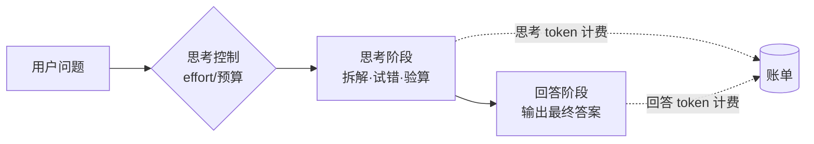

# 推理模型与思考控制

> [!abstract] 一句话总结
> 推理模型在给出答案前先生成一段"内部思考"（花算力在推理时而非只靠训练时），能显著提升数学、代码、多步规划类任务的质量；工程上要学会控制它——选对档位、给思考留 token 空间、并接受"思考也计费"。

## 🗣️ 白话版（先建立直觉）

普通模型像抢答：题目一出口就"脱口而出"，答案全靠平时积累的语感。推理模型像考试时先在草稿纸上演算：列式子、试错、验算，确认无误再誊写到答题卡上。草稿纸（思考过程）你通常看不到全文，但草稿确实占了考试时间（延迟）、也确实费纸（token 照样计费）。所以简单的选择题没必要打草稿——直接答更快更便宜；难题才值得让模型"想一会儿"。

## 📌 这是什么

**推理模型（reasoning model）**是一类在回答前先进行显式"思考"的大模型：它会生成一段中间推理内容（reasoning / thinking tokens），在其中拆解问题、尝试路径、自我检查，最后才输出用户看到的答案。代表形态有 OpenAI 的 o 系列与 GPT-5 的思考档位、Claude 的 extended thinking / adaptive thinking、DeepSeek-R1、Qwen 的思考模式等。

背后的核心思想是 **test-time compute（推理时算力）**：过去提升模型能力主要靠训练时堆数据和参数（train-time compute），而推理模型开辟了另一条路——在回答的那一刻多花算力"多想几步"，用推理时间换答案质量。这两条路是互补的：训练决定模型的"知识与能力上限"，推理时思考决定它这一次能发挥出几成。

"思考控制"则是工程侧的配套能力：通过参数（思考预算、effort 档位、开关思考）决定模型想多深，在质量、延迟、成本三者之间做权衡。

## 🤔 解决什么问题 / 为什么需要

普通模型是"一遍过"的自回归生成：每个 token 只有一次机会，写错了没法回头改。这对闲聊、摘要够用，但对需要多步演算的任务（数学证明、复杂 debug、长链路规划）就容易翻车——中间某一步错了，后面全错，而模型没有"验算"环节。

没有推理模型时的常见困境：

| 困境 | 原因 |
| ---- | ---- |
| 数学/逻辑题频繁出错 | 缺少中间演算和自查，一步错步步错 |
| 靠 CoT 提示词硬撑 | "let's think step by step" 是打补丁，稳定性差 |
| 复杂任务只能拆成多次调用 | 人工编排推理链，工程复杂且脆弱 |
| Agent 长任务中途跑偏 | 模型没有停下来规划和反思的机制 |

推理模型把"先想后答"内化成了模型能力：思考过程经过专门训练（DeepSeek-R1 证明了纯强化学习就能激发出反思、验算等行为），比提示词诱导出来的 CoT 可靠得多。

## 🧩 核心概念

| 概念 | 含义 | 备注 |
| ---- | ---- | ---- |
| Reasoning / Thinking tokens | 回答前生成的内部思考内容 | 计入输出 token，**照常计费** |
| Test-time compute | 把算力花在推理时而非只靠训练时 | "多想一会儿"换质量 |
| 思考预算（budget） | 早期方案：固定分配 N 个 token 给思考 | 如 Claude 早期的 budget_tokens |
| 自适应思考（adaptive） | 模型按题目难度自己决定想不想、想多少 | 简单题少想，难题多想 |
| Effort 档位 | low / medium / high 等档位控制思考深度 | OpenAI 的 reasoning_effort、Claude 的 effort 类似思路 |
| 思考可见性 | 思考内容对用户隐藏或只给摘要 | 防蒸馏 + 减少干扰；DeepSeek-R1 是例外（`<think>` 全可见） |
| 混合/开关思考 | 同一模型可开关思考模式 | 如 Qwen 的思考模式开关 |

**主流形态对比**（讲机制，不纠结具体版本号）：

| 家族 | 机制 | 思考可见性 |
| ---- | ---- | ---- |
| OpenAI o 系列 / GPT-5 | 思考档位（reasoning effort），档位越高想得越深 | 隐藏原始思考，界面/API 提供摘要 |
| Claude | 演进路线：extended thinking（固定 budget_tokens）→ adaptive thinking（自适应）+ effort 档位 | 可选摘要（summarized）或省略（omitted），原始思考链不返回 |
| DeepSeek-R1 | 强化学习训练出的开源推理模型 | `<think>` 标签内思考全文可见 |
| Qwen | 思考模式可开关的混合模型 | 开启时思考内容可见 |

## ⚙️ 工作原理 / 流程



拿一个具体例子走一遍：问"27 × 453 - 19 × 27 等于多少"。

1. **普通模型**：直接开始输出"等于……"，数字是"凭感觉"生成的，三位数乘法经常算错。
2. **推理模型思考阶段**：先在思考区演算——"可以提取公因数 27，27 × (453 - 19) = 27 × 434；27 × 434 = 27 × 400 + 27 × 34 = 10800 + 918 = 11718；验算一下……"。走错路可以回头，算完还能自查。
3. **回答阶段**：把结论誊写成用户看到的答案："11718"。

**思考预算的演进**是理解"思考控制"的关键：

- **第一代：固定预算**。开发者手动指定思考最多用多少 token（如 Claude 早期的 `budget_tokens`）。问题是难调——给少了难题想不完，给多了简单题浪费。
- **第二代：自适应 + 档位**。模型自己判断"这题值不值得想、想多深"（adaptive thinking），开发者只用 effort 档位（low/medium/high 等）表达"整体上偏省还是偏深"。固定 token 数的思考预算在新模型上已被淘汰。

两个工程事实必须记住：**思考 token 按输出 token 计费**（哪怕你看不到全文）；**思考和回答共享 max_tokens 上限**——max_tokens 给小了，思考把额度吃光，答案会被截断。

**工程视角：延迟与成本的权衡**

| 维度 | 影响 | 应对 |
| ---- | ---- | ---- |
| 首 token 延迟 | 思考先行，可见输出前有几秒到几分钟的"沉默期" | 流式输出 + UI 显示"思考中"，或输出思考摘要 |
| 总耗时 | 高档位下单次请求可能长达数分钟 | 调大客户端超时；长任务改异步 + 进度回报 |
| 成本 | 思考 token 全额计入输出计费，高档位成本可能数倍于普通调用 | 按任务路由档位；用 usage 实测而非按可见回答估算 |
| max_tokens | 思考与回答共享上限，给小了答案被截断 | 推理任务从 16K 甚至更高起步，宁大勿小 |

## 🆚 从坏到好（对比案例）

**场景**：用推理模型做代码评审 Agent。

**坏做法——微观管理式 prompt**（给普通弱模型的写法）：

```text
你必须严格按以下步骤执行：
第一步：逐行阅读代码；第二步：列出所有变量并检查命名；
第三步：对每个 if 分支检查空指针；第四步：检查每个循环边界；
第五步：按"严重/一般/轻微"分类；第六步：重新检查一遍第一到五步……
```

为什么不行：推理模型本来就会自己规划检查路径，这份"步骤脚本"反而把它锁死在你设计的（未必最优的）流程里——它会机械地走完六步，而不是顺着代码里真正可疑的地方深挖。实测中这类 prompt 常导致质量**下降**：模型忙着合规，没空真思考。

**好做法——目标 + 约束 + 验收标准**：

```text
目标：找出这段支付模块代码中可能导致线上事故的缺陷。
约束：只报告会影响正确性、并发安全或资金安全的问题，忽略纯风格问题；
     每个问题给出触发条件和修复建议。
验收标准：宁可多报存疑问题（标注置信度），不要漏报真 bug。
```

为什么行：说清"要什么、边界在哪、怎么算做好了"，把"怎么做"留给模型的思考阶段。推理模型的强项恰恰是自己找路径——你管方向，它管路线。

## 💻 代码实践

```java
// ⚠️ 示意代码：展示 Spring AI 风格的思考控制配置思路，
// 参数名以你使用的 Spring AI / SDK 版本文档为准，非可直接运行代码。

// 方式一：OpenAI 系推理模型 —— 用 reasoning effort 档位
OpenAiChatOptions openAiOptions = OpenAiChatOptions.builder()
        .model("<推理模型ID>")
        .reasoningEffort("medium")      // low / medium / high：档位越高想得越深
        .maxTokens(16000)               // 思考 + 回答共享，务必给思考留空间
        .build();

// 方式二：Anthropic Claude —— 自适应思考（新模型推荐，无需手动定预算）
AnthropicChatOptions claudeOptions = AnthropicChatOptions.builder()
        .model("<Claude模型ID>")
        .thinking(new ThinkingConfig("adaptive"))  // 模型自己决定想多少
        .maxTokens(16000)
        .build();
// 旧版 extended thinking 才需要 budget_tokens（固定思考预算），
// 新模型已用 adaptive + effort 档位取代，不要在新代码里再写固定预算。

ChatResponse resp = chatModel.call(new Prompt("排查这段死锁代码的根因", openAiOptions));
// 账单提醒：resp 的 usage 中，思考 token 计入 output tokens 一起计费
```

> 选型层面的配套笔记见：[[05-主流模型选型对比]]

## 🧪 最小验证（做一遍才算学会）

用同一道多步推理题（如"一个水池有 3 根进水管 2 根排水管……几小时注满"）分别调用：① 普通模型；② 推理模型 low 档；③ 推理模型 high 档。对比三点：答案正确率、首 token 延迟、usage 里的输出 token 数。预期看到：high 档更稳但明显更慢更贵；再用"今天天气真好，翻译成英文"重复实验，会发现推理模型的优势消失、纯付出延迟成本——这就是选型决策表的体感版。

## ⚠️ 踩坑与注意事项

- **坑 1：什么任务都用推理模型** → 简单分类/抽取上，思考带来的提升≈0，延迟和成本却翻倍 → 按下面的决策表选型，简单任务用普通模型或低档位。
- **坑 2：max_tokens 没给思考留空间** → 思考吃掉大部分额度，最终答案被截断（stop reason 是 max_tokens）→ 推理模型的 max_tokens 要按"思考+回答"总量设置，宁大勿小。
- **坑 3：给推理模型写 CoT 提示词** → "一步一步想"对它基本多余（它本来就想），过度的步骤脚本反而降低质量 → 写目标和约束，删掉 step-by-step 指令。
- **坑 4：以为看不到就不收钱** → 思考内容隐藏或只给摘要，但思考 token 全额计费 → 做成本核算时看 usage 的 output tokens，别看肉眼可见的回答长度。
- **坑 5：流式 UI 没处理"沉默期"** → 思考阶段用户看不到任何输出，以为卡死了 → UI 上显示"思考中"状态，或选择输出思考摘要。

**什么时候用推理模型（选型决策表）：**

| 场景 | 建议 | 原因 |
| ---- | ---- | ---- |
| 数学推导、复杂算法题 | ✅ 推理模型，高档位 | 多步演算 + 自我验算是刚需 |
| 复杂代码生成 / 重构 / 疑难 debug | ✅ 推理模型，中高档位 | 需要全局规划和反复权衡 |
| Agent 长任务 / 多步规划 | ✅ 推理模型，自适应思考 | 中途反思纠偏能力关键 |
| 深度分析、法律/财务长文档推理 | ✅ 推理模型，中档起步 | 隐含条件多，需要慢想 |
| 简单分类、情感判断 | ❌ 普通模型或最低档 | 思考是纯浪费 |
| 信息抽取、格式转换 | ❌ 普通模型 | 模式化任务，语感足够 |
| 低延迟对话、自动补全 | ❌ 普通模型 / 关闭思考 | 延迟敏感，等不起草稿 |

**Agent 场景补充**：effort 档位还会影响工具调用行为——低档位下模型倾向于更少、更合并的工具调用，直奔目标；高档位下会更多地探索、交叉验证、调用工具确认。长任务用高档位，子任务/简单查询用低档位，是常见的成本优化手法。

## 🧠 自测题（先自己答，再展开对答案）

> 复习时只看题目，口头/纸上回答后再展开。答不上来 → mastery 降一星。

> [!question]- Q1: 为什么"推理时多花算力"能提升答案质量？训练时算力不是已经决定了模型能力吗？
> 参考答案：训练决定的是能力上限（参数里的知识和技能），但一遍过的自回归生成让模型没有试错和验算的机会，实际发挥打折。思考阶段给了模型一块"草稿纸"：可以拆解问题、尝试多条路径、发现错误后回头、输出前自查——相当于把一次抽样变成了带搜索和验证的过程，所以同一个模型"想过再答"显著好于"脱口而出"。这就是 test-time compute 的价值：训练定上限，推理时思考定发挥。

> [!question]- Q2: 线上有个用户评论情感分类服务，同事直接接了推理模型高档位，结果延迟从 0.5s 涨到 8s、成本涨了 10 倍而准确率几乎没变。怎么解释和处理？
> 参考答案：情感分类是模式化任务，普通模型的"语感"已经够用，思考阶段带来的增量≈0，但思考 token 全额计费且思考先行导致首 token 延迟大增——这是典型的"简单题打草稿"。处理：换普通模型或把思考关掉/降到最低档；如果同一服务里混有复杂任务，可以做路由——简单请求走普通模型，复杂请求走推理模型（参考选型决策表）。

> [!question]- Q3: CoT 提示词（"让我们一步一步思考"）和推理模型是什么关系？给推理模型写详细的 step-by-step 指令为什么可能有害？
> 参考答案：CoT 提示词是在普通模型上用提示语"诱导"出推理行为的补丁；推理模型则把这个行为通过训练内化了，所以对它 CoT 提示基本多余。更进一步，详细的步骤脚本是在替模型规划路径，会把它锁死在你设计的流程里，挤占它自己的推理规划——实践中常导致质量下降。正确姿势是"目标 + 约束 + 验收标准"，把"怎么做"留给模型。关联：[[10-CoT思维链]]。

## 🎯 面试问题

> [!question] 高频问题
> - Q: 什么是推理模型？它和普通 LLM 的本质区别是什么？
>   - A:（30 秒）推理模型在输出答案前先生成一段内部思考，把算力花在推理时（test-time compute），在数学、代码、多步规划任务上显著更强，代价是延迟和成本更高。（2 分钟展开）① 机制：思考阶段可以拆解、试错、验算，弥补了自回归"一遍过"的缺陷；② 训练：推理能力是通过 RL 等方式专门训练出来的（DeepSeek-R1 论文证明纯 RL 可行），比 CoT 提示词诱导可靠；③ 形态：OpenAI o 系列/GPT-5 的思考档位、Claude 的 adaptive thinking + effort、DeepSeek-R1、Qwen 思考模式；④ 工程含义：思考 token 计费、和回答共享 max_tokens、首 token 延迟变大。
> - Q: 实际项目中你怎么决定用不用推理模型、用什么档位？
>   - A:（30 秒）看任务复杂度和延迟预算：数学/复杂代码/Agent 长任务用推理模型（中高档位），简单分类/抽取/低延迟场景用普通模型；混合负载做路由。（2 分钟展开）① 判断标准：任务是否需要多步演算和中途纠偏；② 档位策略：优先自适应思考让模型自己定，用 effort 表达整体偏好——主流程高档、子任务低档；③ 成本核算：思考 token 计入输出计费，用 usage 实测而非估算；④ 兜底：max_tokens 给足思考空间，流式 UI 处理思考期的"沉默"；⑤ 验证：用自己的评测集对比档位间的质量/成本/延迟曲线再定，不拍脑袋。
> - Q: 推理模型对 Prompt 写法有什么影响？
>   - A:（30 秒）从"教它怎么做"转向"告诉它做成什么样"：写目标、约束、验收标准，删掉 step-by-step 微观指令，CoT 提示词基本不需要了。（2 分钟展开）① 原因：模型自带规划能力，步骤脚本会锁死它的思考路径，实测降质量；② 该写的：清晰的目标、边界约束（做什么/不做什么）、可检验的完成标准；③ 不该写的：详细执行步骤、"一步一步想"类咒语、过度强调"必须""CRITICAL"的命令式语气；④ 例外：输出格式等硬性要求仍要明说，推理模型只是不需要你教"怎么想"。

## 🪝 记忆钩子

> **"先打草稿再答题；草稿占纸、草稿收钱、草稿不给你看全。"**
> —— 占纸 = 思考和回答共享 max_tokens；收钱 = 思考 token 照常计费；不给看全 = 摘要/隐藏。
> 选型口诀：**"难题打草稿，简单题抢答"**；Prompt 口诀：**"给目标不给步骤——请了博士，就别再教他列竖式"**。

## 🔗 关联笔记

- [[01-LLM工作原理]]（本篇的前置：自回归"一遍过"生成的局限，正是推理模型要解决的问题）
- [[10-CoT思维链]]（CoT 是提示词层面的"手动推理"，推理模型把它内化成了模型能力，二者是演进关系）
- [[04-模型参数-Temperature与TopP]]（同为推理时控制参数；注意部分推理模型不再接受采样参数，改由 effort 档位控制行为）
- [[03-上下文窗口]]（思考 token 占用输出预算，与上下文/输出预算管理直接相关）
- [[_index]]（本章目录）

## 📚 参考资料

- [OpenAI: Reasoning models guide](https://platform.openai.com/docs/guides/reasoning)
- [Anthropic Docs: Building with extended thinking](https://docs.anthropic.com/en/docs/build-with-claude/extended-thinking)
- Anthropic Docs: Adaptive thinking / Effort（Claude 开发者文档中关于自适应思考与 effort 参数的章节）
- [DeepSeek-R1: Incentivizing Reasoning Capability in LLMs via Reinforcement Learning (arXiv:2501.12948)](https://arxiv.org/abs/2501.12948)
