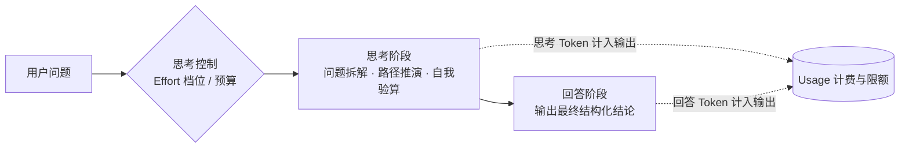

# 推理模型与思考控制

> [!abstract] 一句话总结
> 推理模型在给出答案前先生成一段"内部思考"（花算力在推理时而非只靠训练时），能显著提升数学、代码、多步规划类任务的质量；工程上要学会控制它——选对档位、给思考留 token 空间、并接受"思考也计费"。

## 🗣️ 核心直觉

与直接输出最终回答的常规模型不同，推理模型会在正式作答前投入额外的测试期算力（Test-time Compute），先在内部完成问题拆解、路径探索与自我验算，再输出最终结论。这一机制显著提升了数学推导、复杂代码重构与多步规划任务的表现；与此同时，内部思考所生成的 Token 会计入输出额度并产生相应延迟与费用。因此工程实践的核心在于**按任务复杂度分级路由**——简单感知与抽取任务使用常规模型保障低延迟，高复杂度推理任务启用推理模型并合理配置思考档位与输出上限。

## 📌 这是什么

**推理模型（Reasoning Model）**是一类在输出最终回答前先生成显式中间推理过程的大模型：它会先产生一段内部思考 Token（Reasoning / Thinking Tokens），用于拆解条件、推演方案与验证中间结论，最后再输出面向用户的正式回答。代表形态包括 OpenAI 的 o 系列与 GPT-5 思考档位、Claude 的 Extended / Adaptive Thinking、DeepSeek-R1 以及 Qwen 的思考模式等。

背后的核心思想是 **Test-time Compute（推理时算力扩展）**：过去提升模型能力主要依赖训练阶段扩大数据与参数规模（Train-time Compute），而推理模型在推理阶段通过投入更多计算步骤换取更高的单次作答质量。训练阶段决定了模型的知识储备与能力上限，推理阶段的思考深度则决定了模型在复杂问题上的实际发挥水平。

“思考控制”则是工程侧的配套机制：通过参数（思考预算、Effort 档位、思考模式开关）调节推理深度，在答案质量、响应延迟与调用成本三者之间取得平衡。

## 🤔 解决什么问题 / 为什么需要

常规自回归生成是单向线性的：每个 Token 一旦采样输出便无法撤回重来。这种模式对日常问答、文本摘要足够高效，但在面对多步演算任务（如复杂数学证明、并发死锁排查、长链路架构规划）时容易受限——一旦中间某步推导出现偏差，后续生成往往沿着错误前提继续展开，缺乏内置的回溯与验算环节。

常规模型在复杂推理场景下的典型痛点：

| 痛点 | 原因 |
| ---- | ---- |
| 数学与多跳逻辑题易出错 | 缺少中间演算与反向验算，单步失误导致后续全盘偏离 |
| 仅靠提示词诱导 CoT 稳定性受限 | 提示词层面的分步引导主要依赖语言续写惯性，主动纠错能力较弱 |
| 复杂任务需拆分为多次串行调用 | 人工在代码层编排多步推理链，链路冗长且维护成本高 |
| Agent 长链路执行中途偏航 | 模型缺乏在关键节点主动停顿、复盘状态并修正计划的机制 |

推理模型通过强化学习（如 DeepSeek-R1 采用的冷启动数据结合大规模强化学习训练）将“问题拆解、假设检验、自我纠错”内化为模型原生能力，使复杂任务的推理可靠性显著优于单纯的提示词引导。

## 🧩 核心概念

| 概念 | 含义 | 备注 |
| ---- | ---- | ---- |
| Reasoning / Thinking tokens | 正式回答前生成的内部思考 Token | 计入输出 Token 用量，**参与账单计费与窗口占用** |
| Test-time compute | 在推理阶段投入额外计算步骤以提升生成质量 | 与预训练算力互补，以推理耗时换取复杂任务准确率 |
| 思考预算（Budget） | 显式指定内部思考最多可消耗的 Token 数量 | 如 Claude Extended Thinking 中的 `budget_tokens` |
| 自适应思考（Adaptive） | 模型根据输入问题的复杂度动态决定是否思考及思考深度 | 简单问题快速作答，复杂问题自动展开深度推导 |
| Effort 档位 | 通过 `low` / `medium` / `high` 等档位控制整体推理投入 | 如 OpenAI 的 `reasoning_effort` 与 Claude 的 `effort` 参数 |
| 思考可见性 | 内部思考内容在 API 响应中的暴露形式 | 因厂商而异：如返回脱敏摘要、完整 `<think>` 内容或省略明细 |
| 混合/开关思考 | 同一模型支持按请求动态开启或关闭思考模式 | 如 Qwen3 等支持在常规快答与深度思考模式间切换 |

**主流模型机制对比**（具体型号名称与支持参数以各厂商最新官方文档为准）：

| 家族 | 控制机制 | 思考内容返回形式 |
| ---- | ---- | ---- |
| OpenAI o 系列 / GPT-5 | 通过 `reasoning_effort` 档位调节推理深度 | 隐藏原始思考 Token，API 与界面可提供推理摘要（Summary） |
| Claude | 支持固定 `budget_tokens`（Extended Thinking）及自适应思考（Adaptive Thinking）配合 `effort` 档位 | 返回 Thinking 内容块或摘要，具体展示粒度随型号与接口配置而定 |
| DeepSeek-R1 | 强化学习训练的开源原生推理模型 | 通过 `reasoning_content` 字段或 `<think>` 标签完整返回思考文本 |
| Qwen（思考模式） | 支持在同一模型上通过参数或指令开关思考模式 | 开启思考模式时完整返回中间思考内容 |

## ⚙️ 工作原理 / 流程



以计算“$27 \times 453 - 19 \times 27$”为例对比执行过程：

1. **常规直接生成**：直接输出“等于……”，在缺少中间步骤时容易在多位数乘法与减法进位上出错。
2. **推理模型思考阶段**：先在内部思考区推演——“提取公因数 $27$，原式 $= 27 \times (453 - 19) = 27 \times 434$；拆分为 $27 \times 400 + 27 \times 34 = 10800 + 918 = 11718$；反向核对个位数 $7 \times 4 = 28$ 尾数为 $8$，结果一致”。
3. **正式回答阶段**：基于验算完毕的中间状态，输出整洁的最终结果 `"11718"`。

**思考控制方式的演进**：

- **第一代：固定 Token 预算**。开发者手动指定思考阶段的最大 Token 配额（如 `budget_tokens`）。这种方式需要针对不同业务分布反复调优——配额过小会导致复杂问题推导中断，配额过大则会在简单问题上增加不必要的耗时。
- **第二代：自适应思考 + Effort 档位**。模型根据问题难度自主调节推理深度（Adaptive Thinking），开发者只需通过 `low` / `medium` / `high` 等档位声明当前场景对“速度/成本”与“推理深度”的整体偏好。

**输出上限参数的接口差异**：在设置总输出预算时，OpenAI Chat Completions 接口对推理模型使用 `max_completion_tokens`，Responses API 使用 `max_output_tokens`，Anthropic Claude 等接口则通过 `max_tokens` 配合 `thinking` 配置管理。由于内部思考与最终可见回答通常共享总输出限额，工程配置时需为两部分留足空间。

**工程视角：延迟、成本与配额的权衡**

| 维度 | 工程影响 | 应对策略 |
| ---- | ---- | ---- |
| 首可见 Token 延迟 | 模型需先完成内部思考才开始输出正文，存在数秒至数十秒的等待期 | 开启流式传输，前端展示“深度思考中”状态或实时渲染思考摘要 |
| 端到端总耗时 | 高档位复杂推理单次耗时显著长于常规问答 | 调大 HTTP 客户端读取超时（Read Timeout）；长耗时任务采用异步任务队列 + 状态轮询/推送 |
| 调用成本 | 思考 Token 计入输出 Token 计费，高档位单次消耗可达常规调用的数倍 | 实施模型分级路由；成本监控直接采集响应 `usage` 中的实际输出 Token 明细 |
| 输出截断风险 | 若总输出上限过小，思考阶段耗尽额度会导致最终回答为空或被截断 | 根据真实业务评测集统计思考 Token 分布，合理设置 `max_completion_tokens` / `max_tokens` |

## 🆚 从坏到好（Prompt 设计对比）

**场景**：使用推理模型构建支付核心模块的代码缺陷审查 Agent。

**反例——微观步骤管控式 Prompt**（沿用早期针对弱模型的写法）：

```text
你必须严格按以下六个步骤顺序执行：
第一步：逐行阅读代码；第二步：列出所有变量并检查命名规范；
第三步：对每个 if 分支检查空指针；第四步：检查每个循环边界；
第五步：按"严重/一般/轻微"分类；第六步：重新检查一遍第一到五步……
```

问题分析：推理模型自身已经具备针对代码结构规划排查路径的能力。过于死板的步骤脚本会限制模型对高风险分支的自主深挖，使其将算力消耗在机械满足格式步骤上，实测往往降低复杂隐蔽缺陷的检出率。

**正例——明确目标 + 边界约束 + 验收标准**：

```text
目标：审查以下支付模块代码，识别可能导致线上资金损失、并发状态不一致或服务中断的缺陷。
约束：
1. 仅报告影响业务逻辑正确性、并发安全、事务完整性与幂等性的问题，忽略单纯的代码命名与排版风格问题；
2. 每个问题需说明具体的并发/边界触发条件、潜在影响及修复代码示例。
验收标准：对存在疑点但缺乏上下文确认的潜在风险，请单独列出并标注需要进一步核实的外部依赖条件。
```

设计要点：清晰界定**任务目标、排除范围与交付标准**，将具体的推导路径交给模型的内部思考阶段自主规划。

## 💻 代码实践

```java
// 示意代码：展示 Spring AI 中推理模型的档位与思考参数配置思路（具体 API 随 Spring AI 版本演进）

// 方式一：OpenAI 推理模型 —— 配置 reasoningEffort 与 maxCompletionTokens
OpenAiChatOptions openAiOptions = OpenAiChatOptions.builder()
        .model("<推理模型ID>")
        .reasoningEffort("medium")      // 可选 low / medium / high，按任务复杂度选择
        .maxCompletionTokens(16000)     // 思考 Token 与最终回答共享该输出预算
        .build();

// 方式二：Anthropic Claude —— 配置思考模式与总输出预算
AnthropicChatOptions claudeOptions = AnthropicChatOptions.builder()
        .model("<Claude模型ID>")
        .thinking(new ThinkingConfig("adaptive"))  // 自适应思考（固定预算模式则指定 budget_tokens）
        .maxTokens(16000)
        .build();

ChatResponse resp = chatModel.call(new Prompt("请排查以下并发转账代码的死锁与超卖隐患：\n" + codeSnippet, openAiOptions));
// 成本监控：从 resp.getMetadata().getUsage() 中采集总输出 Token 及推理 Token 明细
```

> 模型选型与路由架构设计可结合阅读：[[05-主流模型选型对比]]

## 🧪 最小验证实验

选用同一道多步逻辑应用题，分别使用：① 常规对话模型；② 推理模型 `low` 档；③ 推理模型 `high` 档进行调用，对比**准确率、首字可见延迟与 `usage` 中的输出 Token 数量**。随后换用一句简单的日常中英翻译重复该实验。通过对比可以直观验证：在复杂多步推理上高档位能有效提升准确率，而在简单模式化任务上常规模型更具性价比。

## ⚠️ 踩坑与注意事项

- **坑 1：所有任务一刀切使用推理模型** $\to$ 在简单意图分类、实体抽取任务上，内部思考几乎不带来准确率收益，反而大幅增加延迟与账单 $\to$ 建立分级路由，简单任务走轻量常规模型或关闭思考模式。
- **坑 2：输出上限未预留思考空间** $\to$ 思考过程消耗了绝大部分输出配额，导致最终可见回答被截断（`finish_reason = length / max_tokens`） $\to$ 根据任务复杂度为 `max_completion_tokens` / `max_tokens` 预留充足的“思考 + 回答”总空间。
- **坑 3：对推理模型堆砌繁琐的 CoT 步骤指令** $\to$ 模型已内化分步推理能力，过度限制每一步怎么想反而干扰其自主验算 $\to$ Prompt 聚焦于清晰的目标、边界约束与输出 Schema。
- **坑 4：仅按可见字符长度估算成本** $\to$ 内部思考即使在界面上折叠或仅返回摘要，其消耗的思考 Token 仍按输出单价计费 $\to$ 账单核算与限流统一以 API 返回的 `usage` 字段为准。
- **坑 5：同步调用未调整超时与前端反馈** $\to$ 深度思考耗时较长，默认网关超时或无状态加载界面会导致连接断开或用户重复提交 $\to$ 延长客户端超时阈值，并在流式 UI 中展示思考状态提示。

**推理模型选型决策参考表：**

| 业务场景 | 选型建议 | 核心依据 |
| ---- | ---- | ---- |
| 数学证明、复杂算法设计与排障 | ✅ 推理模型（中高档位） | 强依赖多步演算、分支试错与反向验算 |
| 核心代码重构、并发死锁与疑难 Bug 诊断 | ✅ 推理模型（中高档位） | 需要跨函数全局状态追踪与多条件权衡 |
| Agent 复杂长链路规划与工具编排 | ✅ 推理模型（自适应或中档位） | 依赖中途状态复盘、异常纠偏与动态重规划 |
| 法律合同审查、财务报表多表交叉核对 | ✅ 推理模型（中档起步） | 隐含约束多，需逐条比对与逻辑自洽检查 |
| 客服意图分类、情感极性判断 | ❌ 常规轻量模型（或最低思考档） | 典型单步模式识别，常规模型响应更快、成本更低 |
| 标准字段抽取、固定格式转换 | ❌ 常规模型 + Structured Outputs | 依赖语法契约与表层语义提取，无需长链推演 |
| 实时输入补全、低延迟闲聊交互 | ❌ 常规高速模型 / 关闭思考 | 首字延迟敏感（需百毫秒级响应） |

**Agent 场景实践补充**：在多步 Agent 架构中，`effort` 档位还会影响模型的工具调用策略——低档位倾向于快速直接发起调用，适合子任务执行；高档位倾向于在调用前后进行更充分的参数核对与结果交叉验证，适合顶层规划器（Planner）与复杂异常恢复节点。

## 🧠 自测题（先自己答，再展开对答案）

> 复习时只看题目，口头或纸上回答后再展开核对。

> [!question]- Q1: 为什么“在推理阶段投入更多算力（Test-time Compute）”能提升答案质量？预训练算力不是已经决定了模型参数吗？
> 参考答案：预训练与后训练决定了模型参数所蕴含的知识广度与能力上限，但常规自回归解码采用单向贪心或单次采样，模型必须在极少的前向步骤内直接输出结论，缺乏试错与修正空间。推理模型的思考阶段允许模型在输出最终结论前，通过生成中间推理 Token 进行问题拆解、多路径探索与结果验算，相当于在测试期将单步预测转化为带验证的序列搜索过程，从而更充分地释放模型参数中的潜在推理能力。

> [!question]- Q2: 线上某用户评论情感分类服务接入了推理模型高档位，结果平均响应延迟从 0.5s 升至 8s、调用成本增加近 10 倍，而准确率几乎不变。如何分析原因并优化？
> 参考答案：情感分类属于典型的浅层语义模式识别任务，常规模型的单次前向表征已完全够用；开启高档位思考后，模型在输出分类标签前额外生成了大量内部思考 Token，这些 Token 既拉长了首字可见延迟，又全额计入输出账单，却无法进一步提升分类上限。优化方案：将该服务切换为常规轻量模型（或关闭思考模式）；若系统同时承载复杂归因分析任务，则引入前置路由层，常规分类走快模型，复杂疑难样本再路由至推理模型。

> [!question]- Q3: 提示词层面的 CoT（“请一步一步思考”）与原生推理模型是什么关系？为什么给推理模型编写过细的步骤脚本反而可能降低效果？
> 参考答案：提示词 CoT 是在常规模型上通过上下文引导触发分步续写模式；而原生推理模型已通过强化学习将分步推演、回溯与验算内化为模型固有机制，因此无需再添加“一步一步思考”等引导语。如果人为编写过于琐碎的微观执行步骤，会强制模型按预设脚本机械填充，限制其根据具体问题特征自主分配注意力与探索高价值分支。针对推理模型的最佳提示策略是明确“业务目标 + 边界约束 + 验收标准”，将具体推导路径交由模型自主完成。关联：[[10-CoT思维链]]。

## 🎯 面试问题

> [!question] 高频问题
> - **Q: 什么是推理模型？它和常规大语言模型的核心区别是什么？**
>   - **A**: 推理模型是在输出正式回答前先生成显式内部思考过程（Reasoning Tokens）、利用测试期算力（Test-time Compute）提升复杂任务表现的模型。核心区别在于：① **工作机制**：思考阶段支持问题拆解、路径试错与自我验算，克服了常规自回归单次直出难以回溯的局限；② **训练范式**：通过强化学习（RL）等后训练专门强化多步推理与反思行为，可靠性显著高于单纯的 Prompt CoT 引导；③ **工程特性**：思考 Token 计入输出配额并按输出单价计费，首可见 Token 延迟较高，支持通过 `reasoning_effort` 或思考预算参数按需调节。
> - **Q: 实际项目中如何决定是否使用推理模型以及如何选择思考档位？**
>   - **A**: 依据任务复杂度与延迟预算分级决策：① **场景划分**：数学计算、复杂代码重构/排障、合同交叉审查及 Agent 顶层规划使用推理模型（中高档位）；简单分类、字段抽取、实时对话使用常规模型；② **档位与混合路由**：高频子任务使用常规模型或 `low` 档，复杂核心链路使用 `medium/high` 档或自适应思考（Adaptive Thinking）；③ **配额与超时保障**：`max_completion_tokens` / `max_tokens` 需同时留足思考与回答空间，调大客户端超时并在前端做好思考状态交互，最后基于真实业务评测集对比质量、延迟与 `usage` 成本曲线定稿。
> - **Q: 使用推理模型时，Prompt 工程策略需要做哪些调整？**
>   - **A**: 从“微观过程指导”转向“目标与契约定义”：① **精简过程指令**：移除“请一步一步思考”等引导语以及死板的分步执行脚本，避免干扰模型原生的推理路径规划；② **强化边界与标准**：重点写清业务目标、负面约束（哪些情况不处理）、数据来源范围与可验证的验收标准；③ **保持结构化契约**：若下游需要 JSON 解析，依然配合原生 Structured Outputs（JSON Schema）约束最终输出格式。

## 🪝 核心要点速记

- **算力视角**：预训练决定模型能力上限，测试期思考（Test-time Compute）决定复杂任务上的实际发挥。
- **工程计费与配额**：内部思考 Token 与最终回答共享最大输出上限，且计入输出 Token 计费，需以响应 `usage` 实测核算。
- **选型与提示原则**：复杂推演与长链规划用推理模型，简单抽取与分类用常规模型；Prompt 聚焦**目标、约束与验收标准**，无需手写繁琐推导步骤。

## 🔗 关联笔记

- [[01-LLM工作原理]]（本篇的前置：自回归"一遍过"生成的局限，正是推理模型要解决的问题）
- [[10-CoT思维链]]（CoT 是提示词层面的"手动推理"，推理模型把它内化成了模型能力，二者是演进关系）
- [[04-模型参数-Temperature与TopP]]（同为推理时控制参数；注意部分推理模型不再接受采样参数，改由 effort 档位控制行为）
- [[03-上下文窗口]]（思考 token 占用输出预算，与上下文/输出预算管理直接相关）
- [[_index]]（本章目录）

## 📚 参考资料

- [OpenAI: Reasoning models guide](https://platform.openai.com/docs/guides/reasoning)
- [Anthropic Docs: Building with extended thinking](https://docs.anthropic.com/en/docs/build-with-claude/extended-thinking)
- Anthropic Docs: Adaptive thinking / Effort（Claude 开发者文档中关于自适应思考与 effort 参数的章节）
- [DeepSeek-R1: Incentivizing Reasoning Capability in LLMs via Reinforcement Learning (arXiv:2501.12948)](https://arxiv.org/abs/2501.12948)
