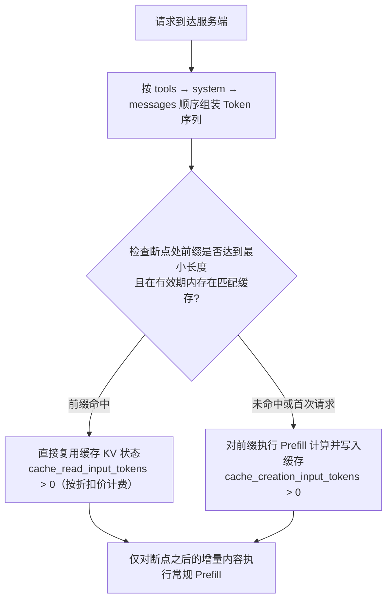

# Prompt Caching 提示缓存

> [!abstract] 一句话总结
> Prompt Caching（提示缓存）通过复用多次请求中一致输入前缀的注意力计算状态（KV Cache），省去重复的 Prefill 预填充计算，从而显著降低长上下文场景下的首 Token 延迟（TTFT）与输入 Token 成本。

## 🗣️ 核心直觉

在调用大模型 API 时，每次请求往往都携带着大量重复的上下文前缀（例如数千 Token 的系统提示词、完整的工具 Schema 列表、长篇背景文档或多轮对话的前序历史）。
Prompt Caching 缓存的是**输入前缀对应的中间计算状态（KV Cache）**，而非缓存模型最终生成的文本答案（因此即使前缀完全命中缓存，模型每次仍会根据当前问题和采样参数动态生成回答）。
工程落地的关键原则是**“稳定内容前置，动态内容后置”**：将固定不变的工具定义、系统规则与基准文档放在输入序列最前端，将每轮变化的时间戳、用户问题追加在末尾。当输入序列从某处发生变动时，变动点之前的合格缓存前缀仍可被复用，仅有变动点及后续新增内容需要重新执行 Prefill 计算。

## 📌 这是什么

在标准 Transformer 推理中，处理请求分为两个阶段：**Prefill（预填充阶段，并行计算所有输入 Token 的 KV 状态）**与 **Decoding（解码阶段，逐个生成输出 Token）**。当输入上下文很长时，Prefill 阶段的计算量与耗时占比极高。
Prompt Caching 允许服务端将已计算的输入前缀 KV 状态暂存在高速缓存介质中；后续请求只要匹配相同的模型输入前缀（满足目标模型的最小 Token 长度门槛且在 TTL 有效期内），即可直接跳过该前缀的重复计算并享受缓存读取折扣价。

## 🤔 解决什么问题 / 为什么需要

| 典型业务场景 | 可复用的稳定前缀 | 工程设计要点 |
| ---- | ---- | ---- |
| 复杂 Agent / 固定角色助手 | 冗长的 System Prompt 与数十个 Tool Schema 定义 | 保持工具定义列表顺序固定，避免在系统提示词中混入动态时间戳或请求 ID |
| 多轮连续对话 / 编码助手 | 不断在末尾追加的前序历史消息（`messages`） | 采用纯追加（Append-only）方式推进多轮会话；仅在跨越窗口阈值时集中执行一次历史摘要 |
| 长文档 / 代码库多轮问答 | 基准知识文档或代码上下文片段 | 将长文档置于用户具体问题之前，使针对同一文档的多次提问共享文档前缀 |

## 🧩 核心概念

| 概念 | 含义 | 工程说明 |
| ---- | ---- | ---- |
| 前缀匹配 (Prefix Match) | 基于模型实际接收的 Token 序列进行从头比对 | 改动点之前的合格前缀可命中缓存，改动点及其后续序列需重新计算 |
| 序列拼接顺序 | 模型内部将各字段拼为统一序列的顺序（如 Anthropic 按 `tools` $\to$ `system` $\to$ `messages` 顺序） | 位于最前端的 `tools` 一旦变动，会导致后续 `system` 与 `messages` 的前缀偏移 |
| `cache_control` 断点 | 显式缓存模式下的标记（如 Anthropic `{"type": "ephemeral"}`），声明“缓存至此块末尾” | 断点应打在稳定内容块的末尾（Anthropic 单次请求最多支持 4 个断点） |
| 缓存有效期 (TTL) | 缓存条目在未命中时的存活时长（如 Anthropic 默认 5 分钟且命中自动续期，可选 1 小时） | 高频调用使用默认短 TTL 即可；低频但周期性触发的任务可评估长 TTL |
| `cache_creation_input_tokens` | 响应 `usage` 字段：本次请求新写入缓存的前缀 Token 数量 | 显式缓存写入通常有小幅溢价（如 Anthropic 5m TTL 约为基础输入价的 $1.25\times$） |
| `cache_read_input_tokens` | 响应 `usage` 字段：本次请求成功从缓存读取复用的 Token 数量 | 命中部分享受显著折扣（如 Anthropic 约为基础输入价的 $0.1\times$） |
| 最小可缓存长度 | 触发缓存所需的最低 Token 数量门槛（常见为 1024～4096 Tokens，依具体模型而定） | 短于门槛的前缀不会触发缓存，响应中 `creation` 与 `read` 均为 `0` |

**缓存成本测算示例（以 Anthropic 5 分钟 TTL 费率为例）**：
设常规输入单价为 $1\times$，则缓存写入单价约为 $1.25\times$，缓存命中读取单价约为 $0.1\times$。
若某 8000 Token 的稳定前缀在有效期内被调用 2 次：总成本 $= 1.25 + 0.1 = 1.35\times$，低于无缓存时的 $2.0\times$，即**第 2 次调用即可收回写入成本**；调用次数越多，边际输入成本越接近 $0.1\times$。

**主流厂商缓存机制对比**：

| 供应商 | 触发机制 | 计费特征 | 开发者配置工作 |
| ---- | ---- | ---- | ---- |
| **Anthropic Claude** | 支持显式 `cache_control` 断点及自动前缀缓存 | 写入约 $1.25\times$（5m）/ $2\times$（1h），命中读取约 $0.1\times$ | 将稳定内容独立成块，在块末尾配置缓存断点 |
| **OpenAI** | 自动前缀缓存（满足最小长度门槛后按步长自动匹配） | 缓存写入无额外溢价，命中读取按折扣价计费（依模型定价） | 无需特殊字段标注，保持提示词前缀稳定置顶即可（支持 `prompt_cache_key` 辅助路由） |
| **DeepSeek** | 自动上下文硬盘缓存（按前缀自动匹配复用） | 缓存写入按标准输入计费，命中部分享受大幅折扣 | 无需修改请求代码，结构上遵循稳定内容前置原则 |
| **Google Gemini** | 支持隐式缓存与显式 Context Caching 资源管理 | 显式缓存按读取 Token 折扣价 + 缓存驻留时长计费 | 超大固定文档可通过 API 预创建 Cache 对象并按 ID 引用 |

尽管各厂商在“自动触发”与“显式断点”的接口形态上有所差异，**前缀匹配（Prefix Matching）的底层原理完全一致**——将稳定内容前置是跨平台通用的架构设计准则。

## ⚙️ 工作原理 / 流程

以下流程以 Anthropic 显式断点缓存为例展示单次请求的匹配与计费逻辑：



以包含 8000 Token 系统提示词 + 200 Token 用户问题的连续调用为例：

1. **第 1 次请求**：系统提示词末尾带有 `cache_control` 断点。此时缓存为空，服务端计算并写入 8000 Token 缓存（`cache_creation = 8000`，`input = 200`）。
2. **第 2 次请求（3 分钟内，系统提示词不变，仅更换用户问题）**：前 8000 Token 前缀完全匹配，直接复用缓存状态（`cache_read = 8000`，`input = 200`），仅需对新增的 200 Token 执行 Prefill。
3. **第 3 次请求（若在系统提示词开头插入了动态字符）**：序列从起始位置即发生偏移，导致整段 8000 Token 无法匹配原断点缓存，需重新执行 Prefill 计算。

**在多轮对话与 Agent 循环中的运用**：
在多轮对话或 Agent 多步工具调用中，如果每一轮仅在 `messages` 列表末尾追加新的 `assistant` / `tool` / `user` 消息，那么前序历史天然构成下一轮请求的稳定前缀。若中途对早期历史执行了滑动窗口裁剪或全文重摘要，前缀序列将发生改变，此时会触发重新计算并建立新的缓存基准。

## 🆚 从坏到好（前缀分层设计对比）

**反例——将动态时间戳直接拼接在单块 System Prompt 中**：

```text
system: "你是企业客服助手……（8000 Token 的业务规则）……当前系统时间：2026-07-26 14:33:07"
```

问题分析：在显式断点模式下，如果将 8000 Token 的静态规则与每秒变化的 `LocalDateTime.now()` 拼在同一个文本块中并在末尾打断点，由于每次请求的块文本哈希均不同，会导致该断点始终无法命中缓存，每次反而多支付缓存写入开销。

**正例——冻结静态前缀块，将动态上下文后置**：

```text
system: [
  { text: "你是企业客服助手……（8000 Token 静态规则，保持只读不变）", cache_control: { type: "ephemeral" } }
]
messages: [
  ...历史消息...,
  { role: "user", content: "[当前时间：2026-07-26 14:33] 用户具体问题……" }
]
```

优化收益：静态的 8000 Token 独立成块并锁定断点，动态变化的时间戳与当前问题位于缓存断点之后，从而确保静态规则前缀在多轮请求间稳定命中缓存。

## 💻 代码实践

Anthropic HTTP 请求体结构示例：

```json
{
  "model": "YOUR_SUPPORTED_MODEL_ID",
  "max_tokens": 1024,
  "system": [
    {
      "type": "text",
      "text": "<固定不变的长系统提示词与业务规范，不包含动态时间戳或随机 ID>",
      "cache_control": { "type": "ephemeral" }
    }
  ],
  "messages": [
    { "role": "user", "content": "[当前时间：2026-07-26 14:33] 用户问题" }
  ]
}
```

Java（使用 Anthropic 官方 SDK 构建带缓存断点的请求）：

```java
MessageCreateParams params = MessageCreateParams.builder()
    .model(System.getenv("ANTHROPIC_MODEL"))
    .maxTokens(1024L)
    // 使用结构化 TextBlockParam 挂载 cacheControl 断点
    .systemOfTextBlockParams(List.of(
        TextBlockParam.builder()
            .text(frozenSystemPrompt)   // 保持静态不变，避免混入动态变量
            .cacheControl(CacheControlEphemeral.builder().build())  // 默认 5 分钟 TTL
            .build()))
    .addUserMessage("[当前时间：" + now + "] " + userQuestion)      // 动态内容后置
    .build();

Message response = client.messages().create(params);
// 从响应 usage 中监控缓存写入与命中情况
System.out.println("新写入缓存 Token 数: " + response.usage().cacheCreationInputTokens());
System.out.println("命中读取缓存 Token 数: " + response.usage().cacheReadInputTokens());
```

> [!TIP] 工具列表顺序规范
> 当请求包含 `tools` 定义时，应保证工具列表按确定性顺序（如按工具名称字典序）序列化，避免因使用无序集合（如 `HashSet`）导致每次请求生成的 JSON 工具顺序变动而破坏前缀匹配。同时，权限变更或业务规则更新时应正常刷新前缀，确保业务安全与正确性优先。

## 🧪 最小验证实验

准备一段超过目标模型最小可缓存长度（如 2048 Tokens 以上）的静态 System Prompt，配置 `cache_control` 断点后连续发送两次请求（两次请求的用户问题不同），观察响应 `usage`：

- **第 1 次请求**：预期 `cache_creation_input_tokens` 约等于静态前缀长度，`cache_read_input_tokens = 0`；
- **第 2 次请求（在 TTL 有效期内）**：预期 `cache_creation_input_tokens = 0`，`cache_read_input_tokens` 约等于静态前缀长度，表明前缀缓存命中；
- **对比实验**：尝试在静态 System Prompt 的起始位置修改一个词再发送请求，观察 `cache_read_input_tokens` 的变化，直观验证前缀匹配机制。

## ⚠️ 踩坑与注意事项

- [ ] **静态前缀中混入动态变量**：在 System Prompt 开头或单块内部拼入高精度时间戳、`UUID` 或随机请求标识，导致前缀缓存频繁失效。
- [ ] **工具集合使用无序容器**：每次构建请求时工具列表顺序不一致，导致位于序列最前端的 `tools` 前缀发生变化。
- [ ] **未达最小 Token 长度门槛**：前缀总长度低于模型要求的最低阈值（如 1024 Tokens），此时服务端静默跳过缓存而不报错，需通过 `usage` 字段确认。
- [ ] **每轮全量重写历史摘要**：在多轮对话中如果每轮都用新生成的摘要替换整个历史列表，会导致历史前缀每轮都在变化；应采用“固定间隔批量摘要 + 近期消息纯追加”的策略。
- [ ] **高并发冷启动同时穿透**：当缓存尚未建立而多个相同前缀请求在同一时刻并发到达时，首批请求可能同时触发缓存写入；待首个缓存写入完成后，后续请求即可正常命中。

## 🧠 自测题（先自己答，再展开对答案）

> 复习时只看题目，口头或纸上回答后再展开核对。

> [!question]- Q1: 为什么在 Prompt 中间插入动态内容会影响缓存复用？
> 参考答案：因为底层 KV Cache 的每个位置都依赖其前面所有 Token 的自注意力计算结果，因此 Prompt Caching 严格按照模型输入的 Token 序列从头进行前缀匹配（Prefix Match）。改动位置之前的合格缓存断点仍可复用，但从发生变动的位置开始，其后的所有 Token 注意力状态都受新内容影响，必须重新执行 Prefill 计算。因此越早引入动态变化，可复用的稳定前缀就越短。

> [!question]- Q2: 线上监控发现 `cache_creation_input_tokens` 持续大于 0，而 `cache_read_input_tokens` 始终为 0（一直写缓存却读不到），应如何排查？
> 参考答案：按以下四个维度排查：① **前缀一致性**：检查被标记缓存的文本块或位于其前面的 `tools` 列表是否每次请求存在细微变化（如动态时间、用户信息、无序 Map/Set 序列化）；② **调用间隔与 TTL**：检查相邻两次请求的时间间隔是否超过了缓存 TTL（如默认 5 分钟未访问已过期驱逐）；③ **断点位置**：确认显式断点是否打在了稳定不变的内容块上，而非包含动态变量的块上；④ **模型与路由**：确认多次请求发送到了完全相同的模型版本。可通过对请求前缀块计算 SHA-256 摘要日志来快速定位发生变动的字段。

> [!question]- Q3: 什么情况下开启显式缓存反而可能不划算？
> 参考答案：在需要额外支付缓存写入溢价的平台上（如写入按 $1.25\times$ 或 $2\times$ 计费），如果某段前缀每次请求只用一次、或者请求间隔远大于 TTL 导致每次都过期重写，那么每次都会支付写入溢价而享受不到读取折扣。显式缓存适合在 TTL 窗口内至少被复用 2 次及以上的稳定前缀场景。

## 🎯 面试问题

> [!question] 高频问题
> - **Q: Prompt Caching 的底层原理是什么？在工程上如何提高缓存命中率？**
>   - **A**: Prompt Caching 的原理是在服务端缓存输入 Token 序列在 Prefill 阶段计算出的注意力键值状态（KV Cache）。当后续请求具有相同的输入前缀时，直接复用缓存的 KV 状态，仅对新增后缀做增量计算，从而大幅降低首字延迟（TTFT）和输入计费。提高命中率的工程方法包括：① **分层构建上下文**，严格按“固定工具列表 $\to$ 静态系统提示词 $\to$ 稳定背景文档 $\to$ 追加历史消息 $\to$ 本轮动态问题与时间”的顺序排列；② **保证序列化确定性**，对工具列表和 JSON 字段固定排序；③ **优化多轮记忆策略**，以纯追加（Append-only）为主，达到阈值时再低频触发历史压缩。
> - **Q: 为什么多轮对话与 Agent 循环特别适合结合 Prompt Caching？需要注意什么？**
>   - **A**: 在多轮对话和 Agent 连续调用工具的循环中，每一轮请求都会携带前序所有的系统规则、工具定义与历史交互记录，输入重复率极高。只要保持前序消息列表不变、仅在末尾追加新消息（并配合多断点滑动演进），每一轮都能复用上一轮的绝大部分上下文计算结果。需要注意的是：中途修改工具列表、重写早期历史摘要或超过 TTL 均会导致前缀重算；同时，Prompt Caching 省去的是重复 Prefill 计算开销，这些前缀 Token 依然占用模型单次调用的上下文窗口总容量上限。

## 🪝 核心要点速记

- **缓存对象**：缓存的是输入前缀的 **KV Cache 中间计算状态**（省去重复 Prefill），而非最终回答文本。
- **结构铁律**：**稳定内容放前面（Tools / System / 固定文档），动态内容放末尾（时间戳 / 当前提问）**。
- **效果验证**：不凭猜测，统一通过响应 `usage` 中的 `cache_read_input_tokens` 与实际账单监控命中率。

## 🔗 关联笔记

- [[03-上下文窗口]]（缓存复用的正是窗口内重复的前缀内容，两者是同一份 token 预算的两个视角）
- [[14-上下文窗口预算管理]]（预算分层与缓存分层是同一个设计：稳定层、会话层、请求层）
- [[08-System-Prompt设计]]（稳定系统提示有利于缓存，动态内容的注入位置是共同话题）
- [[_index]]

## 📚 参考资料

- [Anthropic: Prompt caching](https://platform.claude.com/docs/en/build-with-claude/prompt-caching)
- [OpenAI: Prompt caching](https://platform.openai.com/docs/guides/prompt-caching)
- [DeepSeek: Context Caching（硬盘缓存）](https://api-docs.deepseek.com/guides/kv_cache)
- [Gemini API: Context caching](https://ai.google.dev/gemini-api/docs/caching)
