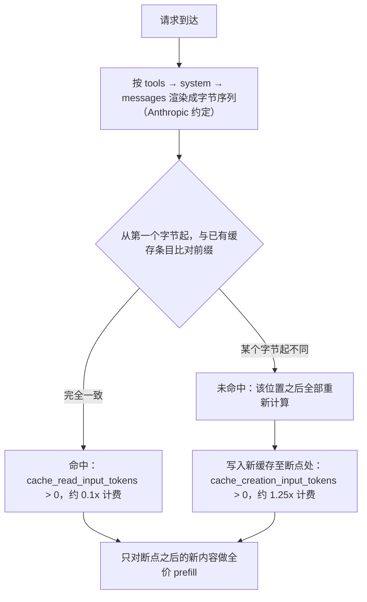

# Prompt Caching 提示缓存

> [!abstract] 一句话总结
> Prompt Caching 让 API 把请求中"从头开始完全相同的前缀"缓存起来，后续请求命中缓存时只按约 1 折价格读取，从而大幅降低重复上下文（长 system prompt、工具列表、对话历史）的成本和延迟——代价是你必须保证前缀一个字节都不能变。

## 🗣️ 白话版（先建立直觉）

> 就像食堂备菜：如果每份炒饭都从洗菜、切菜开始，一份要 20 分钟；师傅提前把不变的部分（洗好切好的配菜）备好，点单时只做"下锅翻炒"这最后一步，3 分钟出餐。
> Prompt Caching 就是把每次请求里不变的部分（系统提示、工具定义、历史对话）提前"备好"存在服务端，下次只处理新加的那一小段。也可以类比服务端渲染缓存：页面框架缓存好，只渲染变化的数据区。
> 但有个苛刻条件——备菜单必须**一字不差**：今天的配菜清单里多写了一个"当前日期"，缓存就整个作废，从洗菜重来。

## 📌 这是什么

LLM 是无状态的：每次调用都要把 system prompt、工具列表、全部历史消息重新发一遍，模型也要重新处理（prefill）这些 token——即使它们和上一次请求一模一样。Prompt Caching 允许服务端把已处理过的前缀的中间计算结果（KV Cache）存下来，下次遇到**完全相同的前缀**时直接复用，跳过重复计算。

对调用方来说，它不改变模型输出，只改变两件事：**账单**（命中部分按大约 1 折计费）和**首 token 延迟**（长前缀不用重新 prefill，TTFT 显著下降）。

## 🤔 解决什么问题 / 为什么需要

没有它会发生什么：一个 Agent 应用带 8K token 的 system prompt + 工具定义，用户聊了 20 轮，每一轮都要为这 8K + 越来越长的历史付全价、等全量 prefill。成本随轮数平方级增长，延迟越来越糟。

| 场景 | 无缓存 | 有缓存 |
| ---- | ---- | ---- |
| 长 system prompt 高频复用 | 每次全价 | 第 2 次起约 1 折 |
| 多轮对话 / Agent 循环 | 历史每轮重复计费 | 历史是前缀，天然命中 |
| 大文档 + 多个问题 | 文档 × 问题数全价 | 文档只写一次缓存 |
| 首 token 延迟 | 长前缀 prefill 慢 | 命中后 TTFT 大幅下降 |

## 🧩 核心概念

| 概念 | 含义 | 备注 |
| ---- | ---- | ---- |
| 前缀匹配 (Prefix Match) | 缓存以"渲染后的字节前缀"为 key，必须从第一个字节起完全一致 | 前缀中任何一个字节变化，其后所有缓存全部失效 |
| 渲染顺序 | 请求按 `tools` → `system` → `messages` 顺序拼成前缀（**以 Anthropic 为例**；OpenAI 无 tools 断点、DeepSeek 自动） | 所以改工具列表 = 从头失效 |
| cache_control 断点 | Anthropic 的显式标记：`{"type": "ephemeral"}`，表示"缓存到这里为止" | 每请求最多 4 个断点 |
| TTL | 缓存存活时间：默认 5 分钟（每次命中会刷新），可选 1 小时 | 1h 写入更贵，适合低频但规律的流量 |
| cache_creation_input_tokens | 响应 usage 字段：本次写入缓存的 token 数 | 写入按约 1.25×（5m）/ 2×（1h）计费 |
| cache_read_input_tokens | 响应 usage 字段：本次从缓存读取的 token 数 | 读取按约 0.1× 计费 |
| 最小可缓存长度 | 前缀太短不缓存，静默不生效；阈值随模型不同（约 512~4096 token） | 无报错，只是 creation 恒为 0 |

**缓存经济学（以 Anthropic 为例）**：设基础输入价为 1×，则 5 分钟 TTL 写入约 1.25×、读取约 0.1×。两次相同请求：1.25 + 0.1 = 1.35× < 不缓存的 2×——**第二次请求即回本**。1 小时 TTL 写入是 2×，需要至少三次请求才划算（2 + 0.2 = 2.2× < 3×）。

**各家机制对比**：核心分歧是"显式控制"还是"自动"。

| 提供商 | 机制 | 定价特点 | 开发者要做什么 |
| ---- | ---- | ---- | ---- |
| Anthropic | 显式 `cache_control` 断点 | 写 1.25×/2×，读约 0.1× | 自己标断点，控制力最强 |
| OpenAI | 自动前缀缓存 | 命中部分约 5 折 | 无需标注，只需组织好前缀顺序 |
| DeepSeek | 自动硬盘缓存 | 命中价格极低（约百分之一量级） | 无需标注 |
| Gemini | 显式缓存对象（context caching）+ 隐式缓存 | 缓存内容按存储时长计费 | 显式模式需先创建 cache 资源再引用 |

无论显式还是自动，**前缀匹配这条铁律是共通的**——"稳定内容放前面"的分层设计在所有提供商上都成立。

## ⚙️ 工作原理 / 流程



跟一个具体例子走一遍（Anthropic，5 分钟 TTL）：

1. **第 1 次请求**：8000 token 的 system prompt（末尾打 `cache_control` 断点）+ 200 token 用户问题。缓存里没有条目 → 写入：`cache_creation=8000`，`input=200`。费用 ≈ 8000×1.25 + 200×1。
2. **第 2 次请求**（3 分钟后，system 一字未改，问题换了）：前缀 8000 token 完全一致 → 命中：`cache_read=8000`，`input=200`。费用 ≈ 8000×0.1 + 200×1，比不缓存省约 90%。
3. **第 3 次请求**：有人在 system prompt 第 50 个字符处加了一个空格 → 从该字节起前缀不同 → `cache_read=0`，重新写一份 8000 token 的缓存。一个空格 = 一次全价重算。

**断点放哪**：放在"稳定内容的末尾"。断点标在最后一个 system 块上，会把 tools + system 一起缓存（因为 tools 渲染在 system 之前）。多轮对话中，断点打在**最近一轮消息的最后一个内容块**上——这样每轮请求都能复用上一轮的全部前缀，命中量随对话增长而累积。

**与 Agent / 多轮对话的关系**：多轮对话天然适合前缀缓存——历史消息本来就是新请求的前缀，只要你只在末尾追加、从不回头修改。Agent 循环（工具调用 → 结果 → 再调用）同理，每一轮只是在前缀后追加 tool_use / tool_result。反过来，任何"回头改前面"的操作（改 system、换模型、增删工具）都会击穿整个缓存。

## 🆚 从坏到好（对比案例）

**坏做法**：为了让模型知道时间，把时间戳塞进 system prompt。

```text
system: "你是客服助手。……（8000 token 规则）……当前时间：2026-07-26 14:33:07"
```

时间每秒都在变 → system prompt 每次请求的字节都不同 → 前缀永不一致 → `cache_read` 永远是 0，每次都付 1.25× 的写入价还一次都读不到。这是最常见、最隐蔽的"缓存永不命中"事故。

**好做法**：冻结 system prompt，把时间挪到消息末尾（最后一条 user 消息里）。

```text
system: "你是客服助手。……（8000 token 规则，一字不变）……"   ← 断点打在这
messages: [ ...历史..., { role: "user", content: "[当前时间：2026-07-26 14:33] 用户问题……" } ]
```

时间戳位于缓存断点**之后**，它的变化不影响前面 8000 token 的前缀 → 每次都命中。一行改动，成本降约 90%。

## 💻 代码实践

Anthropic HTTP 请求体（各语言 SDK 最终都渲染成这个形状）：

```json
{
  "model": "claude-sonnet-5",   // 以官方最新模型为准
  "max_tokens": 1024,
  "system": [
    {
      "type": "text",
      "text": "<冻结的长 system prompt，不含任何时间戳/UUID>",
      "cache_control": { "type": "ephemeral" }
    }
  ],
  "messages": [
    { "role": "user", "content": "[当前时间：2026-07-26 14:33] 用户问题" }
  ]
}
```

Java（官方 Anthropic SDK，Spring AI 项目里可封装成 Bean 使用；1 小时 TTL 用 `Ttl.TTL_1H`）：

```java
MessageCreateParams params = MessageCreateParams.builder()
    .model("claude-opus-5")
    .maxTokens(1024L)
    // 注意：必须用 systemOfTextBlockParams，纯字符串的 system(String) 挂不上 cacheControl
    .systemOfTextBlockParams(List.of(
        TextBlockParam.builder()
            .text(frozenSystemPrompt)   // 冻结内容，禁止拼接 LocalDateTime.now()
            .cacheControl(CacheControlEphemeral.builder().build())  // 默认 5 分钟 TTL
            .build()))
    .addUserMessage("[当前时间：" + now + "] " + userQuestion)  // 易变内容放最后
    .build();

Message response = client.messages().create(params);
// 验证命中情况
System.out.println("写入缓存: " + response.usage().cacheCreationInputTokens());
System.out.println("读取缓存: " + response.usage().cacheReadInputTokens());
```

工具列表要**确定性排序**后再传（如按 name 排序），否则顺序抖动会让 tools 段字节不稳定，从位置 0 开始击穿缓存。

## 🧪 最小验证（做一遍才算学会）

10 分钟实验：准备一个 ≥1500 token 的 system prompt（太短不会被缓存），带上 `cache_control` 断点，**连续发两次**相同前缀的请求（用户问题可以不同），打印 usage：

- 第 1 次：预期 `cache_creation_input_tokens ≈ 前缀长度`，`cache_read_input_tokens = 0`。
- 第 2 次（5 分钟内）：预期 `cache_creation ≈ 0`，`cache_read ≈ 前缀长度`——命中。
- 再做破坏实验：在 system prompt 里加一个字符再发 → `cache_read` 归 0，直观感受"一个字节毁全部"。

如果第 2 次 `cache_read` 仍为 0：把两次请求的完整 JSON body 落盘做 `diff`，逐字节找出那个"隐形杀手"（通常是时间戳、UUID 或 JSON key 顺序）。

## ⚠️ 踩坑与注意事项

缓存失效的隐形杀手清单（工程实战最高频，逐条对照检查）：

- [ ] **system prompt 里插时间戳 / UUID / 请求 ID**：前缀每次都变 → 永不命中。挪到最后一条 user 消息，或删掉。
- [ ] **JSON 序列化 key 顺序不稳定**：用 HashMap/Set 拼工具 schema 或结构化内容，序列化字节每次不同。改用 `LinkedHashMap`、排序后的确定性序列化（Python 用 `sort_keys=True`）。
- [ ] **工具列表每次请求不同或顺序不同**：tools 渲染在最前（位置 0），任何增删改排 → 整个缓存作废。固定工具集并按 name 排序。
- [ ] **mid-conversation 修改 system prompt**：对话中途改顶层 system，等于改了全部历史的前缀，缓存整体失效。运行时新增指令应追加到消息末尾，而不是回头改 system。
- [ ] **切换模型**：缓存按模型隔离，换模型 = 冷启动重新写缓存。主循环固定一个模型，便宜的子任务交给子代理去跑。
- [ ] **前缀太短**：低于最小可缓存长度时静默不缓存，无任何报错——`cache_creation` 恒为 0 不一定是 bug。阈值按模型不同约在 512~4096 token 之间（同代模型也可能不同，且新模型不一定更低），怀疑时查该模型的官方文档而不是套用记忆里的数字。
- [ ] **只写不读**：断点打在了"每次都变的内容"之后（比如打在用户问题上），每次都写一份新缓存、永远读不到，反而多付 25% 写入费。断点必须打在**共享部分**的末尾。
- [ ] **并发首发全部 miss**：缓存要等第一个响应开始流式返回后才可读，N 个并发相同前缀请求会各付全价。扇出场景先发 1 个、等到首 token 再发其余。

正确的分层设计口诀：**稳定在前，易变在后**——冻结的 system prompt、确定性排序的工具列表放最前；用户问题、时间戳、检索结果等每次变化的内容放最后、放在断点之后。

## 🧠 自测题（先自己答，再展开对答案）

> 复习时只看题目，口头/纸上回答后再展开。答不上来 → mastery 降一星。

> [!question]- Q1: 为什么在 system prompt 开头加一个字符，会让整个请求的缓存全部失效，而在最后一条 user 消息里加字符却几乎无影响？
> 参考答案：缓存是**前缀匹配**——以渲染后的字节序列为 key，从第一个字节开始比对，某个位置字节不同，则该位置之后的所有缓存条目全部无法匹配。system 渲染在前（tools → system → messages），开头的改动使得几乎整个前缀都对不上；而最后一条 user 消息位于所有缓存断点之后，它的变化不参与前缀比对，前面的缓存照常命中。

> [!question]- Q2: 你的服务连续请求的 usage 里 `cache_read_input_tokens` 一直是 0，但 `cache_creation_input_tokens` 每次都很大。怎么排查？说出至少三个最可能的原因。
> 参考答案：现象是"每次都在写、从来读不到"，即每次请求的前缀都不一样。排查方法：把两次请求渲染后的完整 JSON body 落盘 `diff`，逐字节找差异。高频原因：① system prompt 里有时间戳/UUID 等每次变化的内容；② JSON 序列化 key 顺序不稳定（HashMap/Set）；③ 工具列表内容或顺序每次不同；④ 负载均衡到不同模型或中途换了模型；⑤ 断点打错位置——打在了易变内容之后，导致每次写的都是不同的新条目。

> [!question]- Q3: 什么时候不该开缓存？5 分钟 TTL 和 1 小时 TTL 各适合什么流量形态？
> 参考答案：**不该开**：前缀每次从头就不同（无共享前缀，如每次全新的单轮短请求）、或前缀低于最小可缓存长度——此时只付 1.25× 写入费、零收益。**5 分钟 TTL**（写 1.25×）：请求间隔小于 5 分钟的连续流量，两次即回本；且每次命中会刷新 TTL，持续流量可以一直保活。**1 小时 TTL**（写 2×）：请求有超过 5 分钟的空窗但整体有规律（如定时任务、低频会话），需要至少三次请求才回本，用更贵的写入换跨空窗的保活。

## 🎯 面试问题

> [!question] 高频问题
> - Q: Prompt Caching 的原理是什么？工程上怎么保证命中率？
>   - A:（30 秒版）服务端把请求前缀的 KV Cache 按"渲染字节的前缀匹配"缓存，命中部分约 1 折计费、免重复 prefill；渲染顺序是 tools → system → messages，任何一个字节变化会使其后缓存全部失效。保证命中的核心是分层：稳定内容（冻结 system、排序后的工具列表）放前，易变内容（时间戳、用户问题）放最后。
>   -（2 分钟版展开要点）① 机制：无状态 API 每次重发全部上下文，缓存复用的是 prefill 的中间计算结果，不影响输出质量；② 经济学：Anthropic 写 1.25×（5m）/2×（1h）、读 0.1×，第二次请求即回本，OpenAI/DeepSeek 是自动前缀缓存无需标注；③ 工程纪律：消灭隐形杀手（时间戳/UUID 进 system、非确定性 JSON 序列化、工具列表抖动、中途改 system、换模型）；④ 验证闭环：监控 usage 里 cache_read/cache_creation，read 为 0 时 diff 两次请求的渲染字节定位。
> - Q: 多轮对话和 Agent 场景下缓存断点应该怎么打？为什么说这类场景"天然适合"前缀缓存？
>   - A:（30 秒版）因为对话历史只在末尾追加、从不修改，旧历史正好构成新请求的前缀——这就是前缀缓存最理想的访问模式。断点打在最近一轮消息的最后一个内容块上，每轮复用上一轮的全部前缀，命中量随轮数累积。
>   -（2 分钟版展开要点）① 每轮请求 = 上轮前缀 + 新增的一小段（user 消息或 tool_result），只有新增段付全价；② 断点随对话滚动前移，旧断点仍是有效的读取点；③ 破坏条件要守住：不回头改 system（运行时指令追加在消息末尾）、不中途增删工具、不换模型；④ 长 Agent 循环注意断点间隔——单轮塞入过多内容块可能超出缓存回溯窗口，需要在长轮次里加中间断点；⑤ 成本效果：长会话中总输入的绝大部分来自缓存读取，看账单要看 input + cache_read + cache_creation 三者之和，而不是只看 input_tokens。

## 🪝 记忆钩子

> **"前缀一字不差，缓存才认账。"**
> 数字锚点：**1.25 写、0.1 读、第 2 次回本**；顺序锚点：**tools → system → messages，越稳越靠前**。
> 脑内画面：食堂备菜单上多写了一笔"今日日期"，师傅把整筐备好的菜倒掉重切。

## 🔗 关联笔记

- [[03-上下文窗口]]（缓存复用的正是窗口内重复的前缀内容，两者是同一份 token 预算的两个视角）
- [[14-上下文窗口预算管理]]（预算分层与缓存分层是同一个设计：稳定层、会话层、请求层）
- [[08-System-Prompt设计]]（system prompt 必须"冻结"才能被缓存，动态内容的注入位置是共同话题）
- [[_index]]

## 📚 参考资料

- [Anthropic: Prompt caching](https://platform.claude.com/docs/en/build-with-claude/prompt-caching)
- [OpenAI: Prompt caching](https://platform.openai.com/docs/guides/prompt-caching)
- [DeepSeek: Context Caching（硬盘缓存）](https://api-docs.deepseek.com/guides/kv_cache)
- [Gemini API: Context caching](https://ai.google.dev/gemini-api/docs/caching)
