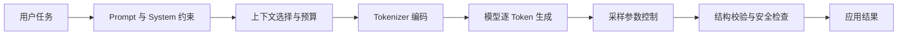

# LLM 基础与 Prompt：本章总结与复习

> [!abstract] 一句话总结
> LLM 应用的基础是理解 Token 级生成、上下文与采样边界，再用 Prompt、结构化输出、安全约束和上下文管理把模型能力变成稳定行为。

## 核心知识概览

| 模块 | 核心问题 | 关键结论 | 对应笔记 |
| --- | --- | --- | --- |
| 生成基础 | LLM 如何处理输入并生成输出 | 文本先被 Tokenizer 编码，模型按条件概率逐 Token 预测 | [[01-LLM工作原理]]、[[02-Token与Tokenizer]] |
| 窗口与采样 | 能放多少信息，输出如何变化 | 上下文窗口限制总 Token；Temperature 与 Top-P 控制随机性 | [[03-上下文窗口]]、[[04-模型参数-Temperature与TopP]] |
| 模型适配 | 选哪个模型，何时改变模型能力 | 先按质量、成本、延迟和部署约束选型；只有稳定能力缺口才考虑 LoRA、QLoRA | [[05-主流模型选型对比]]、[[06-微调-LoRA-QLoRA-LLaMA-Factory入门]] |
| Prompt 设计 | 如何清楚表达任务并提升效果 | 明确角色、目标、约束和输出格式；按任务选择 Zero-shot、Few-shot 与分步推理 | [[07-Prompt工程基础]]、[[08-System-Prompt设计]]、[[09-Few-shot与Zero-shot]]、[[10-CoT思维链]] |
| 输出与安全 | 如何让结果可消费、可防护 | 用 Schema、解析和校验约束输出；把外部内容视为不可信数据并实施权限隔离 | [[11-结构化输出]]、[[12-防御性提示与防注入]] |
| 上下文工程 | 如何把有限窗口分给最有价值的信息 | 对指令、历史、检索材料和输出预留做预算，并通过裁剪、摘要、检索和压缩控量 | [[13-上下文工程概述]]、[[14-上下文窗口预算管理]]、[[15-上下文压缩策略]] |

## 全章主线

## 快速复习

1. Token 是模型计算和计费的基本单位，字符数不能直接等同于 Token 数。
2. 上下文窗口包含输入与输出；必须为回答预留空间，并警惕长文本中的关键信息丢失。
3. Temperature 和 Top-P 都影响采样分布，生产任务通常先固定一个再调整另一个。
4. 模型选型先看任务质量、成本、延迟、上下文、安全与部署条件，不追求单一榜单最优。
5. Prompt 的最小骨架是目标、背景、约束、输入和输出格式；示例应少而有代表性。
6. 结构化输出不能只靠提示词，还要做 Schema 约束、解析校验和失败处理。
7. Prompt 防注入不是完整安全边界；工具权限、数据隔离和输出审查必须由应用层落实。
8. 上下文工程的核心不是塞满窗口，而是选择、排序、压缩最有价值的信息。

## 自测问题

1. 为什么同一段中文在不同 Tokenizer 下的 Token 数可能不同，这会影响哪些工程决策？
2. 什么时候应使用 Few-shot、RAG 或微调，它们分别解决什么类型的问题？
3. 如何为 System Prompt、对话历史、检索材料和模型输出制定上下文预算？
4. 为什么“忽略恶意指令”不足以防御 Prompt 注入，还需要哪些应用层控制？

## 下一章衔接

下一章进入 [[02-框架-SpringAI与LangChain4j/_index|Spring AI 与 LangChain4j]]：把本章的 Prompt、模型参数、结构化输出和上下文管理落到 Java 框架中的 `ChatClient`、模板、Advisor、记忆与工具调用上。

## 相关编号双链

- 基础与模型：[[01-LLM工作原理]] · [[02-Token与Tokenizer]] · [[03-上下文窗口]] · [[04-模型参数-Temperature与TopP]] · [[05-主流模型选型对比]] · [[06-微调-LoRA-QLoRA-LLaMA-Factory入门]]
- Prompt 工程：[[07-Prompt工程基础]] · [[08-System-Prompt设计]] · [[09-Few-shot与Zero-shot]] · [[10-CoT思维链]] · [[11-结构化输出]] · [[12-防御性提示与防注入]]
- 上下文工程：[[13-上下文工程概述]] · [[14-上下文窗口预算管理]] · [[15-上下文压缩策略]]

