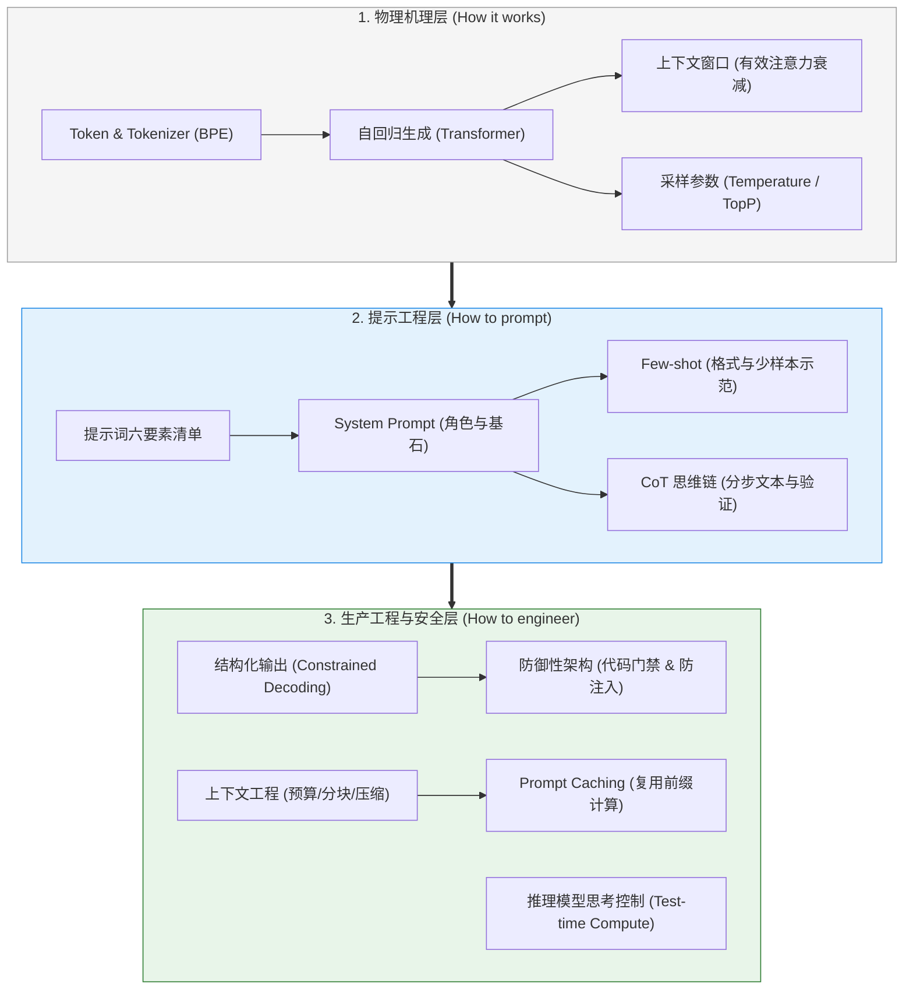

# 🎯 LLM 基础与 Prompt：本章通关总结与复习

> [!abstract] 一句话总结
> 大模型应用需要理解文本生成和 Token 计量，再结合提示词、上下文管理、输出校验与服务端权限控制完成具体任务。

---

## 🗺️ 全章知识拓扑大一统

---

## 📊 核心模块关键结论总览

| 模块 | 要解决的问题 | 关键结论 | 对应笔记 |
| :--- | :--- | :--- | :--- |
| **01 生成与编码** | LLM 到底如何感知语言与生成？ | 主流模型采用自回归机制逐步预测下一个 Token；BPE 子词分词决定了 Token 数量与字符长度不等价，成本核算与字符级精确操作需分别结合目标 Tokenizer 与外部代码工具。 | [[01-LLM工作原理]] [[02-Token与Tokenizer]] |
| **02 窗口与采样** | 怎么控制模型的自由度与记忆？ | 上下文窗口通常需要为输入和输出分配空间；长序列效果取决于模型与任务。`temperature` 调节概率分布，`top_p` 按累计概率筛选候选集。 | [[03-上下文窗口]] [[04-模型参数-Temperature与TopP]] |
| **03 提示与推理** | 如何让模型稳定完成复杂任务？ | 用必要的任务、背景和约束减少歧义；CoT 可提供中间步骤帮助处理多步问题，但步骤仍需验证。 | [[07-Prompt工程基础]] [[10-CoT思维链]] |
| **04 契约与安全** | 怎么将非结构化自然语言接入代码？ | 根据服务支持使用原生 Schema 约束，后端仍需检查拒答、截断与业务字段；权限由服务端控制。 | [[11-结构化输出]] [[12-防御性提示与防注入]] |
| **05 上下文与缓存** | 如何兼顾上下文质量、延迟和成本？ | 按预算选择和压缩内容；服务支持时可复用输入前缀的计算，具体收益需要实测。 | [[14-上下文窗口预算管理]] [[17-Prompt-Caching提示缓存]] |

---

## ⚡ 高频核心面试 10 连问

> [!question]- 1. 为什么相同语义的中英文文本消耗的 Token 数存在差异？
> 不同模型的 Tokenizer 词表和训练数据不同。常见英文单词或中文词组可能合并为一个 Token，生僻字符也可能拆成多个 Token。正文、代码和 JSON 的情况各不相同，应使用目标模型对应的分词器统计实际样本。

> [!question]- 2. 为什么大模型直接统计单词（如 `strawberry`）中的字母数量容易出错？
> Token 边界不一定对应单个字母，这可能影响模型处理字符级任务，但不能断定某次错误的内部原因。涉及精确字符统计与算术运算时，使用程序计算并核对输入更可靠。

> [!question]- 3. Temperature 和 Top-P 的作用机制有什么区别？
> `temperature` 在 Softmax 前对 Logits 进行缩放，改变整体概率分布的尖锐程度（趋近 0 时趋向贪心解码，调高时增强随机多样性）；`top_p`（核采样）则将候选词按概率降序排列，仅保留累积概率达到阈值 $P$ 的高置信度候选子集参与采样。调参时通常固定其中一个参数，单独调节另一个。

> [!question]- 4. 什么是 Lost in the Middle（中间迷失）？如何工程应对？
> 部分模型和任务中，位于长上下文中段的信息更容易被遗漏，但表现取决于模型、位置和任务。可以减少无关内容、重排证据并用问题集比较不同布局，不应假设首尾布局总有效。

> [!question]- 5. CoT（思维链）为什么能提升复杂推理任务的表现？
> CoT 让模型生成可供后续步骤参考的中间文本，可能帮助处理多步任务；这些步骤也可能错误，不一定反映内部推理。应比较直接回答、分步提示和工具验证的实际结果。

> [!question]- 6. JSON Mode 和 Structured Outputs 有何本质不同？
> JSON Mode 主要约束输出为合法 JSON，未必约束字段结构；支持原生 Schema 的严格模式可进一步约束字段名和类型。具体实现与支持的 Schema 子集因服务而异；拒答、截断和业务语义仍需处理。

> [!question]- 7. 什么是间接提示注入（Indirect Prompt Injection）？
> 攻击者将恶意指令预埋在第三方外部数据源中（如外部网页、RAG 检索文档、邮件或简历附件）。当模型在正常业务流程中读取这些不可信数据时，将其中隐藏的祈使句识别为控制指令，进而可能诱导 Agent 越权调用工具或外泄上下文敏感数据。

> [!question]- 8. 为什么说 System Prompt 不能作为系统的最终安全边界？
> 大模型将系统指令与外部数据编码在同一条上下文序列中进行注意力计算，缺乏像操作系统内存隔离或数据库预编译语句那样的刚性边界，纯自然语言约束仍可能被对抗性语境绕过。因此真实的安全边界必须下沉至服务端确定性代码、RBAC 权限过滤、参数白名单与人机协同审批。

> [!question]- 9. Prompt Caching 的核心工作原理与触发条件是什么？
> 服务支持时可复用匹配前缀的输入计算，但命中还取决于模型、长度、缓存期限、路由和服务商实现。可以把稳定内容放在前面，并通过响应中的用量信息检查实际命中情况。

> [!question]- 10. 推理模型（如 DeepSeek-R1、OpenAI o 系列、Claude Extended Thinking）的思考 Token 如何计费与管理预算？
> 部分服务会将内部推理 Token 计入输出用量，并与最终回答共用输出上限；计费和字段随模型与接口而变化。应查阅当前服务文档，预留预算并结合实际用量与效果选择推理档位。

---

## 🚨 生产架构落地十条准则

1. 使用与目标模型匹配的 Tokenizer 估算用量，不用 `String.length()` 代替。
2. 为输出预留空间，并处理回答被截断的情况。
3. 服务支持提示词缓存时，尽量保持可复用前缀稳定，并观察实际命中量。
4. 根据接口能力使用结构化输出，后端仍要处理拒答、解析和业务校验。
5. 根据任务评测推理成本与效果；精确计算交给程序或计算工具。
6. 在资料进入上下文之前，由服务端校验用户权限。
7. 工具执行前校验身份、权限和参数，高风险操作按业务规则确认。
8. 使用窗口、相关性筛选或摘要管理历史，控制上下文预算。
9. 筛选和重排证据，用实际问题比较不同布局，不假定固定位置总是最优。
10. 按业务评测决定是否需要模型路由，并比较质量、延迟和成本。

---

## 🔗 下一章通关衔接

继续阅读 [[../02-框架-SpringAI与LangChain4j/_index|Spring AI 与 LangChain4j]]，了解模型调用、工具、记忆和向量检索的 Java 实现。
