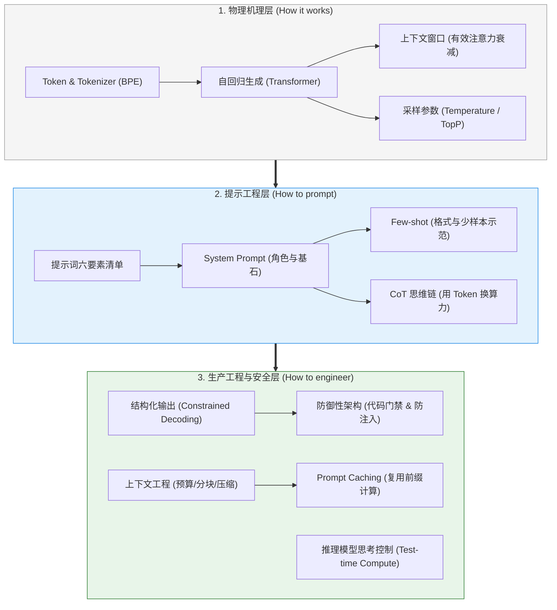

# 🎯 LLM 基础与 Prompt：本章通关总结与复习

> [!abstract] 一句话总结
> 大模型应用的本质不是“跟机器闲聊”，而是**“深刻理解自回归概率生成的物理限制，通过 Token 计量、上下文预算调度、强类型结构化契约与代码级安全防线，把充满不确定性的自然语言转化为工业级高可用的软件服务”**。

---

## 🗺️ 全章知识拓扑大一统

---

## 📊 核心模块关键结论总览

| 模块分层 | 核心攻坚问题 | 第一性原理关键结论 | 对应笔记精读 |
| :--- | :--- | :--- | :--- |
| **01 生成与编码** | LLM 到底如何感知语言与生成？ | 主流模型采用自回归机制逐步预测下一个 Token；BPE 子词分词决定了 Token 数量与字符长度不等价，成本核算与字符级精确操作需分别结合目标 Tokenizer 与外部代码工具。 | [[01-LLM工作原理]] [[02-Token与Tokenizer]] |
| **02 窗口与采样** | 怎么控制模型的自由度与记忆？ | 上下文窗口由输入与输出共同占用，且长序列存在中间注意力衰减（Lost in the Middle）；`temperature` 调节概率分布平滑度，`top_p` 按累积概率阈值裁剪候选集。 | [[03-上下文窗口]] [[04-模型参数-Temperature与TopP]] |
| **03 提示与推理** | 如何让模型稳定完成复杂任务？ | 用结构化六要素清单消除指令歧义；CoT 思维链通过生成显式中间步骤承接推导状态，将高难度单步映射拆解为多步序列计算。 | [[07-Prompt工程基础]] [[10-CoT思维链]] |
| **04 契约与安全** | 怎么将非结构化自然语言接入代码？ | 原生 Structured Outputs 基于受约束解码保障 JSON Schema 合规，后端配合完成状态检查与 Bean Validation 校验；安全边界必须建立在服务端确定性代码与权限控制之上。 | [[11-结构化输出]] [[12-防御性提示与防注入]] |
| **05 上下文与缓存** | 如何在企业级高频调用中兼顾低延时与低成本？ | 通过分层预算分配与面向问题的压缩防止窗口溢出；Prompt Caching 复用一致输入前缀的 KV Cache 状态，显著降低长前缀的首字延迟与输入成本。 | [[14-上下文窗口预算管理]] [[17-Prompt-Caching提示缓存]] |

---

## ⚡ 高频核心面试 10 连问

> [!important] 高频核心问题直击要害
>
> 1. **为什么相同语义的中英文文本消耗的 Token 数存在差异？**
>    - 答：不同模型的 Tokenizer 词表分布与训练语料配比不同。常见英文单词与高频中文词组通常合并为单个 Token，而低频汉字或生僻字符可能拆分为多个字节级 Token。由于不同文本类型（正文、代码、JSON）编码密度各异，工程上应使用目标模型的专用分词器实测统计。
>
> 2. **为什么大模型直接统计单词（如 `strawberry`）中的字母数量容易出错？**
>    - 答：经过 BPE 分词后，模型接收的是子词级 Token ID 而非逐个展开的字母序列；在单步直接回答中，模型难以同时完成隐式子词拆解与跨位置计数。通过分步展开字符可缓解该问题，而生产环境中涉及精确字符统计与算术运算的逻辑应交由确定性程序代码执行。
>
> 3. **Temperature 和 Top-P 的作用机制有什么区别？**
>    - 答：`temperature` 在 Softmax 前对 Logits 进行缩放，改变整体概率分布的尖锐程度（趋近 0 时趋向贪心解码，调高时增强随机多样性）；`top_p`（核采样）则将候选词按概率降序排列，仅保留累积概率达到阈值 $P$ 的高置信度候选子集参与采样。调参时通常固定其中一个参数，单独调节另一个。
>
> 4. **什么是 Lost in the Middle（中间迷失）？如何工程应对？**
>    - 答：在长上下文场景下，模型对序列起始位置（System Prompt）和末尾位置（最新问题）的信息召回率较高，而处于长上下文中段的信息注意力权重容易衰减。工程上应通过重排（Rerank）控制检索片段数量，并将核心规则与高相关度证据置于上下文首尾两端。
>
> 5. **CoT（思维链）为什么能提升复杂推理任务的表现？**
>    - 答：单步前向传播的网络层数固定，直接从复杂问题跨越到最终结论时条件概率映射难度大。CoT 通过生成显式的中间推理步骤，一方面将复杂问题拆解为逻辑跨度更小的顺序子步骤，另一方面利用上下文序列与 KV Cache 保存中间推导状态供后续步骤引用，扩展了测试期有效计算量（Test-time Compute）。
>
> 6. **JSON Mode 和 Structured Outputs 有何本质不同？**
>    - 答：JSON Mode 仅约束输出满足合法的 JSON 语法，但不绑定具体字段结构；Structured Outputs 则将 JSON Schema 编译为语法状态机，在采样阶段通过 Logit Masking 屏蔽不符合 Schema 的 Token，从而在请求正常完成（非超长截断、非安全拒答）时保障字段名、必填项与数据类型严格符合契约。
>
> 7. **什么是间接提示注入（Indirect Prompt Injection）？**
>    - 答：攻击者将恶意指令预埋在第三方外部数据源中（如外部网页、RAG 检索文档、邮件或简历附件）。当模型在正常业务流程中读取这些不可信数据时，将其中隐藏的祈使句识别为控制指令，进而可能诱导 Agent 越权调用工具或外泄上下文敏感数据。
>
> 8. **为什么说 System Prompt 不能作为系统的最终安全边界？**
>    - 答：大模型将系统指令与外部数据编码在同一条上下文序列中进行注意力计算，缺乏像操作系统内存隔离或数据库预编译语句那样的刚性边界，纯自然语言约束仍可能被对抗性语境绕过。因此真实的安全边界必须下沉至服务端确定性代码、RBAC 权限过滤、参数白名单与人机协同审批。
>
> 9. **Prompt Caching 的核心工作原理与触发条件是什么？**
>    - 答：服务端缓存输入前缀在 Prefill 阶段计算的 KV Cache 状态，后续请求若匹配相同的模型输入前缀（达到最小 Token 长度门槛且在 TTL 有效期内），即可直接复用前缀计算结果，仅对变动点之后的新增内容执行 Prefill。工程上应将静态工具定义、系统提示词与固定文档置于序列前端，并通过响应 `usage` 验证缓存命中量。
>
> 10. **推理模型（如 DeepSeek-R1、OpenAI o 系列、Claude Extended Thinking）的思考 Token 如何计费与管理预算？**
>     - 答：推理模型在输出正式回答前生成的内部思考 Token（Reasoning / Thinking Tokens）即使在界面上折叠或仅返回摘要，依然全额计入输出 Token 计费，且与最终回答共享总输出上限（如 `max_completion_tokens` / `max_output_tokens` / `max_tokens`）。工程配置时需为“思考 + 回答”预留充足的总输出空间，并按任务复杂度分级控制推理档位。

---

## 🚨 生产架构落地十条准则

1. **精确计量 Token**：成本核算、限流配额与上下文预算分配应使用与目标模型匹配的 Tokenizer（如 `jtokkit`），避免使用 `String.length()` 字符长度粗略代替。
2. **显式预留输出空间**：调用接口时必须合理设置最大输出上限（如 `max_tokens` / `max_completion_tokens`），为模型生成完整结构化回答及内部思考预留充足余量，防止输出中途截断。
3. **稳定前缀置顶**：构建上下文时坚持“静态内容在前、动态内容在后”，避免在 System Prompt 头部混入实时时间戳或随机 ID，最大化 Prompt Caching 命中率。
4. **强类型结构化契约**：面向下游程序解析的接口优先开启原生 Structured Outputs（JSON Schema），并在后端配套完成状态检查、Jackson 反序列化与 Jakarta Bean Validation 校验。
5. **按任务复杂度分级启用推理**：简单分类、字段抽取等单步感知任务使用常规轻量模型；数学计算、复杂排障与长链路规划再启用 CoT 或原生推理模型。
6. **代码级前置数据鉴权**：RBAC/ABAC 权限过滤必须在检索数据进入模型上下文之前由 Java 服务端完成，确保模型仅能接触当前用户有权访问的数据子集。
7. **高危工具人机协同（Human-in-the-Loop）**：涉及删改数据、资金划转、外发邮件等不可逆副作用的工具调用，模型仅生成参数草案，必须经真实用户确认授权后由后端执行。
8. **多轮历史动态预算与压缩**：长会话场景结合滑动窗口、相关性筛选与阶段性增量摘要控制历史 Token 规模，避免无限制全量堆叠。
9. **核心证据首尾布局**：针对长上下文的中间注意力衰减特性，在多文档 RAG 组装时通过重排（Rerank）精简片段，并将高相关度证据置于上下文首尾显著位置。
10. **实施多模型路由架构**：建立模型网关路由机制，高频简单请求路由至低延迟轻量模型，复杂核心推理请求路由至高能力旗舰或推理模型，兼顾服务质量与总体拥有成本（TCO）。

---

## 🔗 下一章通关衔接

你已经掌握了 LLM 与 Prompt 底层的第一性原理！接下来我们将从**“概念理解”**正式跨入**“企业工程实战”**：

👉 进入下一章：[[../02-框架-SpringAI与LangChain4j/_index|02 · 框架：Spring AI 与 LangChain4j]]
- 如何用 Spring Boot 现代化架构统一多模型调用？
- `ChatClient` 流式交互、函数调用（Function Calling）与 Advisor 链式拦截器内幕；
- 生产级会话持久化与企业级 RAG 向量检索在 Java 中的工业落地！
