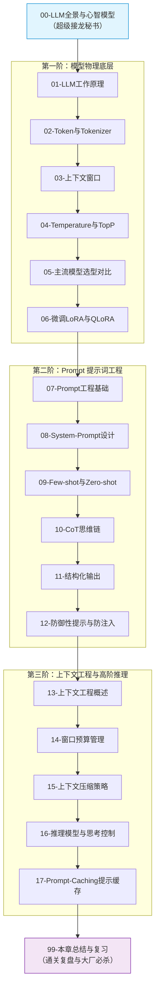

# 🧠 01 · LLM 基础与 Prompt 工程

> [!info] 本区说明
> 对应学习路径 **阶段一**。系统沉淀 LLM 原理、Token 编码、模型选型、Prompt 工程、上下文工程基础及防御性架构设计。

---

## 🗺️ 通关全景学习路线

---

## 📚 知识笔记清单

### 00 · 全景心智
- [ ] [[00-LLM与Prompt工程全景与心智模型]] 🌟（大模型运作与开发全景心智模型）

### 01 · LLM 物理基础
- [ ] [[01-LLM工作原理]]（自回归接龙、三大训练阶段、幻觉成因）
- [ ] [[02-Token与Tokenizer]]（BPE算法、草莓难题、多语言计费第一性原理）
- [ ] [[03-上下文窗口]]（有效注意力衰减、Lost in the Middle 现象）
- [ ] [[04-模型参数-Temperature与TopP]]（采样平滑 Softmax 与核采样截断）
- [ ] [[05-主流模型选型对比]]（闭源商用 vs 开源自建权衡）
- [ ] [[06-微调-LoRA-QLoRA-LLaMA-Factory入门]]（低秩适配矩阵分解与量化实战）

### 02 · Prompt 提示工程
- [ ] [[07-Prompt工程基础]]（CRISPE六要素框架与生产规范）
- [ ] [[08-System-Prompt设计]]（角色赋能、规则固化与边界约束）
- [ ] [[09-Few-shot与Zero-shot]]（少样本示范与上下文学习规律）
- [ ] [[10-CoT思维链]]（用 Token 换算力，显式外挂内存与自洽表决）
- [ ] [[11-结构化输出]]（Constrained Decoding 与强契约实体反序列化）
- [ ] [[12-防御性提示与防注入]]（直接越狱与间接注入防御，安全边界在代码）

### 03 · 上下文工程与前沿黑科技
- [ ] [[13-上下文工程概述]]（从单次 Prompt 到系统级上下文调度）
- [ ] [[14-上下文窗口预算管理]]（三层预算模型与防爆溢出治理）
- [ ] [[15-上下文压缩策略]]（选择性丢弃、语义摘要与骨架提取）
- [ ] [[16-推理模型与思考控制]]（Test-time Compute、思考预算与 Reasoning Effort 档位）
- [ ] [[17-Prompt-Caching提示缓存]]（KV Cache 复用、前缀匹配铁律与 90% 降本实战）

### 99 · 通关复盘
- [ ] [[99-本章总结与复习]]（全章核心图谱、大厂 30 秒必杀 10 连问、十诫规约）

---

## 🔗 关联指引

- **下一章**：[[../02-框架-SpringAI与LangChain4j/_index|02 · 框架：Spring AI 与 LangChain4j]]
- **全栈总览**：[[../00-总览/学习仪表盘]]
