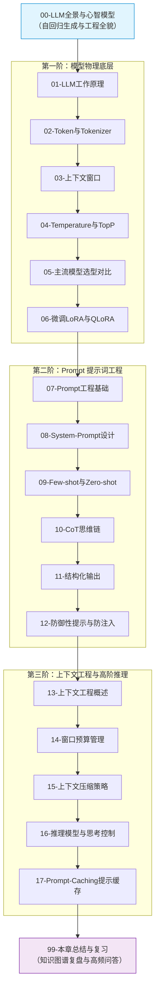

# 🧠 01 · LLM 基础与 Prompt 工程

> [!info] 本区说明
> 对应学习路径 **阶段一**。系统沉淀 LLM 原理、Token 编码、模型选型、Prompt 工程、上下文工程基础及防御性架构设计。

---

## 🗺️ 通关全景学习路线

---

## 📚 知识笔记清单

### 00 · 全景心智
- [ ] [[00-LLM与Prompt工程全景与心智模型]] 🌟（大模型运作机制与工程开发全景）

### 01 · LLM 物理基础
- [ ] [[01-LLM工作原理]]（自回归生成、三阶段训练演进、幻觉成因与治理）
- [ ] [[02-Token与Tokenizer]]（BPE 分词算法、字符级操作局限与 Token 精确计量）
- [ ] [[03-上下文窗口]]（有效注意力衰减、Lost in the Middle 现象）
- [ ] [[04-模型参数-Temperature与TopP]]（采样平滑 Softmax 与核采样截断）
- [ ] [[05-主流模型选型对比]]（闭源商用与开源自建多维选型权衡）
- [ ] [[06-微调-LoRA-QLoRA-LLaMA-Factory入门]]（低秩适配矩阵分解与微调适用边界）

### 02 · Prompt 提示工程
- [ ] [[07-Prompt工程基础]]（提示词六要素清单与生产规范）
- [ ] [[08-System-Prompt设计]]（角色设定、规则固化与边界约束）
- [ ] [[09-Few-shot与Zero-shot]]（少样本示例与上下文学习规律）
- [ ] [[10-CoT思维链]]（分步推理机制、测试时计算扩展与自洽性采样）
- [ ] [[11-结构化输出]]（Constrained Decoding 与强契约实体反序列化）
- [ ] [[12-防御性提示与防注入]]（直接注入与间接注入防御、代码级安全边界）

### 03 · 上下文工程与高阶推理
- [ ] [[13-上下文工程概述]]（从单次 Prompt 到系统级上下文调度）
- [ ] [[14-上下文窗口预算管理]]（分层预算分配与溢出裁剪治理）
- [ ] [[15-上下文压缩策略]]（选择性丢弃、语义摘要与关键信息提取）
- [ ] [[16-推理模型与思考控制]]（Test-time Compute、思考预算与 Reasoning Effort 档位）
- [ ] [[17-Prompt-Caching提示缓存]]（KV Cache 复用、前缀匹配条件与成本核算）

### 99 · 通关复盘
- [ ] [[99-本章总结与复习]]（全章核心图谱、高频核心问答、生产架构十条准则）

---

## 🔗 关联指引

- **下一章**：[[../02-框架-SpringAI与LangChain4j/_index|02 · 框架：Spring AI 与 LangChain4j]]
- **全栈总览**：[[../00-总览/学习仪表盘]]
