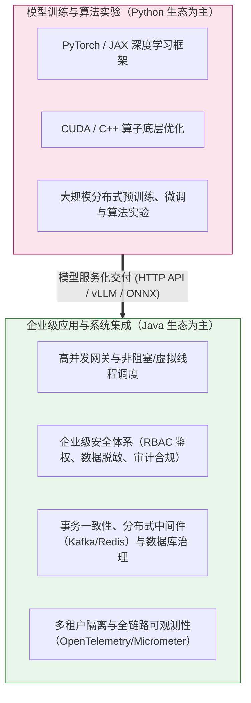
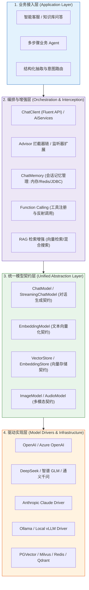
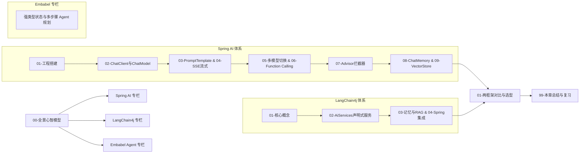

# 🌐 Java AI 框架全景与心智模型

> [!abstract] 一句话总结
> Java AI 框架（Spring AI 与 LangChain4j）通过统一的模型调用接口与数据结构屏蔽各模型厂商的 HTTP 协议差异，提供提示词编排、切面拦截、会话记忆、工具调用与向量检索等组件，将非确定性的模型生成能力集成到类型安全、可观测、可治理的 Java 服务体系中。

---

## 📌 架构定位：为什么企业级 AI 应用广泛采用 Java？

在大模型技术栈中，Python 与 Java 承担着不同阶段的工程职责：



1. **模型训练与业务工程的分工**：
   - 算法团队通常使用 Python 进行模型训练、微调与离线评测；
   - 当模型通过推理引擎（如 vLLM、Ollama 或云端 API）暴露为标准服务后，核心问题转化为**如何将模型能力稳定接入现有的高并发业务系统（如 ERP、财务、电商交易与客服平台）**。
2. **Java 后端生态的工程优势**：
   - **并发与连接管理**：结合 Project Reactor 响应式流或 JDK 21+ 虚拟线程（Virtual Threads），高效承载大模型长耗时 I/O 请求，并与连接池、网关限流协同控制吞吐；
   - **类型安全与结构化契约**：通过静态类型系统在编译期约束服务接口，配合运行时的 JSON Schema 校验将非结构化文本转化为业务 DTO；
   - **成熟的微服务治理闭环**：直接复用企业现有的权限控制（Spring Security）、链路追踪、指标监控（Micrometer/Prometheus）与熔断降级（Resilience4j）基础设施。

---

## 🗺️ Java AI 框架统一分层架构

Spring AI 与 LangChain4j 在整体架构分层上高度一致，自顶向下可分为四层：



> [!NOTE] 跨厂商适配的工程边界
> 统一模型契约层屏蔽了不同厂商的 HTTP 协议与基础报文差异，降低了业务代码的迁移成本。但由于各模型在工具调用（Tool Calling）、原生结构化输出（Structured Outputs）、流式 usage 统计及特定采样参数上的支持程度不同，在切换底层模型时仍需针对具体业务能力做集成测试。

---

## ⚖️ 主流框架对照：Spring AI 与 LangChain4j

| 维度 | Spring AI | LangChain4j |
| :--- | :--- | :--- |
| **维护主体** | **Spring 官方团队**，遵循 Spring 生态统一的工程规范 | **开源社区驱动**，组件迭代快，第三方适配丰富 |
| **架构风格** | **Spring Boot Starter 自动装配 + `ChatClient` 链式 API + `Advisor` 责任链** | **Builder 构造模式 + `AiServices` 声明式接口代理** |
| **核心特性** | 与 Spring WebFlux、Actuator、Micrometer 原生集成，提供统一的切面拦截机制 | 支持通过 Java 接口声明 AI 服务，兼容纯 Java、Spring Boot、Quarkus 等多种运行环境 |
| **适用场景** | **基于 Spring Boot 的企业级微服务体系** | **需要声明式接口风格、多框架异构环境或独立 Java 应用** |

---

## 🧩 核心抽象概念与职责边界

| 框架核心抽象 | 技术职责 | 架构角色与工程定位 |
| :--- | :--- | :--- |
| **`ChatModel`** | 底层模型通信接口。负责与特定模型服务进行 HTTP 通信、请求序列化与响应解析。 | 模型驱动适配层，屏蔽不同供应商的协议格式差异 |
| **`ChatClient` / `AiServices`** | 面向业务层的高阶调用入口。支持组装提示词、挂载拦截器、绑定工具并映射结构化输出。 | 业务编排门面，隔离底层通信细节与通用横切逻辑 |
| **`Advisor` / `Listener`** | 请求与响应的环绕拦截机制。用于在模型调用前后执行记忆注入、RAG 检索、日志审计与安全检查。 | 横切关注点责任链，实现业务逻辑与治理策略解耦 |
| **`Function Calling (Tools)`** | 外部工具调用机制。将本地方法签名转化为 JSON Schema 下发给模型，根据模型返回的调用指令执行本地方法并回传结果。 | 模型与外部业务系统、实时数据源交互的桥接层 |
| **`EmbeddingModel`** | 文本嵌入向量化接口。将自然语言文本转换为高维稠密浮点数向量（Dense Vector）。 | 语义特征编码组件，支撑相似度计算与向量检索 |
| **`VectorStore`** | 向量存储与检索接口。封装向量的写入、更新、删除、Top-K 相似度检索及元数据标量过滤。 | 向量数据库访问抽象层，支撑 RAG 知识召回 |
| **`ChatMemory`** | 会话上下文记忆接口。按会话 ID 维护多轮对话消息列表，支持滑动窗口裁剪与外部存储持久化。 | 会话状态管理组件，为无状态模型请求补充历史上下文 |

---

## 🚀 典型代码形态示例

以 Spring AI 为例，构建一个集成**系统提示词、多轮会话记忆、工具调用与 SSE 流式输出**的接口：

```java
@RestController
@RequestMapping("/api/ai")
public class CustomerSupportController {

    private final ChatClient chatClient;

    public CustomerSupportController(ChatClient.Builder builder, ChatMemory chatMemory) {
        // 链式配置默认系统提示词、记忆拦截器与工具名称
        this.chatClient = builder
                .defaultSystem("你是企业客服助手，请基于事实准确回答用户问题。")
                .defaultAdvisors(MessageChatMemoryAdvisor.builder(chatMemory).build())
                .defaultToolNames("orderLookupTool", "refundApplyTool")
                .build();
    }

    @GetMapping(value = "/chat/stream", produces = MediaType.TEXT_EVENT_STREAM_VALUE)
    public Flux<String> chatStream(@RequestParam String conversationId, @RequestParam String message) {
        return chatClient.prompt()
                .user(message)
                .advisors(advisor -> advisor.param(ChatMemory.CONVERSATION_ID, conversationId))
                .stream()
                .content(); // 返回响应式 Flux 流，支持前端增量渲染
    }
}
```

---

## 🎯 本章学习路线



> [!TIP]
> **学习建议**：建议以 **Spring AI** 作为主线掌握模型接入、流式传输、`Advisor` 责任链与 `@Tool` 工具调用闭环；再通过 **LangChain4j** 对照理解 `AiServices` 声明式接口的设计思路；最后在需要复杂状态编排与动态路径规划时延伸阅读 **Embabel Agent**。
