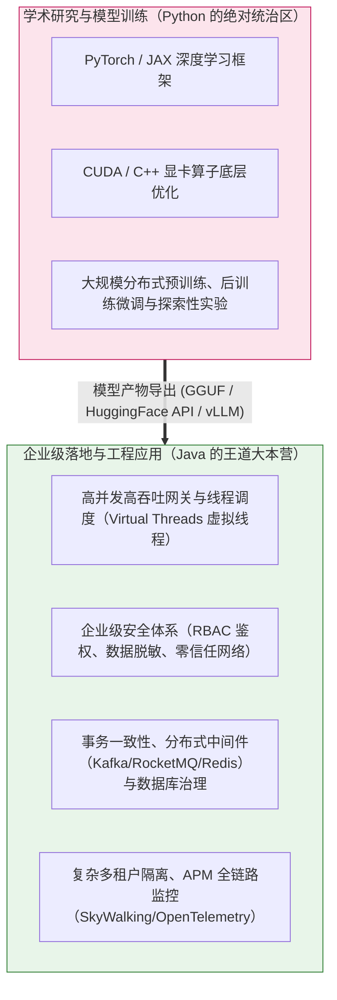
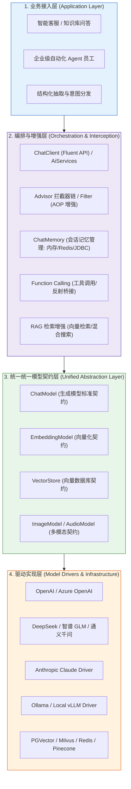
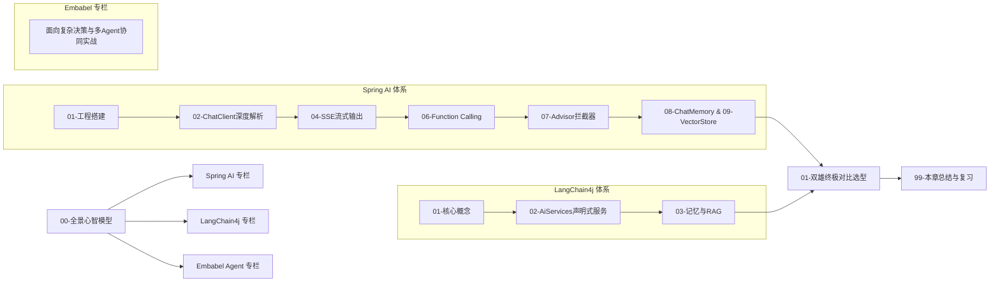

# 🌐 Java AI 框架全景与心智模型

> [!abstract] 一句话总结
> Java AI 框架（Spring AI 与 LangChain4j）的本质是**“大模型时代的 JDBC 与 Spring Data”**——它们抹平了各大模型厂商碎片化的私有 HTTP 协议与数据结构，将非确定性的自回归生成包装为强类型、可拦截、可编排的工业级 Java 服务。

---

## 🗣️ 白话版（先建立直觉）

回想 20 年前，如果没有 JDBC，Java 程序员是如何与数据库打交道的？
- 连 MySQL 得写一套基于 Socket 的通信协议，连 Oracle 得调用另一套完全不同的 C++ 动态库，换成 SQL Server 代码又要推倒重来。
- 后来 Sun 公司推出了 **JDBC 标准接口**（`Connection`, `PreparedStatement`, `ResultSet`），各大数据库厂商只需提供自己的 Driver 驱动即可。再后来，Spring 推出了 **Spring Data**，开发者只需要定义一个接口，底层自动映射，切换数据库一行配置搞定！

今天的大模型领域，完全重演了当年的历史：
- OpenAI 的接口参数长这样，Anthropic Claude 的 system 提示词放最外层参数，DeepSeek 支持 `reasoning_content`，Ollama 的本地模型格式又不一样；
- 如果没有统一的 Java AI 框架，你的业务代码里就会充斥着大量的 `HttpClient`、手写 JSON 序列化、处理复杂的 SSE 流式字符拼接、手动解析 Tool Calls... 一旦公司决定将业务模型从 OpenAI 切换为国产 DeepSeek，几十万行代码当场报废！

**Spring AI 与 LangChain4j，就是大模型时代的“JDBC 驱动池与 Spring Data 抽象层”！** 它们让你像注入常规 Spring Bean 一样注入一个 `ChatClient`，无论是换模型、流式打字机推送、会话记忆管理还是外挂工具调用，全都变成了一致、优雅的 Java 链式语法！

---

## 📌 第一性原理：为什么企业级 AI 应用最终会走向 Java？

很多初学者容易产生一种误解：“做 AI 不都是 Python 的事吗？Java 还能干什么？”

必须从**软件架构的第一性原理**来澄清：



1. **训练 vs 推理应用的分水岭**：
   - 模型算法科学家用 Python 搞研究、调参和训练；
   - 但一旦模型作为服务（API 或本地权重）交付，**如何将大模型集成进支撑百万 DAU、涉及财务记账、ERP 进销存、客户敏感资产的严肃企业业务中**？
2. **企业后端的技术护城河**：
   - 极速的并发 IO 处理能力（Java 21 虚拟线程支持数十万并发长连接流式 SSE）；
   - 严密的强类型系统与编译期检查（避免 Python 动态类型在万行工程中的运行时崩溃）；
   - 成熟的中间件与治理闭环（监控、链路追踪、熔断降级、权限控制）。

因此，**Java 工程师不是要去发明下一个大模型，而是要用工业级工程手段，把大模型驯化为企业内部最靠谱的数字化员工！**

---

## 🗺️ Java AI 框架统一全景架构大图

无论是 Spring AI 还是 LangChain4j，其底层架构分层都是高度同构的：



---

## ⚖️ 双雄并立：Spring AI vs LangChain4j 深度心智对照

在 Java AI 生态中，目前形成了两大主流框架：

| 维度 | Spring AI | LangChain4j |
| :--- | :--- | :--- |
| **出身与背景** | **Spring 官方嫡系**（VMware/Broadcom），遵循 Spring 家族最高工程设计标准 | **开源社区驱动**，由顶级独立开发者发起，活跃度极高 |
| **架构心智** | 纯正的 **Spring Boot Starter + 自动装配 + Bean 依赖注入 + Advisor (AOP)** 风格 | 面向对象 **Builder 模式 + 声明式接口（类似 Spring Cloud OpenFeign）** |
| **杀手级特性** | `ChatClient` 流式链式语法、与 Spring Security/Actuator 原生整合、企业级可观测性 | `AiServices` 声明式接口驱动、支持非 Spring 的轻量级 Java 环境（如 Quarkus、Micronaut） |
| **学习曲线** | 对 Spring Boot 开发者来说**零违和感**，像使用 `WebClient` 一样自然 | 简单直接，不依赖 Spring ApplicationContext，单元测试极轻 |
| **选型建议** | **现有项目是 Spring Boot 3.x，首选 Spring AI** | **非 Spring 项目、微服务技术栈异构、或希望快速声明式接入 AI** |

---

## 🧩 核心名词概念大白话对照表

| 核心概念 | 传统 Web 开发对应物 | 大模型生态实际含义 |
| :--- | :--- | :--- |
| **ChatModel** | `DataSource` / 底层数据库驱动 | 代表某一家特定大模型的基础通信驱动器，负责底层的序列化与网络请求 |
| **ChatClient** | `JdbcTemplate` / `RestClient` | 业务开发直接使用的流式门面工具类，支持 Prompt 编排、Advisor 链挂载 |
| **Advisor** | Spring AOP 切面 / Web 过滤器 | 在大模型请求发出前、响应返回后执行的环绕拦截链，用于记忆注入、日志脱敏与审计 |
| **Function Calling** | 依赖注入调用本地 Bean 方法 | 大模型发现回答需要外部数据时，生成包含参数的 JSON 结构，由框架自动反射调用本地 Java 方法并回填 |
| **EmbeddingModel** | 字符编码转换器（如 UTF-8 编码器） | 把人类自然语言文本转换成高维浮点数向量（如 1536 维数组）的数学转化器 |
| **VectorStore** | MySQL / Elasticsearch 搜索引擎 | 专门存储与检索高维浮点数向量的数据库驱动抽象（如 PGVector、Milvus） |
| **ChatMemory** | `HttpSession` / 购物车缓存 | 维护用户多轮会话上下文的存储介质，支持内存、Redis、MySQL 持久化 |

---

## 🚀 现代化 Java AI 开发的核心体验

使用现代化 Java AI 框架，完成一次集成了**会话记忆、系统人设、工具调用与 SSE 流式输出**的企业级接口，只需要短短十几行代码：

```java
@RestController
@RequestMapping("/api/ai")
public class CustomerSupportController {

    private final ChatClient chatClient;

    public CustomerSupportController(ChatClient.Builder builder, ChatMemory chatMemory) {
        // 类似配置 WebClient，一站式链式装配
        this.chatClient = builder
                .defaultSystem("你是官方资深客服。态度热情，遵守公司纪律。")
                // 挂载会话记忆拦截器（自动管理多轮历史）
                .defaultAdvisors(new MessageChatMemoryAdvisor(chatMemory))
                // 挂载业务工具（自动暴露给模型调用）
                .defaultTools("orderLookupTool", "refundApplyTool")
                .build();
    }

    @GetMapping(value = "/chat/stream", produces = MediaType.TEXT_EVENT_STREAM_VALUE)
    public Flux<String> chatStream(@RequestParam String conversationId, @RequestParam String message) {
        return chatClient.prompt()
                .user(message)
                .advisors(advisor -> advisor.param(CHAT_MEMORY_CONVERSATION_ID_KEY, conversationId))
                .stream()
                .content(); // 响应式返回 Flux，前端实时打字机渲染！
    }
}
```

---

## 🎯 本章通关路线与学习建议

本章将带你全方位攻克 Java AI 应用开发的两大支柱：



> [!TIP]
> 学习建议：建议以 **Spring AI** 作为企业生产首选主线，以 **LangChain4j 的 AiServices** 作为声明式设计的启发参照。重点攻克 **ChatClient 流式交互、Advisor 拦截器机制与 Function Calling 工具闭环**，这三大杀招是后续掌握企业级 RAG 与 Agent 的绝对基础！
