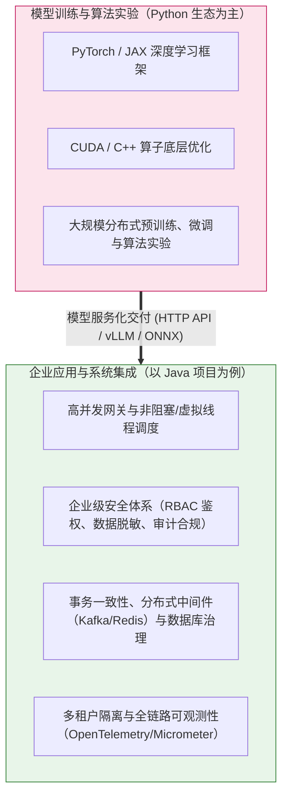
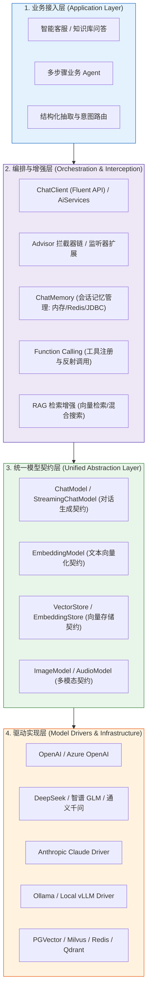
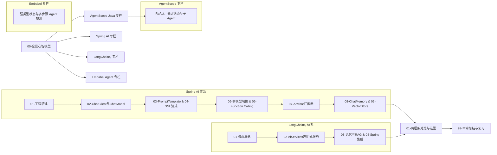

# 🌐 Java AI 框架全景与心智模型

> [!abstract] 一句话总结
> Spring AI 和 LangChain4j 为模型调用提供统一接口，并提供提示词、记忆、工具调用和向量检索等组件，方便 Java 应用接入大模型。不同模型的能力和协议仍有差异，切换时需要验证。

---

## 📌 架构定位：为什么企业级 AI 应用广泛采用 Java？

在大模型技术栈中，Python 与 Java 承担着不同阶段的工程职责：



模型训练、微调和离线评测常用 Python；模型通过推理引擎或云端 API 提供服务后，已有 Java 后端可以调用它，并复用现有的业务系统和工程能力：
- 使用 Reactor 响应式流或 JDK 21 虚拟线程处理等待模型返回的请求，同时配合连接池和限流。
- 用 Java 类型定义业务接口，在运行时校验模型输出并转换成业务对象。
- 复用 Spring Security、Micrometer、Resilience4j 等现有的权限、监控和熔断设施，并接入链路追踪。

---

## 🗺️ Java AI 框架统一分层架构

Spring AI 与 LangChain4j 在整体架构分层上高度一致，自顶向下可分为四层：



> [!NOTE] 跨厂商适配的工程边界
> 统一模型契约层屏蔽了不同厂商的 HTTP 协议与基础报文差异，降低了业务代码的迁移成本。但由于各模型在工具调用（Tool Calling）、原生结构化输出（Structured Outputs）、流式 usage 统计及特定采样参数上的支持程度不同，在切换底层模型时仍需针对具体业务能力做集成测试。

---

## ⚖️ 主流框架对照：Spring AI 与 LangChain4j

| 维度 | Spring AI | LangChain4j |
| :--- | :--- | :--- |
| **维护主体** | **Spring 官方团队**，遵循 Spring 生态统一的工程规范 | **开源社区驱动**，组件迭代快，第三方适配丰富 |
| **架构风格** | **Spring Boot Starter 自动装配 + `ChatClient` 链式 API + `Advisor` 责任链** | **Builder 构造模式 + `AiServices` 声明式接口代理** |
| **核心特性** | 与 Spring WebFlux、Actuator、Micrometer 原生集成，提供统一的切面拦截机制 | 支持通过 Java 接口声明 AI 服务，兼容纯 Java、Spring Boot、Quarkus 等多种运行环境 |
| **适用场景** | **基于 Spring Boot 的企业级微服务体系** | **需要声明式接口风格、多框架异构环境或独立 Java 应用** |

---

Spring AI 和 LangChain4j 都能用于工具调用和 RAG，具体能力应以项目所用版本为准。若需要进一步学习 Agent 编排，还可以了解 [[EmbabelAgent/_index|Embabel Agent]] 的领域对象与目标规划，以及 [[AgentScopeJava/_index|AgentScope Java]] 的 ReAct 循环与 Harness 能力；它们和前两者有功能重叠，不必为了学习而全部引入同一项目。

---

## 🧩 核心抽象概念与职责边界

| 框架核心抽象 | 技术职责 | 架构角色与工程定位 |
| :--- | :--- | :--- |
| **`ChatModel`** | 底层模型通信接口。负责与特定模型服务进行 HTTP 通信、请求序列化与响应解析。 | 模型驱动适配层，屏蔽不同供应商的协议格式差异 |
| **`ChatClient` / `AiServices`** | 面向业务层的高阶调用入口。支持组装提示词、挂载拦截器、绑定工具并映射结构化输出。 | 业务编排门面，隔离底层通信细节与通用横切逻辑 |
| **`Advisor` / `ChatModelListener`** | Spring AI 的 Advisor 可参与处理请求与响应；LangChain4j 的监听器主要观察模型请求、响应和错误。 | 分别用于调用链增强和可观测性，两者职责不完全相同 |
| **`Function Calling (Tools)`** | 外部工具调用机制。将本地方法签名转化为 JSON Schema 下发给模型，根据模型返回的调用指令执行本地方法并回传结果。 | 模型与外部业务系统、实时数据源交互的桥接层 |
| **`EmbeddingModel`** | 文本嵌入向量化接口。将自然语言文本转换为高维稠密浮点数向量（Dense Vector）。 | 语义特征编码组件，支撑相似度计算与向量检索 |
| **`VectorStore`** | 向量存储与检索接口。封装向量的写入、更新、删除、Top-K 相似度检索及元数据标量过滤。 | 向量数据库访问抽象层，支撑 RAG 知识召回 |
| **`ChatMemory`** | 会话上下文记忆接口。按会话 ID 维护多轮对话消息列表，支持滑动窗口裁剪与外部存储持久化。 | 会话状态管理组件，为无状态模型请求补充历史上下文 |

---

## 🚀 典型代码形态示例

以 Spring AI 为例，假设 `chatClient` 和订单工具已配置。以下片段展示模型调用与工具挂载，不是完整的控制器；用户权限和会话隔离需要应用自行实现。

```java
String answer = chatClient.prompt()
        .user("订单 A123 到哪了？")
        .tools(orderTools)
        .call().content();
```

工具、记忆和流式输出分别见 [[SpringAI/06-Function-Calling工具调用|工具调用]]、[[SpringAI/08-ChatMemory记忆|会话记忆]] 和 [[SpringAI/04-流式输出-SSE|流式输出]]；代码未在本机连接模型运行。

---

## 🎯 本章学习路线



> [!TIP]
> **学习建议**：建议以 **Spring AI** 作为主线掌握模型接入、流式传输、`Advisor` 责任链与 `@Tool` 工具调用闭环；再通过 **LangChain4j** 对照理解 `AiServices` 声明式接口的设计思路；最后在需要复杂状态编排与动态路径规划时延伸阅读 **Embabel Agent**。
