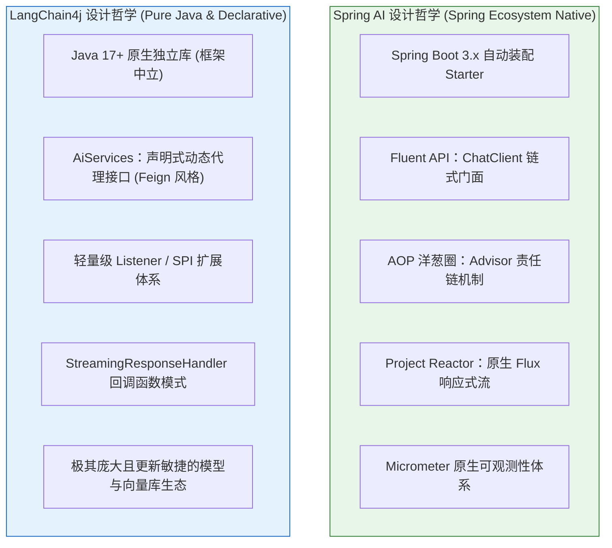
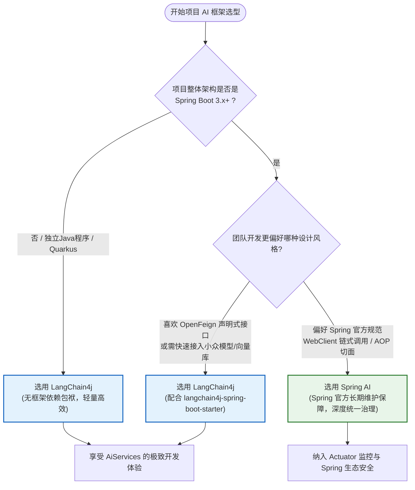

# ⚖️ Spring AI 与 LangChain4j 深度对比与架构选型

> [!abstract] 一句话总结
> **Spring AI 是 Spring Boot 3.x 微服务体系下的正规军**（风格如 Spring Data，深度绑定 AOP 与 Actuator），而 **LangChain4j 是兼顾纯 Java 与多框架的现代化瑞士军刀**（声明式 `AiServices` 风格如 OpenFeign，独立轻量）；业务选型必须坚守“单技术栈闭环，严禁跨框架混用”！

---

## 🗣️ 白话版（先建立直觉）

如果把给 Java 项目接入大模型比作**“选购企业办公软件”**：
- **Spring AI** 就像是 **微软全家桶（Microsoft 365）**：
  如果你原本整套公司系统都是 Windows、Active Directory、Outlook，那么直接用微软全家桶是最顺滑的。它与 Spring Boot 的自动装配、Spring Security 鉴权、Micrometer 监控告警无缝咬合，调大模型就像写 `JdbcTemplate` 或 `WebClient` 一样亲切自然。
- **LangChain4j** 就像是 **独立跨平台的飞书/Notion**：
  它不受任何单一操作系统的绑架，不管你是裸跑的纯 Java 命令行、还是 Quarkus、Micronaut 甚至老旧系统，它都能轻快运行。它独创的 `AiServices`（声明式 AI 接口），就像 Spring Cloud 里的 OpenFeign 一样，写个 Java 接口加两个注解，大模型就被你封装好了，开发体验惊艳且极度直观！

---

## 📌 第一性原理：底层设计哲学与技术架构深度对比



### 1. 核心抽象维度硬核对照

| 对比维度 | Spring AI | LangChain4j |
| :--- | :--- | :--- |
| **项目发起方** | Spring 官方团队（VMware / Broadcom 嫡系） | 顶尖开源社区驱动，由资深 Java 架构师发起维护 |
| **基线环境依赖** | **强绑定 Java 17+ 与 Spring Boot 3.x+** | 独立于框架，**可在任何 Java 环境运行**（包含 Quarkus/Micronaut/纯 Java Main） |
| **调用交互范式** | **Fluent API 建造者链式**（`chatClient.prompt()...call()`） | **声明式动态代理接口**（`AiServices.create(MyAssistant.class)`） |
| **切面增强机制** | **Advisor 责任链**（完全遵循 Spring AOP 语义，分 `CallAround` 与 `StreamAround`） | `ChatModelListener` 监听器钩子 + 编排拦截 |
| **流式响应支持** | **深度集成 Project Reactor**，原生返回 `Flux<String>` / `Flux<ChatResponse>` | 基于回调接口 `StreamingResponseHandler<AiMessage>` 或 TokenStream |
| **监控与可观测** | **开箱对齐 Micrometer Observation**，指标天然对接 Prometheus 与 Grafana | 内置基础 Logging，需通过自定义 Listener 对接 APM |
| **向量库适配度** | 覆盖主流企业级存储（PGVector, Milvus, Redis, Elasticsearch 等） | 覆盖面更广、更新极快（包含 20+ 种向量数据库驱动） |

---

## 💻 编程范式硬核对比：ChatClient vs AiServices

同样是实现一个**带有系统人设、支持动态入参、能反序列化为实体**的 AI 助手，看看两者的代码差异：

### 1. Spring AI：Fluent API 链式驱动
```java
// Spring AI 风格：强调链式配置与建造者
@Service
public class OrderService {
    @Autowired private ChatClient chatClient;

    public OrderAnalysisResult analyzeOrder(String orderText) {
        return chatClient.prompt()
                .system("你是一个专业的电商风控审核员。")
                .user(u -> u.text("请审查以下订单信息：{order}").param("order", orderText))
                .call()
                .entity(OrderAnalysisResult.class); // 强类型反序列化
    }
}
```

### 2. LangChain4j：AiServices 声明式接口驱动
```java
// LangChain4j 风格：强调接口声明与动态代理，如同 OpenFeign！
public interface OrderFraudAuditor {

    @SystemMessage("你是一个专业的电商风控审核员。")
    @UserMessage("请审查以下订单信息：{{order}}")
    OrderAnalysisResult audit(@V("order") String orderText);
}

// 运行时自动生成动态代理实现类
OrderFraudAuditor auditor = AiServices.builder(OrderFraudAuditor.class)
        .chatLanguageModel(model)
        .build();

OrderAnalysisResult result = auditor.audit(orderText);
```

> [!TIP]
> **心智洞察**：
> - 喜欢函数式、链式编程、需要在单次调用中自由拼装各种参数的，用 **Spring AI** 爽感极强；
> - 喜欢清晰的面向对象契约、希望把 AI 交互封装成一个个标准 Java 业务接口的，用 **LangChain4j** 极其优雅！

---

## 🎯 企业级架构选型决策树



---

## ⚠️ 生产架构避坑十诫（选型血泪史）

### 1. 绝对死穴：在同一个微服务模块中同时引入两个框架！
- **血淋淋的教训**：有些团队“既要又要”，POM 里既配 `spring-ai-starter` 又配 `langchain4j-spring-boot-starter`。
- **灾难后果**：
  - 两者都依赖了不同版本的 Jackson、Retrofit 或 OkHttp，引发恶性依赖冲突；
  - 团队代码风格人格分裂，有的写 `ChatClient`，有的写 `AiServices`，记忆和 RAG 上下文完全无法打通；
  - 维护成本倍增，排查线上 Bug 时不知责任归属。
- **铁律**：**一个项目有且只能选定一个主 AI 编排框架！**

### 2. 警惕版本追新：Spring AI 快速演进中的破坏性变更
- Spring AI 从 1.0 到 2.0+ 迭代极为迅猛，部分早期实验性 API（如旧版 `PromptChatMemoryAdvisor` 部分构造函数）曾发生变动。
- **治理**：企业生产必须锁定稳定正式发行版本（GA / Milestone），生产环境杜绝直接使用 `SNAPSHOT` 镜像。

### 3. 不要因为框架能力差异而放弃统一治理
- 如果选择了 LangChain4j，务必补充针对模型调用的统一 MDC 链路追踪和 Micrometer 指标采集切面，不要让 AI 调用变成黑盒盲区。

---

## 🎯 大厂高频面试 30 秒绝杀

> [!question] 面试高频问题 3 连击
> 
> **Q1：请从设计理念、生态集成和编程范式三个方面，对比 Spring AI 与 LangChain4j 的异同？**
> - **答（满分绝杀）**：
>   1. **设计理念**：Spring AI 是 Spring 官方的一等公民，追求与 Spring Boot 3.x、Spring Security、Actuator 的深度同构与开箱即用；LangChain4j 则是跨平台框架中立的轻量库，追求纯 Java 的优雅解耦；
>   2. **编程范式**：Spring AI 核心是以 `ChatClient` 为代表的 **Fluent API 链式建造者模式**，强调基于 Advisor 的 AOP 洋葱圈切面；LangChain4j 的杀手锏是 **`AiServices` 声明式接口驱动**，使用动态代理让 AI 交互像调用本地或 Feign 接口一样自然；
>   3. **流式与响应式**：Spring AI 底层深度绑定 Project Reactor（`Flux`），非常契合 WebFlux 反应式微服务；LangChain4j 则主要基于监听回调模式。
>
> **Q2：你们团队在实际项目中是如何进行选型的？为什么这么选？**
> - **答（满分绝杀）**：
>   结合公司当前架构，若现有核心服务均已升级至 **Spring Boot 3.x**，首选 **Spring AI**。理由是：① 团队技术心智高度统一，`ChatClient` 与 `RestClient` 风格一致，上手零学习成本；② Advisor 机制完美承接了我们企业原有的日志审计、敏感词脱敏和多轮记忆持久化切面；③ 原生支持 Micrometer 监控，能够以极低成本将 Token 消耗和延迟推送至公司现有的 Prometheus 监控看板。
>
> **Q3：为什么说严禁在同一个微服务模块内混用 Spring AI 与 LangChain4j？**
> - **答（满分绝杀）**：
>   混用会带来三大致命隐患：① **底层抽象撕裂**：两者的 `Message`、`ChatMemory`、`Tool` 注解互不兼容，导致同一套上下文无法跨框架复用；② **依赖冲突**：两个框架各自引入了不同版本的 HTTP Client（OkHttp/WebClient）和 JSON 序列化组件，极易在打包运行时引发 `NoSuchMethodError` 等类加载灾难；③ **维护成本高昂**：导致团队代码风格严重割裂，排查生产事故时追踪链路极其混乱。

---

## 🪝 一分钟复盘记忆卡

```
┌────────────────────────────────────────────────────────┐
│             Spring AI vs LangChain4j 极速通关卡         │
├────────────────────────────────────────────────────────┤
│  1. 阵营归属：Spring 官方正规军 vs 社区驱动瑞士军刀    │
│  2. 核心范式：ChatClient 链式 Fluent vs AiServices 接口│
│  3. 运行环境：Spring AI 强绑 Boot 3.x；LC4J 框架中立   │
│  4. 切面哲学：Spring AI 靠 Advisor AOP；LC4J 靠 Listener│
│  5. 生产红线：一山不容二虎，绝不在单模块内混用两套体系 │
└────────────────────────────────────────────────────────┘
```

---

## 🔗 关联笔记

- [[00-Java-AI框架全景与心智模型]] - 全局心智桥梁
- [[SpringAI/02-ChatClient与ChatModel]] - 深入 Spring AI 调用体系
- [[LangChain4j/02-AiServices声明式AI服务]] - 深入 LangChain4j 声明式黑科技
- [[_index]] - 返回本章索引
