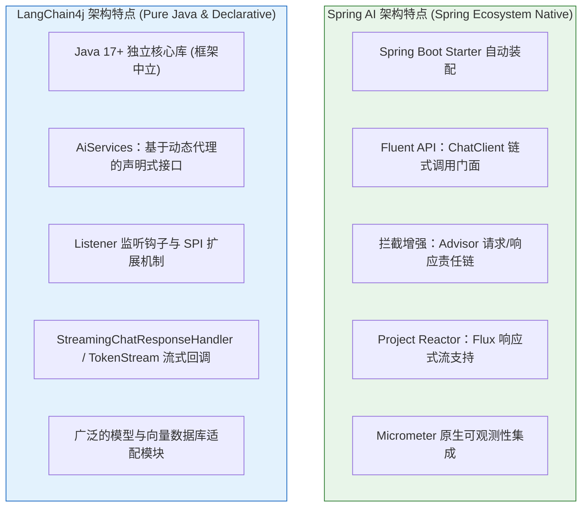
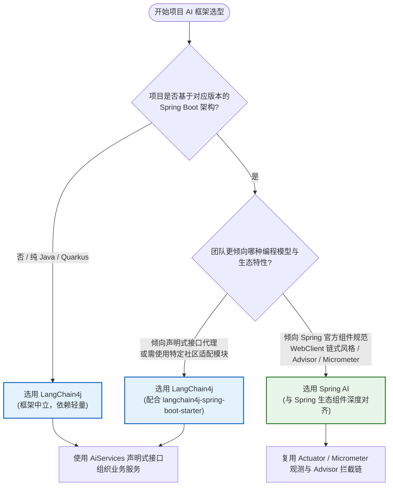

# ⚖️ Spring AI 与 LangChain4j 深度对比与架构选型

> [!abstract] 一句话总结
> **Spring AI** 深度集成 Spring Boot 自动配置、`ChatClient` 链式 API、`Advisor` 责任链与 Micrometer 可观测体系；**LangChain4j** 提供框架中立的 Java 组件与 `AiServices` 声明式接口代理。工程选型建议结合现有技术栈与目标特性统一主框架，降低多套抽象并存的维护成本。

---

## 📌 设计理念与技术架构对比



### 1. 核心维度对比

| 对比维度 | Spring AI | LangChain4j |
| :--- | :--- | :--- |
| **维护主体** | Spring 官方团队（VMware / Broadcom） | 开源社区驱动，核心维护活跃 |
| **运行环境要求** | 与 Spring Boot 版本线对应（1.x 基于 Boot 3.x，2.x 基于 Boot 4.x，要求 Java 17/21+） | 核心库基于 Java 17+，可脱离 Spring 独立运行，也提供 Spring Boot 与 Quarkus 集成 |
| **调用交互范式** | **Fluent API 链式构建**（`chatClient.prompt()...call()`） | **声明式接口动态代理**（`AiServices.builder(MyService.class)...build()`） |
| **切面增强机制** | **`Advisor` 责任链**（面向模型请求 `ChatClientRequest` 与响应的专用拦截链） | `ChatModelListener` 监听器钩子与 `AiServices` 内部编排扩展 |
| **流式响应支持** | 基于 **Project Reactor**，直接返回 `Flux<String>` / `Flux<ChatResponse>` | 基于 `StreamingChatResponseHandler` 回调接口或 `TokenStream` |
| **监控与可观测** | 原生接入 **Micrometer Observation**，指标与追踪可直接对接 Prometheus / OpenTelemetry | 提供请求/响应日志开关与 `ChatModelListener`，可通过监听器对接自定义监控 |
| **生态适配范围** | 覆盖主流企业级模型与向量库（PGVector、Milvus、Redis、Elasticsearch 等） | 模型与向量存储适配模块数量多，社区新增速度快 |

---

## 💻 编程范式对比：ChatClient vs AiServices

以实现一个**包含系统提示词、动态参数注入与结构化对象返回**的订单审核服务为例，对比两者的代码风格：

### 1. Spring AI：Fluent API 链式调用

```java
// Spring AI：通过 ChatClient 链式组装请求并映射结果
@Service
public class OrderService {
    private final ChatClient chatClient;

    public OrderService(ChatClient.Builder builder) {
        this.chatClient = builder.build();
    }

    public OrderAnalysisResult analyzeOrder(String orderText) {
        return chatClient.prompt()
                .system("你是一个专业的电商风控审核员。")
                .user(u -> u.text("请审查以下订单信息：{order}").param("order", orderText))
                .call()
                .entity(OrderAnalysisResult.class); // 结构化反序列化
    }
}
```

### 2. LangChain4j：AiServices 声明式接口

```java
// LangChain4j：通过接口与注解声明契约，运行时生成动态代理
public interface OrderFraudAuditor {

    @SystemMessage("你是一个专业的电商风控审核员。")
    @UserMessage("请审查以下订单信息：{{order}}")
    OrderAnalysisResult audit(@V("order") String orderText);
}

// 运行时构建代理实例
OrderFraudAuditor auditor = AiServices.builder(OrderFraudAuditor.class)
        .chatModel(model)
        .build();

OrderAnalysisResult result = auditor.audit(orderText);
```

> [!tip] 两种调用方式
> `ChatClient` 使用链式调用，便于在请求中调整参数和挂载 Advisor；`AiServices` 把提示词与接口方法绑定，业务代码可以通过接口调用，也便于替换成测试实现。

---

## 🎯 架构选型决策参考



---

## ⚠️ 工程选型与治理注意事项

### 1. 保持单一模块内的框架收敛

在同一服务中混用两个框架时，需要考虑：
- 消息、记忆、工具和向量检索接口不能直接互换，需要做适配。
- 两套框架的传递依赖可能发生版本冲突。
- 日志、异常处理和监控可能需要维护两套接入方式。

通常可以先为同一服务确定主框架；确需共存时，再按模块或适配层划清边界。

### 2. 版本锁定与 BOM 管理

两个框架都在持续更新。项目可以通过 `spring-ai-bom` 或 `langchain4j-bom` 统一子模块版本，升级前查看变更并用集成测试验证模型、记忆和工具调用等链路。

### 3. 补齐统一的可观测性与安全治理

模型调用需要考虑超时、Token 用量、链路追踪和敏感信息过滤。使用 LangChain4j 时，可以通过 `ChatModelListener` 对接现有监控系统。

---

## 🎯 高频面试问题

> [!question]- Q1：请从设计理念、编程范式和流式处理三个方面，对比 Spring AI 与 LangChain4j 的异同？
>   1. **设计理念**：Spring AI 是 Spring 官方项目，深度集成 Spring Boot 自动配置、依赖注入与 Micrometer 可观测性体系；LangChain4j 则是框架中立的 Java 库，既支持纯 Java 与 Quarkus，也提供 Spring Boot Starter；
>   2. **编程范式**：Spring AI 以 `ChatClient` 的 **Fluent 链式 API** 为核心，通过 `Advisor` 责任链实现记忆、RAG 和日志等横切逻辑；LangChain4j 主打 **`AiServices` 声明式接口**，基于 JDK 动态代理将注解与接口方法转化为模型调用链；
>   3. **流式处理**：Spring AI 原生基于 Project Reactor 返回 `Flux<String>` / `Flux<ChatResponse>`，与 WebFlux 响应式编程模型无缝衔接；LangChain4j 则主要基于 `StreamingChatResponseHandler` 回调或 `TokenStream` 处理增量输出。

> [!question]- Q2：在实际项目中如何进行技术选型？
> 可以从三方面判断：
> - 看现有技术栈：Spring Boot 项目可以优先评估 Spring AI；纯 Java 或 Quarkus 项目可以评估 LangChain4j。
> - 看调用方式：`ChatClient` 偏链式编排，`AiServices` 偏接口声明。
> - 核对项目需要的模型、向量库和其他组件是否得到充分支持。

> [!question]- Q3：为什么通常建议在一个服务模块中统一主框架，而不是混用 Spring AI 与 LangChain4j？
> 两套框架的消息、记忆和工具接口不能直接互换，底层依赖也可能冲突；日志、异常处理和监控需要分别接入。在同一模块确定主框架，可以减少这些适配工作。

---

## 🪝 知识复盘卡

```text
┌────────────────────────────────────────────────────────┐
│             Spring AI vs LangChain4j 复盘卡             │
├────────────────────────────────────────────────────────┤
│  1. 生态定位：Spring 官方深度集成 vs 社区驱动框架中立     │
│  2. 调用范式：ChatClient 链式 API vs AiServices 接口代理 │
│  3. 流式模型：Reactor Flux 响应式流 vs TokenStream 回调  │
│  4. 扩展机制：Advisor 责任链切面 vs ChatModelListener    │
│  5. 选型原则：结合现有技术栈统一主框架，用 BOM 锁定版本   │
└────────────────────────────────────────────────────────┘
```

---

## 🔗 关联笔记

- [[00-Java-AI框架全景与心智模型]] - 全局分层架构与核心抽象
- [[SpringAI/02-ChatClient与ChatModel]] - Spring AI 调用门面与底层接口
- [[LangChain4j/02-AiServices声明式AI服务]] - LangChain4j 声明式 AI 服务详解
- [[_index]] - 返回本章索引
