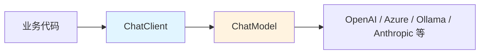

# 💬 ChatClient 与 ChatModel

> [!abstract] 一句话总结
> `ChatModel` 是底层模型调用抽象，`ChatClient` 是面向业务开发的流式 Fluent API；日常优先用 `ChatClient`，需要底层控制时再碰 `ChatModel`。

## 📌 这是什么

Spring AI 的聊天调用分两层：

| 抽象 | 定位 | 类比 |
| ---- | ---- | ---- |
| `ChatModel` | 模型能力接口 | JDBC Driver / HTTP Client |
| `ChatClient` | 业务友好的调用门面 | JdbcTemplate / WebClient |

`ChatModel` 接收 `Prompt`，返回 `ChatResponse`；`ChatClient` 在它之上提供 `.prompt().system().user().call().content()` 这类链式写法。

## 🤔 解决什么问题

直接用模型 SDK 容易让业务代码绑定某个 Provider。Spring AI 用 `ChatModel` 抹平差异，再用 `ChatClient` 提供统一的工程入口。



---

## 🧩 ChatClient 核心用法

```java
String answer = chatClient.prompt()
        .system("你是一个 Java AI 应用导师。")
        .user("解释 ChatClient 和 ChatModel 的区别")
        .call()
        .content();
```

默认系统提示：

```java
ChatClient client = builder
        .defaultSystem("回答要简洁，代码示例优先用 Java。")
        .build();
```

获取完整响应：

```java
ChatResponse response = chatClient.prompt()
        .user("给我三个 RAG 关键词")
        .call()
        .chatResponse();
```

完整响应里通常能拿到候选结果、元数据、Token 使用情况等信息，适合做日志、计费和观测。

---

## ⚙️ ChatModel 什么时候用

`ChatModel` 更适合框架层、封装层或需要自己构造 `Prompt` 的场景：

```java
Prompt prompt = new Prompt("用一句话解释 Spring AI");
ChatResponse response = chatModel.call(prompt);
String content = response.getResult().getOutput().getText();
```

优先级：

```text
业务 Controller / Service：ChatClient
自定义框架封装：ChatModel
需要插入 Advisor / Tool / Memory：ChatClient
需要完全掌控 Prompt / Response：ChatModel
```

> [!note] 推荐理解
> `ChatModel` 负责“怎么调模型”，`ChatClient` 负责“这次对话带什么系统提示、用户输入、工具、记忆、Advisor”。

---

## ✅ 学习检查点

- [ ] 能说清 `ChatClient` 和 `ChatModel` 的层级关系
- [ ] 能用 `ChatClient.Builder` 创建默认系统提示
- [ ] 能区分 `.content()` 和 `.chatResponse()` 的使用场景
- [ ] 能说明为什么业务代码不要直接绑定某个模型 SDK

## ⚠️ 常见坑

- [ ] **所有代码都用 ChatModel**：会让工具、记忆、Advisor 组合变笨重。
- [ ] **只取 content**：生产系统通常还要记录元数据、耗时、Token 和模型名。
- [ ] **系统提示到处散落**：建议在 `ChatClient` 构造时设置默认值，业务方法只传变量。

## 🎯 面试速记

> - **Q: ChatClient 和 ChatModel 区别？**
>   - A: `ChatModel` 是底层模型调用接口，`ChatClient` 是基于它的 Fluent API，封装 prompt、tool、memory、advisor 等组合能力。
> - **Q: 为什么日常推荐 ChatClient？**
>   - A: 写法更贴近业务，并且更容易组合 Spring AI 的高级能力。

## 🔗 关联阅读

- [[01-Spring-AI项目搭建]]
- [[03-PromptTemplate]]
- [[07-Advisor拦截器]]

## 📚 参考资料

- [Spring AI Chat Client API](https://docs.spring.io/spring-ai/reference/api/chatclient.html)
- [Spring AI Chat Model API](https://docs.spring.io/spring-ai/reference/api/chatmodel.html)
