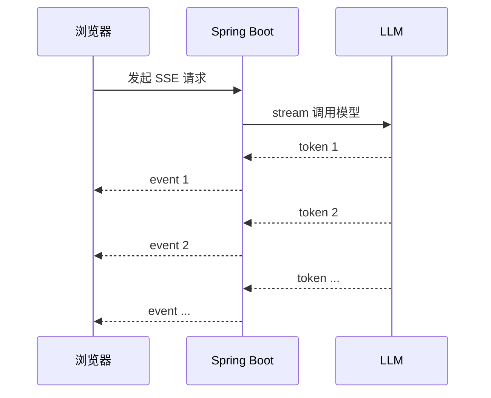

# 🌊 流式输出 SSE

> [!abstract] 一句话总结
> 流式输出把“等完整答案”改成“边生成边返回”，SSE 是 Java Web 场景里最简单稳定的文本流传输方式。

## 🎯 本节定位

- **本章第 4 课，输出体验**。前置：[[02-ChatClient与ChatModel]] 的同步调用；本节把它升级为流式输出，会用到 Spring WebFlux 的 `Flux` 响应式流类型（只需基本用法，不必先系统学响应式编程）。
- **延伸**：流式响应的工程注意点见本节“工程注意点”；前端消费方式见“EventSource”示例。

## 📌 这是什么

大模型生成长答案时，如果等全部生成完再返回，用户会觉得卡。Spring AI 的 `ChatClient.stream()` 可以返回响应流，Spring WebFlux 可以把它包装成 `text/event-stream`。这里用到的 WebFlux 是 Spring 的响应式 Web 框架，`Flux<String>` 是它的响应式流类型（可理解为“可订阅的异步序列”），本节只使用其最基础用法，无需先系统学完响应式编程。



## 🤔 解决什么问题

| 普通响应 | 流式响应 |
| ---- | ---- |
| 首字慢，用户等待 | 首 token 快，体验好 |
| 长答案容易超时 | 持续输出保持连接活跃 |
| 只能一次性展示 | 可做打字机效果 |

---

## 💻 Spring WebFlux 示例

```java
@RestController
class StreamController {

    private final ChatClient chatClient;

    StreamController(ChatClient.Builder builder) {
        this.chatClient = builder.build();
    }

    @GetMapping(value = "/chat/stream", produces = MediaType.TEXT_EVENT_STREAM_VALUE)
    Flux<String> stream(@RequestParam String message) {
        return chatClient.prompt()
                .user(message)
                .stream()
                .content();
    }
}
```

前端用 `EventSource`：

```javascript
const source = new EventSource("/chat/stream?message=解释RAG");

source.onmessage = (event) => {
  document.querySelector("#answer").textContent += event.data;
};

source.onerror = () => {
  source.close();
};
```

---

## 🧩 SSE vs WebSocket

| 维度 | SSE | WebSocket |
| ---- | ---- | ---- |
| 通信方向 | 服务端到客户端为主 | 双向 |
| 实现复杂度 | 低 | 中 |
| 适合场景 | LLM 文本流、通知 | 实时协作、双向控制 |
| HTTP 兼容 | 好 | 需要升级协议 |

AI 聊天的“模型往前端吐字”优先选 SSE；如果需要用户中途打断、多人协作、复杂状态同步，再考虑 WebSocket。

## ⚙️ 工程注意点

```text
☑ 网关 / Nginx 不要缓存 SSE
☑ 关闭响应缓冲，否则前端看不到逐 token 输出
☑ 前端要处理断线和重试
☑ 后端要记录请求 ID，方便追踪流式请求
☑ 敏感内容审核要考虑流式场景
```

---

## ✅ 学习检查点

- [ ] 能写出 `produces = MediaType.TEXT_EVENT_STREAM_VALUE`
- [ ] 能用 `ChatClient.stream().content()` 输出 `Flux<String>`
- [ ] 能说明 SSE 和 WebSocket 的区别
- [ ] 能解释为什么流式输出改善用户体验

## ⚠️ 常见坑

- [ ] **用了 Spring MVC 却返回 Flux**：流式体验建议配 WebFlux 或确认容器支持。
- [ ] **Nginx 缓冲**：代理层缓冲会导致前端一次性收到全部内容。
- [ ] **异常只在日志里**：流中报错要给前端一个可识别结束状态。
- [ ] **逐 token 存库**：通常只在结束后存完整答案，避免大量小写入。

## 🎯 面试速记

> - **Q: SSE 为什么适合大模型输出？**
>   - A: 大模型输出天然是单向增量文本，SSE 简单、基于 HTTP、浏览器原生支持。
> - **Q: 流式接口怎么做？**
>   - A: 后端用 `ChatClient.stream()` 返回 `Flux`，接口声明 `text/event-stream`，前端用 `EventSource` 消费。

## 🔗 关联阅读

- [[02-ChatClient与ChatModel]]
- [[01-Spring-AI项目搭建]]
- [[_index]]

## 📚 参考资料

- [Spring AI Chat Client Streaming](https://docs.spring.io/spring-ai/reference/api/chatclient.html)
- [Spring Framework WebFlux](https://docs.spring.io/spring-framework/reference/web/webflux.html)
