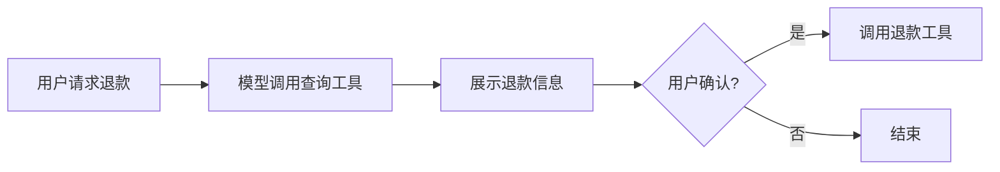

# 🛠️ Function Calling 工具调用

> [!abstract] 一句话总结
> Tool Calling 让模型从“只会说”变成“能调用你提供的函数”，是 Agent、MCP、业务自动化的基础原语。

## 📌 这是什么

Function Calling / Tool Calling 的流程：

```text
用户提问
  → 模型判断需要哪个工具
  → 返回工具名和参数
  → 应用执行 Java 方法
  → 把工具结果交回模型
  → 模型生成最终回答
```

模型不直接访问数据库、发 HTTP 或操作系统，它只是请求调用工具；真正执行的是你的应用代码。

## 🤔 解决什么问题

| 纯聊天 | 工具调用 |
| ---- | ---- |
| 只能基于训练知识回答 | 能查实时数据 |
| 不能执行业务动作 | 能查订单、创建工单、发通知 |
| 容易编造结果 | 用工具结果约束回答 |
| 难做 Agent | Tool Use 是 Agent 基础 |

---

## 💻 Spring AI 示例

### 定义工具

```java
@Service
class WeatherTools {

    @Tool(description = "根据城市名称查询当前天气")
    String currentWeather(@ToolParam(description = "城市名称，例如杭州") String city) {
        return city + "：晴，28℃";
    }
}
```

### 注册到 ChatClient

```java
String answer = chatClient.prompt()
        .user("杭州今天适合跑步吗？")
        .tools(weatherTools)
        .call()
        .content();
```

模型看到工具描述后，会决定是否调用 `currentWeather`，并填入 `city` 参数。

---

## 🧩 工具设计原则

| 原则 | 说明 |
| ---- | ---- |
| 名字清晰 | 方法名和描述要让模型知道什么时候用 |
| 参数少而准 | 参数越多，模型越容易填错 |
| 返回结构化 | 返回 JSON / DTO 比一大段自然语言更稳 |
| 幂等优先 | 查询类工具比写操作更安全 |
| 权限前置 | 工具内部必须做鉴权，不信任模型 |

### 好工具 vs 坏工具

```text
好：queryOrderStatus(orderId)
坏：handleUserRequest(text, mode, data, extra)
```

工具越像清晰的业务 API，模型越容易正确调用。

---

## ⚙️ 写操作要谨慎

对于“退款、删除、发邮件、下单”这类有副作用工具，建议加确认流程：



不要让模型在没有用户确认和权限校验的情况下直接执行高风险动作。

---

## ✅ 学习检查点

- [ ] 能用 `@Tool` 暴露 Java 方法
- [ ] 能解释模型和应用在工具调用中的分工
- [ ] 能设计一个查询类工具
- [ ] 能说出写操作工具的安全措施

## ⚠️ 常见坑

- [ ] **工具描述太模糊**：模型不知道何时调用。
- [ ] **参数过多**：模型填参错误率上升。
- [ ] **把权限交给模型判断**：权限必须在后端代码里校验。
- [ ] **工具返回长文本**：优先返回结构化结果，节省 Token。
- [ ] **没有超时和熔断**：外部 API 卡住会拖垮对话。

## 🎯 面试速记

> - **Q: Tool Calling 的核心流程？**
>   - A: 模型决定工具名和参数，应用执行函数，再把结果给模型生成最终回答。
> - **Q: 模型会真的执行函数吗？**
>   - A: 不会。模型只提出调用请求，执行发生在应用侧。
> - **Q: Tool Calling 和 MCP 的关系？**
>   - A: Tool Calling 是应用内工具调用机制；MCP 是把工具标准化暴露给多个客户端的协议。

## 🔗 关联阅读

- [[02-ChatClient与ChatModel]]
- [[07-Advisor拦截器]]
- [[05-Agent-MCP-Skills/09-MCP协议详解]]

## 📚 参考资料

- [Spring AI Tool Calling](https://docs.spring.io/spring-ai/reference/api/tools.html)
