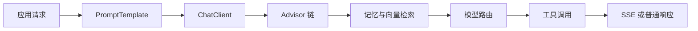

# Spring AI 与 LangChain4j：本章总结与复习

> [!abstract] 一句话总结
> Java AI 框架的价值是用统一抽象组织模型、Prompt、流式响应、工具、记忆和检索，并让这些能力融入 Spring 应用的配置与治理体系。

> [!info] 版本现状（2026-08）
> **Spring AI 2.0.0 GA**（Boot 4.x / MCP SDK 2.0 / Options 全 builder / 记忆需显式 conversationId）与 **LangChain4j 1.18.1**。本章示例以概念与稳定 API 为主，具体版本以官方 BOM 为准（见 [[01-Spring-AI项目搭建]]）。

## 核心知识概览

| 模块 | 核心问题 | 关键结论 | 对应笔记 |
| --- | --- | --- | --- |
| 项目与调用 | 如何接入模型并发起对话 | 用 Starter 和配置完成 Provider 接入；常规调用优先 `ChatClient`，底层控制使用 `ChatModel` | [[01-Spring-AI项目搭建]]、[[02-ChatClient与ChatModel]] |
| 输入与输出 | 如何复用 Prompt 并改善响应体验 | `PromptTemplate` 管理变量化输入；SSE 适合服务端到客户端的单向 Token 流 | [[03-PromptTemplate]]、[[04-流式输出-SSE]] |
| 多模型治理 | 如何切换 Provider 和模型 | 从配置切换、Bean 选择到路由服务逐级增加复杂度，路由应基于任务、成本、延迟与可用性 | [[05-多模型接入与切换]] |
| 工具调用 | 如何让模型使用外部能力 | 模型负责选择工具和生成参数，应用负责校验、授权、执行与返回结果 | [[06-Function-Calling工具调用]] |
| 链路增强 | 如何统一注入横切能力 | Advisor 可组合日志、记忆、RAG 等前后处理；顺序、状态边界和可观测性很关键 | [[07-Advisor拦截器]] |
| 记忆与检索 | 如何支持多轮对话和私有知识 | `ChatMemory` 按会话管理历史，`VectorStore` 负责向量写入与相似度检索，两者解决不同问题 | [[08-ChatMemory记忆]]、[[09-VectorStore向量存储]] |
| 框架选型 | Spring AI 与 LangChain4j 如何取舍 | Spring AI 更贴近 Spring 生态；LangChain4j 以 AiServices 等 Java 抽象见长，应按团队与项目约束选主框架 | [[10-LangChain4j核心概念]]、[[11-SpringAI与LangChain4j对比]] |

## 典型调用链

## 快速复习

1. Spring AI Starter 负责自动配置，`ChatClient` 是面向业务的流畅调用入口，`ChatModel` 是更底层的模型抽象。
2. Prompt 模板只负责稳定组织输入，模板变量仍需校验，复杂模板应与业务代码分离管理。
3. SSE 适合单向流式输出；要处理取消、超时、异常事件、背压和代理缓冲。
4. 多模型接入先统一业务接口，再按任务质量、成本、延迟和故障情况路由。
5. Function Calling 不是直接执行权限，尤其写操作必须经过参数校验、鉴权、确认和审计。
6. Advisor 适合横切增强，但需明确执行顺序，避免隐藏过多业务逻辑或重复注入上下文。
7. `ChatMemory` 保存会话上下文，`VectorStore` 检索外部知识；两者可以组合但不能互相替代。
8. Spring AI 与 LangChain4j 功能大量重叠，生产项目通常选一个主框架以降低认知和集成成本。

## 自测问题

1. `ChatClient` 与 `ChatModel` 的职责差异是什么，业务代码通常应依赖哪一个？
2. 一次工具调用从模型提出请求到应用返回结果，需要经过哪些安全控制？
3. Advisor、ChatMemory 和 VectorStore 在一次 RAG 多轮对话中分别承担什么职责？
4. 选择 Spring AI 或 LangChain4j 时，应比较哪些团队与系统约束？

## 下一章衔接

下一章进入 [[10-AI应用开发/03-知识库技术-RAG/_index|知识库技术 RAG]]：在 `VectorStore` 和 Advisor 的基础上，继续学习文档解析、切分、Embedding、召回、重排、评估与向量数据库选型。

## 相关编号双链

- Spring AI 基础：[[01-Spring-AI项目搭建]] · [[02-ChatClient与ChatModel]] · [[03-PromptTemplate]] · [[04-流式输出-SSE]] · [[05-多模型接入与切换]]
- 应用能力：[[06-Function-Calling工具调用]] · [[07-Advisor拦截器]] · [[08-ChatMemory记忆]] · [[09-VectorStore向量存储]]
- LangChain4j 与选型：[[10-LangChain4j核心概念]] · [[11-SpringAI与LangChain4j对比]]

