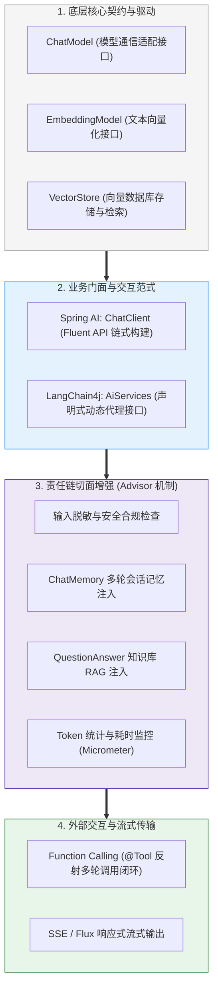

# 🎯 Java AI 框架：本章通关总结与复习

> [!abstract] 一句话总结
> Java AI 框架通过统一面向对象接口与责任链切面，将不同厂商的底层 HTTP 协议抽象为 `ChatModel`，并借助 `ChatClient` / `AiServices` 及 `Advisor` 拦截机制，使会话记忆、工具调用、向量检索与可观测性无缝融入企业级微服务架构。

---

## 🗺️ 全章知识拓扑总览

---

## 📊 核心模块关键结论总览

| 模块 | 核心问题 | 关键机制与工程结论 | 对应笔记 |
| :--- | :--- | :--- | :--- |
| **00 框架定位** | 为什么企业级 AI 应用广泛采用 Java？ | 模型训练主要在 Python 生态完成，而企业级高并发服务、安全鉴权、事务治理与可观测性可充分复用成熟的 Java 微服务体系。 | [[00-Java-AI框架全景与心智模型\|00-框架全景心智]] |
| **02 门面与调用** | `ChatClient` 与 `ChatModel` 如何分工？ | `ChatModel` 负责底层厂商协议适配，`ChatClient` 负责链式组装提示词、挂载 Advisor 与映射结构化实体；业务层优先面向 `ChatClient` 编程。 | [[SpringAI/02-ChatClient与ChatModel\|02-ChatClient与ChatModel]] |
| **04 流式输出** | 增量文本流如何端到端打通？ | 基于 Project Reactor 的 `Flux<String>`，HTTP 层采用 Server-Sent Events (`text/event-stream`) 单向增量推送，需关闭代理层响应缓冲。 | [[SpringAI/04-流式输出-SSE\|04-流式输出-SSE]] |
| **06 工具调用** | 模型如何触发本地业务代码执行？ | 模型根据工具 JSON Schema 输出调用意图与参数，宿主应用在本地反射执行 Java 方法，并将结果封装为 `ToolResponseMessage` 回传给模型。 | [[SpringAI/06-Function-Calling工具调用\|06-Function-Calling]] |
| **07 拦截器切面** | 如何非侵入式实现记忆、日志与安全过滤？ | `Advisor` 提供针对模型请求与响应流的环绕责任链（`CallAdvisor` 与 `StreamAdvisor`），按 `getOrder()` 顺序执行前置改写与后置处理。 | [[SpringAI/07-Advisor拦截器\|07-Advisor拦截器]] |
| **08 会话记忆** | 多轮对话上下文如何存储与隔离？ | `MessageWindowChatMemory` 控制窗口消息条数，`ChatMemoryRepository` 负责底层存储（内存/JDBC/Redis），通过 `conversationId` 隔离不同会话。 | [[SpringAI/08-ChatMemory记忆\|08-ChatMemory记忆]] |
| **01 框架选型** | Spring AI 与 LangChain4j 如何选型？ | Spring Boot 微服务优先选 Spring AI；跨框架或偏好声明式接口代理选 LangChain4j；单一服务内建议统一主框架以降低维护成本。 | [[01-SpringAI与LangChain4j对比\|01-两框架对比与选型]] |

---

## ⚡ 高频面试问题汇总

> [!important] 核心问题解析
>
> 1. **Spring AI 中的 `ChatClient` 是如何设计的？为什么通常不在业务代码中直接调用 `ChatModel`？**
>    - 答：`ChatModel` 是底层模型驱动适配器，仅处理 `Prompt` 到 `ChatResponse` 的基础通信。`ChatClient` 基于门面模式与建造者模式提供 Fluent API，统一封装了提示词模板渲染、结构化对象转换（`.entity()`）、工具绑定以及 `Advisor` 拦截器链，能大幅减少业务层的样板代码。
>
> 2. **Function Calling 工具调用的完整交互时序是怎样的？大模型会直接执行 Java 代码吗？**
>    - 答：大模型不会直接执行本地代码。交互分为三步：① 框架将 `@Tool` 方法解析为 JSON Schema 随请求发送给模型；② 模型判断需要调用工具时，返回包含工具名、参数 JSON 与 `tool_call_id` 的响应；③ 框架在本地反射执行对应 Java 方法，将返回值封装为携带相同 `tool_call_id` 的 `ToolResponseMessage` 再次发送给模型，直至模型生成最终自然语言回复。
>
> 3. **Spring AI 的 `Advisor` 拦截器与传统 Spring AOP 有何区别？**
>    - 答：传统 Spring AOP 基于动态代理拦截通用 Java 方法调用；而 `Advisor` 是专为模型交互设计的领域责任链，直接以 `ChatClientRequest` 和 `ChatClientResponse` 为上下文建模，并通过 `CallAdvisor` 和 `StreamAdvisor` 同时支持同步调用与 Reactor 响应式流的环绕处理。
>
> 4. **在生产环境使用 SSE 实现流式输出时，需要注意哪些工程问题？**
>    - 答：① 在网关与 Nginx 层关闭响应缓冲（如 `proxy_buffering off;`），确保分块数据实时到达前端；② 携带复杂请求体或自定义鉴权 Header 时，前端通常使用 `fetch` + `ReadableStream` 替代原生 `EventSource`；③ 在客户端断开连接时及时取消上游模型流，并在流结束后统一持久化完整回复与统计 Token 用量。
>
> 5. **当系统需要同时接入多个模型（如 OpenAI 与本地 Ollama）时，Spring AI 如何组织与切换？**
>    - 答：通过配置不同的 `ChatModel` Bean，并在构建业务专用的 `ChatClient` 时使用 `@Qualifier` 指定对应的底层模型实例；上层通过路由服务根据任务类型（如简单分类或复杂推理）、数据敏感度或主备降级策略选择对应的 `ChatClient`。
>
> 6. **为什么在微服务架构中，通常建议在同一模块内统一主框架，而不是混用 Spring AI 与 LangChain4j？**
>    - 答：两套框架的消息对象、`ChatMemory`、`@Tool` 注解与检索组件互不兼容，混用会导致上下文无法直接共享、底层网络与序列化依赖易产生版本冲突，并且需要维护两套监控与审计逻辑。统一主框架能保持代码风格与治理体系的一致性。
>
> 7. **`ChatMemory` 在分布式微服务架构下应如何配置？**
>    - 答：使用 `MessageWindowChatMemory` 控制滑动窗口容量以防上下文超限；底层 `ChatMemoryRepository` 需从默认的内存实现切换为 Redis 或 JDBC 等共享持久化存储，以支持多实例负载均衡与进程重启恢复；同时由服务端基于登录态校验并生成包含用户与场景维度的 `conversationId`。
>
> 8. **在 `Advisor` 责任链中，执行顺序（`getOrder()`）为什么重要？**
>    - 答：`Advisor` 责任链遵循“请求阶段按 Order 从小到大执行、响应阶段逆序返回”的顺序。合理安排顺序才能保证数据流正确，同时需要注意：外层输入脱敏仅处理初始用户提问，后续由记忆或 RAG 检索注入的数据同样需要在各自环节做好权限过滤与敏感信息控制。
>
> 9. **LangChain4j 的 `AiServices` 是如何实现声明式接口调用的？**
>    - 答：基于 **JDK 动态代理**。在运行期为标注了 `@SystemMessage`、`@UserMessage`、`@V` 和 `@MemoryId` 的接口生成代理实例，调用接口方法时由代理处理器自动完成记忆读取、提示词渲染、RAG 检索、工具循环调用以及返回值的反序列化。
>
> 10. **对于删除、支付或修改状态等写操作工具，在 Function Calling 中如何保障安全性？**
>     - 答：① 工具方法内部必须结合服务端安全上下文校验当前用户权限，不直接信任模型生成的身份参数；② 写操作需具备业务幂等键，防止重试导致重复执行；③ 高风险操作采用人机协同（Human-in-the-loop）机制，工具仅生成待确认草案，经用户显式审批后再执行真实变更。

---

## 🚨 生产工程实践规范

1. **优先面向门面接口编程**：业务层统一通过 `ChatClient` 或 `AiServices` 组织调用，复用统一的拦截器链与结构化输出能力。
2. **工具方法独立鉴权与参数校验**：`@Tool` 方法内部必须从服务端安全上下文获取真实用户身份并校验数据权限，对入参进行合法性检查。
3. **控制会话记忆窗口边界**：配置合理的窗口大小（如 `MessageWindowChatMemory`），防止多轮对话历史无限增长导致上下文超限与成本上升。
4. **多实例环境使用共享持久化记忆**：在集群部署环境下使用 Redis 或 JDBC 等持久化 `ChatMemoryRepository`，并由服务端管控 `conversationId` 防止跨会话越权。
5. **明确拦截器链的执行顺序与职责边界**：通过 `getOrder()` 明确各 `Advisor` 的执行次序，避免在拦截器中执行无超时的同步阻塞远程调用。
6. **配置流式网关反代参数**：生产环境启用 SSE 流式输出时，在 Nginx 或 API 网关显式关闭响应缓冲并配置合理的长连接超时时间。
7. **设置工具调用与规划轮数上限**：限制单次请求的最大工具调用迭代次数，避免模型因参数错误或重复尝试进入无限循环。
8. **通过 BOM 统一管理依赖版本**：使用 `spring-ai-bom` 或 `langchain4j-bom` 锁定正式发布版本（GA），避免子模块版本不一致。
9. **采集 Token 用量与调用耗时指标**：通过 Micrometer 或自定义监听器记录每次调用的输入/输出 Token 数、延迟与异常率，纳入常规监控告警。
10. **外部工具调用配置超时与熔断**：工具方法访问下游服务时需配置连接与读取超时，并结合熔断降级策略防止慢接口拖垮应用线程池。

---

## 🔗 下一章衔接

掌握了 Java AI 框架的模型调用与组件编排后，下一章将深入企业私有知识库构建的核心技术：

👉 进入下一章：[[../03-知识库技术-RAG/_index|03 · 知识库技术：RAG]]
- 文档解析与语义分块（Chunking）策略；
- 文本向量化（Embedding）、相似度计算（余弦/内积）与向量数据库（PGVector/Milvus）选型；
- 多路混合检索（向量检索 + BM25 全文检索）与重排序（Rerank）工程实践。
