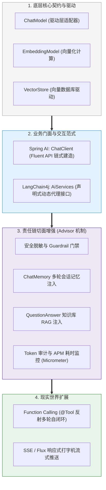

# 🎯 Java AI 框架：本章通关总结与复习

> [!abstract] 一句话总结
> Java AI 框架的核心价值在于**“用标准面向对象接口与 AOP 切面，驯化非确定性的大模型输出”**——将千奇百怪的底层 HTTP 协议收敛为 `ChatModel`，通过 `ChatClient` 链式语法与 `Advisor` 责任链，使企业会话记忆、工具调用、向量检索与监控告警无缝融入现代化微服务体系。

---

## 🗺️ 全章知识拓扑大一统

---

## 📊 核心模块关键结论总览

| 模块 | 核心攻坚问题 | 第一性原理关键结论 | 对应笔记精读 |
| :--- | :--- | :--- | :--- |
| **00 框架哲学** | 为什么做企业级 AI 必须回到 Java？ | 模型训练是 Python 的天下，企业高并发、事务一致性、企业安全与微服务治理是 Java 的主场；AI 框架即大模型时代的“JDBC + Spring Data”。 | [[10-AI应用开发/02-框架-SpringAI与LangChain4j/00-Java-AI框架全景与心智模型\|00-框架全景心智]] |
| **02 门面与调用** | `ChatClient` 与 `ChatModel` 如何分工？ | `ChatModel` 负责底层厂商协议抹平（适配器），`ChatClient` 负责链式组装与 Advisor 挂载（门面）；业务一律面向 `ChatClient` 编程。 | [[10-AI应用开发/02-框架-SpringAI与LangChain4j/SpringAI/02-ChatClient与ChatModel\|02-ChatClient与ChatModel]] |
| **04 流式输出** | 大模型打字机效果如何端到端打通？ | 基于 Project Reactor 响应式流 `Flux<String>`，HTTP 层采用 Server-Sent Events (SSE)，长连接单向低延迟逐 Token 推送。 | [[10-AI应用开发/02-框架-SpringAI与LangChain4j/SpringAI/04-流式输出-SSE\|04-流式输出-SSE]] |
| **06 工具调用** | 大模型如何执行本地业务代码？ | 模型只决策参数 Schema，Java 本地反射执行代码，自动构造 `ToolResponseMessage` 递归回填，直到模型吐出自然语言。 | [[10-AI应用开发/02-框架-SpringAI与LangChain4j/SpringAI/06-Function-Calling工具调用\|06-Function-Calling]] |
| **07 拦截器切面** | 如何非侵入实现记忆、日志与脱敏？ | Advisor 是专为 LLM 设计的 AOP 环绕切面，通过 `CallAroundAdvisor` 与 `StreamAroundAdvisor` 拦截请求与响应流，遵循严格洋葱顺序。 | [[10-AI应用开发/02-框架-SpringAI与LangChain4j/SpringAI/07-Advisor拦截器\|07-Advisor拦截器]] |
| **08 会话记忆** | 多轮对话上下文如何存储与管理？ | `ChatMemory` 支持 InMemory/Redis/JDBC；必须配置基于消息数或 Token 预算的滑动窗口（Sliding Window）防上下文击穿。 | [[10-AI应用开发/02-框架-SpringAI与LangChain4j/SpringAI/08-ChatMemory记忆\|08-ChatMemory记忆]] |
| **01 框架选型** | Spring AI 与 LangChain4j 怎么选？ | Spring Boot 3.x 企业项目首选 Spring AI；框架中立、轻量纯 Java 或偏爱 Feign 声明式接口选 LangChain4j；严禁混用。 | [[10-AI应用开发/02-框架-SpringAI与LangChain4j/01-SpringAI与LangChain4j对比\|01-两框架对比与选型]] |

---

## ⚡ 大厂面试 30 秒绝杀 10 连问

> [!important] 高频核心问题直击要害
>
> 1. **Spring AI 中的 ChatClient 是如何设计出来的？为什么不直接在 Service 中用 ChatModel？**
>    - 答：`ChatModel` 仅充当底层大模型驱动的适配器接口，缺乏业务编排能力。`ChatClient` 是基于建造者与门面模式设计的 Fluent API，它将 Prompt 组装、结构化实体映射（`.entity()`）、多轮会话记忆以及 Advisor 拦截器链统一封装，避免业务代码充斥繁琐的样板胶水代码。
>
> 2. **Function Calling 工具调用的全链路交互时序是怎样的？大模型会直接执行 Java 代码吗？**
>    - 答：绝对不会。交互分三步：① Spring AI 将 `@Tool` 方法反射编译为 JSON Schema 随请求下发；② 模型识别后返回带有参数的 `tool_calls`；③ 框架拦截该响应，在本地反射执行 Java 方法，并将结果包装为 `ToolResponseMessage` 二次发给模型，由模型最终组织出人类回答。
>
> 3. **Spring AI 的 Advisor 拦截器与传统 Spring AOP 有何本质区别？**
>    - 答：传统 AOP 拦截的是通用方法调用（MethodInvocation），而 Advisor 是针对大模型生成领域的语义切面。它专门针对大模型请求体（`AdvisedRequest`）和响应流（`AdvisedResponse`）建模，通过 `CallAround` 和 `StreamAround` 原生支持同步阻塞与响应式 Reactor 流的双重切面。
>
> 4. **在生产环境使用 SSE 实现流式输出时，后端如何防范连接泄露与背压（Backpressure）问题？**
>    - 答：在 Spring WebFlux / MVC 中通过 `Flux<String>` 响应式流对接，底层自动基于 Reactive Streams 规范处理背压；同时必须在反向代理（Nginx）层关闭缓冲（`proxy_buffering off;`），并在客户端断开时通过 `.doOnCancel()` 及时取消上游大模型请求以释放连接。
>
> 5. **如果系统需要同时接入 OpenAI 和本地私有部署的 Ollama/DeepSeek，Spring AI 如何做优雅多模型管理？**
>    - 答：Spring 容器会自动装配不同名称的 `ChatModel` Bean。我们可以为不同的业务场景配置专用的 `ChatClient` Bean，并通过 `@Qualifier("openAiChatModel")` 或 `@Qualifier("ollamaChatModel")` 显式注入对应驱动，实现清晰解耦。
>
> 6. **为什么在微服务架构中，绝对不能在同一个模块中混用 Spring AI 与 LangChain4j？**
>    - 答：① 依赖冲突：两者依赖不同版本的 HTTP 客户端与 JSON 库，易引发类加载冲突；② 抽象割裂：两者的 Message、Memory 和 Tool 注解无法互通，上下文无法复用；③ 维护混乱：团队代码风格割裂，排障追踪极其困难。
>
> 7. **ChatMemory 记忆存储在分布式微服务架构下应如何选型？**
>    - 答：本地内存实现（`InMemoryChatMemory`）仅适用于单机 Demo，分布式多实例环境下会导致请求飘移丢失上下文。生产环境必须采用共享存储：高频低延迟首选 **Redis（基于 List 或 Hash 存储并设置 TTL）**，需要严格审计归档时接入 **MySQL / PostgreSQL JDBC 存储**。
>
> 8. **在 Advisor 责任链中，执行顺序（Order）为什么至关重要？请举出一个顺序颠倒的灾难案例。**
>    - 答：Advisor 类似洋葱圈，遵循“先进后出”。若顺序混乱会导致严重安全事故：例如若将 RAG 知识检索 Advisor 放在用户输入脱敏 Advisor 之前，用户提问中包含的明文身份证/手机号就会直接带入向量库进行检索并记录在检索日志中，导致数据违规泄露！
>
> 9. **LangChain4j 的 AiServices 是通过什么机制实现“写个接口就能调模型”的？**
>    - 答：基于 **Java 动态代理（JDK Dynamic Proxy）**。在运行时为标注了 `@SystemMessage`、`@UserMessage` 的业务接口生成代理类，在 `invoke()` 方法中自动解析注解、拼装参数、调用 `ChatLanguageModel` 并将输出强类型反序列化为方法返回值。
>
> 10. **对于删除、转账等破坏性写操作工具，在 Function Calling 中如何实施人机协同（Human-in-the-loop）？**
>     - 答：工具方法本身绝不直接操作数据库，而是仅生成“待审批工单草案”并返回带有确认标记的结构体。前端通过 WebSocket 收到后弹出确认弹窗，由真实人类用户点击授权后，再通过传统业务 API 携用户登录态 Token 正式执行。

---

## 🚨 生产落地十诫（Architectural Commandments）

1. **一戒裸用底层 ChatModel**：业务 Service 一律面向 `ChatClient` 编程，享受 Fluent API、Advisor 切面与结构化实体的全套保障。
2. **二戒工具方法不做鉴权**：大模型只是提议者，不是决策者！`@Tool` 方法内部必须从线程上下文获取真实用户身份，严厉校验行级权限。
3. **三戒会话记忆无限膨胀**：`ChatMemory` 必须配置基于消息轮数（如最近 10 轮）或 Token 预算的滑动窗口策略，防止历史拖垮上下文。
4. **四戒单机内存存生产记忆**：分布式部署时必须切为 Redis 或数据库集中持久化，单机 `InMemoryChatMemory` 必将导致串台与丢失。
5. **五戒 Advisor 顺序随意堆砌**：严格实现 `Ordered` 接口，脱敏与审计必须放在最外层，记忆与 RAG 居中。
6. **六戒忽略 Nginx 对 SSE 的缓冲**：生产开启流式输出时，网关与 Nginx 必须显式配置 `proxy_buffering off;`，否则打字机效果会被截留拼包。
7. **七戒大模型工具陷入死循环**：单次对话必须显式限制最大工具递归调用次数（如上限 5~10 次），防止模型因参数不合死循环烧钱。
8. **八戒一个模块混用两个框架**：技术选型定型即收敛，严禁在同一个 POM 中同时引入 Spring AI 与 LangChain4j。
9. **九戒忽略 Token 计费与耗时监控**：必须在 Advisor 中提取 `ChatResponse` 的 `Usage` 指标并推送至 Micrometer / Prometheus，做到调用全透明。
10. **十戒工具方法长阻塞无超时**：工具方法涉及下游微服务调用时，必须设置严格的超时时间与 Resilience4j 熔断器，防止外部接口拖垮整体线程池。

---

## 🔗 下一章通关衔接

你已经彻底征服了 Java AI 框架的底层驱动与调用编排！接下来我们将攻克企业级大模型应用最具商业价值的核心黑科技：

👉 进入下一章：[[10-AI应用开发/03-知识库技术-RAG/_index|03 · 知识库技术：RAG]]
- 如何打破大模型的时间与知识壁垒？
- PDF/Word 文档解析、高级语义分块（Chunking）策略；
- 文本向量化（Embedding）、向量相似度（余弦/点积）与专业向量数据库（PGVector/Milvus）选型；
- 生产级多路混合检索（Hybrid Search: 向量 + BM25）与重排（Rerank）实战！
