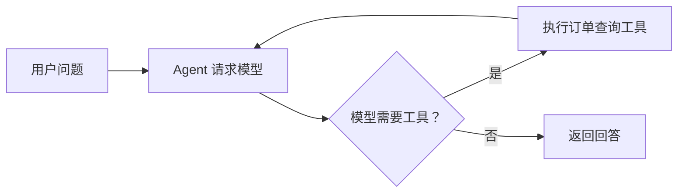

# 🌐 AgentScope Java 定位与核心概念

> [!abstract] 一句话总结
> AgentScope Java 是面向 Agent 开发的 Java 框架：`ReActAgent` 负责模型与工具的交互循环，`HarnessAgent` 在此基础上提供工作区、会话和子 Agent 等运行能力。

## 🎯 它解决什么问题？

假设用户问“订单 123 到哪了”。普通聊天调用把问题交给模型，但模型没有实时订单数据；Agent 可以在模型提出查询请求后执行订单工具，把查询结果交回模型，再生成回答。查询权限仍由服务端校验，框架不会自动知道这个用户能否查看订单。



## 🧩 Core 与 Harness

| 组件 | 做什么 | 需要注意 |
| :--- | :--- | :--- |
| `ReActAgent` | 根据模型响应执行工具、接收结果并继续调用模型 | 工具是否可靠、用户是否有权操作仍由应用负责 |
| `Toolkit` | 注册工具并提供模型可用的工具定义 | 应限制工具权限、参数和执行结果 |
| `HarnessAgent` | 在 ReAct 基础上组织工作区、会话、记忆和子 Agent 等能力 | 能力和默认配置依版本变化，需要按文档配置并验证 |
| `RuntimeContext` | 为调用携带用户、会话等运行上下文 | 身份必须来自服务端认证，不能信任模型生成的用户 ID |

不是每个任务都需要 Harness。只需少量工具时可以先理解 `ReActAgent`；需要工作区、长任务或子 Agent 时再评估额外能力。

## ⚙️ 为什么使用响应式接口？

一次 Agent 请求可能经历多次模型和工具调用，模型返回前通常要等待网络。AgentScope 使用 Reactor 的 `Mono` / `Flux` 表达异步结果和事件流，便于组合调用；响应式接口不保证底层所有工具都非阻塞，也不能单凭框架断言吞吐量提升多少。`block()` 可以用于命令行示例，但不要在 WebFlux 事件循环线程中随意阻塞。

## 💻 最小 Agent 片段

下面展示官方 2.x 的构建方式。假设已添加对应模型扩展并配置服务商密钥；`model`、依赖与完整应用配置省略。代码用于说明结构，未在本机连接模型运行。

```java
ReActAgent agent = ReActAgent.builder()
        .name("order_assistant")
        .sysPrompt("根据订单工具查询结果回答用户。")
        .model(model)
        .toolkit(toolkit)
        .build();
```

其中 `model` 是已配置的模型，`toolkit` 是已注册工具的工具箱。具体调用、工具注册和用户身份传递见 [[02-第一个Agent与工具调用]]。

## ⚖️ 和其他 Java 框架怎么选？

| 框架 | 适合优先了解的方向 |
| :--- | :--- |
| Spring AI | 已有 Spring 项目，希望接入模型、工具、RAG 和记忆 |
| LangChain4j | 希望通过 Java 接口声明 AI 服务，也需要工具或 Agent 工作流 |
| Embabel Agent | 希望研究强类型领域对象和目标驱动规划 |
| AgentScope Java | 希望研究 ReAct 工具循环、多 Agent 与 Harness 运行能力 |

这些能力存在重叠，不能只根据框架名字判断是否支持某种功能。先从项目需求、团队技术栈、文档质量和实际验证结果出发。

> [!question]- 有了 AgentScope，是不是模型可以直接查询订单数据库？
> 不是。模型只能提出工具调用请求，真正访问数据库的是应用注册并执行的工具。服务端仍要验证身份、订单归属和返回数据范围。

## 🔗 继续学习

- [[02-第一个Agent与工具调用]]：工具调用和身份传递。
- [[05-状态管理与会话持久化]]：会话状态和存储。
- [AgentScope Java：Agent 官方文档](https://github.com/agentscope-ai/agentscope-java/blob/v2.0.4/docs/v2/en/docs/building-blocks/agent.md)
- [AgentScope Java：版本发布记录](https://github.com/agentscope-ai/agentscope-java/releases)
